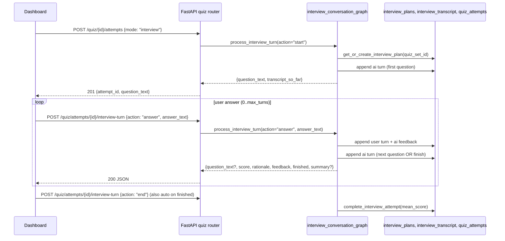
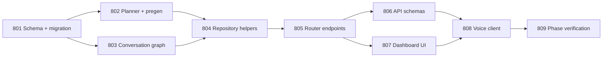

# Phase 8 — Interactive AI Interview mode

> **Note:** Historical Kilo planning session, kept for decision history. The
> interactive-interview feature work is tracked as tickets `SRA-801`–`SRA-809` in
> [`../../tickets/`](../../tickets/README.md); Phase 8 status lives in
> [`../../PROGRESS.md`](../../PROGRESS.md).

## Goal

Add an adaptive, conversational interview mode alongside the existing MCQ quiz.
The AI acts like a live interviewer: it asks open-ended questions grounded in a
study entry, listens to the user's free-form answer, grades **0–100** with
feedback, and decides whether to **probe deeper** on the current topic or
**move on** to the next outline item. The user can manually skip to the next
outline item or end the attempt at any time.

This sits next to today's MCQ (`QuizQuestion` rows) — same
`QuizSet`/`QuizAttempt` rows, new `mode="interview"`. MCQ and interview modes
can coexist on the same `QuizSet`.

## Design decisions (resolved with the user)

| Decision | Resolution |
|---|---|
| Question sourcing | **Hybrid**: pre-generate a topic outline per `(entry, day)`; each turn the LLM expands the current outline item into a concrete question and may issue a follow-up. |
| Scoring | **Graded 0–100** with `{score, rationale, feedback}` from a structured-output LLM call. |
| Length & adaptivity | **Fully adaptive**: the LLM decides when to stop; the user has explicit **"Next question"** (skip current item, advance on the outline) and **"End interview"** controls. The server also force-stops at `max_turns=20` to bound cost. |
| Transport | **Web + voice in the same ticket batch**. Web uses typed answers; voice uses the Phase 5 recorder/transcriber + `say` for both question and feedback. |
| Data model | **New tables** `interview_plans` + `interview_transcript` (separate from MCQ tables). Existing `QuizAttempt.cursor` is repurposed as `current_outline_index`. |
| Live streaming | **Out of scope** for this phase. Each turn is one HTTP round-trip with a short LLM call (≤ 6 s target). Streaming can be added later behind the same endpoint. |

## Runtime shape

## Files to create / modify

### SRA-801 — Schema and migration

- `src/sra/db/models.py`
  - `InterviewPlan` (`quiz_set_id` FK unique, `outline` JSON
    `list[{subtopic, difficulty, focus_prompt}]`, `target_questions` int,
    `created_at`).
  - `InterviewTurn` (`attempt_id` FK indexed, `role` enum
    `ai|user|system_summary`, `content` text, `score` int? — only on `user`,
    `outline_index` int? — only on `ai`, `created_at`). Renamed from
    `interview_transcript` to match repo convention (the table is a
    transcript log).
- `src/sra/alembic/versions/<rev>_add_phase8_interview_tables.py`
  - Two new tables, FKs cascade-delete from `quiz_sets` / `quiz_attempts`,
    index on `attempt_id`, check constraint on `role`.
- `src/sra/db/models.py` — `UserBase` adds two columns:
  - `interview_question_count` int (default 6, range 3–12)
  - `interview_target_minutes` int (default 5, range 1–20)
- Same migration adds the two `users` columns (mirrors SRA-501/601).
- `src/sra/api/schemas.py` — extend `PreferencesIn`/`PreferencesOut` with the
  two new fields (with the same range validators already used for the MCQ
  counts).

### SRA-802 — Planner agent and pregeneration

- `src/sra/agents/interview_planner.py` — new LangGraph:
  - `InterviewOutlineItem` Pydantic (subtopic, difficulty, focus_prompt).
  - `InterviewOutline` container of N items.
  - System prompt pins the rubric (open-ended, entry-grounded, no invented
    facts, difficulty escalates within the outline).
  - Returns empty outline on LLM failure (consistent with `quiz_graph.py`).
  - LLM seam `_get_chat_model()` mirrors `quiz_graph`.
- `src/sra/jobs/quiz_pregeneration.py`
  - `pregenerate_quizzes_for_user` grows an `InterviewPlan` for every new
    `QuizSet` it creates (idempotent — same unique constraint per
    `quiz_set_id`).
  - Uses `users.interview_question_count` as `target_questions`.
- `src/sra/agents/interview_planner.py` exports
  `generate_interview_outline(entry, target_questions, *, llm=None)`.
- Update `src/sra/api/routers/dev.py`'s `dev_pregenerate_now` summary to
  include `interview_plans_created` / `skipped` / `errored` counts.

### SRA-803 — Per-turn conversation graph

- `src/sra/agents/interview_conversation_graph.py` — new module:
  - `InterviewDecision` Pydantic (`score: int 0-100`, `rationale: str`,
    `feedback: str`, `next_action: Literal["ask_new","follow_up","finish"]`,
    `next_question_text: str | None`, `summary: str | None`).
  - `process_interview_turn(*, session, attempt, action, answer_text=None,
    llm=None) -> InterviewTurnResult`.
  - State reloaded from the DB on every turn (mirrors
    `quiz_conversation_graph`).
  - One structured-output LLM call per turn when `action="answer"`. For
    `action="start"`, `"next"`, or `"end"` with no answer, skip the grading
    call and either expand the next outline item (start/next) or compute the
    summary from existing user turns (end).
  - Persists every ai/user/system_summary row, advances
    `attempt.cursor_on_plan` (new column on `QuizAttempt` — see SRA-801).
  - On `finished`, calls `complete_interview_attempt(attempt,
    mean_user_score, session)`.
  - Hard cap: refuse a 21st `action="answer"` with `QuizAttemptFullError`
    that the router maps to `409`.

### SRA-804 — Repository helpers

- `src/sra/db/repository.py`
  - `get_or_create_interview_plan(quiz_set_id, session)` — used at start to
    lazily create a plan if pregen missed it.
  - `append_interview_turn(attempt_id, role, content, *, score=None,
    outline_index=None, session)` — typed insert.
  - `get_interview_turns(attempt_id, session)` — ordered list for
    resume/replay.
  - `complete_interview_attempt(*, attempt, mean_score, session)` — sets
    `score = round(mean_score)`, `completed_at = utcnow()`.

### SRA-805 — Router endpoints

- `src/sra/api/routers/quiz.py`
  - Extend `StartAttemptRequest.mode` → `Literal["web","voice","interview"]`.
  - `POST /quiz/{id}/attempts` — when `mode=="interview"`, create the attempt
    with `cursor_on_plan=0`, lazy-generate `InterviewPlan` if absent, and
    return `{attempt_id, question_text, transcript_so_far: [...]}` so the
    browser can render immediately.
  - `POST /quiz/attempts/{id}/interview-turn` — body
    `{action: "answer"|"next"|"end", answer_text?: str}`. Returns
    `{question_text?, score?, rationale?, feedback?, finished, summary?,
    transcript_so_far, attempt: QuizAttemptOut}`. Enforces ownership and
    mode (`interview` only).
  - `GET /quiz/attempts/{id}/interview` — returns
    `{plan: InterviewPlanOut, turns: [InterviewTurnOut], summary?, attempt}`.
    Powers **resume** after the user closes the tab and the summary panel.
- All new routes inherit the existing per-user rate-limit bucket
  (SRA-304/501).

### SRA-806 — API schemas

- `src/sra/api/schemas.py`
  - `InterviewPlanOut`, `InterviewTurnOut`, `InterviewSummaryOut`,
    `InterviewTurnRequest`, `InterviewTurnResponse`.
  - Add `cursor_on_plan: int` to `QuizAttemptOut`.
  - Add `interview_question_count` / `interview_target_minutes` to
    `PreferencesIn` / `PreferencesOut`.

### SRA-807 — Dashboard UI

- `dashboard/static/interview.html`, `dashboard/static/interview.js`:
  - Reuse the `el()` / `handleErrorStatus()` helpers from `quiz.js` — extract
    them into a tiny shared `dashboard/static/sra_dom.js` if duplication
    grows past ~80 LOC, otherwise keep two copies per existing
    single-purpose-module style.
  - Chat-thread rendering: AI bubbles (left, muted) vs user bubbles (right),
    score chip under each user bubble, rationale collapsible.
  - Persistent "Next question" + "End interview" buttons; "End interview"
    disabled when `finished=true`.
  - On `finished`, swap the input area for the summary panel (mean score,
    count of answered / remaining outline items, link back to dashboard).
  - "Start interview" button on the today-list page, alongside the existing
    MCQ "Start" button. Same auth/rate-limit handling as `quiz.js`.

### SRA-808 — Voice client (macOS)

- `src/sra/client/api_client.py`
  - `start_interview_attempt(quiz_set_id) -> dict`
  - `send_interview_turn(attempt_id, action, answer_text=None) -> dict`
  - `get_interview(attempt_id) -> dict`
- `src/sra/capture/voice_quiz_client.py`
  - `run_interview(quiz_set_id) -> dict` — composes recorder + transcriber +
    `speak()` + the three new client methods into a single function. Speaks
    each new question, records until silence / 30 s cap, transcribes,
    sends `action="answer"`. Speaks feedback on the way out. On
    `finished=true`, speaks the summary and returns `{score,
    answered_count, remaining_count}`.
- Reuse `src/sra/capture/tts.py` — no new TTS module. Cap the spoken
  question at 280 chars (truncate with ellipsis); print the full text to the
  terminal so the user can read anything that was cut.

### SRA-809 — Phase 8 integration verification

- `pytest -q` (regression: phases 1–7 stay green).
- `alembic upgrade head` + `downgrade -1` + `upgrade head` against a copy of
  the live DB.
- Manual evidence:
  - Web loop: start → 3 answers → "Next question" → 1 answer → "End
    interview" → summary matches the transcript count and mean score.
  - Voice loop: `python -m sra.capture.voice_quiz_client` (interview path)
    produces a transcript and a score.
  - Resume: close the tab after the 2nd answer, reopen, see the transcript
    and continue from question 3.
  - Recovery: kill the API mid-attempt, restart, `GET /interview` returns
    the same transcript (DB is canonical).

## Implementation order

801 → 802 and 801 → 803 can run in parallel. 804 needs both 802 and 803.
805–808 fan out from 804.

## Risks and mitigations

| Risk | Mitigation |
|---|---|
| **Per-turn LLM cost** (1 call per turn vs 0 for MCQ) | Hard cap `max_turns=20`; the planner outline is short; the grading call uses `max_completion_tokens=512` and `timeout=15`. Default `interview_question_count=6` keeps typical interviews under 10 turns. |
| **Grading drift** between runs | Structured output `{score, rationale, feedback, next_action, next_question_text}` pinned to a single rubric; deterministic system prompt; `tests/integration/test_phase8_real_browser.py` exercises one live LLM turn and snapshots within a band. |
| **Transcript storage growth** | Hard cap at 200 turns per attempt in the graph (`QuizAttemptFullError`); summary is a separate `system_summary` row, not duplicated. |
| **Voice TTS length** | `say` truncates at 280 chars; full text printed to terminal. Same boundary already used by `capture/voice_quiz_client.py` for MCQ feedback. |
| **Resume after disconnect** | `cursor_on_plan` on `QuizAttempt` plus `GET /quiz/attempts/{id}/interview` return the full plan + ordered turns; client re-renders the thread before posting the next action. |
| **Lazy plan generation race** when two browser tabs start an interview on the same `QuizSet` | `get_or_create_interview_plan` uses the existing `uq_interview_plans_quiz_set_id` unique constraint; second caller catches `IntegrityError` and re-reads. |
| **Cost / latency surprise** on the demo server | Add an `INTERVIEW_MAX_TURNS_PER_DAY` setting (default 20 per user) and surface a `429` once exceeded, mirroring the existing rate-limit message style. |

## Out of scope

- Server-sent events / WebSocket streaming of the LLM's response.
- Multi-modal (image/audio) answers.
- Persisting the LLM's raw reasoning or tokens — only `score`, `rationale`,
  `feedback`, `next_question_text`, and `summary` are kept.
- Editing the outline mid-attempt.
- Cross-entry interviews (one entry at a time).

## Acceptance criteria (per ticket)

- **801**: migration is reversible; pre-existing rows survive; new `users`
  columns default correctly.
- **802**: `generate_interview_outline` returns a structured outline of the
  configured length; pregen creates one `InterviewPlan` per new `QuizSet`
  with no duplicates on rerun.
- **803**: `process_interview_turn` handles `start | answer | next | end`,
  persists every turn, force-stops at `max_turns`, and raises typed errors
  for LLM and full-attempt failures.
- **804**: every helper enforces ownership / mode; cascade-deletes remove
  `InterviewPlan` + `InterviewTurn` with their `QuizSet` / `QuizAttempt`.
- **805**: all three routes enforce auth + ownership + rate limit; `mode≠
  interview` is rejected with `400`; `409` on already-completed or full.
- **806**: every new schema field has a focused unit test in
  `tests/unit/test_quiz_schemas.py` (mirroring SRA-401).
- **807**: dashboard loop runs end-to-end against a fake fetch; e2e test in
  `tests/e2e/test_phase8_interview_dashboard_e2e.py` proves a 4-turn loop.
- **808**: voice driver composes recorder/transcriber/speak/api_client; e2e
  test in `tests/e2e/test_phase8_voice_interview_e2e.py` (fake audio +
  transcriber).
- **809**: full suite green, migration round-trip clean, lint/types clean,
  two manual evidence runs recorded.