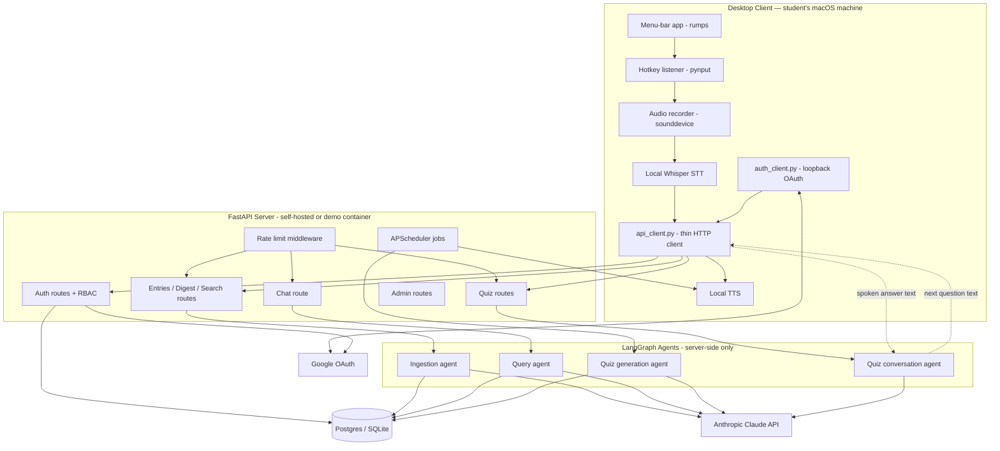
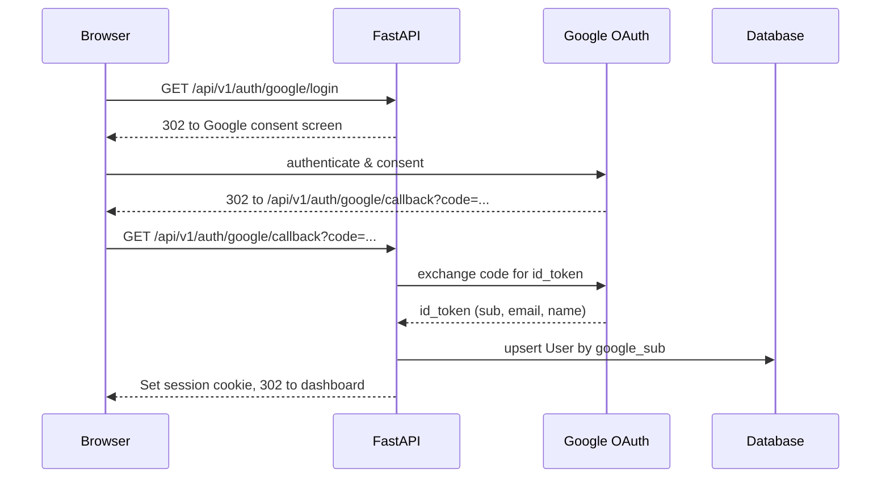
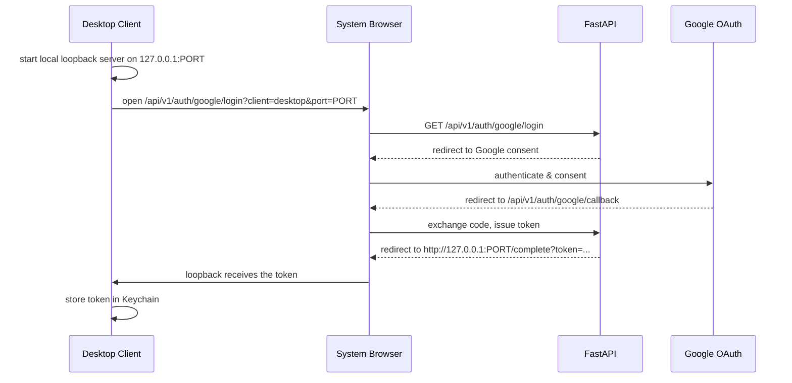
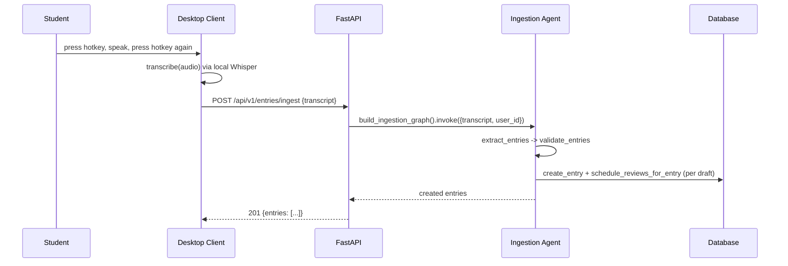
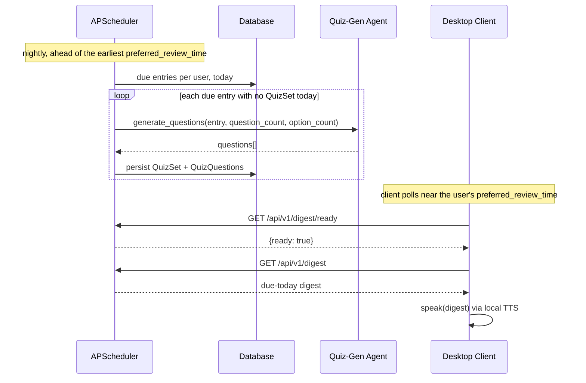
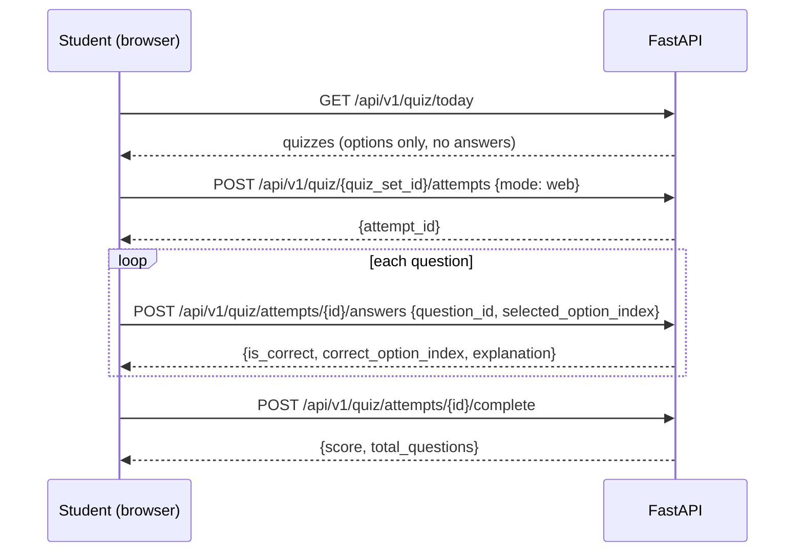
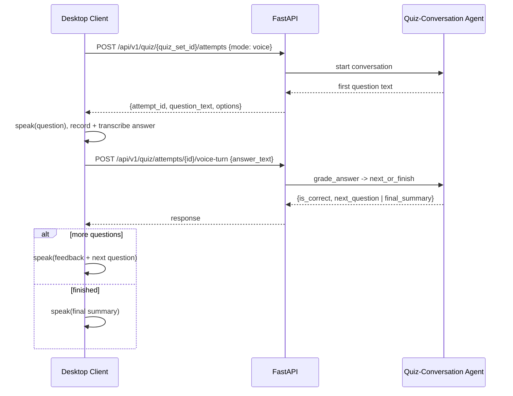
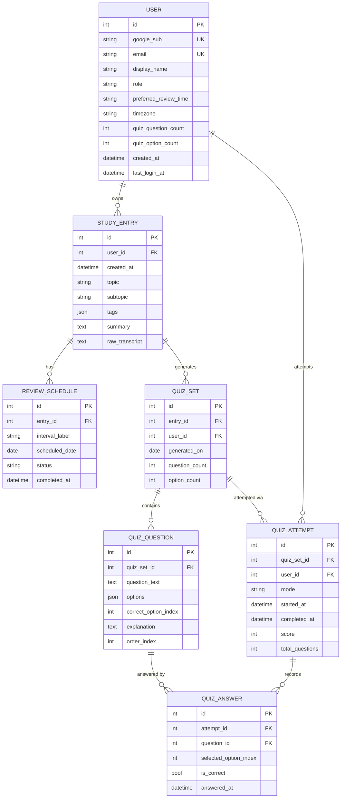

# Spaced Repetition Agent — Technical Design

**This file is the canonical design document.** It owns the architecture, the database schema, the module-by-module design, the API contract, and every flow diagram. Everything else points here instead of restating it: [`README.md`](../../README.md) for install, quickstart, and the env var reference; [`CONTRIBUTING.md`](../../CONTRIBUTING.md) for dev checks and the Alembic how-to; [`PROGRESS.md`](../../PROGRESS.md) for what is actually built; [`tickets/README.md`](../../tickets/README.md) for the work-item inventory.

Companion to the [implementation plan](../plans/2026-09-25-1616-feat-study-agent-scaffold-plan.md), one level deeper. Function bodies are the intended scaffold stubs (`raise NotImplementedError`) except where marked **concrete** — ORM models, Pydantic schemas, and wiring, written out in full because they are not the learning exercise. **[NEW]** marks a file or shape this design adds beyond the plan.

---

## Contents

1. [High-Level Design](#1-high-level-design)
   - [1.1 System architecture](#11-system-architecture) · [1.2 Component responsibilities](#12-component-responsibilities) · [1.3 Client/server boundary](#13-clientserver-boundary) · [1.4 Key flows](#14-key-flows)
2. [Database Design](#2-database-design)
   - [2.1 Entity-relationship diagram](#21-entity-relationship-diagram) · [2.2 Table definitions](#22-table-definitions)
3. [Low-Level Design (module by module)](#3-low-level-design-module-by-module)
   - Config & DB — [3.1](#31-srcsraconfigpy)–[3.5](#35-srcsradbrepositorypy)
   - LangGraph agents — [3.6](#36-srcsraagentsschemaspy--new--concrete)–[3.10](#310-srcsraagentsquiz_conversation_graphpy)
   - Auth & API plumbing — [3.11](#311-srcsraauthgoogle_oauthpy)–[3.14b](#314b-srcsraapirouters__init__py--new)
   - Routers — [3.15](#315-srcsraapiroutersentriespy--new)–[3.22](#322-srcsraapiroutersadminpy--new)
   - Scheduled jobs — [3.23](#323-srcsrajobsdigest_schedulerpy)–[3.25](#325-srcsrajobsdemo_resetpy)
   - Capture & desktop client — [3.26](#326-srcsracapturetranscriptionpy)–[3.33](#333-srcsracapturevoice_quiz_clientpy--new)
4. [API Contract](#4-api-contract)

---

## 1. High-Level Design

### 1.1 System architecture



### 1.2 Component responsibilities

| Component | Runs where | Responsibility |
|---|---|---|
| Desktop client (`capture/`, `client/`) | Student's Mac | Hotkey capture, local Whisper transcription, local TTS playback, OAuth login via loopback, thin HTTP calls to the server — never touches the LLM directly |
| FastAPI server (`api/`) | Self-hosted or demo container | REST API, session/RBAC enforcement, rate limiting, serves the dashboard's static files |
| LangGraph agents (`agents/`) | Server process | Ingestion, query, quiz generation, quiz conversation — all Claude-backed, all server-side |
| APScheduler jobs (`jobs/`) | Server process (background thread) | Nightly quiz pre-generation, per-user wake-up trigger, demo-data reset |
| Database (`db/`) | Postgres (prod/demo) or SQLite (self-host default) | Users, study entries, review schedules, quizzes, attempts |
| Google OAuth | External | Identity provider — the only auth method |
| Anthropic Claude API | External | LLM backing every LangGraph agent |

### 1.3 Client/server boundary

The plan left implicit whether LangGraph agents run on the client or the server; this document settles it — **all LangGraph agents run server-side only**. The client never holds an `ANTHROPIC_API_KEY` and never imports `langgraph`; it is a thin I/O device (mic, local Whisper, local TTS, a small HTTP client). That is what makes rate limiting and cost control enforceable, and it means a self-hoster's students need only the *server operator's* Anthropic key. Consequence: `capture/pipeline.py` (§3.30) transcribes locally and POSTs the transcript, letting the server run the graph.

### 1.4 Key flows

#### Web sign-in



#### Desktop client sign-in (loopback OAuth)



#### Capture → ingest



#### Nightly pre-generation and morning wake-up



#### Web quiz



#### Voice quiz



---

## 2. Database Design

### 2.1 Entity-relationship diagram



`QUIZ_ATTEMPT` / `QUIZ_ANSWER` are **[NEW]** beyond the plan — needed so scoring is durable history rather than a stateless one-shot request, which is what lets `GET /api/v1/quiz/attempts/{id}` answer "did I already take this today".

> **Note:** the code has grown past this schema — interview and reference-material tables arrived in later phases. This section stays the design of record; authoritative migrations live in [`src/sra/alembic/versions/`](../../src/sra/alembic/versions/).

### 2.2 Table definitions

#### `users`

| Column | Type | Constraints | Notes |
|---|---|---|---|
| `id` | integer | PK, autoincrement | |
| `google_sub` | varchar(255) | unique, not null | Google's stable subject id — the login key, not email |
| `email` | varchar(255) | unique, not null | |
| `display_name` | varchar(255) | not null | |
| `role` | varchar(16) | not null, default `'user'` | `'user'` \| `'admin'` |
| `preferred_review_time` | varchar(5) | not null, default `'09:00'` | 24h `HH:MM`, local to `timezone` |
| `timezone` | varchar(64) | not null, default `'UTC'` | IANA name, e.g. `America/Los_Angeles` |
| `quiz_question_count` | integer | not null, default `10` | 1–50, validated at the API layer |
| `quiz_option_count` | integer | not null, default `4` | 2–6, validated at the API layer |
| `created_at` | timestamp | not null, default now | |
| `last_login_at` | timestamp | nullable | |

#### `study_entries`

| Column | Type | Constraints | Notes |
|---|---|---|---|
| `id` | integer | PK | |
| `user_id` | integer | FK → `users.id`, not null, indexed | Every query in `repository.py` filters on this |
| `created_at` | timestamp | not null, default now | The "studied on" date intervals are computed from |
| `topic` | varchar(255) | not null | |
| `subtopic` | varchar(255) | nullable | |
| `tags` | json | not null, default `[]` | list[str] |
| `summary` | text | not null | |
| `raw_transcript` | text | not null | Kept even if extraction is imperfect (R4) |

#### `review_schedules`

| Column | Type | Constraints | Notes |
|---|---|---|---|
| `id` | integer | PK | |
| `entry_id` | integer | FK → `study_entries.id`, not null, indexed | |
| `interval_label` | varchar(4) | not null | `'1d'` \| `'3d'` \| `'7d'` \| `'1mo'` \| `'3mo'` \| `'6mo'` |
| `scheduled_date` | date | not null, indexed | Indexed — `get_due_reviews` filters `<= today` at scale |
| `status` | varchar(8) | not null, default `'pending'` | `'pending'` \| `'done'` \| `'skipped'` |
| `completed_at` | timestamp | nullable | |

Unique constraint: `(entry_id, interval_label)` — one row per interval per entry.

#### `quiz_sets`

| Column | Type | Constraints | Notes |
|---|---|---|---|
| `id` | integer | PK | |
| `entry_id` | integer | FK → `study_entries.id`, not null | |
| `user_id` | integer | FK → `users.id`, not null, indexed | Denormalized for cheap ownership checks without a join |
| `generated_on` | date | not null | |
| `question_count` | integer | not null | Snapshot of the user's preference at generation time |
| `option_count` | integer | not null | |

Unique constraint: `(entry_id, generated_on)` — the idempotency guard `pregenerate_quizzes_for_day` relies on.

#### `quiz_questions`

| Column | Type | Constraints | Notes |
|---|---|---|---|
| `id` | integer | PK | |
| `quiz_set_id` | integer | FK → `quiz_sets.id`, not null, indexed | |
| `question_text` | text | not null | |
| `options` | json | not null | list[str], length == parent `quiz_sets.option_count` |
| `correct_option_index` | integer | not null | 0-based index into `options` |
| `explanation` | text | nullable | Shown after answering, win or lose |
| `order_index` | integer | not null | Display/ask order within the set |

#### `quiz_attempts`

| Column | Type | Constraints | Notes |
|---|---|---|---|
| `id` | integer | PK | |
| `quiz_set_id` | integer | FK → `quiz_sets.id`, not null | |
| `user_id` | integer | FK → `users.id`, not null, indexed | |
| `mode` | varchar(8) | not null | `'web'` \| `'voice'` |
| `started_at` | timestamp | not null, default now | |
| `completed_at` | timestamp | nullable | Null while in progress |
| `score` | integer | nullable | Set on completion |
| `total_questions` | integer | not null | Snapshot from the quiz set |

#### `quiz_answers`

| Column | Type | Constraints | Notes |
|---|---|---|---|
| `id` | integer | PK | |
| `attempt_id` | integer | FK → `quiz_attempts.id`, not null, indexed | |
| `question_id` | integer | FK → `quiz_questions.id`, not null | |
| `selected_option_index` | integer | nullable | Null if unanswered/timed out |
| `is_correct` | boolean | not null | |
| `answered_at` | timestamp | not null, default now | |

Unique constraint: `(attempt_id, question_id)` — one answer per question per attempt.

---

## 3. Low-Level Design (module by module)

Every learning-target function's real signature and docstring, exactly as the scaffold ships it (KTD1). **[NEW]** marks files this design adds beyond the plan.

> **Note:** this section describes the *intended* design. The implementation has since grown past it — `config/` is a package, interview and reference-material modules exist, and some routers have no section here. Read it for shape and intent; read [`PROGRESS.md`](../../PROGRESS.md) and [`tickets/README.md`](../../tickets/README.md) for what exists.

### 3.1 `src/sra/config.py`

`src/sra/config/` is the configuration module. `Settings` and `get_settings()` live in
`src/sra/config/__init__.py`; `src/sra/config/settings.py` is only a small SRA-903 test
shim. The canonical environment-variable names and defaults are in
[`README.md`](../../README.md#environment-variables).

> **Note:** the original plan named `src/sra/config.py`; the implementation is the
> `src/sra/config/` package. The environment-variable reference is canonical in
> [`README.md`](../../README.md#environment-variables).

### 3.2 `src/sra/db/models.py` — **[NEW]**

Concrete (SQLModel), not stubbed.

**Convention:** any table a caller can create with user-influenced data gets a `<Name>Base`/`<Name>Create` split, not a single `table=True` class. `<Name>Create` (`model_config = {"extra": "forbid"}`) declares ONLY the fields a caller may legitimately supply; server-owned fields (`id`, `created_at`, FKs assigned by the repository layer) live exclusively on the `table=True` class. Repository functions build the row with `Model.model_validate(create_obj, update={...server-owned fields...})` rather than re-listing fields as kwargs — a server-owned field can never be supplied by a caller because the `Create` schema's type never carries it, not because the call site remembered to leave it out. This mirrors the official FastAPI/SQLModel full-stack template's `UserBase`/`UserCreate`/`User` + `crud.create_user`; apply it to every new table. The split, and the two quiz tables it covers, are what this design adds beyond the plan's simpler classes.

```python
from datetime import date, datetime
from sqlmodel import SQLModel, Field, JSON, Column

class UserBase(SQLModel):
    google_sub: str = Field(unique=True, index=True)
    email: str = Field(unique=True)
    display_name: str
    role: str = Field(default="user")
    preferred_review_time: str = Field(default="09:00")
    timezone: str = Field(default="UTC")
    quiz_question_count: int = Field(default=10)
    quiz_option_count: int = Field(default=4)

class UserCreate(UserBase):
    """No id, created_at, or last_login_at -- server-owned."""
    model_config = {"extra": "forbid"}

class User(UserBase, table=True):
    __tablename__ = "users"
    id: int | None = Field(default=None, primary_key=True)
    created_at: datetime = Field(default_factory=datetime.utcnow)
    last_login_at: datetime | None = None

class StudyEntryBase(SQLModel):
    topic: str
    subtopic: str | None = None
    tags: list[str] = Field(default_factory=list, sa_column=Column(JSON))
    summary: str
    raw_transcript: str

class StudyEntryCreate(StudyEntryBase):
    """No id, user_id, or created_at -- server-owned."""
    model_config = {"extra": "forbid"}

class StudyEntry(StudyEntryBase, table=True):
    __tablename__ = "study_entries"
    id: int | None = Field(default=None, primary_key=True)
    user_id: int = Field(foreign_key="users.id", index=True)
    created_at: datetime = Field(default_factory=datetime.utcnow)

class ReviewScheduleBase(SQLModel):
    entry_id: int = Field(foreign_key="study_entries.id", index=True)
    interval_label: str
    scheduled_date: date = Field(index=True)

class ReviewScheduleCreate(ReviewScheduleBase):
    """No id, status, or completed_at -- server-owned."""
    model_config = {"extra": "forbid"}

class ReviewSchedule(ReviewScheduleBase, table=True):
    __tablename__ = "review_schedules"
    id: int | None = Field(default=None, primary_key=True)
    status: str = Field(default="pending")
    completed_at: datetime | None = None

class QuizSet(SQLModel, table=True):
    __tablename__ = "quiz_sets"
    id: Optional[int] = Field(default=None, primary_key=True)
    entry_id: int = Field(foreign_key="study_entries.id")
    user_id: int = Field(foreign_key="users.id", index=True)
    generated_on: date
    question_count: int
    option_count: int

class QuizQuestion(SQLModel, table=True):
    __tablename__ = "quiz_questions"
    id: Optional[int] = Field(default=None, primary_key=True)
    quiz_set_id: int = Field(foreign_key="quiz_sets.id", index=True)
    question_text: str
    options: list[str] = Field(sa_column=Column(JSON))
    correct_option_index: int
    explanation: Optional[str] = None
    order_index: int

class QuizAttempt(SQLModel, table=True):
    __tablename__ = "quiz_attempts"
    id: Optional[int] = Field(default=None, primary_key=True)
    quiz_set_id: int = Field(foreign_key="quiz_sets.id")
    user_id: int = Field(foreign_key="users.id", index=True)
    mode: str
    started_at: datetime = Field(default_factory=datetime.utcnow)
    completed_at: Optional[datetime] = None
    score: Optional[int] = None
    total_questions: int

class QuizAnswer(SQLModel, table=True):
    __tablename__ = "quiz_answers"
    id: Optional[int] = Field(default=None, primary_key=True)
    attempt_id: int = Field(foreign_key="quiz_attempts.id", index=True)
    question_id: int = Field(foreign_key="quiz_questions.id")
    selected_option_index: Optional[int] = None
    is_correct: bool
    answered_at: datetime = Field(default_factory=datetime.utcnow)
```

### 3.3 `src/sra/db/session.py` — **[NEW]** — concrete

```python
from collections.abc import Generator
from sqlmodel import Session, create_engine
from sra.config import get_settings

engine = create_engine(get_settings().database_url)

def get_session() -> Generator[Session, None, None]:
    """FastAPI dependency yielding one DB session per request."""
    with Session(engine) as session:
        yield session
```

### 3.4 `src/sra/db/scheduler.py`

```python
from datetime import date

INTERVALS = [("1d", 1), ("3d", 3), ("7d", 7), ("1mo", 30), ("3mo", 90), ("6mo", 180)]

def compute_review_dates(studied_on: date) -> list[tuple[str, date]]:
    """
    Return the six (interval_label, scheduled_date) pairs for an entry
    studied on `studied_on`.

    Concept: pure calendar math, no I/O — use `date` arithmetic, not naive
    day-count addition, so "1mo" on Jan 31 isn't Feb 31st.
    """
    raise NotImplementedError

def schedule_reviews_for_entry(entry_id: int, studied_on: date, session) -> list["ReviewSchedule"]:
    """
    Persist the six ReviewSchedule rows for a new entry.

    Concept: wrap each compute_review_dates() pair in a
    ReviewSchedule(status="pending") and commit in one transaction — a
    batch-insert pattern you'll reuse elsewhere.
    """
    raise NotImplementedError
```

### 3.5 `src/sra/db/repository.py`

```python
from datetime import date
from sra.db.models import StudyEntry, StudyEntryCreate, ReviewSchedule

def create_entry(*, entry_create: StudyEntryCreate, user_id: int, session) -> StudyEntry:
    """
    Insert a StudyEntry scoped to user_id, then schedule_reviews_for_entry
    for it. Concept: every write here takes user_id first and never trusts
    a caller-supplied row's ownership; take a StudyEntryCreate so
    id/user_id/created_at can never come from a caller (see §3.2).
    """
    raise NotImplementedError

def get_due_reviews(user_id: int, as_of: date, session) -> list[ReviewSchedule]:
    """
    Return this user's pending ReviewSchedule rows with scheduled_date
    <= as_of, joined to their parent StudyEntry. Concept: the query behind
    both GET /api/v1/digest and the query agent's get_due_reviews_tool.
    """
    raise NotImplementedError

def search_entries(
    user_id: int, query: str, date_from: date | None, date_to: date | None, session,
) -> list[StudyEntry]:
    """
    Case-insensitive substring match over topic/subtopic/tags/summary for
    this user only, optionally bounded by [date_from, date_to], newest
    first; empty query returns all of this user's entries.

    Concept: LIKE/ILIKE plus optional range predicates built up
    conditionally — build the query, don't branch on which filters ran.
    """
    raise NotImplementedError

def mark_review_done(user_id: int, review_id: int, status: str, session) -> ReviewSchedule:
    """
    Flip a review's status ('done' or 'skipped'), stamp completed_at, and
    raise a typed PermissionError if review_id isn't user_id's (never a
    silent no-op).
    """
    raise NotImplementedError
```

### 3.6 `src/sra/agents/schemas.py` — **[NEW]** — concrete

```python
from pydantic import BaseModel, Field

class StudyEntryDraft(BaseModel):
    topic: str
    subtopic: str | None = None
    tags: list[str] = Field(default_factory=list)
    summary: str

class MCQDraft(BaseModel):
    question_text: str
    options: list[str]
    correct_option_index: int
    explanation: str
```

### 3.7 `src/sra/agents/ingestion_graph.py`

```python
from typing import TypedDict
from sra.agents.schemas import StudyEntryDraft

class IngestionState(TypedDict):
    transcript: str
    user_id: int
    drafts: list[StudyEntryDraft]
    error: str | None

def extract_entries(state: IngestionState) -> IngestionState:
    """
    Turn state["transcript"] into StudyEntryDraft objects via a
    structured-output Claude call, tolerating multi-topic transcripts.
    On LLM failure set state["error"] rather than raising, so the graph
    can route to request_clarification.

    Concept: bind a Pydantic schema to the model call so you get validated
    objects back, not a string to parse yourself.
    """
    raise NotImplementedError

def validate_entries(state: IngestionState) -> IngestionState:
    """
    Drop drafts with an empty topic or summary; if none survive, set
    state["error"] so the edge routes to request_clarification.
    """
    raise NotImplementedError

def persist_entries(state: IngestionState) -> IngestionState:
    """
    Build a StudyEntryCreate per surviving draft and call
    repository.create_entry(...). Concept: keep this the one node that
    touches storage, so extract/validate stay pure and LLM-free.
    """
    raise NotImplementedError

def request_clarification(state: IngestionState) -> IngestionState:
    """
    Terminal node for the invalid branch — surface state["error"] instead
    of silently dropping the transcript.
    """
    raise NotImplementedError

def build_ingestion_graph():
    """
    Wire extract_entries -> validate_entries -> persist_entries, with a
    conditional edge to request_clarification when state["error"] is set.

    Concept: StateGraph + add_node + add_conditional_edges — the core
    LangGraph wiring API (see KTD4 in the plan).
    """
    raise NotImplementedError
```

### 3.8 `src/sra/agents/query_graph.py`

```python
from langchain_core.tools import tool

def make_tools(user_id: int, session):
    """
    Build the three tools below, each closed over `user_id` so the LLM can
    never pass another user's id — the agent chooses *what* to search,
    never *whose*. Concept: closures over server-trusted context rather
    than an LLM-supplied argument.
    """
    raise NotImplementedError

@tool
def search_entries_tool(query: str, date_from: str | None = None, date_to: str | None = None) -> str:
    """LLM-facing tool: search the current user's study history. Returns a formatted summary string."""
    raise NotImplementedError

@tool
def get_due_reviews_tool(as_of: str) -> str:
    """LLM-facing tool: list the current user's reviews due on or before `as_of` (ISO date)."""
    raise NotImplementedError

@tool
def get_entry_detail_tool(entry_id: int) -> str:
    """LLM-facing tool: fetch one entry's full detail, scoped to the current user."""
    raise NotImplementedError

def build_query_graph(user_id: int, session):
    """
    Build a tool-calling ReAct-style agent bound to the three tools,
    looping [agent] <-> [tools] until a final answer with no further tool
    calls. Concept: LangGraph's prebuilt tool-calling loop (see KTD5).
    """
    raise NotImplementedError
```

### 3.9 `src/sra/agents/quiz_graph.py`

```python
from sra.agents.schemas import MCQDraft

def generate_questions(entry, question_count: int, option_count: int) -> list[MCQDraft]:
    """
    Produce exactly `question_count` MCQDraft objects from `entry`'s
    summary/topic, each with exactly `option_count` options and one
    correct index. Concept: constrained generation — the prompt commits
    to the counts, the structured-output schema enforces the shape.
    """
    raise NotImplementedError

def build_quiz_graph():
    """
    Single-node graph wrapping generate_questions, kept as a graph so it
    composes like the other three agents and can gain branches later
    without changing call sites.
    """
    raise NotImplementedError
```

### 3.10 `src/sra/agents/quiz_conversation_graph.py`

```python
from typing import TypedDict

class QuizConversationState(TypedDict):
    quiz_set_id: int
    attempt_id: int
    question_index: int
    score: int
    last_answer_text: str | None
    finished: bool

def ask_question(state: QuizConversationState) -> QuizConversationState:
    """
    Return the question at state["question_index"] as plain text for the
    caller to speak — the graph never calls TTS itself.
    """
    raise NotImplementedError

def grade_answer(state: QuizConversationState) -> QuizConversationState:
    """
    Map state["last_answer_text"] (a free-form transcript like "the second
    one" or "B") to an option index via a small Claude call, record a
    QuizAnswer, and update state["score"].

    Concept: use the LLM for *interpretation* (loose speech -> a structured
    choice) while keeping *scoring* a plain equality check against
    correct_option_index — don't let the LLM grade.
    """
    raise NotImplementedError

def next_or_finish(state: QuizConversationState) -> QuizConversationState:
    """
    Advance question_index, or set finished=True and finalize the
    QuizAttempt (score, completed_at) once every question has been asked.
    """
    raise NotImplementedError

def build_quiz_conversation_graph():
    """
    Wire ask_question -> (external: client speaks + listens) -> grade_answer
    -> next_or_finish -> loop back to ask_question until finished.

    Concept: invoked once per HTTP turn (POST .../voice-turn), not
    start-to-finish — state reloads from the QuizAttempt row each turn
    rather than living in memory between requests.
    """
    raise NotImplementedError
```

### 3.11 `src/sra/auth/google_oauth.py`

```python
def build_authorization_url(state: str, redirect_uri: str) -> str:
    """
    Build the Google consent-screen URL, embedding `state` (CSRF token)
    and `redirect_uri` (the web callback, or a desktop-loopback variant
    per §1.4).
    """
    raise NotImplementedError

def exchange_code_for_user(code: str, redirect_uri: str, session) -> "User":
    """
    Exchange `code` for tokens, verify the id_token, then upsert a User
    keyed on google_sub (create on first login, update
    display_name/last_login_at on repeat logins).

    Concept: authorization-code exchange plus an idempotent upsert —
    google_sub, not email, is the stable key (email can change; the
    Google subject id can't).
    """
    raise NotImplementedError
```

### 3.12 `src/sra/auth/dependencies.py`

```python
from fastapi import Depends, Request
from sra.db.models import User

def require_user(request: Request, session=Depends(get_session)) -> User:
    """
    Resolve the current User from the session cookie or Bearer token;
    raise HTTPException(401) if missing or invalid.

    Concept: a dependency, not middleware — each route declares
    `user: User = Depends(require_user)` and gets a typed, authenticated
    object instead of re-parsing the request.
    """
    raise NotImplementedError

def require_admin(user: User = Depends(require_user)) -> User:
    """
    Build on require_user; raise HTTPException(403) if user.role != "admin".
    Concept: dependency composition, not a parallel auth path.
    """
    raise NotImplementedError
```

### 3.13 `src/sra/api/rate_limit.py`

```python
def rate_limit_key(request) -> str:
    """
    Return `f"user:{id}"` for an authenticated request (the User is read
    off request.state by require_user upstream) or `f"ip:{addr}"` otherwise.
    """
    raise NotImplementedError

def enforce_rate_limit(request) -> None:
    """
    Token-bucket check against the authenticated/anonymous per-minute
    settings (tighter under DEMO_MODE per KTD16); raise HTTPException(429,
    headers={"Retry-After": ...}) over the limit.

    Concept: an in-process {key: (tokens, last_refill)} dict is enough for
    one instance — the seam to swap for Redis if the demo ever needs
    multiple instances.
    """
    raise NotImplementedError
```

### 3.14 `src/sra/api/schemas.py` — **[NEW]** — concrete

```python
from datetime import date, datetime
from pydantic import BaseModel

class IngestRequest(BaseModel):
    transcript: str

class EntryOut(BaseModel):
    id: int
    topic: str
    subtopic: str | None
    tags: list[str]
    summary: str
    created_at: datetime

class ReviewOut(BaseModel):
    id: int
    entry: EntryOut
    interval_label: str
    scheduled_date: date
    status: str

class PreferencesIn(BaseModel):
    preferred_review_time: str  # "HH:MM"
    timezone: str
    quiz_question_count: int
    quiz_option_count: int

class ChatRequest(BaseModel):
    question: str

class ChatResponse(BaseModel):
    answer: str

class QuizQuestionOut(BaseModel):
    id: int
    question_text: str
    options: list[str]
    order_index: int
    # correct_option_index intentionally omitted

class QuizSetOut(BaseModel):
    id: int
    entry: EntryOut
    generated_on: date
    questions: list[QuizQuestionOut]

class StartAttemptRequest(BaseModel):
    mode: str  # "web" | "voice"

class SubmitAnswerRequest(BaseModel):
    question_id: int
    selected_option_index: int

class AnswerResult(BaseModel):
    is_correct: bool
    correct_option_index: int
    explanation: str | None

class VoiceTurnRequest(BaseModel):
    answer_text: str

class VoiceTurnResponse(BaseModel):
    is_correct: bool | None
    feedback_text: str
    next_question_text: str | None
    finished: bool
    score: int | None
```

### 3.14a `src/sra/api/deps.py` — **[NEW]**

```python
from sra.auth.dependencies import require_user, require_admin
from sra.db.session import get_session

__all__ = ["require_user", "require_admin", "get_session"]
```

Every router imports its dependencies from here rather than reaching into `auth/` and `db/` directly — one import line per router, one place to point a new router at.

### 3.14b `src/sra/api/routers/__init__.py` — **[NEW]**

```python
from fastapi import APIRouter

from sra.api.routers import admin, auth, chat, digest, entries, preferences, quiz, search

api_router = APIRouter()
api_router.include_router(entries.router)
api_router.include_router(digest.router)
api_router.include_router(search.router)
api_router.include_router(chat.router)
api_router.include_router(quiz.router)
api_router.include_router(preferences.router)
api_router.include_router(auth.router)
api_router.include_router(admin.router)
```

`api/app.py`'s `create_app()` mounts this router once with `prefix="/api/v1"`; individual router files below declare only their resource-relative prefix (`/entries`, not `/api/entries`), so the version prefix lives in one place.

### 3.15 `src/sra/api/routers/entries.py` — **[NEW]**

```python
from fastapi import APIRouter, Depends

router = APIRouter(prefix="/entries", tags=["entries"])

@router.post("/ingest", status_code=201)
def ingest_transcript(body: "IngestRequest", user=Depends(require_user), session=Depends(get_session)) -> list["EntryOut"]:
    """
    Run build_ingestion_graph().invoke({"transcript": body.transcript,
    "user_id": user.id}) and return the created entries. This is the
    endpoint the desktop client's pipeline.py calls after local
    transcription — the graph itself never runs on the client.
    """
    raise NotImplementedError

@router.get("/{entry_id}")
def get_entry(entry_id: int, user=Depends(require_user), session=Depends(get_session)) -> "EntryOut":
    """Fetch one entry; 404 if it doesn't exist or belongs to another user."""
    raise NotImplementedError

@router.patch("/reviews/{review_id}")
def update_review_status(review_id: int, status: str, user=Depends(require_user), session=Depends(get_session)) -> "ReviewOut":
    """Call repository.mark_review_done; 403 via PermissionError if not owned by user."""
    raise NotImplementedError
```

### 3.16 `src/sra/api/routers/digest.py`

```python
from fastapi import APIRouter, Depends

router = APIRouter(prefix="/digest", tags=["digest"])

@router.get("")
def get_digest(user=Depends(require_user), session=Depends(get_session)) -> list["ReviewOut"]:
    """repository.get_due_reviews(user.id, today), grouped by entry in the response shape."""
    raise NotImplementedError

@router.get("/ready")
def digest_ready(user=Depends(require_user), session=Depends(get_session)) -> dict:
    """
    Lightweight poll target for the desktop client's wakeup.py:
    {"ready": bool} — true once today's QuizSets for this user's due
    entries exist (i.e. the nightly pregeneration job has run).
    """
    raise NotImplementedError
```

### 3.17 `src/sra/api/routers/search.py`

```python
from fastapi import APIRouter, Depends

router = APIRouter(prefix="/search", tags=["search"])

@router.get("")
def search(q: str = "", date_from: str | None = None, date_to: str | None = None,
           user=Depends(require_user), session=Depends(get_session)) -> list["EntryOut"]:
    """repository.search_entries(user.id, q, date_from, date_to)."""
    raise NotImplementedError
```

### 3.18 `src/sra/api/routers/chat.py`

```python
from fastapi import APIRouter, Depends

router = APIRouter(prefix="/chat", tags=["chat"])

@router.post("")
def chat(body: "ChatRequest", user=Depends(require_user), session=Depends(get_session)) -> "ChatResponse":
    """build_query_graph(user.id, session).invoke({"messages": [body.question]}) -> final answer text."""
    raise NotImplementedError
```

### 3.19 `src/sra/api/routers/quiz.py`

```python
from fastapi import APIRouter, Depends

router = APIRouter(prefix="/quiz", tags=["quiz"])

@router.get("/today")
def list_todays_quizzes(user=Depends(require_user), session=Depends(get_session)) -> list["QuizSetOut"]:
    """QuizSets for today, scoped to user.id, with correct_option_index stripped."""
    raise NotImplementedError

@router.get("/{quiz_set_id}")
def get_quiz(quiz_set_id: int, user=Depends(require_user), session=Depends(get_session)) -> "QuizSetOut":
    """404 if not found; 403 if it belongs to another user."""
    raise NotImplementedError

@router.post("/{quiz_set_id}/attempts", status_code=201)
def start_attempt(quiz_set_id: int, body: "StartAttemptRequest", user=Depends(require_user), session=Depends(get_session)) -> dict:
    """
    Create a QuizAttempt(mode=body.mode). For mode="voice", also run
    build_quiz_conversation_graph()'s first ask_question turn and
    include its question text in the response.
    """
    raise NotImplementedError

@router.post("/attempts/{attempt_id}/answers")
def submit_answer(attempt_id: int, body: "SubmitAnswerRequest", user=Depends(require_user), session=Depends(get_session)) -> "AnswerResult":
    """Web-mode only. Record a QuizAnswer, return correctness + explanation."""
    raise NotImplementedError

@router.post("/attempts/{attempt_id}/voice-turn")
def voice_turn(attempt_id: int, body: "VoiceTurnRequest", user=Depends(require_user), session=Depends(get_session)) -> "VoiceTurnResponse":
    """
    Voice-mode only. Feed body.answer_text into the conversation graph's
    grade_answer -> next_or_finish for this attempt's persisted state,
    return feedback plus the next question (or a summary when finished).
    """
    raise NotImplementedError

@router.post("/attempts/{attempt_id}/complete")
def complete_attempt(attempt_id: int, user=Depends(require_user), session=Depends(get_session)) -> dict:
    """Web-mode only. Compute final score from recorded QuizAnswers, stamp completed_at."""
    raise NotImplementedError

@router.get("/attempts/{attempt_id}")
def get_attempt(attempt_id: int, user=Depends(require_user), session=Depends(get_session)) -> dict:
    """Attempt detail/summary, for history or a post-quiz review screen."""
    raise NotImplementedError
```

### 3.20 `src/sra/api/routers/preferences.py`

```python
from fastapi import APIRouter, Depends

router = APIRouter(prefix="/me/preferences", tags=["preferences"])

@router.get("")
def get_preferences(user=Depends(require_user)) -> "PreferencesIn":
    raise NotImplementedError

@router.put("")
def update_preferences(body: "PreferencesIn", user=Depends(require_user), session=Depends(get_session)) -> "PreferencesIn":
    """Validate quiz_question_count in [1,50] and quiz_option_count in [2,6] before saving."""
    raise NotImplementedError
```

### 3.21 `src/sra/api/routers/auth.py`

```python
from fastapi import APIRouter

router = APIRouter(prefix="/auth", tags=["auth"])

@router.get("/google/login")
def google_login(client: str = "web", port: int | None = None):
    """Redirect to build_authorization_url(...); embed client/port in `state` for the desktop-loopback variant."""
    raise NotImplementedError

@router.get("/google/callback")
def google_callback(code: str, state: str, session=Depends(get_session)):
    """
    exchange_code_for_user(code, ...), issue a session cookie (web)
    or redirect to the desktop loopback URL with a bearer token
    (desktop) depending on what `state` encoded.
    """
    raise NotImplementedError

@router.post("/logout")
def logout():
    raise NotImplementedError

@router.get("/me")
def get_me(user=Depends(require_user)) -> dict:
    """Also the endpoint the desktop client calls to verify a stored token is still valid."""
    raise NotImplementedError
```

### 3.22 `src/sra/api/routers/admin.py` — **[NEW]**

```python
from fastapi import APIRouter, Depends

router = APIRouter(prefix="/admin", tags=["admin"])

@router.get("/usage")
def get_usage(admin=Depends(require_admin)) -> dict:
    """Instance-level counts: users, entries created today, requests today — never another user's study content."""
    raise NotImplementedError

@router.get("/rate-limits")
def get_rate_limits(admin=Depends(require_admin)) -> dict:
    raise NotImplementedError

@router.post("/demo/reset")
def trigger_demo_reset(admin=Depends(require_admin)) -> dict:
    """Manually invoke jobs.demo_reset.reset_demo_data(); only meaningful when Settings.demo_mode is True."""
    raise NotImplementedError
```

### 3.23 `src/sra/jobs/digest_scheduler.py`

```python
from datetime import datetime

def users_due_for_wakeup(as_of_utc: datetime, session) -> list["User"]:
    """
    Return users whose local time (per their `timezone`) has just crossed
    `preferred_review_time` since the last scheduler tick — each user
    included exactly once per day, never repeated on a later tick.

    Concept: timezone-aware comparison (convert as_of_utc into each user's
    IANA zone, don't compare raw strings) plus a "since last tick" window.
    """
    raise NotImplementedError

def run_wakeup_tick(session) -> None:
    """APScheduler job entry point: call users_due_for_wakeup, then mark each as delivered for today."""
    raise NotImplementedError
```

### 3.24 `src/sra/jobs/quiz_pregeneration.py`

```python
def pregenerate_quizzes_for_day(session) -> None:
    """
    For every user, every entry due today with no QuizSet where
    generated_on == today, call build_quiz_graph().invoke(...) and persist
    the result. Idempotent — safe to re-run the same day.

    Concept: an idempotent batch job keyed by a natural uniqueness
    constraint ((entry_id, generated_on)) rather than an external "already
    ran" flag, so re-running never double-generates.
    """
    raise NotImplementedError
```

### 3.25 `src/sra/jobs/demo_reset.py`

```python
from datetime import datetime

def reset_demo_data(retention_days: int, session) -> None:
    """
    Delete study entries (cascading to their schedules/quizzes) older than
    `retention_days`, scoped to demo-instance data only. Only ever invoked
    when Settings.demo_mode is True.
    """
    raise NotImplementedError
```

### 3.26 `src/sra/capture/transcription.py`

```python
from pathlib import Path
from functools import lru_cache

@lru_cache
def load_model(model_size: str):
    """Load and cache a faster-whisper model by size, once per process."""
    raise NotImplementedError

def transcribe(audio_path: Path, model_size: str = "base") -> str:
    """Transcribe a local audio file to text via load_model(model_size). Raise a typed TranscriptionError on a missing/corrupt file."""
    raise NotImplementedError
```

### 3.27 `src/sra/capture/tts.py`

```python
def speak(text: str) -> None:
    """
    Synthesize and play `text` aloud on the local machine (e.g. macOS
    `say`). Blocks until playback finishes, since callers (wakeup delivery,
    the voice quiz) must know when it is safe to listen again.
    """
    raise NotImplementedError
```

### 3.28 `src/sra/client/auth_client.py` — **[NEW]**

```python
def login_via_browser(server_url: str) -> str:
    """
    Start a local loopback HTTP server, open the system browser to
    `{server_url}/api/v1/auth/google/login?client=desktop&port=...`, wait
    for the loopback to receive the token, store it in the macOS Keychain,
    and return it.
    """
    raise NotImplementedError

def load_or_refresh_token() -> str | None:
    """Read a previously stored token from the Keychain; return None if absent (caller should trigger login_via_browser)."""
    raise NotImplementedError
```

### 3.29 `src/sra/client/api_client.py` — **[NEW]**

```python
def ingest_transcript(transcript: str) -> list[dict]:
    """POST /api/v1/entries/ingest with the stored auth token; return the created entries."""
    raise NotImplementedError

def get_digest_ready() -> bool:
    """GET /api/v1/digest/ready -> the "ready" flag wakeup.py polls."""
    raise NotImplementedError

def get_digest_text() -> str:
    """GET /api/v1/digest, formatted into the sentence wakeup.py hands to tts.speak()."""
    raise NotImplementedError

def start_voice_quiz_attempt(quiz_set_id: int) -> dict:
    """POST /api/v1/quiz/{quiz_set_id}/attempts {mode: "voice"}."""
    raise NotImplementedError

def send_voice_turn(attempt_id: int, answer_text: str) -> dict:
    """POST /api/v1/quiz/attempts/{attempt_id}/voice-turn {answer_text}."""
    raise NotImplementedError
```

### 3.30 `src/sra/capture/pipeline.py`

```python
from pathlib import Path
from sra.capture.transcription import transcribe
from sra.client.api_client import ingest_transcript

def process_recording(audio_path: Path) -> list[dict]:
    """
    Transcribe audio_path locally, then call
    client.api_client.ingest_transcript(transcript) so the server's
    ingestion graph does the extraction. Refines KTD3 from the plan: a
    *local* transcribe() plus a *remote* ingest call, not a fully local
    graph invocation — see §1.3 for why.
    """
    raise NotImplementedError
```

### 3.31 `src/sra/capture/menubar_app.py`

```python
import rumps

class SpacedRepetitionAgentApp(rumps.App):
    """
    Menu-bar app: registers the configured global hotkey (pynput) to
    start/stop recording via sounddevice, then calls
    capture.pipeline.process_recording on stop. Thinnest-tested file in
    the project by nature — OS mic/hotkey permissions can't be meaningfully
    unit tested; verify manually per the plan's U5.
    """
    raise NotImplementedError
```

### 3.32 `src/sra/capture/wakeup.py`

```python
from sra.client.api_client import get_digest_ready, get_digest_text
from sra.capture.tts import speak

def poll_digest_ready() -> bool:
    """Thin wrapper over client.api_client.get_digest_ready(), called on a local timer near the user's preferred_review_time."""
    raise NotImplementedError

def deliver_digest() -> None:
    """Fetch the digest text and speak() it — the client-side half of the wake-up flow in §1.4."""
    raise NotImplementedError
```

### 3.33 `src/sra/capture/voice_quiz_client.py` — **[NEW]**

```python
from sra.capture.tts import speak
from sra.capture.transcription import transcribe
from sra.client.api_client import start_voice_quiz_attempt, send_voice_turn

def run_voice_quiz(quiz_set_id: int) -> dict:
    """
    Drive one full voice quiz attempt end to end: start the attempt, then
    loop speak(question) -> record+transcribe an answer ->
    send_voice_turn(...) -> speak(feedback) until the server reports
    finished=True. Returns the final {score, total_questions}.

    Concept: the client-side conversational loop — all grading lives
    server-side in quiz_conversation_graph.py; this only does audio I/O
    and turn-taking.
    """
    raise NotImplementedError
```

---

## 4. API Contract

All routes are prefixed `/api/v1`, except the unversioned health check (`/api/health`, for healthchecks that shouldn't need updating on a version bump). Authenticated routes accept a session cookie (web) or `Authorization: Bearer <token>` (desktop client) — both resolve to `require_user` (§3.12). All authenticated routes are rate-limited per KTD11; anonymous routes per IP.

**Standard error envelope:** `{"error": {"code": "string", "message": "string"}}`. Standard status codes used throughout: `400` validation, `401` unauthenticated, `403` forbidden/cross-user, `404` not found, `422` malformed body, `429` rate limited.

| Method & Path | Auth | Request | Response | Notes |
|---|---|---|---|---|
| `GET /api/health` | none | — | `200 {"status": "ok"}` | Docker healthcheck; deliberately unversioned |
| `GET /api/v1/auth/google/login` | none | query: `client`, `port?` | `302` → Google | `client=desktop` embeds the loopback port in `state` |
| `GET /api/v1/auth/google/callback` | none | query: `code`, `state` | `302` → dashboard (web) or loopback URL (desktop) | Issues session cookie or bearer token |
| `POST /api/v1/auth/logout` | user | — | `204` | Clears session cookie |
| `GET /api/v1/auth/me` | user | — | `200 UserOut` | Also used by the desktop client to validate a stored token |
| `GET /api/v1/me/preferences` | user | — | `200 PreferencesIn` | |
| `PUT /api/v1/me/preferences` | user | `PreferencesIn` | `200 PreferencesIn` | `400` if counts out of range |
| `POST /api/v1/entries/ingest` | user | `IngestRequest{transcript}` | `201 EntryOut[]` | Runs the ingestion agent server-side |
| `GET /api/v1/entries/{id}` | user | — | `200 EntryOut` | `404` if not found/not owned |
| `PATCH /api/v1/entries/reviews/{id}` | user | `{status}` | `200 ReviewOut` | `403` if not owned |
| `GET /api/v1/digest` | user | — | `200 ReviewOut[]` | Due today + overdue, grouped by entry |
| `GET /api/v1/digest/ready` | user | — | `200 {"ready": bool}` | Polled by the desktop client's wake-up loop |
| `GET /api/v1/search` | user | query: `q`, `date_from?`, `date_to?` | `200 EntryOut[]` | Empty `q` returns all entries |
| `POST /api/v1/chat` | user | `ChatRequest{question}` | `200 ChatResponse{answer}` | Runs the query agent |
| `GET /api/v1/quiz/today` | user | — | `200 QuizSetOut[]` | No `correct_option_index` in payload |
| `GET /api/v1/quiz/{quiz_set_id}` | user | — | `200 QuizSetOut` | `403` if not owned |
| `POST /api/v1/quiz/{quiz_set_id}/attempts` | user | `StartAttemptRequest{mode}` | `201 {attempt_id, question_text?}` | `question_text` present only for `mode="voice"` |
| `POST /api/v1/quiz/attempts/{id}/answers` | user | `SubmitAnswerRequest` | `200 AnswerResult` | Web mode only |
| `POST /api/v1/quiz/attempts/{id}/voice-turn` | user | `VoiceTurnRequest{answer_text}` | `200 VoiceTurnResponse` | Voice mode only |
| `POST /api/v1/quiz/attempts/{id}/complete` | user | — | `200 {score, total_questions}` | Web mode only |
| `GET /api/v1/quiz/attempts/{id}` | user | — | `200 attempt detail` | `403` if not owned |
| `GET /api/v1/admin/usage` | admin | — | `200 {...instance stats}` | Never another user's study content |
| `GET /api/v1/admin/rate-limits` | admin | — | `200 {...configured limits}` | |
| `POST /api/v1/admin/demo/reset` | admin | — | `200 {"deleted": int}` | Only meaningful under `DEMO_MODE=true` |