# Tickets

Work items for implementing the scaffold, one small module at a time — same idea as a JIRA board. Each `SRA-NNN-*.md` file is one ticket: what to implement, where to look, how to test that ticket in isolation, and its Definition of Done.

Numbering follows the phase: `SRA-1xx` = Phase 1, `SRA-2xx` = Phase 2, and so on. Phase 1 is implemented. Phase 2 tests and teaching stubs are prepared; the user implements the functions and verifies each complete flow. See the [TDD guide](../tests/README.md) and [`PROGRESS.md`](../PROGRESS.md) for the current state.

## Board — Phase 1 (Core loop)

Each ticket from SRA-104 onward is designed to leave you with something you can actually run and poke at, one new system at a time — not a pile of modules that only click together at the very end. See each ticket's "Where things stand" / "What this ticket unlocks" sections for the story of what becomes possible after it lands.

| Ticket | Title | Blocked by | Status |
|---|---|---|---|
| [SRA-101](SRA-101-configuration.md) | Application configuration | — | Done |
| [SRA-102](SRA-102-spaced-repetition-scheduler.md) | Spaced-repetition scheduler | — | Done |
| [SRA-103](SRA-103-data-repository-layer.md) | Data repository layer | SRA-102 | Done |
| [SRA-104](SRA-104-api-skeleton.md) | API skeleton: app factory + digest + search | SRA-103 | Done |
| [SRA-105](SRA-105-ingestion-agent-and-route.md) | Ingestion LangGraph agent + ingest route | SRA-101, SRA-103, SRA-104 | Done; live OpenAI verified |
| [SRA-106](SRA-106-query-agent-and-route.md) | Query LangGraph agent + chat route | SRA-101, SRA-103, SRA-104 | Done; live OpenAI verified |
| [SRA-107](SRA-107-phase-1-integration-verification.md) | Phase 1 integration verification | SRA-105, SRA-106 | Done — 2026-10-07 |

Suggested order, and what each step gives you to run:

1. **101 + 102** (done) — no server, but `pytest` proves config and interval math work.
2. **103** (done) — still no server; a Python script proves entries get created and scheduled correctly.
3. **104** — first running server: `uvicorn` + `curl`/Swagger against `/digest` and `/search` with seeded data. No LLM yet.
4. **105** — the ingestion agent, then wired straight into `/entries/ingest`: paste a transcript over HTTP, see it land on the digest and in search.
5. **106** — the query agent, then wired into `/chat`: ask a free-form question, get an answer grounded in your data.
6. **107** — no new code; proves 101–106 work together as one continuous flow, closing out the phase.

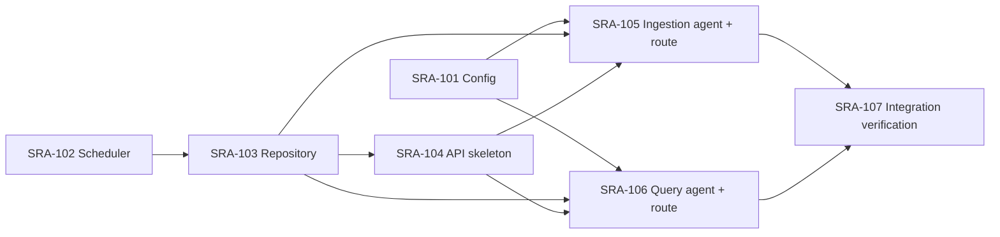

---

## Board — Phase 2 (Voice capture)

Every implementation ticket must finish with a complete flow a developer can run manually using completed prerequisites and that ticket's work. Each new boundary is connected to the already working app before the ticket closes. Each ticket includes concrete inputs/commands, observable output, a failure/recovery check, and a place to record the result.

Learning-target functions are typed stubs with teaching docstrings. At the user's request, all tests and stubs are prepared up front so the user writes the implementation. Implement one ticket at a time, keeping its focused checks and Phase 1 regressions green. Later tickets' stubs intentionally fail in the full suite; all default tests must pass before SRA-206 closes. Manual checks use real components, while default automated tests substitute external inference and hardware.

| Ticket | Title | Blocked by | Status |
|---|---|---|---|
| [SRA-201](SRA-201-text-capture-api-client.md) | Text capture through the HTTP client | SRA-107 (done) | Done — 2026-10-13; live API/search and recovery verified |
| [SRA-202](SRA-202-local-whisper-transcription.md) | Local Whisper transcription into saved study entries | SRA-201 | Implemented; automated checks complete |
| [SRA-203](SRA-203-recording-to-ingestion-pipeline.md) | Recording-to-ingestion pipeline | SRA-202 | Implemented; automated checks complete; live submission pending approval |
| [SRA-204](SRA-204-microphone-capture.md) | Microphone capture through the working pipeline | SRA-203 | Implemented; automated checks complete; real microphone acceptance pending |
| [SRA-205](SRA-205-menubar-hotkey-capture.md) | macOS menu-bar hotkey capture | SRA-204 | Implemented; automated checks complete; real desktop acceptance pending |
| [SRA-206](SRA-206-phase-2-integration-verification.md) | Phase 2 integration verification | SRA-205 | Automated verification complete; physical desktop acceptance pending |

Suggested order, and what each step gives you to run:

1. **201** — submit a typed note through the Python HTTP client and retrieve the created entry IDs through search. Includes the client config/dependencies needed for that flow.
2. **202** — transcribe a real saved WAV, send that transcript through the completed client, and retrieve its new entries through search.
3. **203** — use one `process_recording` call for that audio-to-entry flow, with consistent no-speech/error behavior and automated storage/scheduling/digest verification.
4. **204** — speak into the microphone and stop with Enter; verify the resulting entries and recording cleanup. The terminal entry point proves the recorder that the next ticket reuses.
5. **205** — drive that same recorder/pipeline with the global hotkey while another app has focus; verify new entries, UI feedback, and recovery.
6. **206** — repeat the whole desktop-to-digest flow, including restart and regression checks, and record phase completion.

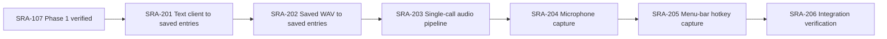

### How the Phase 2 files work together

The diagram above is **implementation order**. At runtime, the eventual desktop flow starts at SRA-205 and calls down through the earlier components. Phase 2 adds ways to obtain and submit text; Phase 1 continues to extract study topics, save data, and schedule reviews. SRA-201 through SRA-205 are implemented. Real microphone and global-hotkey acceptance remain pending.

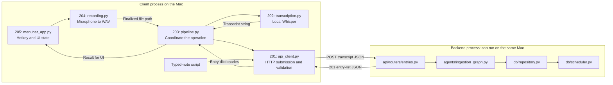

Arrows inside a process represent calls or returned data; the labeled HTTP arrows cross the client/server boundary. Local audio stays with the client. The backend receives transcript text and returns saved entries. The [SRA-201 sequence diagram](SRA-201-text-capture-api-client.md#follow-one-request-and-its-response) expands the request and response, including what happens before the server replies.

| Ticket / main file | Input → output | Responsibility added to the existing flow |
|---|---|---|
| [201 — `client/api_client.py`](SRA-201-text-capture-api-client.md) | Transcript string → saved entry dictionaries or `ApiClientError` | Make one HTTP submission, validate the response, and give all callers consistent errors. |
| [202 — `capture/transcription.py`](SRA-202-local-whisper-transcription.md) | Audio file path → transcript string or `TranscriptionError` | Recognize speech locally and reuse the model; preserve the input file. |
| [203 — `capture/pipeline.py`](SRA-203-recording-to-ingestion-pipeline.md) | Audio file path → entry list or propagated error | Compose transcription and submission; skip HTTP for silence. |
| [204 — `capture/recording.py`](SRA-204-microphone-capture.md) | Microphone samples → finalized temporary WAV | Own device/file lifetime; terminal entry point invokes the pipeline after stop. |
| [205 — `capture/menubar_app.py`](SRA-205-menubar-hotkey-capture.md) | Hotkey/menu event → recording, processing, and result feedback | Coordinate capture state, background processing, UI updates, and orderly quit. |
| [206 — verification](SRA-206-phase-2-integration-verification.md) | Complete flow → recorded evidence | Prove new IDs, transcripts, ownership, schedules, retrieval, cleanup, and recovery across all components. |

For example, saying "Today I studied mitosis" produces audio samples, then a WAV path, then a transcript string, then `{"transcript": "Today I studied mitosis"}` on the wire. The server turns that text into one or more database entries and six reviews per entry. Its JSON response becomes Python dictionaries again, which the caller uses to display saved IDs/topics or a count. Search, chat, and digest are separate later requests that read the stored data; saving a note does not itself fetch them.

Each ticket now includes its own runtime diagram and a **Files and why they matter** table. Read that map before implementing: it identifies the component to change, the completed components to reuse, and the tests that establish each boundary. Files called "new" in the original plan have already been scaffolded; the remaining work is to implement and verify their learning functions.

### Required manual evidence for each ticket

| Ticket | Run against real components | Observable success | Failure/recovery check |
|---|---|---|---|
| SRA-201 | Typed note → HTTP client → running server | Created IDs found through search | Unused port errors; restore URL and submit successfully |
| SRA-202 | Fixture WAV → Whisper → client → server | Recognizable transcript and new IDs found through search | Missing file prevents submission; restore input and retry |
| SRA-203 | WAV → one pipeline call → server | New IDs found through search; input file preserved | Missing input/unavailable server fail clearly; next valid call works |
| SRA-204 | Live microphone → Enter to stop → pipeline → server | Spoken note saved and found by ID; microphone/file released | Cancel/deny permission/stop server, then recover |
| SRA-205 | Hotkey from another app → microphone → pipeline → server | New IDs found; responsive recording/processing/result UI | Permission/server failure and rapid hotkeys recover without overlapping submissions |
| SRA-206 | Full capture/search/chat/digest flow plus restart | Recorded IDs, transcripts, six schedules, due-date digest results | Error paths recover and capture still works after restart |

The due-date checks use the next day's digest date in an isolated test; an immediate empty digest is expected for a new entry. Each ticket's **Verification record** must contain actual outcomes before closing it. A passing unit test, a saved-entry count alone, or an older matching search result is insufficient evidence. SRA-206 checks the complete phase again; earlier tickets must already be manually verified.

### How this maps to the existing plan

| Planned work | Ticket coverage |
|---|---|
| KTD1 / R10–R11: teaching stubs, docstrings, tests | Tests/stubs prepared; user implements each slice within SRA-201–205 |
| KTD6: client configuration and configurable hotkey/model size | SRA-201 base URL; SRA-202 model size; SRA-205 hotkey |
| U4 / R2; design §3.26: local Whisper, model cache, fixture, typed errors | SRA-202 |
| Design §3.29: thin HTTP ingestion client | SRA-201 |
| U5 refined by design §3.30: local transcription → remote ingestion | SRA-202 manual composition; SRA-203 reusable pipeline |
| U5 / R1; design §3.31: macOS recording and global hotkey | SRA-204 recorder/terminal verification; SRA-205 menu-bar/hotkey integration |
| Phase completion: voice capture → stored entries → scheduled reviews | Every ticket's manual result; SRA-203 due-date e2e test; SRA-206 final verification |

The technical design's client/server split takes precedence over U5's earlier sketch of invoking an ingestion graph on the desktop. Phase 2 sends **transcript text** to the existing `POST /api/v1/entries/ingest`; audio stays local, and the backend runs the agents. Use Phase 1's current OpenAI setup and FastAPI response shapes where the older plan still names Claude or future API contracts.

Phase 2 retains the single local user. OAuth/token storage, multi-tenancy, RBAC, and rate limiting are Phase 3; quiz generation is Phase 4; wake-up/TTS/voice quiz is Phase 5; Docker/distribution is Phase 6. The broader design's client methods for those features are not Phase 2 exercises.

### Testing Phase 2 as it is implemented

Files, tests, runtime implementations, and optional `capture` / `desktop`
dependency declarations are present. Default unit and e2e tests use fake
inference/audio devices and isolated HTTP/DB wiring. The real Whisper fixture
check is opt-in; real microphone, menu-bar permissions, and hotkey delivery are
verified on macOS. Do not interpret a platform skip as completed desktop
verification.

Current Phase 2 checks:

```bash
pytest tests/unit/test_client_config.py tests/unit/test_transcription.py tests/unit/test_api_client.py tests/unit/test_capture_pipeline.py tests/unit/test_recording.py -v
pytest tests/e2e/test_client_ingestion_e2e.py tests/e2e/test_voice_capture_to_digest_e2e.py -v
pytest tests/e2e/test_terminal_capture_e2e.py -v
SRA_RUN_WHISPER_TESTS=1 pytest tests/integration/test_transcription_whisper.py -v
pytest tests/unit/test_menubar_app.py -v
```

The automated suite is green. Record actual results for any rerun rather than
copying historical counts. Physical desktop and live-server evidence remains
required in the individual tickets and SRA-206 before Phase 2 is complete.

---

## Board — Phase 3 (Multi-tenancy, auth, RBAC, rate limiting)

Phase 3 replaces the trusted local-user placeholder with verified identity. The
database and repository already carry `user_id`; these tickets migrate the
existing user row, establish Google-backed credentials, make desktop capture
authenticate, and enforce per-principal request bounds. Every implementation
ticket must include a runnable result and failure/recovery evidence. Default
automation substitutes Google, browser, Keychain, model, and hardware boundaries
explicitly; real OAuth and macOS acceptance remain required before the phase
closes.

| Ticket | Title | Blocked by | Status |
|---|---|---|---|
| [SRA-301](SRA-301-oauth-user-schema-migration.md) | OAuth identity schema and safe legacy migration | SRA-206 | Done — 2026-10-14 |
| [SRA-302](SRA-302-google-oauth-rbac-isolation.md) | Google OAuth, authenticated isolation, and RBAC | SRA-301 | Implemented; automated checks complete, real Google verification pending |
| [SRA-303](SRA-303-desktop-oauth-authenticated-client.md) | Desktop OAuth and authenticated capture client | SRA-302 | Implemented; automated checks complete; real macOS OAuth/capture acceptance pending |
| [SRA-304](SRA-304-api-rate-limiting.md) | Per-user and per-IP API rate limiting | SRA-302 | Implemented and verified with real loopback HTTP and substituted inference — 2026-10-14 |
| [SRA-305](SRA-305-phase-3-integration-verification.md) | Phase 3 integration verification | SRA-303, SRA-304 | Automated verification complete; open for real Google/two-account/Keychain/physical desktop acceptance |
| [SRA-306](SRA-306-automatic-application-credential-refresh.md) | Automatic application credential refresh (long-lived refresh token) | SRA-302, SRA-303 | Planned — the access TTL of 3,600 seconds forces a Google re-login every hour; this ticket adds a paired refresh credential so an active session never sees a forced logout |

Suggested order, and what each step gives you to run:

1. **301** — upgrade a real Phase 2-shaped database without losing existing
   ownership, then create distinct OAuth-ready users and roles.
2. **302** — sign in through Google in a browser, use protected study routes as
   two isolated users, and exercise a real user/admin boundary.
3. **303 + 304** — these can proceed in parallel after SRA-302. Authenticate the
   existing desktop capture flow through loopback/Keychain, and independently
   add user/IP buckets before costly route work.
4. **305** — migrate, sign in with two real accounts, capture through the real
   desktop client, prove isolation/RBAC/rate limits, restart, and record evidence.
5. **306** — add a long-lived refresh token so an active browser tab or running
   desktop client transparently renews its access token without a Google
   re-login. Refresh tokens are rotated on every exchange; a stolen value is
   invalidated by the next legitimate refresh.

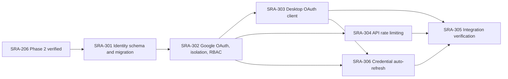

### How the Phase 3 files work together

The diagram above is implementation order. At runtime, Google login first maps
an external identity to an existing `users` row. Later requests present the
server-issued session or bearer credential; `require_user` resolves the trusted
numeric ID, the rate limiter selects that user's bucket, and existing routes pass
the ID into already scoped repositories and agents. The desktop never sends a
numeric user ID or server/Google secret.

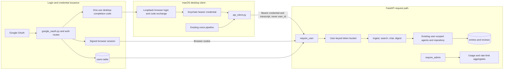

| Ticket / main boundary | Input → output | Responsibility added |
|---|---|---|
| [301 — models/migration](SRA-301-oauth-user-schema-migration.md) | Phase 2 database → OAuth-ready schema with ownership preserved | Durable stable identity and role without unsafe legacy claiming. |
| [302 — server auth](SRA-302-google-oauth-rbac-isolation.md) | Google callback or app credential → trusted `User` / `401` / `403` | Verify identity, issue/resolve credentials, protect routes, and enforce user/admin separation. |
| [303 — desktop auth](SRA-303-desktop-oauth-authenticated-client.md) | Browser loopback result → Keychain credential → authenticated capture | Keep credentials local/secure and attach them to the existing one-submit HTTP flow. |
| [304 — rate limiter](SRA-304-api-rate-limiting.md) | Trusted user or anonymous IP + request → allow or `429` | Bound work per principal before model calls/mutations and expose safe admin state. |
| [305 — verification](SRA-305-phase-3-integration-verification.md) | Complete shared-server flow → recorded evidence | Prove migration, two-user privacy, desktop auth, RBAC, limiting, restart, and recovery. |

Do not add Phase 4 quiz preferences, Phase 5 wake-up preferences, or Phase 6
demo cleanup merely because the older `User` design lists their eventual fields.
Phase 3's admin endpoints provide aggregate usage and limiter inspection; demo
reset belongs to the demo/distribution phase. The rate limiter is deliberately
single-process and must not be described as distributed enforcement.

---

## Board — Phase 4 (Daily MCQ quiz — web)

Phase 4 turns pre-generated `QuizSet` rows into a web study session. The four
new tables and the quiz agent land first; the nightly batch job, the API
router, and the dashboard JavaScript follow in dependency order. The voice
quiz flow (and the `voice-turn` endpoint) is Phase 5. Every implementation
ticket ships with its own runnable flow and recorded evidence; the final
ticket closes the phase.

| Ticket | Title | Blocked by | Status |
|---|---|---|---|
| [SRA-401](SRA-401-quiz-schema-and-migration.md) | Quiz schema and safe migration | SRA-305 | Done — 2026-10-14 |
| [SRA-402](SRA-402-mcq-generation-agent-and-repository.md) | MCQ generation agent and quiz repository | SRA-401 | Done — 2026-10-14 |
| [SRA-403](SRA-403-quiz-pregeneration-job.md) | Quiz pregeneration job | SRA-402 | Done — 2026-10-14 |
| [SRA-404](SRA-404-quiz-api-endpoints.md) | Quiz API endpoints (web) | SRA-402, SRA-403 | Done — 2026-10-14 (1 known e2e failure: test seeds entry directly bypassing repository.create_entry) |
| [SRA-405](SRA-405-dashboard-quiz-ui.md) | Dashboard quiz UI | SRA-404 | Done — 2026-10-14 (unit tests blocked by hard-coded `PATH = "/usr/bin:/usr/local/bin"` on this machine; e2e 4/4 pass; async/DOM timing limitation documented) |
| [SRA-406](SRA-406-phase-4-integration-verification.md) | Phase 4 integration verification | SRA-401, SRA-402, SRA-403, SRA-404, SRA-405 | Done — 2026-10-14 (pyright restored to clean, audit gap closed, shared-bucket test fixed; documented limitations remain) |

Suggested order, and what each step gives you to run:

1. **401** — upgrade a real Phase 3 database with the four new tables and
   prove every pre-existing row survives the migration and a downgrade.
2. **402** — generate one quiz per `(entry_id, generated_on)` via the MCQ
   agent, with the same `_get_chat_model()` seam the ingestion and query
   agents use; repository helpers enforce ownership and idempotency.
3. **403** — pre-generate today's quizzes for every due entry across every
   user; re-running the same day creates no duplicates and continues past a
   single entry's LLM failure.
4. **404** — read-only routes for the dashboard: list today, get one set,
   start an attempt, submit an answer, complete, and read the attempt
   summary. Voice mode is rejected until Phase 5.
5. **405** — a small static JavaScript module that drives the routes
   end-to-end from the dashboard, never seeing `correct_option_index`
   before the user submits an answer.
6. **406** — re-run the full suite, the migration replay, the rate-limit
   inheritance, the cross-user isolation, and the dashboard loop, then
   record the phase-level evidence.

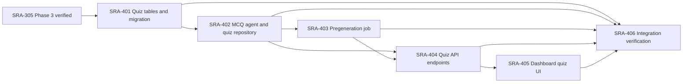

### How the Phase 4 files work together

The diagram above is **implementation order**. At runtime, the SRA-403 job
writes the `QuizSet` and `QuizQuestion` rows ahead of the user's preferred
review time. The dashboard in SRA-5 reads them through the SRA-404 routes,
and the server is the only place that decides whether an answer was correct.
Phase 4 does not move the ingestion, scheduling, or auth layers; it sits next
to them as a new read/write boundary owned by the new tables.

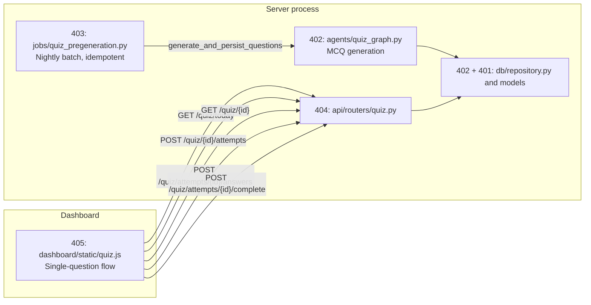

| Ticket / main boundary | Input → output | Responsibility added |
|---|---|---|
| [401 — models/migration](SRA-401-quiz-schema-and-migration.md) | Phase 3 database → Phase 4 database with four quiz tables | Durable sets, questions, attempts, answers; snapshot per-set counts; ownership denormalized. |
| [402 — agent and repository](SRA-402-mcq-generation-agent-and-repository.md) | One entry + counts → persisted `QuizSet` with `QuizQuestion` rows | Generate MCQ drafts with structured output and idempotent per-day persistence. |
| [403 — pregeneration job](SRA-403-quiz-pregeneration-job.md) | Today's date → summary of created, skipped, and errored sets | Walk due entries; skip ones with a set already for today; never duplicate. |
| [404 — quiz router](SRA-404-quiz-api-endpoints.md) | Authenticated request → today's quiz list, attempt lifecycle, score | Enforce ownership; strip `correct_option_index` from question payloads; reject voice mode until Phase 5. |
| [405 — dashboard UI](SRA-405-dashboard-quiz-ui.md) | Click → answer → score | Drive the same `fetch` sequence the tests use; never see `correct_option_index` until after the answer is submitted. |
| [406 — verification](SRA-406-phase-4-integration-verification.md) | Phase 4 components → recorded evidence | Migration replay, idempotency, isolation, rate-limit inheritance, full web-quiz loop. |

The voice-quiz agent, the `quiz_conversation_graph`, the `voice-turn` endpoint,
the APScheduler wiring of the pregeneration job, the `preferred_review_time` /
`timezone` user fields, and TTS/STT for spoken quizzes are **not** Phase 4 —
they are Phase 5. The Phase 4 dashboard module rejects `mode: "voice"` at the
server with a typed `400`; Phase 5 will turn that branch into a real flow.

---

## Board — Phase 5 (Scheduled wake-up & voice quiz)

Phase 5 turns the Phase 4 quiz into something the desktop client can run out loud,
on a schedule. The server owns user preferences and time-of-day delivery; the
client owns audio I/O. Every implementation ticket ships with its own runnable
flow and recorded evidence; the final ticket closes the phase.

| Ticket | Title | Blocked by | Status |
|---|---|---|---|
| [SRA-501](SRA-501-user-preferences-and-scheduler-columns.md) | User preferences and scheduler columns | SRA-406 | Implemented — 2026-10-14 |
| [SRA-502](SRA-502-digest-ready-and-scheduler-wiring.md) | Digest ready endpoint and APScheduler wiring | SRA-501 | Implemented — 2026-10-14 |
| [SRA-503](SRA-503-local-tts-abstraction.md) | Local TTS abstraction | — | Implemented — 2026-10-14 |
| [SRA-504](SRA-504-voice-quiz-conversation-graph.md) | Voice quiz conversation graph | SRA-501 | Implemented — 2026-10-14 |
| [SRA-505](SRA-505-voice-quiz-router-endpoint.md) | Voice quiz router endpoint | SRA-504 | Implemented — 2026-10-14 |
| [SRA-506](SRA-506-client-api-extensions.md) | Client API extensions for wake-up and voice quiz | SRA-502, SRA-505 | Implemented — 2026-10-14 |
| [SRA-507](SRA-507-wakeup-delivery-loop.md) | Wake-up delivery loop | SRA-503, SRA-506 | Implemented — 2026-10-14 |
| [SRA-508](SRA-508-voice-quiz-client-driver.md) | Voice quiz client driver | SRA-503, SRA-504, SRA-506 | Implemented — 2026-10-14 |
| [SRA-509](SRA-509-phase-5-integration-verification.md) | Phase 5 integration verification | SRA-501–508 | Implemented — 2026-10-14 |

Suggested order, and what each step gives you to run:

1. **501** — extend `users` with the columns the rest of Phase 5 reads
   (`preferred_review_time`, `timezone`, `quiz_question_count`,
   `quiz_option_count`, `wakeup_notification_sent_at`), expose them via
   `GET/PUT /api/v1/me/preferences`, and rewire the pregeneration job to
   read counts from the user row.
2. **502** — register the pregeneration and wake-up jobs with APScheduler
   inside the FastAPI lifespan; add `GET /api/v1/digest/ready` so the
   desktop loop has a signal to poll.
3. **503** — `speak(text)` over `subprocess.run(["say", ...])` with a
   swappable backend so tests do not invoke real audio.
4. **504** — `process_voice_turn(session, attempt, answer_text)` that maps a
   free-form spoken answer to a structured option index via the LLM, records
   a `QuizAnswer`, advances or finalizes the attempt, and returns the next
   question text. State is reloaded from the database on each HTTP turn.
5. **505** — `POST /api/v1/quiz/attempts/{id}/voice-turn` plus the voice-mode
   branch in `POST /api/v1/quiz/{id}/attempts`. Removes the Phase 4 `400`
   rejection and returns the first question inline.
6. **506** — `get_digest_ready`, `get_digest_text`, `start_voice_quiz_attempt`,
   `send_voice_turn` on `src/sra/client/api_client.py`. Same auth-token
   resolution and resource cleanup as the existing client methods.
7. **507** — `run_wakeup_loop(stop_event, ...)` on the desktop; polls,
   speaks when ready, sleeps otherwise, exits cleanly when the stop event
   fires.
8. **508** — `run_voice_quiz(quiz_set_id)` on the desktop; composes recorder
   + transcriber + api_client + tts into a single function that speaks each
   question, records each answer, and returns `{score, total_questions}`.
9. **509** — re-run the full suite, the migration rehearsal, the scheduler
   lifecycle, the rate-limit inheritance, the wake-up loop, and the voice
   quiz driver, then record the phase-level evidence.

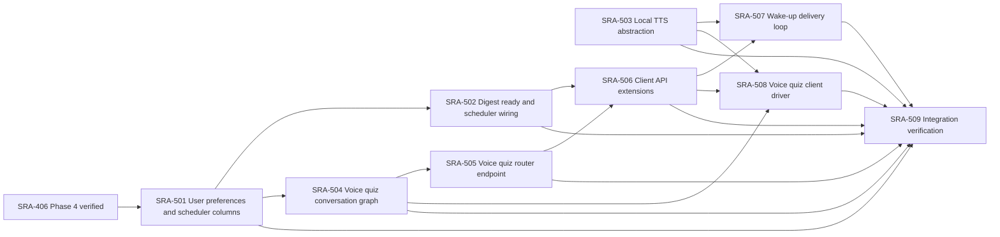

### How the Phase 5 files work together

The diagram above is **implementation order**. At runtime, the server's
scheduler (SRA-502) pre-generates today's quizzes and flips the per-user
`wakeup_notification_sent_at` flag at the user's local `preferred_review_time`.
The wake-up loop on the desktop (SRA-507) polls `GET /api/v1/digest/ready`, then
calls `speak(get_digest_text())`. The voice quiz driver on the desktop
(SRA-508) drives the same loop with the voice-turn endpoints added by SRA-505.
TTS (SRA-503) is the audio-output dependency both desktop functions share.

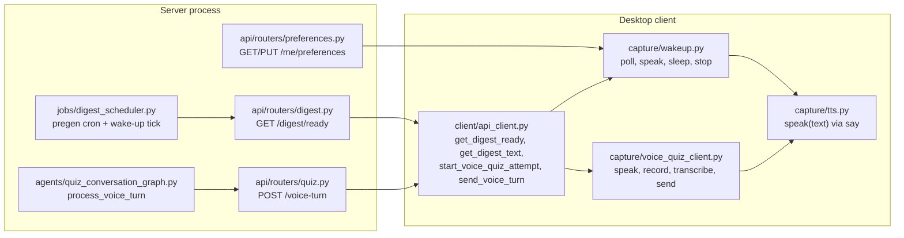

Arrows inside a process represent calls or returned data; the labeled HTTP
arrows cross the client/server boundary. The server keeps no per-client
state for the wake-up loop — it just flips a per-user flag at the configured
time and answers polls from any client that asks.

| Ticket / main boundary | Input → output | Responsibility added |
|---|---|---|
| [501 — preferences & columns](SRA-501-user-preferences-and-scheduler-columns.md) | `PUT /api/v1/me/preferences` → persisted user row | Extend `users` with the five Phase 5 columns; expose them through a typed router. |
| [502 — scheduler](SRA-502-digest-ready-and-scheduler-wiring.md) | UTC tick → pregenerated quizzes + per-user wake-up flag | Own server time-of-day delivery inside the FastAPI lifespan. |
| [503 — TTS](SRA-503-local-tts-abstraction.md) | text → audible speech via macOS `say` | Local audio output with a swappable backend for tests. |
| [504 — conversation graph](SRA-504-voice-quiz-conversation-graph.md) | one voice turn → next question or final score | Interpret free-form answers via the LLM; grade by integer equality; persist state to the database. |
| [505 — voice routes](SRA-505-voice-quiz-router-endpoint.md) | HTTP → HTTP | Wrap the conversation graph in `POST /api/v1/quiz/attempts/{id}/voice-turn`; return the first question inline at attempt start. |
| [506 — client methods](SRA-506-client-api-extensions.md) | method call → HTTP request → typed result | Add the four desktop-facing methods to `api_client.py`. |
| [507 — wake-up loop](SRA-507-wakeup-delivery-loop.md) | `stop_event` → `speak(digest)` on the user's schedule | Poll the server, speak when ready, sleep otherwise, exit cleanly. |
| [508 — voice quiz driver](SRA-508-voice-quiz-client-driver.md) | `quiz_set_id` → `{score, total_questions}` | Compose recorder + transcriber + HTTP client + TTS into one function. |
| [509 — verification](SRA-509-phase-5-integration-verification.md) | Complete phase → recorded evidence | Migration rehearsal, scheduler lifecycle, rate-limit inheritance, wake-up loop, voice quiz loop, regression check. |

### Required manual evidence for each ticket

| Ticket | Run against real components | Observable success | Failure/recovery check |
|---|---|---|---|
| SRA-401 | Phase 3 database + `alembic upgrade head` + `downgrade -1` + `upgrade head` | Four new tables exist; pre-existing rows unchanged; unique constraints fire | Restore the backup file; rerun the migration; confirm idempotency |
| SRA-402 | Real OpenAI call | `QuizSet` + `QuizQuestion` rows with snapshot counts and in-range `correct_option_index` | A second call the same day raises on the unique constraint, no duplicate |
| SRA-403 | Real database, real LLM seam (or fake in tests) | Summary reports created/skipped/errored; no duplicate sets on rerun | An LLM failure for one entry does not stop the batch; the row count is unchanged |
| SRA-404 | `curl` against a running server with a real token | Today's list contains the set; attempt lifecycle returns expected IDs and scores | A second user's token gets `403`; missing token gets `401`; rate-limit burst gets `429` |
| SRA-405 | Browser signed in as the user | Question list rendered without `correct_option_index`; per-question result panel; final score | Network panel shows zero pre-answer leaks; private-window second user sees only their own quizzes |
| SRA-406 | Full suite + manual evidence replay | All focused, e2e, and integration tests pass; Phase 1/2/3 regressions stay green; lint and types clean | Skipped opt-in tests are recorded with the reason; no protected quiz endpoints appear in the route audit |

Each ticket's **Verification record** must contain actual outcomes before it
closes. A passing unit test, a saved-entry count alone, or an older matching
quiz attempt is not sufficient. SRA-406 re-runs the complete flow; earlier
ticket tickets must already have their own evidence.

---

## Board — Phase 6 (Open-source packaging)

Phase 6 turns the same FastAPI image into something anyone can self-host with
one `docker compose up`. Two settings (`DEMO_MODE`, `DEMO_DATA_RETENTION_DAYS`)
plus one user-flag column (`is_demo_user`) define the demo instance; a third
setting (`DEMO_RESET_INTERVAL_S`) governs how often stale demo data is wiped.
The README is the visitor-facing surface for self-host instructions, demo
expectations, and the macOS-only desktop notice. Every implementation ticket
ships with its own runnable flow and recorded evidence; the final ticket
closes the phase.

| Ticket | Title | Blocked by | Status |
|---|---|---|---|
| [SRA-601](SRA-601-demo-mode-settings-and-user-marker.md) | Demo-mode settings and per-user marker column | — | Implemented — 2026-10-14 |
| [SRA-602](SRA-602-dockerfile-and-docker-compose.md) | Dockerfile and docker-compose.yml | — | Implemented — 2026-10-14 |
| [SRA-603](SRA-603-demo-reset-job-and-admin-endpoint.md) | Demo reset job and admin endpoint | SRA-601 | Implemented — 2026-10-14 |
| [SRA-604](SRA-604-self-host-documentation.md) | Self-host documentation | SRA-602, SRA-603 | Implemented — 2026-10-14 |
| [SRA-605](SRA-605-phase-6-integration-verification.md) | Phase 6 integration verification | SRA-601–604 | Done — 2026-10-14 |

Suggested order, and what each step gives you to run:

1. **601** — extend `Settings` with `demo_mode`, `demo_data_retention_days`,
   plus the `is_demo_user` column on `users` and the repository cascade
   helpers (`delete_user_cascade`, `list_old_demo_users`).
2. **602** — `Dockerfile`, `docker/entrypoint.sh`, `docker-compose.yml`
   (default + `postgres` + `demo` profiles), `.dockerignore`. The image has
   no application code changes — only packaging.
3. **603** — `src/sra/jobs/demo_reset.py` (`reset_demo_data` + typed
   `DemoModeDisabledError`), `POST /api/v1/admin/demo/reset`, the APScheduler
   interval hook when `demo_mode=True`, and rate-limit narrowing under
   `demo_mode=True`.
4. **604** — README top-section rewrite (public-demo callout, self-host
   quickstart, demo-mode subsection, Google OAuth setup, environment-variable
   table), `.env.example` Phase 6 block, Phase 6 board entries.
5. **605** — end-to-end demo-lifecycle test, migration round-trip, route
   audit extension, `ruff` and `pyright` clean, `PROGRESS.md` close-out.

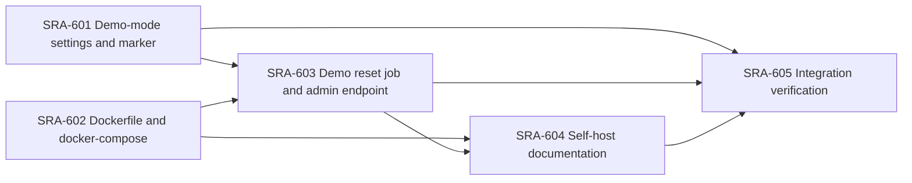

### How the Phase 6 files work together

The diagram above is **implementation order**. At runtime, the same Docker
image powers all three paths. The image reads `Settings` from environment
variables; `DEMO_MODE=true` activates the demo profile (tighter rate limits,
hourly reset tick). The self-host default runs the same image against an
on-container SQLite file. The `postgres` profile swaps SQLite for Postgres
without code changes.

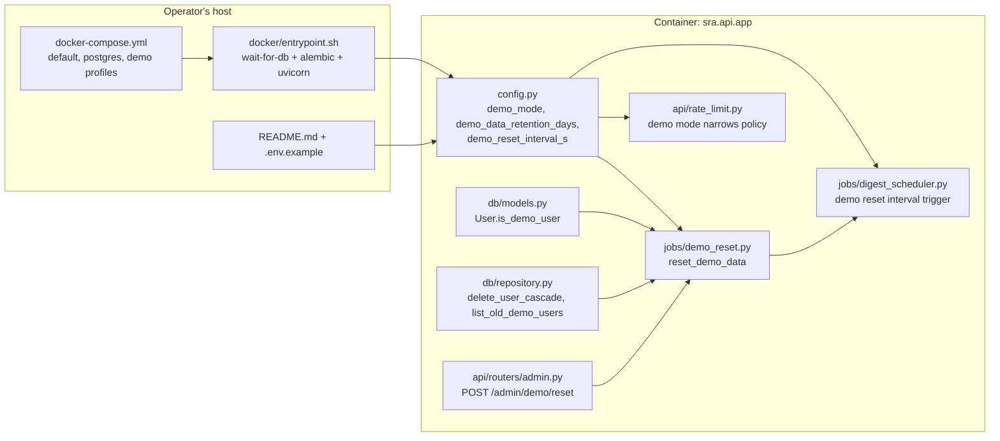

Arrows inside the container represent calls or returned data; the labelled
env-file arrows cross the host/container boundary. The image is identical
across paths — only environment variables and the compose profile change.
The macOS desktop client runs on the operator's Mac, not in the container,
and points `API_BASE_URL` at the host port.

| Ticket / main boundary | Input → output | Responsibility added |
|---|---|---|
| [601 — settings + column](SRA-601-demo-mode-settings-and-user-marker.md) | env vars + DB schema → typed config + cascade helpers | Distinguish demo data from real data; define one typed repository path to remove a user's data. |
| [602 — packaging](SRA-602-dockerfile-and-docker-compose.md) | clean clone → running container | Docker image + entrypoint + compose profiles (default, postgres, demo). |
| [603 — reset](SRA-603-demo-reset-job-and-admin-endpoint.md) | `DEMO_MODE=true` + stale demo users → deleted demo data | Hourly cleanup tick + admin-triggered reset + rate-limit narrowing. |
| [604 — docs](SRA-604-self-host-documentation.md) | reader → running instance | README self-host quickstart, demo-mode subsection, env-var table; `.env.example` Phase 6 block; phase board entries. |
| [605 — verification](SRA-605-phase-6-integration-verification.md) | full repo → recorded evidence | Migration round-trip, demo lifecycle, route audit, lint/types, `PROGRESS.md` close-out. |

### Required manual evidence for each ticket

| Ticket | Run against real components | Observable success | Failure/recovery check |
|---|---|---|---|
| SRA-601 | `alembic upgrade head` from `c3d4e5f6a7b8` then `downgrade -1` then `upgrade head` | `is_demo_user` column appears, disappears, reappears; pre-Phase-6 rows keep `False` | Restore backup; rerun the migration |
| SRA-602 | `docker compose up` against a clean `.env` | `/api/health` returns 200; `alembic current` matches head | Missing `OPENAI_API_KEY` produces a clear startup error; restore it and rerun |
| SRA-603 | `POST /api/v1/admin/demo/reset` with `DEMO_MODE=true` | `{"deleted": N}` with N equal to stale demo users; non-demo users survive | Outside demo mode the route returns 503; the scheduler tick is absent |
| SRA-604 | `grep -nE 'docker compose' README.md` and `grep -nE 'DEMO_MODE' .env.example` | Both greps return non-empty matches; the README lists every env var | Swap the public-demo URL placeholder back, confirm the round-trip |
| SRA-605 | `pytest -q` + `ruff check .` + `pyright` + manual demo-lifecycle | All green (modulo documented pre-existing Phase 4 limitations); lint/types clean | The Phase 4 limitation count matches the SRA-406 baseline |

Each ticket's **Verification record** must contain actual outcomes before it
closes. A passing unit test for one model validator, an empty grep, or a
to-be-filled-in URL are not sufficient. SRA-605 re-runs the complete demo
lifecycle; earlier tickets must already have their own evidence.

---

## Board — Phase 7 (Study dashboard)

Phase 7 turns every captured study entry and every scheduled review into a
single browsable page. The dashboard is a read-only SSR shell in `web/` that
fetches `/api/v1/search`, `/api/v1/digest`, and a new
`/api/v1/reviews/upcoming` endpoint through the existing Phase 1–6 server.
There is no new server-side data model; the page joins `study_entries` and
`review_schedules` (both Phase 1 tables) through the existing
user-scoped repository helpers.

| Ticket | Title | Blocked by | Status |
|---|---|---|---|
| [SRA-701](SRA-701-study-dashboard.md) | Study dashboard: entries, search, upcoming reviews | SRA-104, SRA-404, SRA-502 | Implemented — 2026-10-15 |

Suggested order, and what each step gives you to run:

1. **701** — sign in as a user with a handful of captures, open
   `/dashboard`, and see every entry listed, the search box narrow it in
   real time, each entry's original transcript on expand, and the
   upcoming-reviews timeline reflect the same six checkpoints
   `1d/3d/7d/1mo/3mo/6mo` the scheduler already writes.

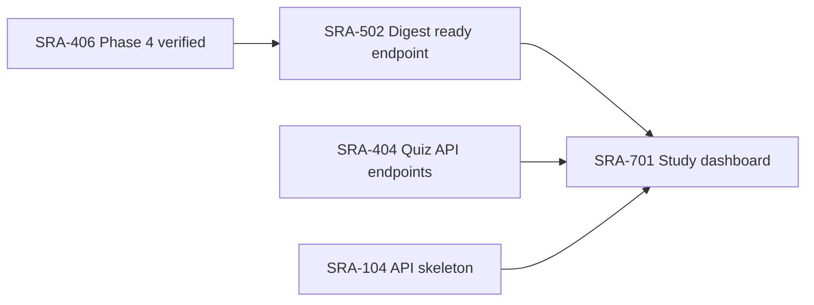

### How the Phase 7 files work together

At runtime, the dashboard browser tab fetches three read endpoints. The
server is unchanged from Phase 1–6 except for one new route that exposes
the "future scheduled reviews" view that `/digest` deliberately does not
own. Every read is user-scoped on the server, so a second signed-in user
sees only their own entries and reviews even if they hit the same URL.

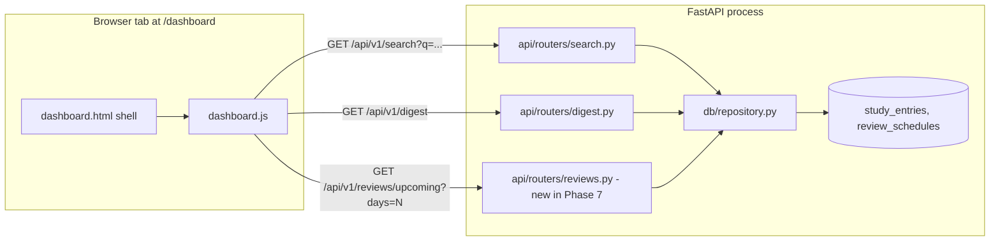

The new `/api/v1/reviews/upcoming?days=N` endpoint returns pending reviews
for the strictly-future window `(today, today + days]` bucketed by
`scheduled_date`. It never overlaps with `/digest` (which is "due today or
earlier"). The endpoint inherits the authenticated rate-limit policy from
the aggregator.

### Required manual evidence for SRA-701

| Ticket | Run against real components | Observable success | Failure/recovery check |
|---|---|---|---|
| SRA-701 | Sign in with one or two captures already on disk; open `/dashboard` | Total entries / Due today / Upcoming tiles match direct `curl` calls; search filters in real time; expanding an entry reveals its original transcript; switching the window `<select>` re-renders the timeline without a reload | Private-window sign-in for a second user shows only their own entries and reviews; the first user's URL still scopes to whoever is signed in |

Each ticket's **Verification record** must contain actual outcomes before it
closes. SRA-701's record includes the focused/integration/e2e test
results and the lint/type-check status; manual browser verification is
the closing step.

---

## Board — Phase 8 (Interactive AI interview mode)

Phase 8 adds a third quiz mode alongside MCQ (`web`) and spoken-MCQ
(`voice`): an open-ended, LLM-driven interview where the AI asks
grounded questions, listens to the user's free-form answer, grades it
**0–100** with feedback, and decides whether to probe deeper on the
current topic or move to the next outline item. The user can skip ahead
or end the attempt at any time. The nightly pregeneration job produces
an `InterviewPlan` per `QuizSet`; the per-turn conversation graph
expands one outline item at a time and persists every `ai` / `user` /
`system_summary` row to the `interview_turns` table. Both the dashboard
and the macOS voice client consume the same SRA-805 routes.

| Ticket | Title | Blocked by | Status |
|---|---|---|---|
| [SRA-801](SRA-801-interview-schema-and-migration.md) | Interview schema and safe migration | SRA-509 | Planned |
| [SRA-802](SRA-802-interview-planner-and-pregen.md) | Interview planner agent and pregeneration | SRA-801 | Planned |
| [SRA-803](SRA-803-interview-conversation-graph.md) | Interview conversation graph (per-turn agent) | SRA-801 | Planned |
| [SRA-804](SRA-804-interview-repository-helpers.md) | Interview repository helpers | SRA-801, SRA-802, SRA-803 | Planned |
| [SRA-805](SRA-805-interview-router-endpoints.md) | Interview router endpoints | SRA-804, SRA-806 | Planned |
| [SRA-806](SRA-806-interview-api-schemas.md) | Interview API schemas (DTOs) | SRA-801, SRA-803 | Planned |
| [SRA-807](SRA-807-interview-dashboard-ui.md) | Interview dashboard UI | SRA-805 | Planned |
| [SRA-808](SRA-808-interview-voice-client-and-tts.md) | Interview voice client and TTS integration | SRA-805 | Planned |
| [SRA-809](SRA-809-phase-8-integration-verification.md) | Phase 8 integration verification | SRA-805, SRA-807, SRA-808 | Planned |

Suggested order, and what each step gives you to run:

1. **801** — upgrade a real Phase 5/6 database with the two new tables
   (`interview_plans`, `interview_turns`), the `QuizAttempt.cursor_on_plan`
   column, and the two new `users` preference columns, and prove every
   pre-existing row survives a downgrade and a subsequent upgrade.
2. **802** — pre-generate an `InterviewPlan` outline per `QuizSet` via
   the new planner LangGraph; pregen creates the outline idempotently and
   the dev pregen summary surfaces the new counters.
3. **803** — drive one HTTP turn of the conversation: interpret the
   user's free-form answer, grade 0–100, decide the next action, persist
   every `ai` / `user` / `system_summary` row, advance or finalize the
   attempt. State is reloaded from the DB on every turn.
4. **804** — add the five repository helpers (`create_interview_plan`,
   `get_or_create_interview_plan`, `append_interview_turn`,
   `get_interview_turns`, `complete_interview_attempt`) so the graph
   never speaks SQL directly and the cascade from `quiz_sets` /
   `quiz_attempts` covers the new tables.
5. **806** — define the wire DTOs the dashboard and voice client
   consume; extend `PreferencesIn` / `PreferencesOut` and
   `StartAttemptRequest.mode` (adds `"interview"`).
6. **805** — wire the three HTTP routes: the `interview` branch in
   `POST /quiz/{id}/attempts`, `POST /quiz/attempts/{id}/interview-turn`,
   and `GET /quiz/attempts/{id}/interview`. All three inherit the
   per-user rate-limit bucket.
7. **807** — render the chat-thread dashboard with score chips, action
   buttons, the summary panel, and the resume fetch on page load.
8. **808** — drive the same conversation through the macOS client:
   `speak(question)` → `record_audio()` → `transcribe()` → POST
   `action="answer"` → `speak(feedback)` → `speak(next_question)`.
9. **809** — re-run the full suite, the migration round-trip, the
   rate-limit inheritance, the dashboard loop, the voice loop, the
   resume flow, and the recovery flow, then record the phase-level
   evidence.

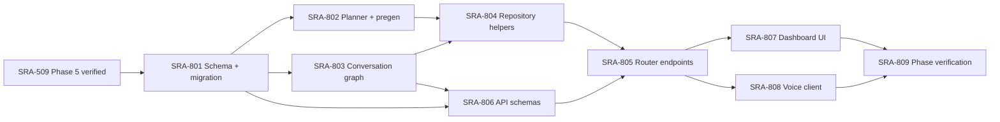

### How the Phase 8 files work together

At runtime, the SRA-502 scheduler pre-generates today's MCQ `QuizSet`
**and** an `InterviewPlan` outline per `QuizSet` (SRA-802). The
dashboard's "Start interview" button (SRA-807) calls
`POST /api/v1/quiz/{id}/attempts {mode: "interview"}` (SRA-805), which
loads the plan through `get_or_create_interview_plan` (SRA-804) and
returns the first question inline. Each subsequent typed answer calls
`POST /quiz/attempts/{id}/interview-turn {action: "answer"}`, which
delegates to `process_interview_turn` (SRA-803) — one LLM call per
turn that grades the answer and produces the next question or decides
to finish. The voice client (SRA-808) reuses the same routes with
`speak()` for the AI's voice and `record_audio()` + `transcribe()` for
the user's spoken answer. Every `ai` / `user` / `system_summary` row
is persisted to `interview_turns` (SRA-801) so closing the tab and
reopening `/dashboard/interview?attempt_id=…` reloads the full
transcript through `GET /quiz/attempts/{id}/interview`. The database is
the canonical owner of attempt state; no in-process state survives a
restart.

```mermaid
flowchart LR
  subgraph Server[FastAPI process]
    Job["jobs/quiz_pregeneration.py<br/>pregen creates InterviewPlan"]
    Planner["agents/interview_planner.py<br/>outline per QuizSet"]
    Graph["agents/interview_conversation_graph.py<br/>process_interview_turn"]
    Repo["db/repository.py<br/>append_interview_turn,<br/>get_interview_turns,<br/>complete_interview_attempt"]
    Router["api/routers/quiz.py<br/>POST /attempts {mode: interview},<br/>POST /interview-turn, GET /interview"]
  end

  subgraph Browser[Dashboard at /dashboard/interview]
    Page[dashboard/interview.html shell]
    JS[dashboard/interview.js]
    Page --> JS
  end

  subgraph Desktop[macOS client]
    Driver["capture/voice_quiz_client.py<br/>run_interview"]
    Speak["capture/tts.py<br/>speak()"]
    Rec["capture/recording.py"]
    STT["capture/transcription.py"]
    Driver --> Speak
    Driver --> Rec
    Driver --> STT
  end

  subgraph DB[(SQLite/Postgres)]
    IP[interview_plans]
    IT[interview_turns]
    QS[quiz_sets]
    QA[quiz_attempts<br/>cursor_on_plan]
  end

  Job --> Planner
  Planner --> IP
  Router --> Repo
  Graph --> Router
  Repo --> IP
  Repo --> IT
  Repo --> QA
  JS -->|start / answer / next / end| Router
  JS -->|resume on reload| Router
  Driver -->|start_interview_attempt<br/>send_interview_turn| Router
```

| Ticket / main boundary | Input → output | Responsibility added |
|---|---|---|
| [801 — schema](SRA-801-interview-schema-and-migration.md) | Phase 5/6 database → Phase 8 database with two new tables, one new `quiz_attempts` column, two new `users` preference columns | Durable plans, transcript log, ownership boundaries, and per-attempt turn cap. |
| [802 — planner + pregen](SRA-802-interview-planner-and-pregen.md) | One entry + count → persisted `InterviewPlan` with a structured outline | Generate outline drafts with structured output and idempotent per-day persistence; surface `interview_plans_created / skipped / errored` counts. |
| [803 — conversation graph](SRA-803-interview-conversation-graph.md) | One HTTP turn → next question or final summary | One LLM call per turn that grades the user's free-form answer and decides the next action; persist every turn; force-stop at `max_turns=20`. |
| [804 — repository](SRA-804-interview-repository-helpers.md) | DB session + typed args → typed rows | Typed insert / read / cascade for `interview_plans` and `interview_turns`; no other module speaks SQL to the new tables. |
| [805 — router](SRA-805-interview-router-endpoints.md) | Authenticated request → interview lifecycle HTTP responses | Enforce ownership; map typed errors to `400 / 403 / 404 / 409 / 422 / 429`; inherit the per-user rate-limit bucket. |
| [806 — schemas](SRA-806-interview-api-schemas.md) | DTO definitions | Wire shape for the interview surface; extend `PreferencesIn` / `PreferencesOut` and `StartAttemptRequest.mode`. |
| [807 — dashboard](SRA-807-interview-dashboard-ui.md) | Click → answer → summary | Chat-thread UI with score chips, action buttons, summary panel, and resume fetch on page load. |
| [808 — voice client](SRA-808-interview-voice-client-and-tts.md) | `quiz_set_id` → `{score, answered_count, remaining_count}` | Compose recorder + transcriber + `speak()` + the three new client methods into one function. |
| [809 — verification](SRA-809-phase-8-integration-verification.md) | Phase 8 components → recorded evidence | Migration round-trip, full suite, web loop, voice loop, resume, recovery, lint/types. |

The `dev_pregenerate_now` route, the `GET /digest/ready` endpoint, the
`wakeup_notification_sent_at` flag, the TTS module, the recorder, the
transcriber, and the macOS menu-bar app are not changed by Phase 8 —
the interview feature reuses them as-is. The voice-quiz `voice` mode
remains the only spoken path for MCQ; interview mode is the only
spoken path for the open-ended interview. Both share the same rate-limit
bucket and the same auth flow.

### Required manual evidence for Phase 8

| Ticket | Run against real components | Observable success | Failure/recovery check |
|---|---|---|---|
| SRA-801 | `alembic upgrade head` from `d4e5f6a7b8c9` then `downgrade -1` then `upgrade head` | Two new tables appear, the new `users` columns appear with defaults, the new `quiz_attempts` column appears with `server_default=0`; pre-Phase-8 rows keep their IDs | Restore backup; rerun the migration |
| SRA-802 | Real OpenAI call | `InterviewPlan` row with an outline of `interview_question_count` items, each with `subtopic`, `difficulty`, `focus_prompt` | A second pregen call the same day raises on the unique constraint, no duplicate |
| SRA-803 | Real OpenAI call | One `interview_turns` row per AI / user / system_summary message; `score` integer in `[0, 100]`; `next_action` is one of `ask_new` / `follow_up` / `finish` | LLM failure raises `InterviewLLMError`; the 21st `answer` raises `InterviewAttemptFullError` |
| SRA-804 | Real database | `create_interview_plan` is idempotent; `delete_user_cascade` removes every `interview_plans` and `interview_turns` row owned by the user | Restore backup; rerun the cascade check |
| SRA-805 | `curl` against a running server with a real token | Start / answer / next / end / GET return documented shapes; the second user's token gets `403`; missing token gets `401`; rate-limit burst gets `429` | Wrong mode returns `400`; already-completed returns `409`; full attempt returns `409` |
| SRA-806 | OpenAPI spec at `/api/v1/openapi.json` | Every new DTO appears with the documented field names; `StartAttemptRequest.mode` enum contains `"interview"`; `PreferencesIn` carries the two new fields | A round-trip through `model_validate(model_dump())` is the regression test |
| SRA-807 | Browser signed in as the user | Chat thread renders without a console error; score chip appears under each user bubble; action buttons enable / disable correctly; summary panel shows `score`, `answered_count`, `remaining_count`; resume fetch renders the existing transcript | Network panel shows zero pre-answer leaks; private-window second user sees only their own interviews |
| SRA-808 | macOS client with a real OpenAI key | TTS sequence matches the documented question / feedback / next-question / summary order; recorder / transcriber close on stop; menu-bar status updates with the saved score | Network error surfaces a clean message; resuming after the network returns shows the same transcript |
| SRA-809 | Full suite + manual evidence replay | All focused, integration, and e2e tests pass; Phase 1–7 regressions stay green; lint and types clean | The Phase 4 limitation count matches the SRA-406 baseline |

Each ticket's **Verification record** must contain actual outcomes
before it closes. A passing unit test for one model validator, an
empty grep, or a to-be-filled-in URL are not sufficient. SRA-809
re-runs the complete interview lifecycle; earlier tickets must already
have their own evidence.

---

## Board — Phase 9 (Topic authoring with reference materials + question-quality uplift)

Phase 9 fixes the two quality gaps Phase 8 exposed: (1) there is no way
to *author* a topic — the only entry path is the Phase 1 ingest route,
which is transcript-shaped; (2) the MCQ + interview generation agents
only see a tiny slice of metadata and are forced to invent questions,
which the user has repeatedly called "mediocre". Phase 9 adds a
`reference_materials` table that the generation agents consume as
source-grounded evidence, plus a six-section rubric + Bloom
distribution + distractor rubric + per-question verifier that
demonstrably improves question quality. PDF/DOCX uploads are
explicitly out of scope (deferred to a Phase 9.x follow-up); URLs and
pasted text cover the user's stated use cases.

| Ticket | Title | Blocked by | Status |
|---|---|---|---|
| [SRA-901](SRA-901-reference-materials-and-ingestion-route.md) | Reference materials schema, URL fetcher, doc extractor, ingestion route | SRA-509 | Implemented — 2026-10-16; 84/84 new tests pass, baseline unchanged at 17, ruff + pyright clean |
| [SRA-902](SRA-902-dashboard-create-topic-ui.md) | Dashboard "Create topic with references" UI + generate-now endpoint | SRA-901 | Planned |
| [SRA-903](SRA-903-quiz-graph-quality-uplift.md) | MCQ prompt uplift (Bloom's, distractor rubric, source-grounded, verify pass) | SRA-901 | Planned |
| [SRA-904](SRA-904-interview-quality-uplift.md) | Interview planner + per-turn grader prompt uplift (source-grounded, rubric-anchored grading) | SRA-901 | Planned |
| [SRA-905](SRA-905-phase9-integration-verification.md) | Phase 9 integration verification + README | SRA-901, SRA-902, SRA-903, SRA-904 | Planned |
| [SRA-906](SRA-906-dashboard-ui-recovery.md) | Dashboard UI recovery and topic-generation completion | SRA-901, SRA-902, SRA-903, SRA-904 | Done — 2026-10-17; 227 Phase 9 tests and 16 Chromium flows pass |
| [SRA-907](SRA-907-startup-quiz-pregeneration-catch-up.md) | Catch up quiz pre-generation when the API starts | SRA-403, SRA-502 | Done — 2026-10-17; live catch-up persisted a missing quiz set |
| [SRA-908](SRA-908-transcript-grounded-quiz-verification.md) | Verify quizzes generated from captured transcripts | SRA-903, SRA-907 | Done — 2026-10-17; live entry retained 9 verified questions |
| [SRA-909](SRA-909-collapse-repeated-transcription-spans.md) | Collapse repeated spans in local transcription | SRA-202 | Done — 2026-10-17; observed loop shrank from 181 to 81 words |

Suggested order, and what each step gives you to run:

1. **901** — sign in, `POST /api/v1/topics` with a topic + 1 paste + 1 URL;
   the entry + references are persisted and the URL is fetched and
   stored inline. No quiz yet.
2. **902** — open `/dashboard`, click **Create topic**, fill the form, click
   **Generate now**, see the new entry card and the quiz + interview
   links appear in place.
3. **903** — a quiz generated from a topic with two references carries
   `bloom_level` + `source_passage_quote` + `distractor_misconception` on
   every question; a planted unsupported question is dropped by the
   verifier.
4. **904** — the interview plan items carry `source_passage_quote` +
   `ideal_answer_rubric`; the per-turn grader's rationale is anchored
   to the rubric instead of LLM-improvised.
5. **905** — re-runs the full suite + migration round-trip + route audit
   + cascade + a manual live run; README + PROGRESS updated.

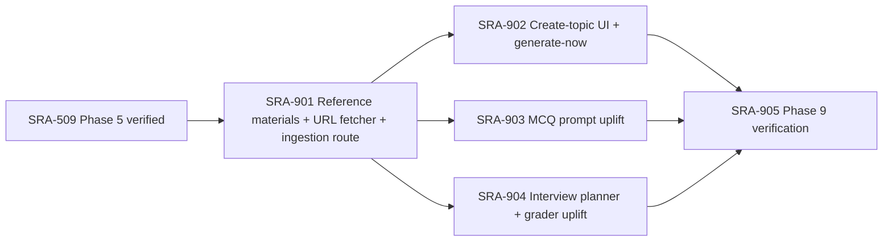

### How the Phase 9 files work together

At runtime, the dashboard's **Create topic** modal (SRA-902) collects a
topic + a list of references, hits `POST /api/v1/topics` (SRA-901), which
persists the entry + references and returns partial-success with
`quiz_set_id`/`interview_plan_id` already populated by the *uplifted*
generation pipeline (SRA-903 and SRA-904). The pipeline reads
`reference_materials` rows for the entry through
`repository.get_reference_text_bundle` and assembles a six-section
rubric prompt that includes the source excerpts, demands Bloom-distributed
questions, requires every MCQ to cite a verbatim source passage, and
(described in [`docs/plans/2026-10-16-phase9-topic-authoring-and-quality.md`](../docs/plans/2026-10-16-phase9-topic-authoring-and-quality.md))
runs a second LLM call per MCQ to verify the correct option is actually
supported by the cited passage. The interview planner writes the same
`source_passage_quote` + `ideal_answer_rubric` into each outline item, and
the per-turn grader (SRA-803 + the SRA-904 upgrade) threads those keys
into the human message so grading is anchored to the planner's expected
answer rather than invented on the fly.

```mermaid
flowchart LR
   subgraph Browser[Dashboard]
     D[dashboard.html + dashboard.js (SRA-902)]
   end
   subgraph Server[FastAPI process]
     T[api/routers/topics.py (SRA-901)]
     F[sources.fetcher (SRA-901)]
     Q[agents.quiz_graph (SRA-903)]
     I[agents.interview_planner (SRA-904)]
     G[agents.interview_conversation_graph (SRA-904)]
   end
   subgraph DB[(reference_materials, quiz_sets, interview_plans)]
     R[reference_materials]
     QS[quiz_sets]
     IP[interview_plans]
   end
   D -->|POST /api/v1/topics| T
   T --> F
   T --> R
   T --> Q
   T --> I
   Q --> QS
   I --> IP
   G -->|reads plan item, threads source_passage_quote + rubric| I
```

| Ticket / main boundary | Input → output | Responsibility added |
|---|---|---|
| [901 — schema + fetcher + ingestion route](SRA-901-reference-materials-and-ingestion-route.md) | `POST /api/v1/topics` body → persisted `StudyEntry` + `reference_materials` + per-reference fetch result | Durable references with a single synchronous URL fetch; cascade-friendly; rate-limit-aware |
| [902 — dashboard UI](SRA-902-dashboard-create-topic-ui.md) | Click → typed form → inline entry card with quiz + interview links | Vanilla-DOM modal + per-reference fetch-error UX; Regenerate hits `POST /api/v1/topics/{id}/regenerate` |
| [903 — quiz graph uplift](SRA-903-quiz-graph-quality-uplift.md) | One entry + references → persisted `QuizSet` with `bloom_level` + `source_passage_quote` + `distractor_misconception` per `QuizQuestion` | Six-section rubric; per-question verify pass (gated on `OPENAI_VERIFY_MCQS`); additive on the read side, so legacy rows keep working |
| [904 — interview uplift](SRA-904-interview-quality-uplift.md) | One entry + references → `InterviewPlan` outline items carrying `source_passage_quote` + `ideal_answer_rubric`, threaded into the per-turn grader | Source-grounded planning + rubric-anchored grading; backwards-compatible fallback to today's behavior when the plan lacks the new keys |
| [905 — verification](SRA-905-phase9-integration-verification.md) | Phase 9 components + manual live run → recorded evidence | Migration round-trip, full suite, route audit, cascade, prompt smoke, live curl-completion evidence |

### Required manual evidence for Phase 9

| Ticket | Run against real components | Observable success | Failure/recovery check |
|---|---|---|---|
| SRA-901 | `alembic upgrade head` from `e5f6a7b8c9d0` then `downgrade -1` then `upgrade head` | `reference_materials` table appears with the documented CHECK constraint; pre-Phase-9 rows survive; URL references go from `fetch_status='pending'` → `fetched` or `failed` | Restore backup; rerun the migration; confirm idempotent fetch via HTTP retries |
| SRA-902 | `curl POST /api/v1/topics` + browser modal | A new entry card appears inline with quiz + interview links; per-reference fetch errors surface inline with retry per row; cross-user isolation holds | Click **Cancel** mid-submit, confirm no rows persisted; click **Regenerate** on a card whose `QuizSet` is fresh, confirm the endpoint replaces it idempotently within a day |
| SRA-903 | A seeded topic with two real references + real OpenAI key | Every quiz question carries `bloom_level`, `source_passage_quote`, and a non-empty `distractor_misconception`; the Bloom distribution approximates the requested split; a planted unsupported MCQ is dropped | `OPENAI_VERIFY_MCQS=false` skips the second LLM call; legacy Phase 4 quiz rows still render without the new fields |
| SRA-904 | A seeded topic with two real references + real OpenAI key | Plan items carry `source_passage_quote` + `ideal_answer_rubric`; the per-turn rationale references the rubric | A planner-built plan from before Phase 9 (no new fields) still completes; the grader logs a warning but degrades gracefully |
| SRA-905 | Full suite + manual end-to-end with real `OPENAI_API_KEY` | All Phase 9 tests green; legacy Phase 1–8 regressions stay green; lint + types clean; live curl trace records a new topic → quiz → interview transcripts | The Phase 4 limitation count matches the SRA-406 baseline |

Each ticket's **Verification record** must contain actual outcomes
before it closes. A passing unit test for one model validator, an
empty grep, or a to-be-filled-in URL are not sufficient. SRA-905
re-runs the complete topic-with-references lifecycle; earlier tickets
must already have their own evidence.

---

## Running the app

```bash
cd /Users/shubhamsingh/Documents/cells/spaced-repetition-agent
source .venv/bin/activate          # venv already created; see README.md if missing
cp -i .env.example .env               # first time only, then fill in OPENAI_API_KEY
uvicorn sra.api.app:create_app --factory --reload --port 8000
```

Interactive API docs (Swagger UI) once it's running: **http://localhost:8000/docs** — the fastest way to manually try an endpoint without writing curl commands.

## Testing an individual ticket

Every ticket names its own test file. Run just that file, verbosely, while you work on it:

```bash
pytest tests/unit/test_scheduler.py -v
```

A stub that still raises `NotImplementedError` makes its tests fail (or error, for API/e2e tests whose fixtures depend on it) — that's the expected starting state once the scaffold exists. A ticket is done when its focused tests, acceptance criteria, manual checks, and Definition of Done are satisfied.

## Testing the whole app

```bash
pytest -q                 # everything: unit + e2e
pytest -q tests/e2e/      # end-to-end flows for the scaffolded phases
```

Manual smoke test once the server is running (`uvicorn ...` above), in a second terminal:

```bash
# 1. Log a study session
curl -s -X POST http://localhost:8000/api/v1/entries/ingest \
  -H "Content-Type: application/json" \
  -d '{"transcript": "Today I learned about photosynthesis: light reactions and dark reactions."}' | python3 -m json.tool

# 2. See reviews due today (the new entry's first review is due tomorrow)
curl -s http://localhost:8000/api/v1/digest | python3 -m json.tool

# 3. Search for it
curl -s "http://localhost:8000/api/v1/search?q=photosynthesis" | python3 -m json.tool

# 4. Ask the query agent about it
curl -s -X POST http://localhost:8000/api/v1/chat \
  -H "Content-Type: application/json" \
  -d '{"question": "what did I study today?"}' | python3 -m json.tool
```

Step 1 should return a created entry and step 3 should find it immediately. Step 2 shows its `1d` checkpoint once it is due, one day after studying. Once SRA-106 is implemented, step 4 should answer using that entry. `tests/e2e/test_capture_to_digest_e2e.py` advances the digest date to test the first review without waiting a day.

## Reference docs

- Implementation plan: `../docs/plans/2026-09-25-1616-feat-study-agent-scaffold-plan.md`
- HLD / LLD / database / API contract: `../docs/design/technical-design.md`
- Phase-level progress log: `../PROGRESS.md`
