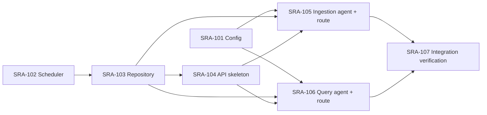
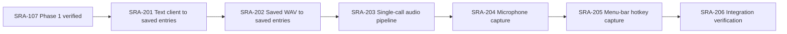
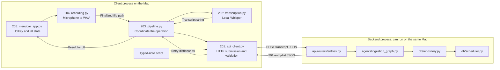
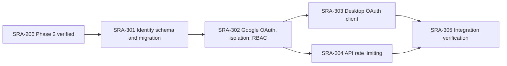
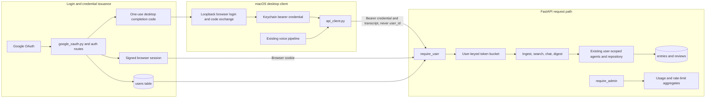

# Tickets

Work items for implementing the scaffold, one small module at a time — same idea as a JIRA board. Each `SRA-NNN-*.md` file is one ticket: what to implement, where to look, how to test that ticket in isolation, and its Definition of Done.

Numbering follows the phase: `SRA-1xx` = Phase 1, `SRA-2xx` = Phase 2, and so on. Phase 1 is implemented. Phase 2 tests and teaching stubs are prepared; the user implements the functions and verifies each complete flow. See the [TDD guide](../tests/README.md) and [`PROGRESS.md`](../PROGRESS.md) for the current state.

## Board — Phase 1 (Core loop)

Each ticket from SRA-104 onward is designed to leave you with something you can actually run and poke at, one new system at a time — not a pile of modules that only click together at the very end. See each ticket's "Where things stand" / "What this ticket unlocks" sections for the story of what becomes possible after it lands.

| Ticket | Title | Blocked by | Status |
|---|---|---|---|
| [SRA-101](SRA-101-configuration.md) | Application configuration | — | Done |
| [SRA-102](SRA-102-spaced-repetition-scheduler.md) | Spaced-repetition scheduler | — | Done |
| [SRA-103](SRA-103-data-repository-layer.md) | Data repository layer | SRA-102 | Done |
| [SRA-104](SRA-104-api-skeleton.md) | API skeleton: app factory + digest + search | SRA-103 | Done |
| [SRA-105](SRA-105-ingestion-agent-and-route.md) | Ingestion LangGraph agent + ingest route | SRA-101, SRA-103, SRA-104 | Done; live OpenAI verified |
| [SRA-106](SRA-106-query-agent-and-route.md) | Query LangGraph agent + chat route | SRA-101, SRA-103, SRA-104 | Done; live OpenAI verified |
| [SRA-107](SRA-107-phase-1-integration-verification.md) | Phase 1 integration verification | SRA-105, SRA-106 | Done — 2026-10-07 |

Suggested order, and what each step gives you to run:

1. **101 + 102** (done) — no server, but `pytest` proves config and interval math work.
2. **103** (done) — still no server; a Python script proves entries get created and scheduled correctly.
3. **104** — first running server: `uvicorn` + `curl`/Swagger against `/digest` and `/search` with seeded data. No LLM yet.
4. **105** — the ingestion agent, then wired straight into `/entries/ingest`: paste a transcript over HTTP, see it land on the digest and in search.
5. **106** — the query agent, then wired into `/chat`: ask a free-form question, get an answer grounded in your data.
6. **107** — no new code; proves 101–106 work together as one continuous flow, closing out the phase.



---

## Board — Phase 2 (Voice capture)

Every implementation ticket must finish with a complete flow a developer can run manually using completed prerequisites and that ticket's work. Each new boundary is connected to the already working app before the ticket closes. Each ticket includes concrete inputs/commands, observable output, a failure/recovery check, and a place to record the result.

Learning-target functions are typed stubs with teaching docstrings. At the user's request, all tests and stubs are prepared up front so the user writes the implementation. Implement one ticket at a time, keeping its focused checks and Phase 1 regressions green. Later tickets' stubs intentionally fail in the full suite; all default tests must pass before SRA-206 closes. Manual checks use real components, while default automated tests substitute external inference and hardware.

| Ticket | Title | Blocked by | Status |
|---|---|---|---|
| [SRA-201](SRA-201-text-capture-api-client.md) | Text capture through the HTTP client | SRA-107 (done) | Done — 2026-10-13; live API/search and recovery verified |
| [SRA-202](SRA-202-local-whisper-transcription.md) | Local Whisper transcription into saved study entries | SRA-201 | Implemented; automated checks complete |
| [SRA-203](SRA-203-recording-to-ingestion-pipeline.md) | Recording-to-ingestion pipeline | SRA-202 | Implemented; automated checks complete; live submission pending approval |
| [SRA-204](SRA-204-microphone-capture.md) | Microphone capture through the working pipeline | SRA-203 | Implemented; automated checks complete; real microphone acceptance pending |
| [SRA-205](SRA-205-menubar-hotkey-capture.md) | macOS menu-bar hotkey capture | SRA-204 | Implemented; automated checks complete; real desktop acceptance pending |
| [SRA-206](SRA-206-phase-2-integration-verification.md) | Phase 2 integration verification | SRA-205 | Automated verification complete; physical desktop acceptance pending |

Suggested order, and what each step gives you to run:

1. **201** — submit a typed note through the Python HTTP client and retrieve the created entry IDs through search. Includes the client config/dependencies needed for that flow.
2. **202** — transcribe a real saved WAV, send that transcript through the completed client, and retrieve its new entries through search.
3. **203** — use one `process_recording` call for that audio-to-entry flow, with consistent no-speech/error behavior and automated storage/scheduling/digest verification.
4. **204** — speak into the microphone and stop with Enter; verify the resulting entries and recording cleanup. The terminal entry point proves the recorder that the next ticket reuses.
5. **205** — drive that same recorder/pipeline with the global hotkey while another app has focus; verify new entries, UI feedback, and recovery.
6. **206** — repeat the whole desktop-to-digest flow, including restart and regression checks, and record phase completion.



### How the Phase 2 files work together

The diagram above is **implementation order**. At runtime, the eventual desktop flow starts at SRA-205 and calls down through the earlier components. Phase 2 adds ways to obtain and submit text; Phase 1 continues to extract study topics, save data, and schedule reviews. SRA-201 through SRA-205 are implemented. Real microphone and global-hotkey acceptance remain pending.



Arrows inside a process represent calls or returned data; the labeled HTTP arrows cross the client/server boundary. Local audio stays with the client. The backend receives transcript text and returns saved entries. The [SRA-201 sequence diagram](SRA-201-text-capture-api-client.md#follow-one-request-and-its-response) expands the request and response, including what happens before the server replies.

| Ticket / main file | Input → output | Responsibility added to the existing flow |
|---|---|---|
| [201 — `client/api_client.py`](SRA-201-text-capture-api-client.md) | Transcript string → saved entry dictionaries or `ApiClientError` | Make one HTTP submission, validate the response, and give all callers consistent errors. |
| [202 — `capture/transcription.py`](SRA-202-local-whisper-transcription.md) | Audio file path → transcript string or `TranscriptionError` | Recognize speech locally and reuse the model; preserve the input file. |
| [203 — `capture/pipeline.py`](SRA-203-recording-to-ingestion-pipeline.md) | Audio file path → entry list or propagated error | Compose transcription and submission; skip HTTP for silence. |
| [204 — `capture/recording.py`](SRA-204-microphone-capture.md) | Microphone samples → finalized temporary WAV | Own device/file lifetime; terminal entry point invokes the pipeline after stop. |
| [205 — `capture/menubar_app.py`](SRA-205-menubar-hotkey-capture.md) | Hotkey/menu event → recording, processing, and result feedback | Coordinate capture state, background processing, UI updates, and orderly quit. |
| [206 — verification](SRA-206-phase-2-integration-verification.md) | Complete flow → recorded evidence | Prove new IDs, transcripts, ownership, schedules, retrieval, cleanup, and recovery across all components. |

For example, saying "Today I studied mitosis" produces audio samples, then a WAV path, then a transcript string, then `{"transcript": "Today I studied mitosis"}` on the wire. The server turns that text into one or more database entries and six reviews per entry. Its JSON response becomes Python dictionaries again, which the caller uses to display saved IDs/topics or a count. Search, chat, and digest are separate later requests that read the stored data; saving a note does not itself fetch them.

Each ticket now includes its own runtime diagram and a **Files and why they matter** table. Read that map before implementing: it identifies the component to change, the completed components to reuse, and the tests that establish each boundary. Files called "new" in the original plan have already been scaffolded; the remaining work is to implement and verify their learning functions.

### Required manual evidence for each ticket

| Ticket | Run against real components | Observable success | Failure/recovery check |
|---|---|---|---|
| SRA-201 | Typed note → HTTP client → running server | Created IDs found through search | Unused port errors; restore URL and submit successfully |
| SRA-202 | Fixture WAV → Whisper → client → server | Recognizable transcript and new IDs found through search | Missing file prevents submission; restore input and retry |
| SRA-203 | WAV → one pipeline call → server | New IDs found through search; input file preserved | Missing input/unavailable server fail clearly; next valid call works |
| SRA-204 | Live microphone → Enter to stop → pipeline → server | Spoken note saved and found by ID; microphone/file released | Cancel/deny permission/stop server, then recover |
| SRA-205 | Hotkey from another app → microphone → pipeline → server | New IDs found; responsive recording/processing/result UI | Permission/server failure and rapid hotkeys recover without overlapping submissions |
| SRA-206 | Full capture/search/chat/digest flow plus restart | Recorded IDs, transcripts, six schedules, due-date digest results | Error paths recover and capture still works after restart |

The due-date checks use the next day's digest date in an isolated test; an immediate empty digest is expected for a new entry. Each ticket's **Verification record** must contain actual outcomes before closing it. A passing unit test, a saved-entry count alone, or an older matching search result is insufficient evidence. SRA-206 checks the complete phase again; earlier tickets must already be manually verified.

### How this maps to the existing plan

| Planned work | Ticket coverage |
|---|---|
| KTD1 / R10–R11: teaching stubs, docstrings, tests | Tests/stubs prepared; user implements each slice within SRA-201–205 |
| KTD6: client configuration and configurable hotkey/model size | SRA-201 base URL; SRA-202 model size; SRA-205 hotkey |
| U4 / R2; design §3.26: local Whisper, model cache, fixture, typed errors | SRA-202 |
| Design §3.29: thin HTTP ingestion client | SRA-201 |
| U5 refined by design §3.30: local transcription → remote ingestion | SRA-202 manual composition; SRA-203 reusable pipeline |
| U5 / R1; design §3.31: macOS recording and global hotkey | SRA-204 recorder/terminal verification; SRA-205 menu-bar/hotkey integration |
| Phase completion: voice capture → stored entries → scheduled reviews | Every ticket's manual result; SRA-203 due-date e2e test; SRA-206 final verification |

The technical design's client/server split takes precedence over U5's earlier sketch of invoking an ingestion graph on the desktop. Phase 2 sends **transcript text** to the existing `POST /api/v1/entries/ingest`; audio stays local, and the backend runs the agents. Use Phase 1's current OpenAI setup and FastAPI response shapes where the older plan still names Claude or future API contracts.

Phase 2 retains the single local user. OAuth/token storage, multi-tenancy, RBAC, and rate limiting are Phase 3; quiz generation is Phase 4; wake-up/TTS/voice quiz is Phase 5; Docker/distribution is Phase 6. The broader design's client methods for those features are not Phase 2 exercises.

### Testing Phase 2 as it is implemented

Files, tests, runtime implementations, and optional `capture` / `desktop`
dependency declarations are present. Default unit and e2e tests use fake
inference/audio devices and isolated HTTP/DB wiring. The real Whisper fixture
check is opt-in; real microphone, menu-bar permissions, and hotkey delivery are
verified on macOS. Do not interpret a platform skip as completed desktop
verification.

Current Phase 2 checks:

```bash
pytest tests/unit/test_client_config.py tests/unit/test_transcription.py tests/unit/test_api_client.py tests/unit/test_capture_pipeline.py tests/unit/test_recording.py -v
pytest tests/e2e/test_client_ingestion_e2e.py tests/e2e/test_voice_capture_to_digest_e2e.py -v
pytest tests/e2e/test_terminal_capture_e2e.py -v
SRA_RUN_WHISPER_TESTS=1 pytest tests/integration/test_transcription_whisper.py -v
pytest tests/unit/test_menubar_app.py -v
```

The automated suite is green. Record actual results for any rerun rather than
copying historical counts. Physical desktop and live-server evidence remains
required in the individual tickets and SRA-206 before Phase 2 is complete.

---

## Board — Phase 3 (Multi-tenancy, auth, RBAC, rate limiting)

Phase 3 replaces the trusted local-user placeholder with verified identity. The
database and repository already carry `user_id`; these tickets migrate the
existing user row, establish Google-backed credentials, make desktop capture
authenticate, and enforce per-principal request bounds. Every implementation
ticket must include a runnable result and failure/recovery evidence. Default
automation substitutes Google, browser, Keychain, model, and hardware boundaries
explicitly; real OAuth and macOS acceptance remain required before the phase
closes.

| Ticket | Title | Blocked by | Status |
|---|---|---|---|
| [SRA-301](SRA-301-oauth-user-schema-migration.md) | OAuth identity schema and safe legacy migration | SRA-206 | Done — 2026-10-14 |
| [SRA-302](SRA-302-google-oauth-rbac-isolation.md) | Google OAuth, authenticated isolation, and RBAC | SRA-301 | Implemented; automated checks complete, real Google verification pending |
| [SRA-303](SRA-303-desktop-oauth-authenticated-client.md) | Desktop OAuth and authenticated capture client | SRA-302 | Implemented; automated checks complete; real macOS OAuth/capture acceptance pending |
| [SRA-304](SRA-304-api-rate-limiting.md) | Per-user and per-IP API rate limiting | SRA-302 | Implemented and verified with real loopback HTTP and substituted inference — 2026-10-14 |
| [SRA-305](SRA-305-phase-3-integration-verification.md) | Phase 3 integration verification | SRA-303, SRA-304 | Automated verification complete; open for real Google/two-account/Keychain/physical desktop acceptance |

Suggested order, and what each step gives you to run:

1. **301** — upgrade a real Phase 2-shaped database without losing existing
   ownership, then create distinct OAuth-ready users and roles.
2. **302** — sign in through Google in a browser, use protected study routes as
   two isolated users, and exercise a real user/admin boundary.
3. **303 + 304** — these can proceed in parallel after SRA-302. Authenticate the
   existing desktop capture flow through loopback/Keychain, and independently
   add user/IP buckets before costly route work.
4. **305** — migrate, sign in with two real accounts, capture through the real
   desktop client, prove isolation/RBAC/rate limits, restart, and record evidence.



### How the Phase 3 files work together

The diagram above is implementation order. At runtime, Google login first maps
an external identity to an existing `users` row. Later requests present the
server-issued session or bearer credential; `require_user` resolves the trusted
numeric ID, the rate limiter selects that user's bucket, and existing routes pass
the ID into already scoped repositories and agents. The desktop never sends a
numeric user ID or server/Google secret.



| Ticket / main boundary | Input → output | Responsibility added |
|---|---|---|
| [301 — models/migration](SRA-301-oauth-user-schema-migration.md) | Phase 2 database → OAuth-ready schema with ownership preserved | Durable stable identity and role without unsafe legacy claiming. |
| [302 — server auth](SRA-302-google-oauth-rbac-isolation.md) | Google callback or app credential → trusted `User` / `401` / `403` | Verify identity, issue/resolve credentials, protect routes, and enforce user/admin separation. |
| [303 — desktop auth](SRA-303-desktop-oauth-authenticated-client.md) | Browser loopback result → Keychain credential → authenticated capture | Keep credentials local/secure and attach them to the existing one-submit HTTP flow. |
| [304 — rate limiter](SRA-304-api-rate-limiting.md) | Trusted user or anonymous IP + request → allow or `429` | Bound work per principal before model calls/mutations and expose safe admin state. |
| [305 — verification](SRA-305-phase-3-integration-verification.md) | Complete shared-server flow → recorded evidence | Prove migration, two-user privacy, desktop auth, RBAC, limiting, restart, and recovery. |

Do not add Phase 4 quiz preferences, Phase 5 wake-up preferences, or Phase 6
demo cleanup merely because the older `User` design lists their eventual fields.
Phase 3's admin endpoints provide aggregate usage and limiter inspection; demo
reset belongs to the demo/distribution phase. The rate limiter is deliberately
single-process and must not be described as distributed enforcement.

---

## Running the app

```bash
cd /Users/shubhamsingh/Documents/cells/spaced-repetition-agent
source .venv/bin/activate          # venv already created; see README.md if missing
cp .env.example .env               # first time only, then fill in OPENAI_API_KEY
uvicorn sra.api.app:create_app --factory --reload --port 8000
```

Interactive API docs (Swagger UI) once it's running: **http://localhost:8000/docs** — the fastest way to manually try an endpoint without writing curl commands.

## Testing an individual ticket

Every ticket names its own test file. Run just that file, verbosely, while you work on it:

```bash
pytest tests/unit/test_scheduler.py -v
```

A stub that still raises `NotImplementedError` makes its tests fail (or error, for API/e2e tests whose fixtures depend on it) — that's the expected starting state once the scaffold exists. A ticket is done when its focused tests, acceptance criteria, manual checks, and Definition of Done are satisfied.

## Testing the whole app

```bash
pytest -q                 # everything: unit + e2e
pytest -q tests/e2e/      # end-to-end flows for the scaffolded phases
```

Manual smoke test once the server is running (`uvicorn ...` above), in a second terminal:

```bash
# 1. Log a study session
curl -s -X POST http://localhost:8000/api/v1/entries/ingest \
  -H "Content-Type: application/json" \
  -d '{"transcript": "Today I learned about photosynthesis: light reactions and dark reactions."}' | python3 -m json.tool

# 2. See reviews due today (the new entry's first review is due tomorrow)
curl -s http://localhost:8000/api/v1/digest | python3 -m json.tool

# 3. Search for it
curl -s "http://localhost:8000/api/v1/search?q=photosynthesis" | python3 -m json.tool

# 4. Ask the query agent about it
curl -s -X POST http://localhost:8000/api/v1/chat \
  -H "Content-Type: application/json" \
  -d '{"question": "what did I study today?"}' | python3 -m json.tool
```

Step 1 should return a created entry and step 3 should find it immediately. Step 2 shows its `1d` checkpoint once it is due, one day after studying. Once SRA-106 is implemented, step 4 should answer using that entry. `tests/e2e/test_capture_to_digest_e2e.py` advances the digest date to test the first review without waiting a day.

## Reference docs

- Implementation plan: `../docs/plans/2026-09-25-1616-feat-study-agent-scaffold-plan.md`
- HLD / LLD / database / API contract: `../docs/design/technical-design.md`
- Phase-level progress log: `../PROGRESS.md`
