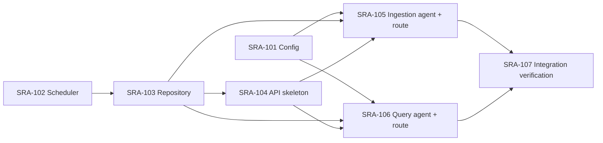

# Tickets

Work items for implementing the scaffold, one small module at a time — same idea as a JIRA board. Each `SRA-NNN-*.md` file is one ticket: what to implement, where to look, how to test that ticket in isolation, and its Definition of Done.

Numbering follows the phase: `SRA-1xx` = Phase 1, `SRA-2xx` = Phase 2, and so on. Tickets for a phase are only created once that phase's scaffold exists (see `../PROGRESS.md` for phase status) — right now that's Phase 1 only.

## Board — Phase 1 (Core loop)

Each ticket from SRA-104 onward is designed to leave you with something you can actually run and poke at, one new system at a time — not a pile of modules that only click together at the very end. See each ticket's "Where things stand" / "What this ticket unlocks" sections for the story of what becomes possible after it lands.

| Ticket | Title | Blocked by | Status |
|---|---|---|---|
| [SRA-101](SRA-101-configuration.md) | Application configuration | — | Done |
| [SRA-102](SRA-102-spaced-repetition-scheduler.md) | Spaced-repetition scheduler | — | Done |
| [SRA-103](SRA-103-data-repository-layer.md) | Data repository layer | SRA-102 | Done |
| [SRA-104](SRA-104-api-skeleton.md) | API skeleton: app factory + digest + search | SRA-103 | Done |
| [SRA-105](SRA-105-ingestion-agent-and-route.md) | Ingestion LangGraph agent + ingest route | SRA-101, SRA-103, SRA-104 | Done; live OpenAI verified |
| [SRA-106](SRA-106-query-agent-and-route.md) | Query LangGraph agent + chat route | SRA-101, SRA-103, SRA-104 | Done; live OpenAI verified |
| [SRA-107](SRA-107-phase-1-integration-verification.md) | Phase 1 integration verification | SRA-105, SRA-106 | Done — 2026-10-07 |

Suggested order, and what each step gives you to run:

1. **101 + 102** (done) — no server, but `pytest` proves config and interval math work.
2. **103** (done) — still no server; a Python script proves entries get created and scheduled correctly.
3. **104** — first running server: `uvicorn` + `curl`/Swagger against `/digest` and `/search` with seeded data. No LLM yet.
4. **105** — the ingestion agent, then wired straight into `/entries/ingest`: paste a transcript over HTTP, see it land on the digest and in search.
5. **106** — the query agent, then wired into `/chat`: ask a free-form question, get an answer grounded in your data.
6. **107** — no new code; proves 101–106 work together as one continuous flow, closing out the phase.



---

## Running the app

```bash
cd /Users/shubhamsingh/Documents/cells/spaced-repetition-agent
source .venv/bin/activate          # venv already created; see README.md if missing
cp .env.example .env               # first time only, then fill in OPENAI_API_KEY
uvicorn sra.api.app:create_app --factory --reload --port 8000
```

Interactive API docs (Swagger UI) once it's running: **http://localhost:8000/docs** — the fastest way to manually try an endpoint without writing curl commands.

## Testing an individual ticket

Every ticket names its own test file. Run just that file, verbosely, while you work on it:

```bash
pytest tests/unit/test_scheduler.py -v
```

A stub that still raises `NotImplementedError` makes its tests fail (or error, for API/e2e tests whose fixtures depend on it) — that's the expected starting state. A ticket is done when its own test file is fully green.

## Testing the whole app

```bash
pytest -q                 # everything: unit + e2e
pytest -q tests/e2e/      # just the end-to-end flows (needs SRA-101 through SRA-107 all done)
```

Manual smoke test once the server is running (`uvicorn ...` above), in a second terminal:

```bash
# 1. Log a study session
curl -s -X POST http://localhost:8000/api/v1/entries/ingest \
  -H "Content-Type: application/json" \
  -d '{"transcript": "Today I learned about photosynthesis: light reactions and dark reactions."}' | python3 -m json.tool

# 2. See reviews due today (the new entry's first review is due tomorrow)
curl -s http://localhost:8000/api/v1/digest | python3 -m json.tool

# 3. Search for it
curl -s "http://localhost:8000/api/v1/search?q=photosynthesis" | python3 -m json.tool

# 4. Ask the query agent about it
curl -s -X POST http://localhost:8000/api/v1/chat \
  -H "Content-Type: application/json" \
  -d '{"question": "what did I study today?"}' | python3 -m json.tool
```

Step 1 should return a created entry and step 3 should find it immediately. Step 2 shows its `1d` checkpoint once it is due, one day after studying. Once SRA-106 is implemented, step 4 should answer using that entry. `tests/e2e/test_capture_to_digest_e2e.py` advances the digest date to test the first review without waiting a day.

## Reference docs

- Implementation plan: `../docs/plans/2026-09-25-1616-feat-study-agent-scaffold-plan.md`
- HLD / LLD / database / API contract: `../docs/design/technical-design.md`
- Phase-level progress log: `../PROGRESS.md`
