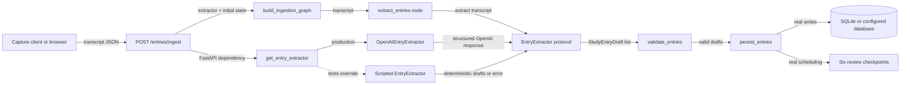

# SRA-1001 — Explicit ingestion extractor boundary

**Type:** Refactor
**Phase:** 10 — Test architecture
**Priority:** High — establishes the pattern for removing private implementation patches
**Status:** implemented; automated verification complete, opt-in live checks pending
**Blocked by:** None
**Blocks:** Applying the same boundary-first testing pattern to query, quiz, and interview agents

## Summary

Replace tests' direct patching of
`sra.agents.ingestion_graph._get_chat_model` with an explicit, typed
`EntryExtractor` boundary. Production behavior remains the same: a transcript is
sent to OpenAI as structured output, validated into `StudyEntryDraft` values,
then persisted through the real graph and repository. Tests pass a deterministic
handwritten extractor while keeping LangGraph routing, FastAPI, SQLite,
scheduling, authentication, and client behavior real.

This is the first, deliberately narrow implementation of the repository's
boundary-first test strategy. It does not attempt to remove all test doubles;
it removes coupling to a private construction helper and makes the external
inference substitution part of the public composition contract.

## Where things stand right now

`extract_entries()` constructs its own `ChatOpenAI` through the private
`_get_chat_model()` helper. Unit, integration, and end-to-end tests replace that
helper with `monkeypatch.setattr`. Those tests are offline and deterministic,
but they know how the ingestion module constructs its collaborator. Renaming the
helper or moving model construction breaks them even when application behavior
has not changed.

The rest of the ingestion path is already tested at the right level. End-to-end
tests exercise the real route, graph, repository, temporary SQLite database,
review scheduler, authentication, and HTTP client. The only behavior that needs
substitution is remote model inference.

## What this ticket unlocks

Before this ticket, an offline ingestion test reaches the external-boundary seam
by patching a private function. After this ticket, callers compose the graph with
an `EntryExtractor`; the API obtains the production extractor through a FastAPI
dependency, and tests override that dependency or pass a fake directly.

The result is a reusable pattern for the query, quiz, and interview agents:

- domain/application code depends on a small protocol;
- the OpenAI-specific prompt, structured-output binding, and response parsing
  live in a production adapter;
- unit tests use values and handwritten fakes;
- integration tests keep every in-process component real and replace only the
  process-external model provider;
- opt-in live tests continue to verify the real provider.

## How this fits into the whole app



At runtime, FastAPI supplies `OpenAIEntryExtractor`, the graph asks it for drafts,
and the existing validation and persistence nodes continue unchanged. In tests,
the dependency is overridden before the request enters the route. The fake
returns the same application-level values or raises the same kind of failure;
it does not imitate LangChain's private call chain.

The graph factory must retain a production default so existing direct production
callers such as the documented manual graph invocation continue to work. The
default is resolved at call time, not stored in a mutable global.

## Files and why they matter

| File | Action | Why |
|---|---|---|
| [`src/sra/agents/entry_extractor.py`](../src/sra/agents/entry_extractor.py) | Create | Own the `EntryExtractor` protocol, `OpenAIEntryExtractor`, prompt, structured-output binding, and the production dependency provider. |
| [`src/sra/agents/ingestion_graph.py`](../src/sra/agents/ingestion_graph.py) | Modify | Make the extraction node and graph factory consume an explicit extractor; remove `_get_chat_model`. Keep validation, routing, persistence, and errors unchanged. |
| [`src/sra/api/routers/entries.py`](../src/sra/api/routers/entries.py) | Modify | Resolve the extractor through FastAPI dependency injection and pass it into the graph factory. |
| [`tests/unit/test_ingestion_graph.py`](../tests/unit/test_ingestion_graph.py) | Modify | Pass handwritten extractors directly; assert returned state and real database state instead of patching model construction. |
| [`tests/unit/test_ingest_route.py`](../tests/unit/test_ingest_route.py) | Modify if needed | Prove route composition, `201`, and `422` behavior through the public dependency seam. |
| [`tests/e2e/conftest.py`](../tests/e2e/conftest.py) | Modify | Override the extractor dependency for the shared capture harness while preserving real HTTP, graph, repository, and scheduling behavior. |
| [`tests/e2e/test_capture_to_digest_e2e.py`](../tests/e2e/test_capture_to_digest_e2e.py) | Modify | Use the public extractor seam for capture-to-digest behavior. Query-agent substitution remains out of scope. |
| [`tests/e2e/test_authenticated_capture_e2e.py`](../tests/e2e/test_authenticated_capture_e2e.py) | Modify | Inject a counting/scripted extractor without patching ingestion internals; continue proving auth runs before inference. |
| [`tests/integration/test_audio_flow.py`](../tests/integration/test_audio_flow.py) | Modify | Supply the offline fixture extractor through application composition while leaving live OpenAI mode unchanged. |
| [`tests/README.md`](../tests/README.md) | Modify | Document the rule: explicit fakes at external ports, no private application-helper patching in new tests. |
| [`tickets/README.md`](README.md) and [`PROGRESS.md`](../PROGRESS.md) | Modify | Track this pilot and record completion evidence when the work is verified. |

## TDD starting point

The test-only step adds or rewrites contracts before production changes:

1. `extract_entries` accepts an `EntryExtractor` and returns its drafts.
2. Blank input does not call the extractor.
3. Extractor construction/invocation failures clear stale drafts and yield the
   existing safe error message.
4. `build_ingestion_graph(extractor=...)` preserves success and clarification
   routing and uses real persistence.
5. The ingest route uses an overridden `get_entry_extractor` dependency and
   preserves `201`/`422` behavior.
6. At least one end-to-end capture test proves that only inference is replaced.
7. Production adapter contract tests exercise the real LangChain
   structured-output parsing path while replacing the outbound generation call.

The tests should initially fail because the public protocol, adapter, and
injection parameters do not exist. They must not fail from collection errors or
from contacting OpenAI.

## What to implement

- Define a runtime-checkable-by-shape `EntryExtractor` protocol with
  `extract(transcript: str) -> list[StudyEntryDraft]`.
- Implement `OpenAIEntryExtractor` using the current model configuration,
  system prompt, `StudyEntryDrafts` structured schema, token limit, timeout, and
  retry behavior.
- Provide `get_entry_extractor() -> EntryExtractor` as the production FastAPI
  dependency. Avoid mutable singleton state; construction may be lightweight and
  model creation may remain lazy.
- Change `extract_entries` to consume the protocol without knowing about
  `ChatOpenAI`, settings, or LangChain structured-output methods.
- Change `build_ingestion_graph` to close over the supplied extractor while
  preserving node names and streamed update names.
- Make `ingest_transcript` receive the extractor with `Depends` and pass it to
  the graph.
- Preserve the existing user-facing error text and ensure raw provider errors,
  credentials, and prompts are never returned by the API.
- Preserve all storage, ownership, scheduling, tracing, and status-code behavior.
- Remove ingestion tests' patches of `_get_chat_model`; do not disguise the
  patch under a differently named private helper.
- Keep real OpenAI verification opt-in. The default suite must remain offline.

## Where to look

- [`tickets/SRA-105-ingestion-agent-and-route.md`](SRA-105-ingestion-agent-and-route.md)
  for the original ingestion contract and historical live evidence.
- [`src/sra/capture/voice_quiz_client.py`](../src/sra/capture/voice_quiz_client.py)
  for existing protocol and callable injection patterns.
- [`src/sra/api/deps.py`](../src/sra/api/deps.py) and
  [`tests/conftest.py`](../tests/conftest.py) for the existing FastAPI dependency
  override pattern.
- [`tests/README.md`](../tests/README.md#what-each-layer-proves) for what remains
  real at each test layer.

## Acceptance criteria

- [x] No ingestion test patches or imports `_get_chat_model`, and that helper no
      longer exists in `ingestion_graph.py`.
- [x] Core extraction tests use a typed handwritten `EntryExtractor`, not
      `Mock`, `MagicMock`, or a fake LangChain model.
- [x] The OpenAI adapter has a focused contract test for prompt delivery,
      structured parsing, malformed output, and provider failure.
- [x] The graph's success, blank-input, provider-error, and clarification paths
      retain their current observable behavior and node names.
- [x] Route and end-to-end tests use dependency injection while exercising real
      FastAPI, LangGraph, SQLite persistence, authentication, and scheduling.
- [x] Offline audio flow substitutes only extraction/query inference; live mode
      still reaches the configured OpenAI adapters.
- [x] The focused suite, full default suite, Ruff, and Pyright pass.
- [x] `tests/README.md` documents the boundary-first rule for future tests.

## How to test this ticket alone

```bash
source .venv/bin/activate
pytest tests/unit/test_ingestion_graph.py tests/unit/test_ingest_route.py -v
pytest tests/e2e/test_capture_to_digest_e2e.py tests/e2e/test_authenticated_capture_e2e.py -v
pytest tests/integration/test_audio_flow.py --collect-only -q
rg -n "ingestion_graph\._get_chat_model|patch.*_get_chat_model" tests
ruff check .
pyright
pytest -q
```

The `rg` command should find no ingestion-model private-helper patches. It may
still find query, quiz, and interview model patches, which are later work and
must not be silently expanded into this ticket.

## Manual verification

Run `make test-data` with cached Whisper weights to prove the complete local
audio path uses deterministic inference while all in-process components remain
real. Then, with an explicitly configured development OpenAI key, run
`make test-live` and verify one newly created entry by its returned ID and stored
review checkpoints. Never use production credentials in untrusted CI.

## Verification record

- Date and environment: 2026-10-24, macOS development workspace, Python 3.13
  virtual environment. The complete suite was allowed to bind ephemeral
  localhost ports for its existing desktop-auth integration cases.
- Commands and inputs: focused adapter/graph/route and capture/auth/tracing
  `pytest` runs; audio and Playwright collection; `ruff check .`; `pyright`;
  `rg -n "ingestion_graph\._get_chat_model" tests`; and full `pytest -q`.
- New IDs/artifacts and observed downstream results: deterministic ingestion
  tests created isolated SQLite entries and their six review checkpoints; no
  durable user data or external provider artifacts were created.
- Failure/recovery and cleanup: the first full run exposed one stale test that
  still called the removed helper; it was migrated to the public adapter and the
  rerun passed. Three unrelated desktop-auth tests could not bind localhost in
  the restricted sandbox and passed when rerun with loopback permission.
- Automated/manual results, skips, and limitations: **1234 passed, 35 skipped**
  in the complete suite; **51 passed** in the final focused regression set;
  Ruff and Pyright clean; no ingestion `_get_chat_model` references under
  `tests/`. `make test-data`, `make test-live`, and real provider/hardware checks
  were not run, so the historical live evidence remains the current live
  evidence.

## Definition of Done

- [x] Acceptance criteria are met and actual evidence is recorded above.
- [x] Focused and regression checks pass without weakening or skipping tests.
- [x] Default tests remain offline; live inference remains explicit and opt-in.
- [x] Ticket board, progress, and testing documentation match verified behavior.
