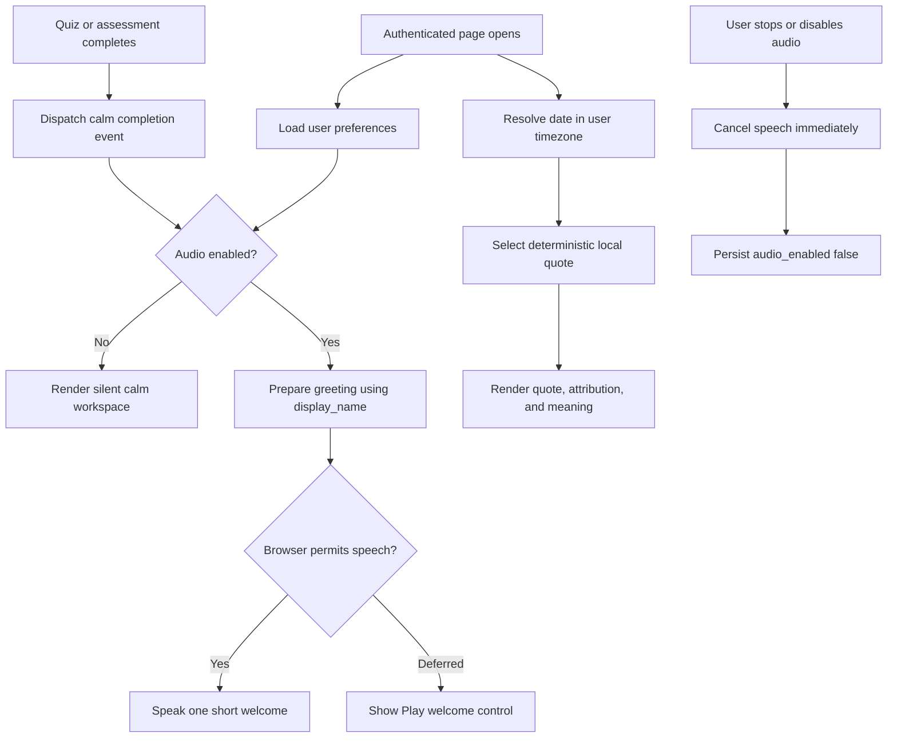

# SRA-1201 — Calm daily study experience

**Type:** Feature
**Phase:** 12 — Calm experience and motivation
**Priority:** High — makes the completed study flows feel inviting enough to revisit every day
**Status:** Implemented; automated verification complete
**Blocked by:** SRA-701, SRA-1101
**Blocks:** Future theme variants and richer voice coaching

## Summary

Turn the authenticated web application into a calm, cohesive daily knowledge
workspace inspired by Readwise's clarity and Headspace's warmth. The refreshed
experience gives the learner one obvious next action, a daily motivational quote
with a plain-language interpretation, subtle motion, and optional spoken moments
that greet the learner by name and make important study transitions feel alive.

The voice layer uses the browser's built-in speech synthesis and a persisted
`audio_enabled` preference. It does not record the microphone, call a speech API,
or add downloadable audio. A visible stop/mute control and a reduced-motion path
keep the experience calm and accessible.

## Where things stand right now

- The shared Jinja layout, navigation, dashboard, quiz, settings, and Interview Me
  pages already work, but they use a generic card system and do not present one
  strong daily action.
- Authenticated users already have a `display_name`, timezone, review time, and
  quiz/interview preferences.
- The dashboard already knows total entries, due reviews, upcoming reviews, and
  recent study entries.
- There is no daily inspiration model, no browser voice preference, no common
  voice controller, and no motion design system.
- Browser autoplay policy may defer speech until a user interacts with the page.
  The application must treat that as a normal state and expose a play control.

## What this ticket unlocks

When a signed-in learner opens the application, they see a calm Today workspace
with a primary review action, a greeting, and one quote whose meaning is explained
in the context of steady learning. If audio is enabled, the site attempts a short
spoken greeting such as "Hello Maya. Let's begin our wonderful day with today's
thought." If the browser defers it, the learner can start it with one click.

The same voice controller can speak brief, non-overlapping encouragement at a
quiz or assessment completion. The learner can stop current speech immediately
or disable all website audio in Settings. That choice persists across devices.

## How this fits into the whole app



The backend owns the persisted preference and the deterministic quote selection.
The shared browser controller owns speech queueing, cancellation, once-per-day
welcome behavior, and browser-policy fallback. Feature pages dispatch semantic
events such as `study:completed`; they do not call `speechSynthesis` directly.
This keeps wording and accessibility behavior consistent across the application.

## Files and why they matter

| File | Responsibility |
|---|---|
| `src/sra/db/models.py` | Add the persisted boolean `audio_enabled` preference with a safe default and database constraint. |
| `src/sra/alembic/versions/*_phase12_audio_preference.py` | Upgrade existing databases without losing users or their current preferences. |
| `src/sra/api/schemas.py` | Include the setting in strict preference input/output validation. |
| `src/sra/db/repository.py` | Read and partially update the new preference through the existing user-scoped boundary. |
| `web/inspiration.py` | Hold a small curated public-domain quote catalog and deterministically select one quote plus an original explanation for a local calendar date. |
| `web/routes.py` | Supply the Today page with the signed-in user's local quote and make authenticated identity available to the shared experience layer. |
| `web/templates/base.html` and `web/templates/_nav.html` | Introduce the calm application shell, accessible audio controls, and semantic page structure. |
| `web/templates/dashboard.html` | Reframe the dashboard as Today: greeting, primary review action, quote/meaning, and supporting library information. |
| `web/templates/settings.html` | Add a clearly described website-audio toggle. |
| `web/static/css/site.css` | Add design tokens, responsive sidebar/content layout, focus states, lightweight CSS transitions, and `prefers-reduced-motion` overrides. |
| `web/static/js/ambient-voice.js` | Centralize speech synthesis, cancellation, daily/session deduplication, browser-policy fallback, and study-event narration. |
| `web/static/js/settings.js` | Round-trip the audio setting with the existing preferences endpoint. |
| `web/static/js/quiz.js` and `web/static/js/interview-me.js` | Dispatch completion events without owning voice implementation. |
| `tests/unit/test_daily_inspiration.py` | Prove stable rotation, complete quote data, timezone-independent date input, and catalog safety. |
| `tests/unit/test_user_preferences.py` and `tests/unit/test_preferences_routes.py` | Prove default, persistence, partial update, strict schema, and legacy request compatibility. |
| `tests/playwright/test_user_flows.py` | Prove the real rendered Today, settings, audio controls, completion event integration, mobile fit, and reduced-motion behavior with speech synthesis stubbed. |

## TDD starting point

Tests should be written before production code. Unit tests isolate quote selection
and the preference contract. Browser tests keep FastAPI, authentication, Jinja,
static assets, settings persistence, and feature-page JavaScript real while
replacing only `window.speechSynthesis` and `SpeechSynthesisUtterance` with a
deterministic in-page fake.

The first focused run must fail on missing quote/voice behavior through assertions,
not import or collection errors. Production files remain untouched during the
test-writing step.

## What to implement

### Calm workspace and motion

- Replace the narrow top-navigation card stack on authenticated desktop pages
  with a responsive application shell and left navigation; retain a compact
  mobile header or bottom navigation without horizontal overflow.
- Make Today the primary label for `/dashboard` while preserving existing routes,
  selectors used by behavior tests, and all current functionality.
- Use warm neutral surfaces, restrained color, generous spacing, and light borders.
- Motion must use opacity/transform only, remain short (roughly 120–240 ms), avoid
  layout-shifting animations, and become effectively instant when
  `prefers-reduced-motion: reduce` is active.

### Daily inspiration

- Each catalog item contains quote text, attribution, and an original concise
  explanation connecting it to learning or steady effort.
- Use public-domain quotations or original text only; do not fetch or generate a
  quote during page load.
- Select exactly one item from the user's local calendar date. The same date always
  gives the same item, and adjacent dates rotate when the catalog has alternatives.
- Render the quote and explanation as real text, not decorative imagery.

### Voice layer

- Add `audio_enabled: bool` to preferences. Existing users receive the documented
  default and old four/six-field update bodies remain valid partial updates.
- When enabled, attempt one short welcome on the first authenticated visit of the
  user's local day. Do not repeat it on every internal page navigation.
- If the browser lacks speech synthesis or defers speech until interaction, the
  page remains fully usable and offers a silent-status/play fallback.
- Use the user's first display-name token after trimming; fall back to a neutral
  greeting when no usable name exists.
- Never overlap utterances. A new meaningful utterance cancels stale queued speech.
- Provide controls to replay the welcome and stop speech immediately. Disabling
  audio cancels speech and prevents later study events from speaking.
- Quiz and assessment completion may speak one brief encouragement. Answers,
  private note content, scores, and interview transcripts are not read aloud by
  the ambient layer.

## Acceptance criteria

- [x] `/dashboard` presents a calm Today workspace with one obvious review action while all existing entry/search/upcoming behavior still works.
- [x] One deterministic daily quote, attribution, and understandable meaning render for the user's local date without an external request.
- [x] Website audio can be enabled/disabled in Settings and persists through `GET/PUT /api/v1/me/preferences`.
- [x] Enabled audio attempts a named welcome once per local day/session, exposes replay/stop controls, and degrades safely when speech synthesis is unavailable or blocked.
- [x] Quiz and assessment completion dispatch at least one shared voice event without coupling those modules to browser speech APIs.
- [x] Motion remains compositor-friendly, introduces no mobile overflow, and respects `prefers-reduced-motion`.
- [x] Existing authenticated flows, keyboard navigation, visible focus, and status announcements remain usable.

## How to test this ticket alone

```bash
pytest tests/unit/test_daily_inspiration.py tests/unit/test_user_preferences.py tests/unit/test_preferences_routes.py -q
SRA_RUN_PLAYWRIGHT_TESTS=1 pytest tests/playwright/test_user_flows.py -q
node --check web/static/js/ambient-voice.js
node --check web/static/js/settings.js
node --check web/static/js/quiz.js
node --check web/static/js/interview-me.js
ruff check .
pyright
pytest -q
```

The browser suite substitutes speech output only. It does not prove the sound,
voice quality, autoplay behavior, or voice availability of a user's actual browser.

## Manual verification

Open the site in current Chrome and Safari with a real signed-in account. Verify
the Today layout at desktop and phone widths, listen to the welcome, navigate
between pages without hearing it repeatedly, replay and stop it, finish one quiz,
then disable website audio and confirm that reloads and later completion events
remain silent. Repeat with reduced motion enabled at the OS/browser level and
with speech synthesis unavailable in developer tools.

## Verification record

- Date and environment: 2026-10-24, macOS arm64, Python 3.13, headless Chromium.
- Commands and inputs: focused SRA-1201 unit tests; JavaScript syntax checks; migration/init tests; full Playwright user-flow suite; Ruff; Pyright; full default pytest suite.
- New IDs/artifacts and observed downstream results: Alembic revision `2b3c4d5e6f70`; `audio_enabled` round-tripped true/false without changing legacy preferences; Today rendered the local quote/meaning and named Playwright greeting; quiz completion emitted one `study:completed` event.
- Failure/recovery and cleanup: unavailable speech left the primary review action usable and reported a silent fallback; disabling audio cancelled queued speech. Initial loopback and Chromium launches were sandbox-blocked and passed when rerun with the required local-process permission.
- Automated/manual results, skips, and limitations: focused preferences/inspiration **99 passed**; migration/init **70 passed**; Chromium **29 passed**; full suite **1254 passed, 42 skipped**; Ruff/Pyright clean. Speech synthesis was stubbed, so real voice sound, installed voice selection, and autoplay behavior remain manual.

## Definition of Done

- [x] Acceptance criteria met and actual evidence recorded
- [x] Focused, full, browser, lint, and type checks completed
- [ ] Real-browser audio and reduced-motion checks recorded without presenting substituted speech as physical evidence
- [x] Ticket board, progress notes, and user-facing documentation match the verified behavior
