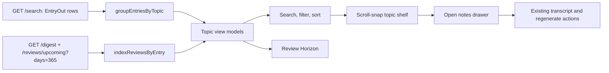

# SRA-1202 — Calm topic shelf and review horizon

**Type:** Feature
**Phase:** 12 — Calm experience and motivation
**Priority:** High — removes duplicate-looking content from the primary knowledge view
**Status:** Implemented; automated verification complete
**Blocked by:** SRA-1201, SRA-701
**Blocks:** Canonical topic merge/split and topic-level mastery

## Summary

Replace the dashboard's long entry list and repetitive date-bucket review list
with a calm, topic-centered shelf. Exact normalized topic names form one card,
each card keeps its individual captured notes accessible, and the learner sees
the topic's next review plus its unique upcoming review dates without scanning a
second list of repeated titles.

The shelf uses native horizontal scrolling and CSS scroll snap. It has explicit
previous/next controls, a position announcement, keyboard-accessible cards, and
no autoplay or carousel dependency. Search, filter chips, and sorting operate on
topic groups rather than hiding the relationship between repeated captures.

## Where things stand right now

- `/api/v1/search` returns one `EntryOut` per capture, newest first.
- `/api/v1/digest` returns due review rows and `/api/v1/reviews/upcoming` returns
  future rows grouped by date. Both include the related entry ID and topic.
- The dashboard renders each entry and review row literally. Two captures named
  "journey of request to backend" therefore appear as two Library cards and as
  two rows on each shared review date.
- Search is already debounced, but its control is squeezed beside action buttons.
- There is no canonical Topic table. Similar names must not be merged by guesswork.

## What this ticket unlocks

A learner sees one card for "Journey of request to backend" with a `2 notes`
badge, the latest summary, the next review, and a compact date rail. Opening the
card reveals both original captures with their timestamps, transcripts, and
regenerate actions. Search and filters keep the topic together. The Review
Horizon summarizes when topics return without listing the same topic repeatedly.

## How this fits into the whole app



Normalization is deliberately conservative: trim the name, collapse repeated
whitespace, and compare case-insensitively. Similar but non-identical topics such
as "RAG retrieval and storage" and "Retrieval and Storage" stay separate. A later
backend ticket can introduce explicit merge/split relationships safely.

## Files and why they matter

| File | Responsibility |
|---|---|
| `web/static/js/library-model.js` | Pure transformation helpers for conservative topic grouping, schedule deduplication, filtering, sorting, and horizon buckets. |
| `web/static/js/dashboard.js` | Load the existing entry/review APIs, build topic view models, render and control the shelf, drawers, toolbar, and horizon, while preserving create/regenerate behavior. |
| `web/templates/dashboard.html` | Give search its own toolbar row and provide semantic filter, sort, shelf-control, and Review Horizon containers. |
| `web/static/css/site.css` | Add calm topic cards, scroll snap, the next-card peek, toolbar chips, note disclosure, date rail, responsive behavior, and reduced-motion-safe transitions. |
| `tests/unit/test_library_model.py` | Execute the pure browser model through Node to pin exact grouping, non-merging, schedule counts, filters, and stable sorting. |
| `tests/playwright/test_user_flows.py` | Exercise real API responses and browser DOM for duplicate grouping, search/filter/sort, shelf controls, note disclosure, date chips, horizon interaction, keyboard use, and mobile overflow. |
| `tests/integration/test_web_pages.py` | Keep the server-rendered dashboard shell and accessibility landmarks stable. |

## TDD starting point

The test subagent adds failing unit and real-browser contracts before production
code changes. Unit tests run the pure data model under Node so topic grouping is
not validated only through CSS selectors. Browser tests keep FastAPI, auth,
repositories, SQLite, templates, and dashboard JavaScript real and substitute no
application boundary.

## What to implement

### Topic grouping

- Group entries by `topic.trim().replace(/\s+/g, " ").toLocaleLowerCase()`.
- Preserve every original entry ID and order captures newest first.
- Use the newest non-empty summary and union tags without duplicating labels.
- Display one topic card with an accessible note count.
- Never fuzzy-merge different normalized names.

### Schedule model

- Join due/upcoming review rows to groups by `review.entry.id`, not by title.
- Deduplicate a group's visible calendar dates while retaining the number of
  notes/checkpoints due on each date.
- Show the next actionable date and up to four date chips, with an accessible
  way to reveal remaining dates.
- Horizon buckets are non-overlapping: Ready now, Next 7 days, Next 30 days,
  and Later. Counts represent unique topic groups, not raw review rows.

### Shelf and controls

- Render a horizontally scrollable, scroll-snapping shelf with no dependency,
  timer, autoplay, or infinite wrapping.
- Provide previous/next buttons that disable at the ends and a polite position
  announcement such as `2 of 6`.
- On desktop show approximately two cards; on phone show one card with a small
  next-card peek. The page must not gain horizontal document overflow.
- Search topic, subtopic, summary, and tags locally over the complete entry set.
- Filter chips: All, Ready now, Next 7 days, No upcoming review.
- Sort options: Next review, Recently captured, A–Z.
- Empty search/filter results explain how to clear the view.

### Notes and actions

- An `Open N notes` disclosure lists each capture's timestamp and summary and
  retains transcript and regenerate access.
- Create Topic and Interview Me remain visible, but the toolbar gives search the
  full available row.
- Preserve existing DOM hooks required by the topic creation/regeneration code or
  update their regression tests with equivalent observable behavior.

## Acceptance criteria

- [x] Exact repeated topics render as one card with the correct note count, while similar non-identical topics stay separate.
- [x] Each card shows next review and unique review dates/counts joined by entry ID.
- [x] Search, filter chips, and sort update topic cards without additional search requests or breaking note grouping.
- [x] Previous/next controls, keyboard scrolling, position status, note disclosure, and empty states are accessible.
- [x] Review Horizon reports unique topics in non-overlapping ranges and can filter/highlight the shelf.
- [x] The shelf is responsive, has no document-level horizontal overflow, uses native scroll snap, and respects reduced motion.
- [x] Create, regenerate, transcript, dashboard statistics, and existing review behavior remain functional.

## How to test this ticket alone

```bash
pytest tests/unit/test_library_model.py tests/unit/test_dashboard_phase9_js.py tests/integration/test_web_pages.py -q
SRA_RUN_PLAYWRIGHT_TESTS=1 pytest tests/playwright/test_user_flows.py -q
node --check web/static/js/library-model.js
node --check web/static/js/dashboard.js
ruff check .
pyright
pytest -q
```

## Manual verification

Seed two exact topic names with different captures plus two similar but distinct
topic names. Verify one grouped card for the exact pair, individual note access,
correct date/count chips, search/filter/sort behavior, arrow and keyboard movement,
and horizon filtering. Repeat at 375 px and a desktop viewport with reduced motion.

## Verification record

- Date and environment: 2026-10-24, macOS arm64, Python 3.13, Node, headless Chromium.
- Commands and inputs: pure library-model unit suite, dashboard integration/source contracts, Node syntax, full Playwright user flows at desktop and 375 px, Ruff, Pyright, and full pytest.
- New IDs/artifacts and observed downstream results: five seeded captures became four cards; the exact Journey pair rendered as one `2 notes` card with two underlying transcripts and two date chips, while the two similar retrieval titles stayed separate. Search remained local, horizon selection filtered the shelf, and create/regenerate actions remained usable.
- Failure/recovery and cleanup: empty filters produced a clear empty state; shelf controls disabled at their ends; test databases and browsers were fixture-owned and cleaned up after each run.
- Automated/manual results, skips, and limitations: model **8 passed**; focused regression **30 passed**; Chromium **33 passed**; full suite **1262 passed, 46 skipped**; Ruff/Pyright/Node/diff checks clean. Exact normalization is intentionally conservative; semantic merge/split remains future backend work.

## Definition of Done

- [x] Acceptance criteria met and evidence recorded
- [x] Focused, browser, full, lint, type, and JavaScript checks complete
- [x] Existing create/regenerate and dashboard flows remain green
- [x] Ticket board and progress documentation match verified behavior
