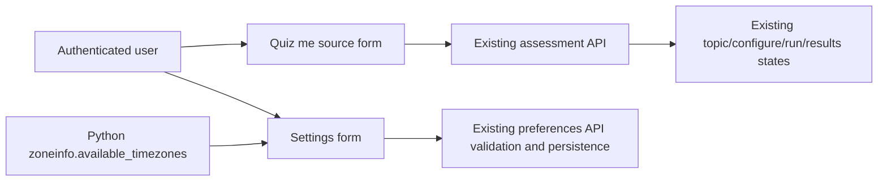

# SRA-1204 — Polished assessment and timezone selection UI

**Type:** Task
**Phase:** 12 — Calm experience and motivation
**Priority:** High — the two current forms are visually unfinished and timezone entry is error-prone
**Status:** Implemented and verified
**Blocked by:** SRA-1101, SRA-1201
**Blocks:** None

## Summary

Turn `/interview-me` into a calm, clearly structured “Quiz me” workspace without
changing its assessment API, and replace the Settings page's free-form timezone
input with a selectable list of the IANA zones supported by the running Python
environment.

## Where things stand right now

The assessment workflow is complete, but its source form, history, and later
wizard states rely on browser-default controls and a shallow single-column
layout. Settings accepts any text and waits for the API to reject unknown zones,
even though `zoneinfo` already knows the available choices.

## What this ticket unlocks

A user can quickly understand how to start an assessment, see accepted source
types, and scan prior sessions in a responsive layout. In Settings, the same
user chooses a valid timezone instead of having to remember an exact IANA name.

## How this fits into the whole app



The browser assessment controller keeps its existing endpoints and state
machine; this ticket changes presentation and accessible labels only. The web
route obtains zone names from Python's installed timezone database, passes them
to Jinja, and the unchanged settings JavaScript submits the selected string to
the existing preferences endpoint.

## Files and why they matter

| File | Action and responsibility |
|---|---|
| [`web/templates/interview_me.html`](../web/templates/interview_me.html) | Present the renamed page header and supporting orientation content. |
| [`web/static/js/interview-me.js`](../web/static/js/interview-me.js) | Render accessible source fields and scannable history/wizard content without changing API calls. |
| [`web/static/css/site.css`](../web/static/css/site.css) | Supply the responsive assessment workspace and matching settings-control styling. |
| [`web/routes.py`](../web/routes.py) | Pass deterministic supported IANA timezone names to the Settings template. |
| [`web/templates/settings.html`](../web/templates/settings.html) | Render timezone as a required select whose current value remains selected. |
| [`tests/unit/test_assessment_contracts.py`](../tests/unit/test_assessment_contracts.py) | Pin the page label and source-form accessibility contract. |
| [`tests/integration/test_web_pages.py`](../tests/integration/test_web_pages.py) | Prove rendered Settings options include and select valid IANA zones. |
| [`tests/playwright/test_user_flows.py`](../tests/playwright/test_user_flows.py) | Exercise timezone selection/save and the real rendered assessment layout. |

## TDD starting point

Add unit/integration and browser coverage first. The new assertions should fail
on the current “Interview Me” header and text timezone input, not on imports or
external services. Browser tests keep FastAPI, templates, JavaScript, and SQLite
real while model calls remain substituted by the existing harness.

## Acceptance criteria

- [x] `/interview-me` presents a polished, responsive “Quiz me” workspace with clear source guidance, labelled controls, a full-width primary action, and visually distinct assessment history.
- [x] Existing analyze, topic selection, configuration, MCQ, interview, result, resume, and history behavior is unchanged.
- [x] `/settings` renders a required timezone select containing `UTC`, `Asia/Kolkata`, `America/New_York`, and the user's currently saved valid zone.
- [x] Saving the select persists through the existing preferences API and keeps inline error handling intact.
- [x] Keyboard focus, labels, reduced-motion behavior, and narrow-screen layout remain usable.

## How to test this ticket alone

```bash
pytest tests/unit/test_assessment_contracts.py tests/integration/test_web_pages.py -q
SRA_RUN_PLAYWRIGHT_TESTS=1 pytest tests/playwright/test_user_flows.py -q
node --check web/static/js/interview-me.js
node --check web/static/js/settings.js
ruff check .
pyright
pytest -q
```

## Manual verification

At desktop and 375px widths, open `/interview-me`, inspect the source card and
history, and move through each wizard state using pasted notes. Open `/settings`,
choose `Asia/Kolkata`, save, reload, and confirm it remains selected.

## Verification record

- Date and environment: 2026-10-24, macOS arm64, Python 3.13, headless Chromium.
- Commands and inputs: focused unit/integration tests; JavaScript syntax checks; full Ruff and Pyright; full default pytest; complete Playwright suite; browser timezone save/reload with `Asia/Kolkata`.
- New IDs/artifacts and observed downstream results: no database IDs; rendered Settings selected the saved zone after reload, and all 34 browser flows passed.
- Failure/recovery and cleanup: the sandbox blocked Chromium Mach ports and three loopback-socket tests. Chromium and the three focused socket cases passed when rerun with the required sandbox permission; no persisted test data remained.
- Automated/manual results, skips, and limitations: focused `25 passed`; Playwright `34 passed`; full suite `1271 passed, 48 skipped, 3 sandbox-only failures`, with those three rerun as `3 passed`; Ruff and Pyright clean; both JavaScript syntax checks passed. No human visual/sound acceptance was performed.

## Definition of Done

- [x] Acceptance criteria met and actual evidence recorded
- [x] Focused, browser, full, lint, type, and JavaScript checks complete
- [x] Ticket board and progress documentation match verified behavior
