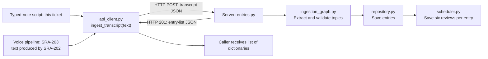
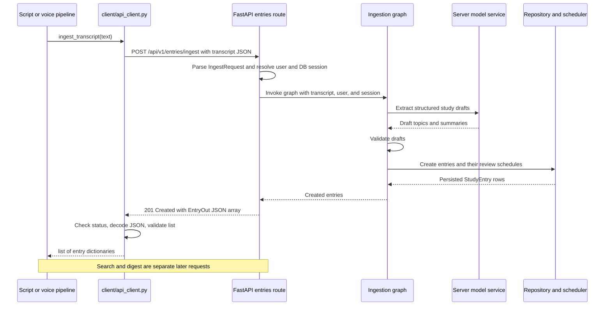

# SRA-201 — Text capture through the HTTP client

**Type:** Task
**Phase:** 2 — Voice capture
**Priority:** High — first working desktop-to-server slice
**Status:** Done — 2026-10-13; automated and live client/API/search verification passed
**Blocked by:** SRA-107 (done)
**Blocks:** SRA-202

## TDD starting point

This ticket began with supplied tests, typed stubs, and teaching docstrings. Its implementations and verification are now complete. See the [test-first guide](../tests/README.md) for the unit/e2e boundary and implementation order. Keep Phase 1 regressions green with `pytest -m 'not phase2' -q`. Later exercises remain visibly red until implemented; the complete default suite must be green for SRA-206.

## Summary

Build the client configuration and ingestion HTTP wrapper together. The finished ticket lets a developer submit a study note from Python, receive created entries from the existing Phase 1 server, and retrieve those exact entries through search.

## Where things stand right now

Phase 1 ingests text, stores entries, and schedules reviews. The `client/` package now submits text through HTTP with strict response validation, typed errors, a finite timeout, and no automatic retries. The server's `Settings` still requires `OPENAI_API_KEY`; the client has independent configuration and needs no server credentials.

All 77 focused configuration/client/e2e tests pass. The real client → running API → OpenAI → storage → search flow and unused-port recovery are verified below. The `capture` extra installs HTTPX; SRA-202 will add Whisper. Its clean-environment lock snapshot matches the existing pins exactly, including `httpx==0.28.1`, so no dependency version changes were needed.

## What this ticket unlocks

**Typed study note → Python client → running API → stored entries → search by returned ID.** Configuration and packaging are part of delivering this working flow. This ticket cannot close with only settings or stub tests working.

## How this fits into the whole app

`api_client.py` is the Python caller's interface to the running backend. A caller gives it a string and gets saved entry dictionaries back. The module handles the HTTP details in between: the server address, request JSON, timeout, response status, JSON decoding, validation, and errors. Keeping these decisions together lets the typed-note script and the later voice pipeline use the same submission behavior.

There are two different functions named `ingest_transcript`: the one in [`client/api_client.py`](../src/sra/client/api_client.py) **sends** a request; the one in [`api/routers/entries.py`](../src/sra/api/routers/entries.py) **handles** the request on the server. HTTP connects them. The client does not call the server function by importing it. Even when both processes run on your Mac, they communicate through a URL and JSON.



The Phase 1 server already owns extraction, database writes, and scheduling. SRA-201 gives Phase 2 a reusable way to reach it. SRA-202 will supply text from a recording; SRA-203 will compose transcription and submission; SRA-204/205 will let microphone and hotkey callers start that flow. See the [Phase 2 map](README.md#how-the-phase-2-files-work-together) for the complete chain.

### Follow one request and its response

For example, a script calls:

```python
entries = ingest_transcript("Today I studied mitosis.")
```

1. `get_client_settings()` supplies the server base URL, normally `http://127.0.0.1:8000`. The client removes a trailing slash and appends `/api/v1/entries/ingest`. On the server, this path comes from `/api/v1` in `api/app.py`, `/entries` in the entries router, and `/ingest` on its handler.
2. `_create_http_client()` creates a synchronous HTTPX client. `client.post(url, json={"transcript": transcript})` serializes the Python dictionary into JSON and sends the request. The caller waits while this operation runs; importing the module alone sends nothing.
3. FastAPI parses the body with `IngestRequest` and supplies a database session and the current local user. The handler invokes the ingestion graph, which asks the configured model for structured topics and validates the drafts.
4. For each valid draft, the graph calls `repository.create_entry()`. The repository saves the original transcript with the entry and calls the scheduler to persist six pending reviews. The route maps the resulting rows to `EntryOut` objects.
5. FastAPI serializes those objects into JSON with status `201 Created`. This is the response to the original POST; it is not another request or a later callback.
6. HTTPX returns a response and the `with` block closes the HTTP client. The wrapper checks for `201`, decodes the JSON, validates the entry list, and returns the original dictionaries. The caller can now display `entry["id"]` and `entry["topic"]`.



This diagram shows the successful path. The original transcript and schedules are stored, but the response exposes only the entry fields below. The wrapper does not automatically search or fetch the digest; the manual verification script makes separate GET requests to prove that the returned IDs are retrievable. New entries are searchable immediately; their first review is due the following day.

### Why is `HTTP_TIMEOUT_SECONDS = 90.0` hardcoded?

It is a **named timeout policy**, in seconds, used by `httpx.Client(timeout=HTTP_TIMEOUT_SECONDS, ...)`. Without an explicit setting, HTTPX's default is five seconds of network inactivity, which may be too short while this route waits for model inference. [`_get_chat_model()`](../src/sra/agents/ingestion_graph.py) currently sets `timeout=30` and `max_retries=1`: an initial model attempt plus at most one retry. The 90-second setting leaves headroom around those waits for retry overhead and database work.

That explains the choice, but **90 is a design estimate, not a value calculated from the backend or a guarantee that every request will finish**. The client and server settings can drift if the backend changes. HTTPX applies the scalar to connect/read/write/pool timeouts; a read timeout limits the wait for a response chunk. It is not a 90-second stopwatch around the whole function. See [HTTPX's timeout documentation](https://www.python-httpx.org/advanced/timeouts/).

Keeping one named constant is reasonable for the current local setup. If deployments need different latency limits, a follow-up could add a positive `api_timeout_seconds` field to `ClientSettings`, expose `API_TIMEOUT_SECONDS` in `.env.example`, and test default/override/invalid values. That setting does **not** exist today. The client would read it without importing backend model configuration. The uppercase name signals a constant by convention; Python does not make it immutable.

The model retry and HTTP retry are different layers: the backend may retry a model call within one request, while the client sends the ingestion POST once. A client timeout does not undo a database save. If the server saved the note but its reply was lost, automatically repeating the POST could create duplicates. `ApiClientError` therefore tells the caller to check search before submitting again.

### Does `_EntryResponse` mean a private class?

**Private by convention, not by access control.** The leading underscore says this is an implementation detail of `api_client.py`; callers should use `ingest_transcript` and `ApiClientError`. Python still permits an explicit import of `_EntryResponse`. Its name signals that callers should not depend on it as a stable public interface. This is the [PEP 8 convention for internal names](https://peps.python.org/pep-0008/#descriptive-naming-styles).

The class inherits from Pydantic's `BaseModel` and describes **one entry as received over HTTP**. `_ENTRY_LIST = TypeAdapter(list[_EntryResponse])` applies that description to the whole response array. Calling `response.json()` only parses JSON; even `{"message": "hello"}` is valid JSON but would be the wrong response for this function. The validator checks that the parsed value is a list and that each item contains the required fields with the expected types.

| Field | JSON / returned Python value | Why the caller needs it |
|---|---|---|
| `id` | Integer | Identify the saved row and verify it in search |
| `topic` | String | Display what was studied |
| `subtopic` | String or `null` / `None` | Optional detail; the field is still required |
| `tags` | Array / list of strings | Labels chosen during extraction |
| `summary` | String | Display the extracted study summary |
| `created_at` | ISO datetime string | Creation time serialized by the server |

The server's `EntryOut` has a Python `datetime`; JSON carries that as a string. The client validates that string with `validate_iso_datetime`. Strict validation rejects an ID such as `"42"` or `true` instead of coercing it into an integer. After validation the function returns the **original dictionaries**, preserving timestamp strings and any additional server fields; callers do not receive `_EntryResponse` instances.

Keeping this small contract in the client makes its dependency boundary explicit. It avoids importing server schemas and allows validation rules that match the JSON representation. The tradeoff is that server response changes must be checked against this contract; the real client-to-API e2e test detects mismatches. This is separate from `StudyEntry` in `db/models.py`, which represents a database row and also contains ownership and raw-transcript data.

### Where failures go

| Failure | What `api_client.py` does | Meaning for the caller |
|---|---|---|
| Connection or request failure | Raises `ApiClientError`, chaining the HTTPX exception | Report the error; interrupted requests can have an uncertain save outcome |
| Timeout | Raises `ApiClientError` with the unknown-outcome explanation | The note may already be stored; check search before another submission |
| Status other than `201`, including redirects | Raises `ApiClientError` with `status_code` and available FastAPI `detail` | Surface the server response; do not follow the redirect or retry |
| `201` with invalid JSON or malformed entries | Raises `ApiClientError` with status `201` | The response cannot be used safely; this does not prove that nothing was saved |
| Valid `201` entry list | Returns the original list, including an allowed empty list | The caller decides how to display the result |

## Files and why they matter

These files already exist and this ticket is implemented. The table describes their roles in the completed slice.

| File | Role in the bigger picture |
|---|---|
| [`src/sra/client/api_client.py`](../src/sra/client/api_client.py) | The text-to-HTTP boundary shared by typed and voice callers; owns submission, validation, and `ApiClientError`. |
| [`src/sra/client/__init__.py`](../src/sra/client/__init__.py) | Package marker for the client code; importing it does not start a server or send a request. |
| [`src/sra/config.py`](../src/sra/config.py) | `ClientSettings` and its separate cache supply client options without constructing server `Settings` or requiring its secrets. |
| [`.env.example`](../.env.example) | Shows the operator how to set `API_BASE_URL`; changing the server address should not require editing the HTTP wrapper. |
| [`pyproject.toml`](../pyproject.toml), [`requirements-lock.txt`](../requirements-lock.txt) | Declare the optional client dependencies and record the tested dependency versions so another environment can run the same flow. |
| [`tests/unit/test_client_config.py`](../tests/unit/test_client_config.py) | Proves URL validation, overrides, caching, and independence from server credentials. |
| [`tests/unit/test_api_client.py`](../tests/unit/test_api_client.py) | Proves request/response and failure behavior with controlled HTTP responses. |
| [`tests/e2e/test_client_ingestion_e2e.py`](../tests/e2e/test_client_ingestion_e2e.py) | Exercises this wrapper through the real route, graph, storage, scheduling, and search; also simulates a response lost after saving. |
| [`README.md`](../README.md), [`CONTRIBUTING.md`](../CONTRIBUTING.md) | Give users and contributors the installation and launch steps needed to reach a running backend. |

The server files in the diagrams are existing Phase 1 collaborators to read. This ticket adds the client boundary; it does not move the graph, database, or scheduler onto the desktop.

## What to implement

- Implement the supplied learning-target stubs against their tests; the teaching docstrings explain the contracts.
- Add `ClientSettings` and cached `get_client_settings()` in `config.py`. Read `API_BASE_URL` (default `http://127.0.0.1:8000`, without `/api/v1`) from environment variables / `.env`; validate a usable HTTP(S) server URL. Load without OpenAI, LangSmith, database, or OAuth credentials. Keep the server's required-key contract and cache independent.
- Add an optional `capture` dependency group containing the HTTP runtime library. Later audio tickets extend this group. Keep the base server installation independent of desktop dependencies, update the lock snapshot, and document installation and the server URL.
- `ingest_transcript(transcript: str) -> list[dict[str, Any]]` — POST `{"transcript": transcript}` to `/api/v1/entries/ingest`, normalizing a trailing slash on the base URL, and return the entry objects from a valid `201` response. Use a finite, documented timeout that allows for the server's model-call budget and close HTTP resources reliably.
- `ApiClientError` — expose connection failures, timeouts, non-201 responses, invalid JSON, and malformed entry-list responses with useful details. Preserve the HTTP status and FastAPI's `detail` when present. A timeout after submission can mean the server already saved the note; explain that uncertainty.
- Attempt one POST per call, with no automatic retry. The server resolves the local user; send no caller-supplied user ID, audio, OAuth token, or LLM key. Do not import agents, repositories, or server settings into the client.
- Add an e2e test through the actual client wrapper and FastAPI route using in-process HTTP transport, an isolated DB, and fake model inference. Confirm returned IDs, persisted transcript/ownership, six pending reviews per entry, and search visibility. Do not replace the ingestion wrapper or route with a fake in this test.

## Where to look

- `src/sra/api/routers/entries.py` and `src/sra/api/schemas.py` for the actual Phase 1 contract.
- `src/sra/config.py`, `tests/unit/test_config.py`, and `tests/conftest.py` for configuration and test wiring.
- Technical design §1.2 and §3.29 for the thin-client boundary. Use current OpenAI-backed Phase 1 behavior; auth remains Phase 3.

## Acceptance criteria

- [x] Client configuration works without server credentials and honors environment overrides; server configuration still requires its OpenAI key
- [x] The client sends the correct JSON/path for base URLs with and without a trailing slash, returning entries from a valid `201`
- [x] Connection, timeout, HTTP, and response-shape failures raise useful `ApiClientError`s without retrying or claiming an uncertain save definitely failed
- [x] The e2e test verifies real client/API/storage/scheduling/search wiring with only transport location and model inference substituted
- [x] The manual flow below creates entries against a running server and finds their exact returned IDs in search
- [x] Pointing at an unused port produces a clear error; restoring the URL permits a successful new submission

## How to test this ticket alone

```bash
source .venv/bin/activate
pytest tests/unit/test_client_config.py tests/unit/test_api_client.py -v
pytest tests/e2e/test_client_ingestion_e2e.py -v
```

Expected: all tests pass without a live server or model. These test files are already supplied. Finish with this ticket's tests, `pytest -m 'not phase2' -q`, `ruff check .`, and `pyright`; inspect the full suite for failures outside later unimplemented exercises.

## Manual verification

Install the client extra and start the Phase 1 server with its configured OpenAI key:

```bash
pip install -e ".[dev,capture]"
uvicorn sra.api.app:create_app --factory --reload --port 8000
```

In a second terminal, run the actual client and verify each returned ID through search:

```bash
API_BASE_URL=http://127.0.0.1:8000 python3 - <<'PY'
import httpx
from sra.client.api_client import ingest_transcript
from sra.config import get_client_settings

entries = ingest_transcript("Today I studied mitosis and the phases of cell division.")
assert entries, "No entries created"
base = str(get_client_settings().api_base_url).rstrip("/")
with httpx.Client(timeout=30) as client:
    for entry in entries:
        response = client.get(f"{base}/api/v1/search", params={"q": entry["topic"]})
        response.raise_for_status()
        assert entry["id"] in {row["id"] for row in response.json()}
        print("Saved and found:", entry["id"], entry["topic"], entry["summary"])
PY
```

Each entry must print `Saved and found` with its new ID. An older note with the same topic is not sufficient evidence. This uses the server's real model; the client itself needs no model key. Repeat with an unused port, confirm an error instead of success, then restore the URL and confirm recovery. Do not resubmit automatically after an ambiguous timeout; check search first.

When changing `API_BASE_URL` within the same Python process, call
`get_client_settings.cache_clear()` before the next submission. The HTTP client
uses a 90-second timeout per operation to accommodate the server's two 30-second
model attempts. Redirects are errors; they never trigger another POST.

## Verification record

- **2026-10-13, 20:15 IST**, server `http://127.0.0.1:8765`, real configured
  `gpt-4.1-nano` inference. Started with
  `DATABASE_URL=sqlite:////tmp/sra-201-verification/live.db LANGSMITH_TRACING=false LANGCHAIN_TRACING_V2=false .venv/bin/python -m uvicorn sra.api.app:create_app --factory --host 127.0.0.1 --port 8765`.
  The isolated database leaves the developer's normal study database untouched.
  Ran `.venv/bin/python /tmp/sra-201-verification/verify_live.py`, which executes
  the submission/search flow above, then the unused-port/recovery steps below.
  The client ran outside the repository's `.env` directory with all server
  credential variables removed. The temporary server was stopped afterward.
- First submitted `Today I studied mitosis and the phases of cell division.`:
  returned **ID 1**, topic **mitosis**; search returned **[1]**.
- Changed the URL to unused port **53425** and cleared the settings cache:
  `ApiClientError: Could not connect to http://127.0.0.1:53425/api/v1/entries/ingest: [Errno 61] Connection refused`.
  There was no success result and no retry.
- Restored `http://127.0.0.1:8765/`, cleared the cache, and submitted
  `Today I studied photosynthesis and how chlorophyll absorbs sunlight.`:
  returned **ID 2**, topic **Photosynthesis**; search returned **[2]**.
  Both rows retain their exact original transcripts, belong to
  **local@localhost**, and have **six pending reviews** each. Captured results
  are in `/tmp/sra-201-verification/result.json`.
- Clean install: created `/tmp/sra-201-venv`, installed
  `-r requirements-lock.txt`, then `-e '.[dev,capture]' -c requirements-lock.txt`.
  `pip check` passed; `pip freeze --exclude-editable` matches the committed lock
  snapshot exactly. No audio/desktop dependencies were installed.
- Focused tests: **77 passed** (24 configuration, 50 HTTP client, 3 end-to-end).
  Phase 1: **91 passed** with `pytest -m 'not phase2' -q`. Both commands pass in
  the existing environment and the clean pinned Python 3.13 environment.
  Full suite: **171 passed, 75 failed, 2 skipped**. Every failure is
  `NotImplementedError` in SRA-202–205 (transcription, pipeline, recording, or
  menu-bar functions); no SRA-201 or Phase 1 failures or collection errors.
  Skips are opt-in real Whisper and unavailable desktop dependencies.
  `ruff check .`, `pyright`, and `git diff --check` pass.

## Definition of Done

- [x] All acceptance criteria met
- [x] Real client → API → stored entry → search flow verified and recorded above
- [x] Failure and recovery observed; no subsequent Phase 2 ticket is needed to run this check
- [x] Focused/completed-ticket tests, Phase 1 regressions, `ruff check .`, and `pyright` pass (all default tests must pass by SRA-206); setup documentation updated
