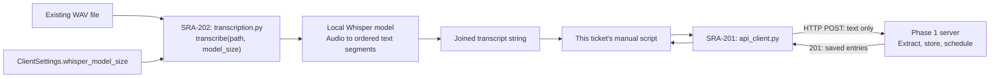

# SRA-202 — Local Whisper transcription into saved study entries

**Type:** Task
**Phase:** 2 — Voice capture
**Priority:** High — first saved-audio-to-study-entry slice
**Status:** Implemented — automated verification complete
**Blocked by:** SRA-201
**Blocks:** SRA-203

## TDD starting point

The assistant has supplied this ticket's tests, typed stubs, and teaching docstrings. **You write the learning-function implementations.** See the [test-first guide](../tests/README.md) for the unit/e2e boundary and implementation order. Focused tests begin red at `NotImplementedError`; after implementing this ticket they must pass. Keep Phase 1 regressions green with `pytest -m 'not phase2' -q`. Later exercises remain visibly red until implemented; the complete default suite must be green for SRA-206. The expected passing results below describe the implemented ticket, not the current scaffold.

## Summary

Implement the local transcription wrapper in `src/sra/capture/transcription.py`: take an audio file, load a cached `faster-whisper` model, and return the spoken text. Then send that text through SRA-201's completed HTTP client and verify the created entries in search. The new concept is local speech recognition; the manual check follows its result all the way into the working app.

## Where things stand right now

SRA-201 is implemented: the Python client creates searchable entries from text.
SRA-202 now supplies the local transcription boundary, model-size setting,
spoken fixture, and optional `faster-whisper` dependency. Starting from a saved
WAV keeps this boundary independent of microphone permissions or UI callbacks.

## What this ticket unlocks

**Saved WAV → local Whisper → transcript → existing HTTP client → stored entries → search by returned ID.** No later Phase 2 ticket is needed for this check. Local transcription can also run offline once weights are cached; ingestion uses the running backend and its model service.

## How this fits into the whole app

The backend accepts **text**, while a recording contains audio samples. `transcription.py` bridges those two representations: `Path` to an audio file in, `str` containing recognized speech out. SRA-201's HTTP client then accepts that string exactly as it accepts a typed note. The server does not need to know whether the text came from typing or speaking.



Two models have different jobs. **Local Whisper** recognizes the words in the audio. The **server's configured model** extracts topics, tags, and summaries from those words. Only the second part needs the backend's model-service credentials. Once Whisper weights are cached, transcription can run offline; saving entries still requires the backend and its model service.

For a recording saying "Today I studied photosynthesis," the intermediate result is a sentence, not a saved entry. `transcribe()` returns that sentence without sending HTTP, choosing a user, or scheduling reviews. The manual script in this ticket calls `ingest_transcript()` next; SRA-203 will move that sequence into the reusable `process_recording()` function. SRA-204 will later create a WAV from the microphone, so this ticket can be completed using the existing fixture.

### What happens inside the transcription boundary

1. Validate that the supplied file exists and can be read before attempting to load a model.
2. `load_model(model_size)` obtains the model through `_create_whisper_model()`. Keeping construction in a small function allows tests to replace expensive inference without replacing your transcription logic.
3. Ask the model to transcribe the file. Consume all returned segments: inference can fail during iteration, after the initial method call has returned.
4. Join the nonblank segment text in order. Return a trimmed string, or `""` for no recognized speech. Raise `TranscriptionError` for a failure so callers can distinguish it from silence.

There are two caches to understand: `load_model`'s `lru_cache` reuses a **model object within this Python process**, while the library's downloaded weights are **files reused across process restarts**. Restarting Python clears the former but should not require downloading already cached weights again. Lazy loading means importing the module does not construct a model or download weights.

The input file belongs to the caller. Transcription reads it and leaves it intact on success or failure. Later, the recorder will delete its own temporary WAV after the entire pipeline has finished; a user-supplied WAV remains the user's file.

## Files and why they matter

The scaffold files below already exist. Implement the learning functions and extend the dependency/setup files; use the supplied tests and fixture as the starting point.

| File | Role in the bigger picture |
|---|---|
| [`src/sra/capture/transcription.py`](../src/sra/capture/transcription.py) | Owns the local audio-to-text boundary, lazy model construction, reuse, segment consumption, and typed failures. |
| [`src/sra/capture/__init__.py`](../src/sra/capture/__init__.py) | Package marker for capture components; package import must remain free of audio/model startup. |
| [`src/sra/config.py`](../src/sra/config.py), [`.env.example`](../.env.example) | Already expose `WHISPER_MODEL_SIZE`; connect that setting to transcription without constructing server settings. |
| [`tests/unit/test_client_config.py`](../tests/unit/test_client_config.py) | Checks that the model option is read with the other independent client settings. |
| [`tests/unit/test_transcription.py`](../tests/unit/test_transcription.py) | Checks joining, caching, input preservation, and early/late failures using fake models. |
| [`tests/integration/test_transcription_whisper.py`](../tests/integration/test_transcription_whisper.py) | Opt-in evidence that the wrapper can use real Whisper on real audio, beyond the fake-model contract. |
| [`tests/fixtures/study_note.wav`](../tests/fixtures/study_note.wav), [`tests/fixtures/README.md`](../tests/fixtures/README.md) | A repeatable spoken input and its provenance/expected keywords, avoiding microphone variability while learning transcription. |
| [`pyproject.toml`](../pyproject.toml), [`requirements-lock.txt`](../requirements-lock.txt) | Add the optional inference library and verify the installable dependency set. HTTPX is already supplied by SRA-201. |
| [`README.md`](../README.md) | Explain model installation, the initial download, and how to run transcription and the saved-entry check. |

Reuse [`api_client.py`](../src/sra/client/api_client.py) as the downstream collaborator. The focused unit test answers "did we turn model segments into text correctly?"; the real fixture test answers "can this installation recognize speech?"; the manual client/search check answers "did that speech become new stored entries?"

## What to implement

- Implement the supplied typed stubs against their tests and teaching docstrings. Extend `ClientSettings` with `whisper_model_size` from `WHISPER_MODEL_SIZE`, default `base`, without requiring server credentials. Extend the `capture` extra with `faster-whisper` and document installation/model caching.
- Add a short spoken-study-note WAV with non-sensitive content. Document the words, expected keywords, and source/permission to use it in the fixture README. The real Whisper fixture test is opt-in with `SRA_RUN_WHISPER_TESTS=1`; default tests fake inference and never download weights.
- `load_model(model_size: str)` — construct and cache a `faster-whisper` model by size. Same size returns the same model object; different sizes have distinct cache entries. Keep construction replaceable in tests, and load lazily rather than at module import.
- `transcribe(audio_path: Path, model_size: str = "base") -> str` — validate the input file, get the model, consume the returned segments, and join their text in order into a trimmed transcript. Errors can occur while consuming segments as well as when starting transcription; handle both.
- `TranscriptionError` — expose a clear, typed failure for missing/unreadable/corrupt audio and model loading/inference failures. Preserve the underlying cause for debugging. No speech yields an empty string; the pipeline decides whether anything should be submitted.
- Do not mutate or delete the supplied audio file. The component that created a temporary recording owns its cleanup.

## Where to look

- Plan U4 and technical design §3.26 in `docs/`.
- `get_client_settings()` and `ingest_transcript()` from SRA-201; this ticket adds the client model-size setting and passes it to `transcribe`.
- The fixture README for what was spoken and which keywords the live transcription check should recognize.

## Acceptance criteria

- [x] Repeated loads of the same model size return the same object; another size constructs a separate model
- [x] Segment text is consumed fully, joined in order, and stripped of surrounding whitespace
- [x] Missing/corrupt input and failures during model loading or segment iteration raise `TranscriptionError`
- [x] An empty segment stream returns `""`; input audio remains intact on success and failure
- [x] Unit tests use fake models and never download weights or access a cloud STT service
- [x] The opt-in test transcribes the real fixture with loose expected-keyword assertions and documents the first-run model download
- [ ] The manual flow uses that real transcript with the completed HTTP client, creates entries, and retrieves their exact IDs through search
- [ ] A missing file raises a clear error before ingestion; restoring the input allows the full flow to succeed

## How to test this ticket alone

Start with the supplied scaffold:

```bash
source .venv/bin/activate
pytest tests/unit/test_client_config.py tests/unit/test_transcription.py -v
```

Expected: all transcription unit tests pass without installing or loading a real model. Clear the model cache between cases so one test cannot satisfy another by accident.

Run the real model check explicitly:

```bash
pip install -e ".[dev,capture]"
SRA_RUN_WHISPER_TESTS=1 pytest tests/integration/test_transcription_whisper.py -v
```

The first run may download model weights. Subsequent runs should work offline with the same cached model. Use keyword assertions, not an exact sentence or punctuation match.

## Manual verification

With the Phase 1 server running and the capture extra installed, run the two completed functions in sequence:

```bash
python3 - <<'PY'
from pathlib import Path
import httpx
from sra.capture.transcription import transcribe
from sra.client.api_client import ingest_transcript
from sra.config import get_client_settings

settings = get_client_settings()
transcript = transcribe(Path("tests/fixtures/study_note.wav"), settings.whisper_model_size)
print("Transcript:", transcript)
assert transcript.strip(), "No speech recognized"
entries = ingest_transcript(transcript)
assert entries, "No entries created"
base = str(settings.api_base_url).rstrip("/")
with httpx.Client(timeout=30) as client:
    for entry in entries:
        response = client.get(f"{base}/api/v1/search", params={"q": entry["topic"]})
        response.raise_for_status()
        assert entry["id"] in {row["id"] for row in response.json()}
        print("Saved and found:", entry["id"], entry["topic"], entry["summary"])
PY
```

Expect readable text matching the spoken fixture followed by `Saved and found` for the new entry IDs. Inspect the topics/summaries to confirm they reflect the recording. Merely printing plausible transcription is insufficient to close the ticket.

Repeat with a nonexistent input and confirm `TranscriptionError` occurs before the HTTP submission. Restore the path and confirm recovery. Separately rerun just `transcribe(...)` offline using cached weights; that local step requires no server or OpenAI key. The full save flow uses the server's real model.

## Verification record

- Date, fixture, model size, and observed transcript: 2026-10-13,
  `tests/fixtures/study_note.wav`, `base`: “Today I studied photosynthesis,
  plants use sunlight to turn water and carbon dioxide into sugar and oxygen,
  chlorophyll absorbs light in the leaves.”
- Created entry IDs and matching search IDs/topics:
- Missing-file failure, recovery, and cached offline transcription results:
  unit coverage passed; after the initial model download, the fixture transcribed
  successfully with `HF_HUB_OFFLINE=1`.
- Unit/opt-in/full test, lint, and type-check results: 40 focused configuration/
  transcription tests passed; 1 real-Whisper integration test passed; 91 Phase 1
  regressions passed; Ruff and Pyright passed. Full suite: 185 passed, 61 failed,
  2 skipped; failures are the unchanged SRA-203–205 teaching stubs. A clean
  Python 3.13 environment installed the pinned capture set and passed `pip check`.

## Definition of Done

- [ ] All acceptance criteria met
- [x] Unit tests and the opt-in real-fixture test pass
- [ ] Real audio → transcript → client → API → search flow and recovery recorded above
- [x] Cached transcription also works offline
- [x] Focused/completed-ticket tests, Phase 1 regressions, `ruff check .`, and `pyright` pass (all default tests must pass by SRA-206); audio setup documented
