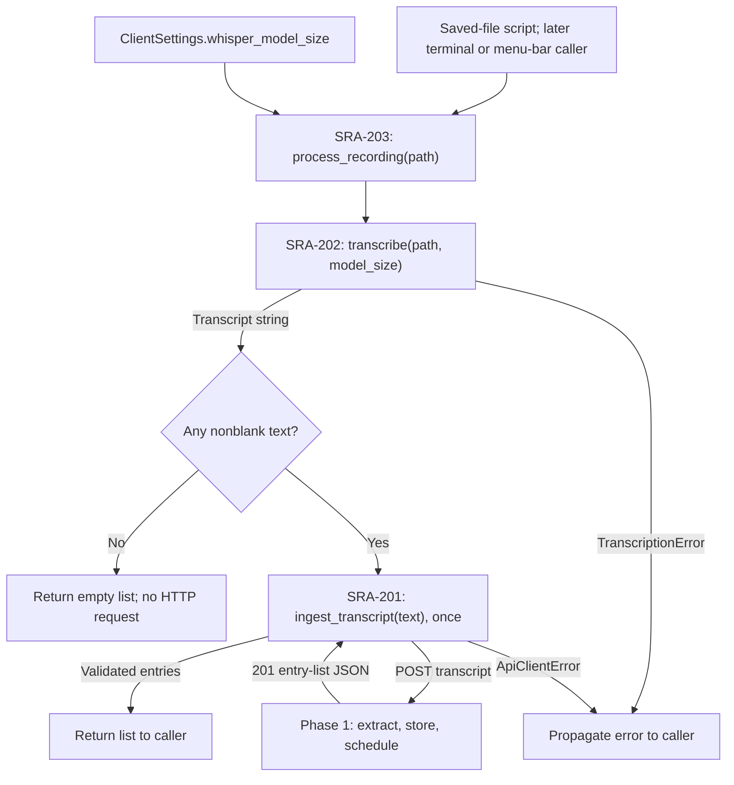

# SRA-203 — Recording-to-ingestion pipeline

**Type:** Task
**Phase:** 2 — Voice capture
**Priority:** High — gives capture callers one complete operation
**Status:** TDD scaffold ready — user implementation pending
**Blocked by:** SRA-202 (transitively: SRA-201)
**Blocks:** SRA-204

## TDD starting point

The assistant has supplied this ticket's tests, typed stubs, and teaching docstrings. **You write the learning-function implementations.** See the [test-first guide](../tests/README.md) for the unit/e2e boundary and implementation order. Focused tests begin red at `NotImplementedError`; after implementing this ticket they must pass. Keep Phase 1 regressions green with `pytest -m 'not phase2' -q`. Later exercises remain visibly red until implemented; the complete default suite must be green for SRA-206. The expected passing results below describe the implemented ticket, not the current scaffold.

## Summary

Implement `process_recording(audio_path)` in `src/sra/capture/pipeline.py`. It owns the sequence from local transcription to HTTP ingestion, including no-speech and failure behavior, so every capture surface can call one function.

## Where things stand right now

When SRA-202 is complete, a real WAV can become searchable entries by manually calling transcription and the HTTP client in sequence. That script does not yet provide a reusable operation that handles silence and failures consistently. This ticket establishes that operation and tests it through the real API and scheduler. Currently `process_recording()` remains a supplied teaching stub.

## What this ticket unlocks

**One call with a WAV → transcript → API → searchable entries and scheduled reviews.** Silence returns a no-speech result, transcription failures prevent submission, and client failures propagate without retrying. The next capture surfaces reuse exactly this behavior.

## How this fits into the whole app

SRA-202 teaches the two calls separately: first `transcribe(path)`, then `ingest_transcript(text)`. `pipeline.py` makes them one application operation: **"process this recording and give me the created entries."** It owns their order and the decision to submit. The transcription module owns speech recognition; the HTTP client owns communication; the server owns study-entry extraction, persistence, and schedules.

This is useful even though the function is small. A terminal command and a menu-bar callback should both treat silence, errors, and submission in the same way. They can call `process_recording(path)` instead of each recreating that policy.



The pipeline passes the configured model size to transcription, checks `transcript.strip()` for emptiness, and sends the original nonempty transcript unchanged. One request can create several entries when the note covers several topics. A successful result is a list of entry dictionaries, the same shape returned by SRA-201; the pipeline adds no new HTTP route or response model.

The empty-list convention deserves care: silence returns `[]` without a POST, but the HTTP wrapper also permits a valid `201` with an empty list. Therefore, `[]` means **no returned entries**, and by itself does not prove whether a POST happened. The no-speech tests explicitly verify that no request was made. Transcription and API errors remain exceptions; converting them into `[]` would hide a failure as an ordinary empty result.

### Who owns the work and the file?

The caller lends the pipeline a readable path. The pipeline reads it through transcription and returns or raises; it never deletes the file. SRA-204's recorder will own temporary audio and clean it up after processing. This lets the same pipeline handle both a user's saved recording and an app-created temporary recording safely.

All of this work is synchronous: the caller waits for transcription and the server response. A terminal script can wait directly. SRA-205 must run this same operation on a worker so the menu remains responsive. Adding a worker changes where the function runs, not the sequence inside it.

## Files and why they matter

The implementation and test files are already scaffolded. This ticket fills in the composition function and verifies the resulting application flow.

| File | Role in the bigger picture |
|---|---|
| [`src/sra/capture/pipeline.py`](../src/sra/capture/pipeline.py) | Coordinates settings → transcription → conditional HTTP submission; gives later capture surfaces one function to call. |
| [`tests/unit/test_capture_pipeline.py`](../tests/unit/test_capture_pipeline.py) | Isolates orchestration: configured model size, original text forwarded once, silence skips HTTP, errors propagate, and input survives. |
| [`tests/e2e/test_voice_capture_to_digest_e2e.py`](../tests/e2e/test_voice_capture_to_digest_e2e.py) | Keeps the pipeline and downstream application code real while replacing inference and network location; follows returned IDs into storage, search, and the due-date digest. |
| [`README.md`](../README.md) | Gives a runnable saved-WAV example using the new single-call interface. |

Read [`transcription.py`](../src/sra/capture/transcription.py), [`api_client.py`](../src/sra/client/api_client.py), and [`config.py`](../src/sra/config.py) as the completed collaborators. [`tests/e2e/conftest.py`](../tests/e2e/conftest.py) supplies the isolated HTTP/model wiring. The backend repository and scheduler remain Phase 1 responsibilities: this ticket's e2e test proves that the new entry point still reaches them.

That test checks more than a return value. It compares response IDs to stored rows and search results, verifies six pending reviews per entry, and advances the digest's date to the next day without modifying stored schedules. This connects "I processed a recording" to the product goal, "I can retrieve and review what I studied."

## What to implement

- Use the supplied teaching docstring and behavior tests to implement `process_recording(audio_path: Path) -> list[dict[str, Any]]`.
- Read the client model setting, call `transcribe(audio_path, model_size=...)`, call `api_client.ingest_transcript(transcript)` once, and return the created entries.
- Empty/whitespace transcription returns `[]` without an HTTP call. Let `TranscriptionError` and `ApiClientError` reach the caller; never disguise them as silence or retry the operation.
- Leave the input audio intact. A caller may supply a user-owned recording; its creator owns any temporary-file cleanup.
- Add an e2e test through the real pipeline, transcription wrapper, HTTP wrapper, FastAPI route, graph, repository, and scheduler. Substitute Whisper/model inference and HTTP transport location, using an isolated DB. Confirm original transcript, server-resolved ownership, six pending reviews per entry, immediate search visibility, and the next-day digest. Keep the actual pipeline and ingestion call in the test.

## Where to look

- Technical design §3.30, which refines plan U5 to call the API rather than a local graph.
- `tests/conftest.py` and `tests/e2e/test_capture_to_digest_e2e.py` for isolated DB/API wiring and advancing the digest date without changing stored schedules.
- SRA-201 and SRA-202 for the completed client and transcription boundaries.

## Acceptance criteria

- [ ] The configured model size reaches transcription and one nonempty transcript produces one HTTP submission
- [ ] No speech returns `[]` with no submission; transcription/API errors preserve their typed failure and never trigger retries
- [ ] The supplied audio file remains intact on success, no-speech, and failure
- [ ] The e2e test proves stored transcript/ownership, six pending reviews, immediate search, no new review due on capture day, and `1d` reviews visible on the next day
- [ ] The single-call manual flow below creates searchable entries from real audio against the running backend
- [ ] A missing input and an unreachable server report failures; restoring the input/server allows the next call to succeed

## How to test this ticket alone

```bash
source .venv/bin/activate
pytest tests/unit/test_capture_pipeline.py -v
pytest tests/e2e/test_voice_capture_to_digest_e2e.py -v
```

Expected: all pass without real inference, microphone access, or a network server. The e2e checks advance the digest date, so the due-date assertion needs no overnight wait. Finish with green completed-ticket and Phase 1 checks, lint, and type check; inspect remaining full-suite failures.

## Manual verification

With the server running and the capture extra installed, use the actual pipeline:

```bash
python3 - <<'PY'
from pathlib import Path
import httpx
from sra.capture.pipeline import process_recording
from sra.config import get_client_settings

audio = Path("tests/fixtures/study_note.wav")
before = audio.read_bytes()
entries = process_recording(audio)
assert entries, "No entries created from the spoken fixture"
assert audio.read_bytes() == before, "Input audio changed"
base = str(get_client_settings().api_base_url).rstrip("/")
with httpx.Client(timeout=30) as client:
    for entry in entries:
        response = client.get(f"{base}/api/v1/search", params={"q": entry["topic"]})
        response.raise_for_status()
        assert entry["id"] in {row["id"] for row in response.json()}
        print("Saved and found:", entry["id"], entry["topic"])
PY
```

Expect new IDs found in search and an unchanged input file. Repeat with a nonexistent path and then with the server unavailable; confirm typed errors, no false success, and a successful call after restoring the input/server. Use the deterministic tests for the exact no-speech/no-POST assertion. Confirm `1d` digest visibility using the focused e2e test above; a fresh entry is not due immediately.

## Verification record

- Date, audio path/model, and commands used:
- Created entry IDs and matching search IDs:
- Input-file preservation, missing-file/server failure, and recovery results:
- E2e scheduling/digest result and full test/lint/type-check results:

## Definition of Done

- [ ] All acceptance criteria met
- [ ] Real single-call audio → API → search flow and error recovery recorded above
- [ ] Storage/scheduling/digest assertions pass through the real e2e wiring
- [ ] Focused/completed-ticket tests, Phase 1 regressions, `ruff check .`, and `pyright` pass (all default tests must pass by SRA-206); saved-recording usage documented
