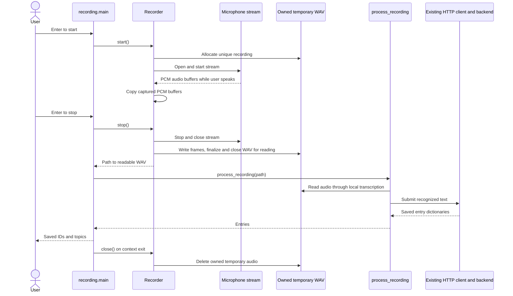

# SRA-204 — Microphone capture through the working pipeline

**Type:** Task
**Phase:** 2 — Voice capture
**Priority:** High — first live voice-to-study-entry flow
**Status:** Implemented — automated checks complete; real microphone acceptance pending
**Blocked by:** SRA-203
**Blocks:** SRA-205

## TDD starting point

The supplied recorder and terminal teaching stubs are now implemented. The
focused lifecycle and terminal-to-backend tests pass, including additional
shutdown/interruption and file-write failure cases. Later SRA-205 exercises
remain visibly red; no tests are skipped or weakened to conceal those failures.
Real microphone acceptance still needs the manual evidence below.

## Summary

Build the microphone recording portion of plan U5 and wire it directly into `process_recording`. Use a small terminal entry point to prove live capture before introducing the menu-bar event loop and global hotkey.

## Where things stand right now

SRA-203 processes saved audio end to end. The recorder and terminal entry point now supply its finalized WAV directly from microphone capture. The plan originally put microphone capture and desktop UI in one module. Extracting the recorder here lets a developer prove actual device access, WAV finalization, and cleanup through the working ingestion flow before adding UI callbacks.

## What this ticket unlocks

**Speak into the microphone → stop with Enter → local transcription → stored entries → search.** This is the same recorder and pipeline the menu-bar app will use. The terminal entry point is a small verification surface for the planned recording behavior.

## How this fits into the whole app

The pipeline accepts a file path. A microphone provides a stream of audio samples. `recording.py` turns that live stream into the finalized WAV file the pipeline already understands. The terminal entry point then joins these two operations so speaking can produce the same saved entries as a typed note.

There are two roles in this module. **`Recorder`** owns the microphone and temporary WAV; it exposes `start()`, `stop() -> Path`, and `close()`. **`main()`** translates Enter presses into those operations, calls `process_recording(path)`, and prints the result. Keeping the recorder independent of terminal input lets SRA-205 drive it with a hotkey.



This is the intended successful flow after implementation. `stop()` releases the microphone and makes the recording readable. `close()` ends the recording's lifetime and removes its owned file. They cannot be the same operation: deleting the WAV at stop would leave transcription with a missing input. A fresh `Recorder` is used for the next capture.

### Follow ownership through success and failure

| Resource or result | Owner | Lifetime / handoff |
|---|---|---|
| Microphone stream | `Recorder` | Acquired on start; released on stop or cleanup, including partial failures. |
| Temporary WAV | `Recorder` | Created for one capture; stays readable throughout processing; removed on close/context exit. |
| Borrowed WAV path | Pipeline and transcription | Read without deleting or taking ownership of the file. |
| Transcript and returned entries | Pipeline caller | Used to submit once and display the backend's actual result. |

Cancellation during capture closes resources and submits nothing. A transcription or API error after stop still exits through recorder cleanup. A timeout retains SRA-201's uncertain-save message: deleting the local recording does not cancel or roll back a server write. For an ordinary successful response, the terminal can report the returned IDs, and a separate search request verifies them.

## Files and why they matter

These source and test files are supplied. The exercise implements device/file ownership and the terminal handoff around the existing pipeline.

| File | Role in the bigger picture |
|---|---|
| [`src/sra/capture/recording.py`](../src/sra/capture/recording.py) | `_open_audio_stream` adapts optional `sounddevice`; `Recorder` manages capture and cleanup; `main()` connects Enter presses to the pipeline. |
| [`tests/unit/test_recording.py`](../tests/unit/test_recording.py) | Uses controlled audio and failures to verify WAV contents, valid lifecycle transitions, cleanup, cancellation, and the terminal handoff. |
| [`tests/e2e/test_terminal_capture_e2e.py`](../tests/e2e/test_terminal_capture_e2e.py) | Exercises the actual recorder, terminal command, pipeline, HTTP client, and backend with fake hardware/inference; proves captured frames can reach persisted entries. |
| [`pyproject.toml`](../pyproject.toml), [`requirements-lock.txt`](../requirements-lock.txt) | The desktop extra already declares microphone dependencies in the scaffold; verify the installed dependency set needed for real recording. |
| [`README.md`](../README.md) | Gives microphone permissions, installation, terminal launch, and cleanup-inspection steps for real hardware verification. |

Reuse [`pipeline.py`](../src/sra/capture/pipeline.py) for all downstream behavior. Tests can prove lifecycle rules without opening a real device; the manual capture is still needed to establish that macOS permissions and the selected microphone actually work. The entry point's `if __name__ == "__main__"` guard ensures importing the recorder for SRA-205 does not start the terminal interaction.

## What to implement

- Implement the supplied typed recorder interface against its teaching docstrings and tests using `sounddevice`. Expose `start()`, `stop() -> Path`, and `close()` on a recorder/context manager. `stop()` closes the stream and finalizes a valid WAV; its path remains usable until cleanup.
- Own a unique temporary file per recording. Always close the device and delete recorder-owned audio on `close()` / context exit, including capture failure, pipeline failure, interruption, and normal completion. Do not delete a recording before the pipeline has finished consuming it.
- Keep start/stop separate so the next ticket can drive them from hotkey events. Handle invalid state transitions without opening a second stream. Expose a useful typed `RecordingError` for permission/device/capture failures. Importing the module must not open a device.
- Add a guarded `python3 -m sra.capture.recording` entry point: Enter starts, Enter stops, then call the real pipeline once. Print recording/processing status and saved IDs/topics, or an explicit no-speech/error result. A failure exits unsuccessfully; cancellation cleans up without submitting unfinished audio. Preserve uncertain-save messaging on HTTP timeouts.
- Add a macOS `desktop` extra that includes the existing capture dependencies plus recording dependencies. SRA-205 extends it with UI/hotkey libraries. Document actual microphone setup and permissions for the launch environment.
- Test recorder lifecycle and the terminal-to-pipeline handoff using a fake audio stream and temporary directory. Assert a readable WAV with the captured frames, one completed recording passed to the pipeline, and cleanup on success/error/interruption. Real device behavior remains a required manual check.

## Where to look

- Plan R1/R2 and U5: the `sounddevice` recording and temporary-file responsibilities originally assigned to `menubar_app.py`.
- SRA-203's pipeline and file-ownership contract.
- The next ticket's UI needs: start/stop operations, a finalized path, and deterministic cleanup.

## Acceptance criteria

- [ ] Starting and stopping actual microphone capture produces a valid WAV that the existing pipeline can transcribe
- [x] The terminal entry point drives capture → pipeline → server and reports saved IDs/topics only after successful ingestion
- [x] A completed recording is processed once; cancellation does not submit unfinished audio
- [x] Audio remains available throughout processing and is removed afterward, with the microphone closed on completion, error, and interruption
- [ ] Permission/device/server failures have useful messages; the next attempt succeeds after recovery
- [ ] The manual flow finds the exact newly reported IDs in search before this ticket closes

## How to test this ticket alone

```bash
source .venv/bin/activate
pytest tests/unit/test_recording.py -v
pytest tests/e2e/test_terminal_capture_e2e.py -v
```

Expected: all tests pass without a real device. Fake only the audio source and downstream pipeline in lifecycle tests; SRA-203's e2e test already proves the downstream behavior. The manual check below must use the actual microphone, Whisper, pipeline, and backend. Finish with completed-ticket and Phase 1 checks, lint, and type check; inspect remaining full-suite failures.

## Manual verification

On macOS with the Phase 1 server running:

```bash
pip install -e ".[dev,desktop]"
python3 -m sra.capture.recording
```

1. Press Enter to start, say "Today I studied mitosis, the phases of cell division," then press Enter to stop. Confirm processing feedback followed by the saved IDs/topics.
2. Search the running server and compare the result IDs to the IDs just printed:

   ```bash
   curl -fsS "http://127.0.0.1:8000/api/v1/search?q=mitosis" | python3 -m json.tool
   ```

   Adjust the search term to the actual returned topic if needed. Seeing only an older matching note fails this check.
3. Inspect the path printed in `Processing recording: /…/sra-recording-….wav` while processing, then use `test ! -e "/printed/path.wav"` after exit to confirm cleanup. Run a second recording to verify microphone reacquisition. The README documents launch permissions and a dedicated `TMPDIR` for inspecting cancellation cleanup.
4. Cancel while recording; confirm no submission, device closure, and cleanup. Repeat with denied microphone permission and an unavailable backend. Confirm clear errors and a successful next capture after restoring permission/server access.
5. Speak a two-topic note and confirm the returned entries are searchable. This exercises the same downstream flow as the saved-file check with actual newly captured audio.

## Verification record

- **2026-10-14 automated verification:** 38 focused recorder/terminal tests passed;
  146 completed-ticket tests passed; 91 Phase 1 regressions passed. Full default
  suite: **239 passed, 15 failed, 1 skipped**. All failures are SRA-205
  `NotImplementedError` stubs; the skip is opt-in real Whisper. Ruff and Pyright pass.
- The real recorder/WAV/pipeline/client/backend e2e tests verify exact newly
  persisted IDs, PCM contents, silence, cancellation, and a lost response after
  persistence. Hardware and model inference are fake in these checks.
- **Environment:** macOS 26.6.2, Python 3.13, agent command runner. Installed
  desktop extra, including sounddevice 0.5.6 and PortAudio 19.7.0. Device
  enumeration returned no audio devices in this environment.
- The real module entry point was also run with Enter-to-start in this no-device
  environment: it exited with code 1, reported `Error querying device -1` with
  device/permission guidance, and left its dedicated temporary directory empty.
- **Dependency verification:** a clean Python 3.13 environment installed the
  existing lockfile plus `.[dev,desktop]` and passed `pip check`. Added the resolved
  desktop pins with macOS platform markers. The shared development environment
  has an unrelated pre-existing `google-genai`/`tenacity` conflict, left unchanged.
  Reinstalling the updated lockfile offline passed; the clean environment also
  passed all 146 completed-ticket tests.
- **Real-device acceptance pending:** spoken notes, new live/search IDs, physical
  permission denial/recovery, microphone reacquisition, and observed real-capture
  cleanup cannot be recorded without an accessible input device. No live
  microphone recording or external note submission is claimed.

## Definition of Done

- [ ] All acceptance criteria met
- [ ] Real microphone → pipeline → API → search flow and failure recovery recorded above
- [x] Recorder lifecycle tests pass and the reusable recorder is ready for SRA-205
- [x] Focused/completed-ticket tests, Phase 1 regressions, `ruff check .`, and `pyright` pass (all default tests must pass by SRA-206); microphone setup documented
