```mermaid
stateDiagram-v2
    [*] --> idle
    idle --> recording: Toggle starts a fresh Recorder
    idle --> idle: Start fails; report and clean up
    recording --> processing: Toggle stops recorder and queues pipeline
    recording --> idle: Stop or worker scheduling fails; clean up
    processing --> processing: Ignore additional toggles
    processing --> idle: Worker finishes; clean up and show result or error
    idle --> closed: Quit
    recording --> closed: Quit; clean up without submission
    processing --> closed: Quit; let worker finish and clean up
    closed --> [*]
```

# SRA-205 — macOS menu-bar hotkey capture

**Phase:** 2 — Voice capture · **Status:** implemented

## Summary

SRA-204 lets Enter presses drive a recorder and the pipeline. This ticket makes
those same operations available while another application has focus.
`SpacedRepetitionAgentApp` in `src/sra/capture/menubar_app.py` owns the user
interaction: listen for a shortcut, show whether capture is recording or
processing, and display the result. It delegates microphone/file ownership to
`Recorder` and audio-to-entry processing to `process_recording()`.

Two parts make this testable. `CaptureController` owns the capture state and order
of operations using injected callbacks. `SpacedRepetitionAgentApp.run()` connects
that controller to `rumps` and macOS's exact `RegisterEventHotKey` API — only the
configured chord is registered, so no Accessibility/Input Monitoring grant is
needed.

## Unlocks

- **Hotkey in another app → live recording → pipeline → saved entries → search by
  new ID.** Launch the menu-bar app once, press the shortcut, speak, press it
  again to save. No terminal interaction required during capture.

## Files

| File | Change | Why |
|---|---|---|
| [`src/sra/capture/menubar_app.py`](../src/sra/capture/menubar_app.py) | edit | `CaptureController` coordinates states, worker/UI callbacks, and quit; the app adapter wires menu actions and the global hotkey. `python3 -m sra.capture.menubar_app` launches it; importing must not. |
| [`src/sra/config/`](../src/sra/config/) | edit | `HOTKEY_COMBO` (default `<ctrl>+<alt>+r`), plus the macOS `desktop` extra with `rumps`. |
| [`tests/unit/test_menubar_app.py`](../tests/unit/test_menubar_app.py) | run | Explicit worker/UI queues expose overlap, cleanup, thread-dispatch, and late-completion mistakes without timing or a live desktop. |

## Acceptance criteria

- [ ] The documented launch command starts a macOS menu-bar app; import alone has
  no recording/listener/event-loop side effects
- [ ] The configured global hotkey works while another application has focus and
  toggles one recording on/off
- [ ] Stop produces a usable WAV and invokes the pipeline once; processing keeps
  the menu responsive and prevents overlapping captures
- [ ] Success displays the actual saved-entry count; no speech, permission errors,
  transcription errors, and server errors produce useful feedback
- [ ] Capture resources and app-owned temporary files are released on all normal
  completion/error/quit paths
- [ ] A later capture still works after a failed one; changing `HOTKEY_COMBO` takes
  effect after restart
- [ ] The server remains the only component extracting entries and scheduling
  reviews; only transcript text crosses the HTTP boundary
- [ ] Desktop setup and limitations are documented; the backend can still run
  without the macOS extras
- [ ] A real hotkey capture produces new entry IDs confirmed in search

## Tests

```bash
source .venv/bin/activate
pip install -e ".[dev,desktop]"
pytest tests/unit/test_client_config.py tests/unit/test_menubar_app.py -v
```

Controller tests pass on every platform using explicit worker/UI queues. The
optional desktop import smoke test passes without opening a microphone or starting
the app; on unsupported platforms it alone skips, with an explicit reason. Per
plan U5, real hotkey delivery, permissions, and the UI event loop are manual
checks — a mocked import is not proof they work.

## Manual verification

- [ ] Start the server in one terminal, `python3 -m sra.capture.menubar_app` in
      another. Focus another application and press the default Control+Option+R;
      confirm the recording indicator.
- [ ] Say a short note covering photosynthesis and mitosis, press the shortcut
      again. Confirm processing feedback, a responsive menu, and the saved result.
- [ ] Record the created IDs from diagnostic output or the ingest response, then
      `curl -fsS "http://127.0.0.1:8000/api/v1/search?q=mitosis"` and confirm those
      exact IDs. First reviews become due the following day.
- [ ] Repeat with silence, denied mic access, and an unavailable server: useful
      messages, no false saved indication, cleanup, working next capture after
      recovery. Activate the hotkey repeatedly during processing — no overlapping
      recording or duplicate submission. Quit while recording and processing —
      orderly cleanup. Change `HOTKEY_COMBO`, restart, repeat a successful capture.



> **Note:** transcription and `ingest_transcript()` are synchronous and slow, so
> they run on a worker via `submit(work)`; `dispatch(work)` marshals callbacks back
> to the UI thread, where state changes are serialized. The hotkey listener must
> use that dispatcher too — receiving a global key event does not make its callback
> the UI thread.

### Verification record

- **2026-10-14:** 33 menu-bar tests passed, covering exact chord
  parsing/registration/release, shortcut-conflict fallback, adapter dispatch/quit,
  and event-loop failure cleanup with fake desktop boundaries. **271 tests passed**
  with `SRA_RUN_WHISPER_TESTS=1 HF_HUB_OFFLINE=1` — the real Whisper fixture ran
  from cached weights, no skips. Ruff and Pyright passed; no new dependencies.
  README documents launch, permissions, configuration, recovery, and quit.
- Real `rumps` and `sounddevice` imports passed. The command runner reports **zero
  audio devices**. Physical hotkey delivery, microphone, permission/recovery
  behavior, responsive native UI, and new IDs confirmed in search remain
  unverified; no live capture or API submission was performed.
- **Manual acceptance still blank:** date/macOS version/launch environment and
  shortcut; spoken note with created entry IDs and matching search IDs;
  permission/silence/server errors with recovery; repeated-hotkey, cleanup/quit and
  shortcut-change results; focused/full test, lint, and type-check results.

---

Design context: [`technical-design.md`](../docs/design/technical-design.md). Ticket
format rules: [`guides/ticket_creation.md`](../guides/ticket_creation.md).
Phase status: [`PROGRESS.md`](../PROGRESS.md).