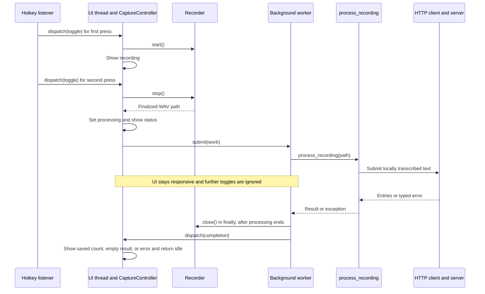

# SRA-205 — macOS menu-bar hotkey capture

**Type:** Task
**Phase:** 2 — Voice capture
**Priority:** High — makes voice capture available during normal study
**Status:** Implemented — automated checks complete; physical desktop acceptance pending
**Blocked by:** SRA-204
**Blocks:** SRA-206

## Original TDD starting point

The assistant has supplied this ticket's tests, typed stubs, and teaching docstrings. **You write the learning-function implementations.** See the [test-first guide](../tests/README.md) for the unit/e2e boundary and implementation order. Focused tests begin red at `NotImplementedError`; after implementing this ticket they must pass. Keep Phase 1 regressions green with `pytest -m 'not phase2' -q`. Later exercises remain visibly red until implemented; the complete default suite must be green for SRA-206. The expected passing results below describe the implemented ticket, not the current scaffold.

## Summary

Implement `SpacedRepetitionAgentApp` in `src/sra/capture/menubar_app.py`. A global hotkey toggles microphone recording; stopping sends the temporary WAV through the working pipeline and reports the result in the desktop UI.

## Where things stand right now

After SRA-204 is implemented and verified, a developer can speak into the microphone from a terminal and verify the resulting entries through search. This ticket adds the menu-bar event loop and global hotkey around that flow. The controller and lazy desktop adapter are implemented; the hotkey setting and optional desktop dependencies were already supplied.

## What this ticket unlocks

**Hotkey in another app → live recording → pipeline → saved entries → search by new ID.** Launch the menu-bar app once, press the shortcut, speak, and press it again to save. During capture, no terminal interaction is required.

## How this fits into the whole app

SRA-204 lets Enter presses drive a recorder and the pipeline. SRA-205 makes those same operations available while another application has focus. `menubar_app.py` owns the user interaction: listen for a shortcut, show whether capture is recording or processing, and display the final result. It delegates microphone/file ownership to `Recorder` and audio-to-entry processing to `process_recording()`.

Two parts make this testable. **`CaptureController`** owns the capture state and the order of operations using injected callbacks. **`SpacedRepetitionAgentApp.run()`** connects that controller to `rumps` and macOS's exact `RegisterEventHotKey` API. This avoids observing general keyboard input and does not require Accessibility or Input Monitoring permission. The controller can be tested without starting a desktop app; the adapter needs real macOS verification.

```mermaid
stateDiagram-v2
    [*] --> idle
    idle --> recording: Toggle starts a fresh Recorder
    idle --> idle: Start fails; report and clean up
    recording --> processing: Toggle stops recorder and queues pipeline
    recording --> idle: Stop or worker scheduling fails; clean up
    processing --> processing: Ignore additional toggles
    processing --> idle: Worker finishes; clean up and show result or error
    idle --> closed: Quit
    recording --> closed: Quit; clean up without submission
    processing --> closed: Quit; let worker finish and clean up
    closed --> [*]
```



The four states are `idle`, `recording`, `processing`, and `closed`. A saved-count message is feedback on completion, followed by returning to idle. Keeping processing explicit prevents a rapid hotkey press from starting a second recording or submitting the first one again.

### Why background work and UI dispatch both exist

Transcription and `ingest_transcript()` are synchronous and can take time. Running them on the UI thread would stop the menu responding until they finish. `submit(work)` schedules that processing on a worker. `dispatch(work)` schedules callbacks on the UI thread, where state changes and UI updates are serialized. The hotkey listener must use that dispatcher too; receiving a global key event does not make its callback the UI thread.



The diagram shows completion while the app remains open. On quit, the controller marks itself closed and stops the listener. An active worker keeps its WAV until processing ends, cleans up, and cannot revive the closed UI with a late result. The adapter must coordinate worker completion before exiting its event loop. Quitting is not a server-side undo operation.

## Files and why they matter

Implement the supplied controller and adapter while retaining the recorder and pipeline as their collaborators.

| File | Role in the bigger picture |
|---|---|
| [`src/sra/capture/menubar_app.py`](../src/sra/capture/menubar_app.py) | `CaptureController` coordinates states, worker/UI callbacks, and quit; the app adapter wires actual menu actions and global hotkeys to it. |
| [`tests/unit/test_menubar_app.py`](../tests/unit/test_menubar_app.py) | Explicit worker/UI queues expose overlap, cleanup, thread-dispatch, and late-completion mistakes without relying on timing or a live desktop. |
| [`src/sra/config.py`](../src/sra/config.py), [`.env.example`](../.env.example) | Already supply `HOTKEY_COMBO`; the adapter reads it along with the existing server URL and model settings. |
| [`tests/unit/test_client_config.py`](../tests/unit/test_client_config.py) | Verifies client option defaults and environment overrides. Actual shortcut registration belongs to desktop integration. |
| [`pyproject.toml`](../pyproject.toml), [`requirements-lock.txt`](../requirements-lock.txt) | Desktop declarations include `rumps` and microphone support; the system hotkey API needs no third-party listener dependency. |
| [`README.md`](../README.md) | Turns working code into a launchable app by documenting permissions, shortcut configuration, server address, startup, and recovery. |

[`recording.py`](../src/sra/capture/recording.py) still owns audio resources, [`pipeline.py`](../src/sra/capture/pipeline.py) still composes transcription/submission, and [`api_client.py`](../src/sra/client/api_client.py) still owns the HTTP contract. The server returns saved entries before the UI reports success. A manual search using those exact IDs then verifies the complete flow beyond the menu's message.

## What to implement

- Implement the supplied platform-independent `CaptureController` against its queued worker/UI tests, then fill in the lazy `SpacedRepetitionAgentApp.run()` adapter with a real `rumps.App` subclass and the guarded module entry point so `python3 -m sra.capture.menubar_app` launches it. Importing the module must not launch the app or request permissions.
- Extend client settings with `HOTKEY_COMBO` (default `<ctrl>+<alt>+r`) and the macOS `desktop` extra with `rumps`. Update the lock and setup docs.
- Register only the configured chord through macOS `RegisterEventHotKey`; do not install a general keyboard event listener. First activation calls SRA-204's recorder `start()`; the next calls `stop()` and passes its finalized WAV to SRA-203's `process_recording`. Reuse the recorder rather than duplicating device/file handling in the UI.
- Close the recorder after processing, or on capture failure/orderly quit, so its owned audio is removed and microphone released. Keep the WAV until processing finishes. Do not delete arbitrary files passed to the standalone pipeline.
- Make the state visible: idle, recording, processing, then a saved-entry count or a useful no-speech/error message. Return to idle so another capture can begin.
- Keep transcription and network work off the UI event loop; marshal UI changes back through the UI's supported mechanism. While processing, ignore or explain additional hotkey activations so a second recording/submission cannot overlap the first.
- Provide menu actions to start/stop recording and quit. On quit, stop listeners, close active capture resources, and coordinate any in-flight worker cleanup. Explain a timeout as an unknown save outcome, matching SRA-201.
- Document the macOS microphone permission, that exact hotkey registration needs no Accessibility/Input Monitoring grant, how to change the shortcut, how to set the server URL, and the first-run model download. Show useful recovery for denied microphone access, unavailable devices, invalid/conflicting shortcuts, and an unreachable server.

## Where to look

- Plan R1, R2, U5 and technical design §3.31.
- The recorder from SRA-204 and `process_recording` from SRA-203: UI callbacks delegate to these completed components.
- `get_client_settings()` and `.env.example` from SRA-201.

## Acceptance criteria

- [ ] The documented launch command starts a macOS menu-bar app; import alone has no recording/listener/event-loop side effects
- [ ] The configured global hotkey works while another application has focus and toggles one recording on/off
- [ ] Stop produces a usable WAV and invokes the pipeline once; processing keeps the menu responsive and prevents overlapping captures
- [ ] Success displays the actual saved-entry count; no speech, permission errors, transcription errors, and server errors produce useful feedback
- [ ] Capture resources and app-owned temporary files are released on all normal completion/error/quit paths
- [ ] A later capture still works after a failed one; changing `HOTKEY_COMBO` takes effect after restart
- [ ] The server remains the only component extracting entries and scheduling reviews; only transcript text crosses the HTTP boundary
- [ ] Desktop setup and limitations are documented; the backend can still run without the macOS extras
- [ ] A real hotkey capture produces new entry IDs confirmed in search; record the IDs through diagnostic output or API inspection as part of verification

## How to test this ticket alone

On macOS, after installing the desktop extra:

```bash
source .venv/bin/activate
pip install -e ".[dev,desktop]"
pytest tests/unit/test_client_config.py tests/unit/test_menubar_app.py -v
```

Expected after implementation: controller tests pass on every platform using explicit worker/UI queues. The optional desktop import smoke test passes without opening a microphone or starting the app; on unsupported platforms or without desktop dependencies, that smoke test alone skips with an explicit reason. Per plan U5, real hotkey delivery, permissions, and the UI event loop are manual checks; a mocked import is not proof that those work.

## Manual verification

Start the Phase 1 server in one terminal, then launch the client in another:

```bash
python3 -m sra.capture.menubar_app
```

1. Grant the documented permissions, focus another application, and press the default Control+Option+R shortcut. Confirm the recording indicator appears.
2. Say a short note covering photosynthesis and mitosis, then press the shortcut again. Confirm processing feedback, a responsive menu, and the saved-entry result.
3. Record the created IDs from diagnostic output or the ingest response, then query search. Confirm those exact IDs, not just an older note with the same topic:

   ```bash
   curl -fsS "http://127.0.0.1:8000/api/v1/search?q=mitosis" | python3 -m json.tool
   ```

   Use the actual returned topic if different. Their first reviews become due the following day.
4. Repeat with silence, denied microphone access, and an unavailable server. Confirm useful messages, no false saved indication, cleanup, and a working next capture after recovery.
5. Activate the hotkey repeatedly during processing; confirm no overlapping recording or duplicate submission. Quit while recording and while processing; confirm orderly resource cleanup.
6. Change `HOTKEY_COMBO`, restart, and repeat a successful capture with the new shortcut.

Record the macOS version, launch environment, and manual outcomes in the ticket/progress log. Live successful capture uses the server's OpenAI key; the desktop configuration itself needs no key.

## Verification record

Implementation verification — 2026-10-14:

- Implemented serialized controller states, single background submission, result/error
  dispatch, saved-ID diagnostics, cleanup, and orderly quit without deleting an
  in-flight worker's WAV. Added a lazy rumps subclass, queued main-loop dispatch,
  configurable exact system shortcut, menu actions, and registration failure feedback.
- **33 menu-bar tests passed**, including exact chord parsing/registration/release,
  shortcut-conflict fallback, adapter dispatch/quit, and event-loop failure cleanup
  with fake desktop boundaries.
- **271 tests passed** with `SRA_RUN_WHISPER_TESTS=1 HF_HUB_OFFLINE=1 .venv/bin/pytest -q`;
  the actual Whisper fixture ran from cached weights, with no skips. Ruff and
  Pyright passed. Existing desktop declarations/pins already cover the adapter;
  no new dependencies were required.
- Real `rumps` and `sounddevice` imports passed. The command
  runner reports **zero audio devices**. Physical hotkey delivery, microphone,
  permission/recovery behavior, responsive native UI, and new IDs confirmed in
  search remain unverified; no live capture or API submission was performed.
- README now documents launch, permissions, configuration, model download,
  recovery, and quit semantics. Desktop acceptance below remains open.

Manual acceptance (pending):

- Date, macOS version, launch environment, and shortcut:
- Spoken note, created entry IDs, and matching search IDs:
- Permission/silence/server errors and successful recovery:
- Repeated-hotkey, cleanup/quit, and shortcut-change results:
- Focused/full test, lint, and type-check results:

## Definition of Done

- [ ] All acceptance criteria met
- [ ] Import smoke test and real hotkey → microphone → pipeline → API → search checks pass and are recorded above
- [x] README documents installation, permissions, launch, configuration, and recovery
- [x] Focused/completed-ticket tests, Phase 1 regressions, `ruff check .`, and `pyright` pass (all default tests must pass by SRA-206), with only documented opt-in/platform skips
