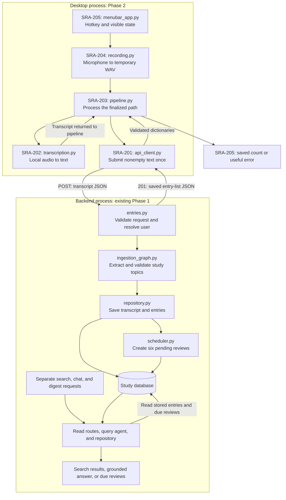

# SRA-206 — Phase 2 integration verification

**Type:** Verification (no new feature code expected)
**Phase:** 2 — Voice capture
**Priority:** Highest — the "Phase 2 is actually done" checkpoint
**Status:** Automated verification complete — physical desktop acceptance pending
**Blocked by:** SRA-205 (transitively: SRA-201 through SRA-204)
**Blocks:** Phase 3 kickoff

The automated integration coverage is implemented, including
`tests/e2e/test_client_ingestion_e2e.py`,
`tests/e2e/test_voice_capture_to_digest_e2e.py`, and
`tests/e2e/test_terminal_capture_e2e.py`. All Phase 2 learning functions are
implemented and the automated suite is green. Physical microphone, global
hotkey, native UI, and live-server evidence remain manual completion criteria.

## Summary

Verify one continuous flow from the real macOS hotkey to recording, local Whisper, the HTTP client, server-side ingestion, stored entries, review scheduling, search, and the due-date digest. Close the phase only when both the automated checks and the desktop flow have evidence.

## Where things stand right now

SRA-201 through SRA-205 are implemented. Their unit and end-to-end coverage is
green, including the real cached Whisper fixture. SRA-201 has live API evidence;
the saved-WAV, microphone, and menu-bar tickets still lack their required live
server/device evidence. This verification pass therefore establishes the
complete automated path and records the environment limitation without claiming
that the physical desktop flow or Phase 2 is complete.

## What this ticket confirms

You can capture what you studied by voice during normal desktop use and later retrieve the resulting scheduled entries. The client handles audio locally; the existing API remains responsible for the study data. That is the Phase 2 foundation for adding real users and login in Phase 3.

## How this fits into the whole app

The earlier tickets add an entry point or boundary one at a time. SRA-206 checks the product behavior across **all** of them: a spoken study note becomes persisted knowledge that can be searched, discussed through chat, and surfaced for review on the correct date. No new layer is needed for this ticket. Its output is verified evidence and accurate completion/setup documentation.



The forward capture path and later read requests meet in the database. Receiving an entry list checks the immediate response; finding those same IDs in search checks persistence and retrieval. Chat exercises the existing query agent against that data. The digest checks scheduling: a note saved today is searchable today but its first review is due the next day. The capture client does not automatically make these read requests; verification runs them separately.

### What each kind of evidence establishes

| Evidence | What it proves | What still needs another check |
|---|---|---|
| Focused unit tests | Each boundary's contract, including silence, typed failures, state transitions, and cleanup | Components work together and real dependencies are usable |
| Client / voice / terminal e2e tests | Actual application wiring reaches storage, schedules, and search; voice e2e also checks the due-date digest | Real inference, microphone hardware, macOS event loop, and permissions |
| Opt-in Whisper fixture test and cached offline repeat | Real audio is recognized with the installed local model and cached weights | Desktop capture and backend ingestion |
| Real hotkey capture against the running server | OS input, microphone, local inference, HTTP, and server inference work together | Correct stored transcript, ownership, review rows, and retrieval by the new IDs |
| Read-only DB inspection plus search/chat/digest checks | The new capture produced the expected stored content and downstream behavior | Restart and error-recovery behavior |
| Failure/recovery and restart checks | The next capture still works, resources are released, and configuration/cache behavior survives restart | No claim beyond the paths actually exercised |

For a two-topic note, record the returned IDs and follow those IDs through every check. Merely finding an older "mitosis" result would not establish that this capture succeeded. Similarly, an empty digest on capture day is expected for new entries; the automated test advances the digest date while preserving the real stored schedule dates.

## Files and why they matter

These are primarily files to run, inspect, and update with actual results. If verification finds a defect, fix its owning component and rerun the relevant checks before recording completion.

| File | Role in the bigger picture |
|---|---|
| [`tests/unit/test_client_config.py`](../tests/unit/test_client_config.py), [`test_api_client.py`](../tests/unit/test_api_client.py), [`test_transcription.py`](../tests/unit/test_transcription.py), [`test_capture_pipeline.py`](../tests/unit/test_capture_pipeline.py), [`test_recording.py`](../tests/unit/test_recording.py), [`test_menubar_app.py`](../tests/unit/test_menubar_app.py) | Check the individual client, audio, orchestration, and UI contracts before interpreting whole-flow failures. |
| [`tests/e2e/test_client_ingestion_e2e.py`](../tests/e2e/test_client_ingestion_e2e.py) | Establishes text-client → server → saved entries, including the ambiguous lost-response case. |
| [`tests/e2e/test_voice_capture_to_digest_e2e.py`](../tests/e2e/test_voice_capture_to_digest_e2e.py) | Establishes recording → transcript → ingestion → storage/search → next-day review visibility. |
| [`tests/e2e/test_terminal_capture_e2e.py`](../tests/e2e/test_terminal_capture_e2e.py) | Adds actual recorder/CLI wiring with controlled audio buffers, plus file/device cleanup. |
| [`tests/integration/test_transcription_whisper.py`](../tests/integration/test_transcription_whisper.py) | Checks the real Whisper dependency and spoken fixture behind the otherwise substituted inference boundary. |
| [`tests/e2e/conftest.py`](../tests/e2e/conftest.py) | Read to understand which external boundaries are replaced and how stored entries/reviews are checked; the normal study database is not the automated test database. |
| [`PROGRESS.md`](../PROGRESS.md), [`tickets/README.md`](README.md) | Record the phase result and each ticket's verified status so future work starts from accurate prerequisites. |
| [`README.md`](../README.md) | Ensure another developer can install, configure, and run the verified flow, including real platform requirements. |
| [This ticket](SRA-206-phase-2-integration-verification.md) | Retain commands, environment, new IDs, observed outcomes, failures, and recovery evidence for the final phase check. |

The runtime files are mapped in the diagram and in [the Phase 2 overview](README.md#how-the-phase-2-files-work-together). The full suite also exercises Phase 1: adding voice capture must preserve typed ingestion, search, chat, and scheduling.

## Acceptance criteria

- [x] The full default suite, including Phase 1 and the new voice e2e flow, passes with no unimplemented Phase 2 behavior left
- [x] The opt-in real Whisper fixture test passes, including a repeat with cached weights offline
- [x] `ruff check .` and `pyright` pass
- [ ] The manual desktop flow below succeeds against a running server and creates entries for the existing local user
- [ ] Stored entries retain the transcription result and have six pending checkpoints each; search finds them immediately and the digest shows their first reviews when due
- [x] Empty audio and dependency failures recover cleanly; no audio upload, automatic duplicate submission, or app-owned temporary-file leak occurs in the checked paths
- [x] Phase-level status, ticket board, and setup documentation reflect verified results and any actual limitations
- [ ] Each preceding ticket has its own completed manual verification record; this final pass does not substitute for missing per-ticket evidence

## Full test suite

```bash
source .venv/bin/activate
pytest -q
pytest -q tests/e2e/
SRA_RUN_WHISPER_TESTS=1 pytest tests/integration/test_transcription_whisper.py -v
ruff check .
pyright
```

Run the desktop smoke test on a Mac with the desktop extra installed as well. Record actual results rather than guessing a test count. The default suite uses fake inference and an isolated database; the explicit Whisper run and manual flow provide the real audio/model evidence.

## End-to-end manual flow

With `.env` already configured and the server's `OPENAI_API_KEY` available, start the backend:

```bash
uvicorn sra.api.app:create_app --factory --reload --port 8000
```

In another terminal on macOS:

```bash
source .venv/bin/activate
python3 -m sra.capture.menubar_app
```

1. Focus another app, start capture with the hotkey, and say: "Today I covered photosynthesis, including light and dark reactions, and mitosis, the phases of cell division." Stop with the same hotkey.
2. Confirm recording and processing feedback, followed by saved entries for the two topics. If extraction is unexpected, inspect the transcript/result and record the finding before calling the phase complete.
3. Query search and chat using the existing endpoints:

   ```bash
   curl -s "http://127.0.0.1:8000/api/v1/search?q=mitosis" | python3 -m json.tool
   curl -s -X POST http://127.0.0.1:8000/api/v1/chat \
     -H "Content-Type: application/json" \
     -d '{"question": "what did I learn about mitosis?"}' | python3 -m json.tool
   curl -s http://127.0.0.1:8000/api/v1/digest | python3 -m json.tool
   ```

   Search should include the new entry and chat should answer from the stored topic. The digest may contain older due reviews, but a newly captured entry's first checkpoint is due tomorrow. Verify the new `1d` checkpoints when due or through an isolated check that advances the digest date; do not edit the stored review dates to make them appear today.

4. Inspect the new entries and their schedules through a read-only DB check: retain each returned ID, confirm the original transcribed text, the local user's ownership, and the six labels `1d`, `3d`, `7d`, `1mo`, `3mo`, `6mo`. Compare by entry ID so pre-existing notes do not count as evidence for the new capture.
5. Exercise no speech, server unavailability, and a failed transcription/permission path. Confirm no false saved message, no automatic POST retry, resource cleanup, and a successful capture after recovery. For timeouts, check search before resubmitting because the server may already have saved the note.
6. Restart the app and repeat a capture. Confirm configuration is honored and that cached local transcription works without a model download. Verify transcription offline separately; server ingestion still needs the backend and its model service.

## Verification record

### Additional real-audio automation — 2026-10-14

- `make test-data`: **280 passed, 1 deselected**. `make test-live`:
  **1 passed, 7 deselected**, including actual OpenAI extraction and chat.
- Both tiers run the real spoken fixture through simulated device callbacks,
  production recorder/controller, Whisper, actual loopback HTTP, and an isolated
  SQLite database. Assertions cover the exact returned IDs, transcript/ownership,
  six schedules, search/chat/digest, server/application/engine restart, and cleanup.
- The fixture suite adds quiet/noisy signals, permission/overflow recovery,
  silence, corrupt WAV, and hotkey registration failure/recovery. A silent WAV
  previously produced the hallucinated transcript “You”; enabling Whisper's
  voice-activity filter fixed this regression without weakening the test.
- This supersedes the earlier lack of an automated live-provider result below.
  It does not supply physical microphone/hotkey/UI or per-ticket manual evidence.
  See [the test guide](../tests/README.md#two-complete-verification-commands).

- **Date, platform, and environment:** 2026-10-14; macOS 26.6.2
  (build 25G83), Python 3.13.12, project `.venv`. The desktop dependencies
  import, but `sounddevice` 0.5.6 reports zero available devices in this agent
  environment.
- **Whisper:** the `base` model transcribed `tests/fixtures/study_note.wav` and
  matched the expected keywords with `HF_HUB_OFFLINE=1`, proving the cached
  model works without a download.
- **Automated gates:** default suite **259 passed, 1 skipped** (the opt-in
  Whisper case); end-to-end suite **16 passed**; explicit offline Whisper test
  **1 passed**; the complete opt-in run **260 passed**. `ruff check .` and
  `pyright` both passed with no findings.
- **Storage and scheduling evidence:** isolated end-to-end tests followed the
  newly returned IDs through persistence and search, retained the exact
  transcript and local-user ownership, created six pending checkpoints per
  entry, excluded new reviews on capture day, and returned their `1d` reviews
  on the next day without modifying stored dates. These are automated test IDs,
  not claimed as live desktop captures.
- **Recovery and cleanup evidence:** tests cover silence, missing audio, late
  decoding failure, server rejection, a response lost after persistence,
  cancellation, callback/write failures, subsequent successful attempts,
  device closure, and owned-file cleanup. They also assert one HTTP submission,
  no automatic retry, and transcript-only upload. Cached Whisper restart
  behavior is covered by the offline run.
- **Remaining manual evidence:** no input device is exposed here, so physical
  microphone capture, cross-application hotkey delivery, native UI feedback,
  permission denial/recovery, restart capture, live OpenAI-backed IDs, chat,
  read-only database inspection, and live due-date digest verification were not
  performed. SRA-204, SRA-205, SRA-206, and Phase 2 remain open until those
  checks are recorded on a Mac with an accessible microphone.

## After this ticket closes

- [ ] Mark Phase 2 done in `PROGRESS.md`, the README phase list, and `tickets/README.md`
- [ ] Record the actual verification date and evidence in this ticket
- [ ] Phase 3 can begin: Google OAuth, real per-user isolation, RBAC, and rate limiting

## Definition of Done

- [ ] All acceptance criteria met
- [ ] Automated and manual results recorded; any blocking failures fixed and rechecked
- [ ] Phase 2 tickets marked done and documentation matches the working flow
