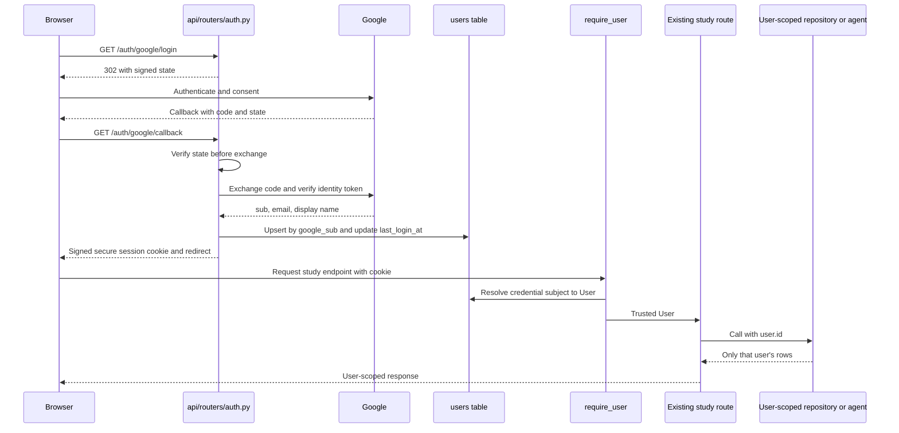

# SRA-302 — Google OAuth, authenticated isolation, and RBAC

**Type:** Task
**Phase:** 3 — Multi-tenancy, authentication, RBAC, and rate limiting
**Priority:** Highest — this replaces the trust-every-request local-user placeholder with a real security boundary
**Status:** Implemented — automated checks complete; real Google verification pending
**Blocked by:** SRA-301
**Blocks:** SRA-303, SRA-304

## Summary

Implement server-side Google OAuth for browser login, issue signed application
credentials, replace automatic local-user resolution with `require_user`, and
prove that every existing study route operates only on the authenticated user's
data. Add `require_admin` plus a minimal operational usage endpoint so the two
roles have observable behavior without exposing anyone's study content.

Before this ticket, a request with no credentials is silently treated as the
first local user. After it, unauthenticated study requests return `401`, a valid
browser session resolves one database user, ordinary users cannot call admin
routes, and two signed-in users see disjoint ingestion, search, chat, and digest
results.

## Where things stand right now

Every existing router depends on `get_current_user`, but its current body creates
or returns a single local user. The repository and query tools already close over
that user's numeric ID, which is valuable defense in depth. SRA-301 adds the
durable identity/role schema. There is no Google module, auth router, session or
bearer verification, OAuth configuration, or admin router yet.

Phase 2's client does not send credentials, so turning on authentication here
will intentionally make capture return `401` until SRA-303 adds desktop login.
The browser login and authenticated HTTP checks in this ticket remain complete
and runnable without that future desktop work.

## What this ticket unlocks

A user can sign in through Google in a browser, call `/api/v1/auth/me`, submit a
typed transcript with the issued session, and find only the newly created IDs in
their own search. A second user receives different results even for an empty or
broad query. Logging out invalidates the browser session. An admin can read
instance-level counts, while an ordinary user receives `403`; neither response
contains another user's transcript, topic, or summary.

## How this fits into the whole app



Google proves the external identity; this server issues and validates its own
short-lived application credential. Never use an unverified claim, request-body
user ID, email address, or desktop-supplied numeric ID as authority. OAuth
`state` binds the callback to the login attempt and prevents login CSRF; it is
not the access credential. Google access/refresh tokens must not be returned to
the browser or stored in application cookies when only identity is needed.

### Web sessions and bearer credentials

The design requires one resolver to accept a signed web session cookie or an
application bearer token. Define one credential format, issuer/audience purpose,
expiry policy, and subject mapping, then test both transports against the same
`require_user` path. SRA-303 consumes the bearer flow. For desktop login, redirect
only a short-lived, single-use completion code to localhost; exchange that code
through a direct API call for the bearer credential. This refines the older
design sketch that put a bearer token in the loopback query string, where browser
history, access logs, and copied URLs could expose it. Never put server secrets
or Google tokens into the desktop client.

Cookie flags must match deployment reality: HTTP-only and SameSite protection
are mandatory, `Secure` is mandatory outside documented localhost development,
and logout must clear the cookie. Do not log authorization codes, identity
tokens, application bearer tokens, session secrets, or full callback URLs that
contain credentials.

## Files and why they matter

| File | Role and required change |
|---|---|
| [`src/sra/auth/google_oauth.py`](../src/sra/auth/) | New provider boundary: build authorization URLs, exchange one-time codes, verify returned identity, and upsert by `google_sub`. Keep provider/network errors typed and testable. |
| [`src/sra/auth/dependencies.py`](../src/sra/auth/dependencies.py) | Replace local-user fallback with `require_user`; add composed `require_admin`. Set trusted request state if later dependencies need it. |
| [`src/sra/api/routers/auth.py`](../src/sra/api/routers/) | New login, callback, desktop completion-code exchange, logout, and `/me` routes. Own redirects/cookies and translate provider failures without leaking secrets. |
| [`src/sra/api/routers/admin.py`](../src/sra/api/routers/) | New minimal `/admin/usage` route for observable RBAC. Return aggregate operational counts only, never study content. |
| [`src/sra/api/deps.py`](../src/sra/api/deps.py), [`src/sra/api/routers/__init__.py`](../src/sra/api/routers/__init__.py) | Re-export the new dependencies and mount auth/admin routes while preserving dependency identity for test overrides. |
| [`src/sra/api/routers/entries.py`](../src/sra/api/routers/entries.py), [`digest.py`](../src/sra/api/routers/digest.py), [`search.py`](../src/sra/api/routers/search.py), [`chat.py`](../src/sra/api/routers/chat.py) | Replace the placeholder dependency at every protected entry point. Continue passing only the resolved `user.id` downstream. |
| [`src/sra/config.py`](../src/sra/config.py), [`.env.example`](../.env.example) | Add and validate server-only OAuth client ID/secret, callback URL, signing secret, credential lifetime, and localhost/deployment cookie settings. Client settings must remain independent. |
| [`pyproject.toml`](../pyproject.toml), [`requirements-lock.txt`](../requirements-lock.txt) | Declare chosen OAuth/signing dependencies directly and pin a verified environment. Do not rely on an accidental transitive install. |
| [`tests/unit/test_auth.py`](../tests/unit/), [`tests/integration/test_authenticated_routes.py`](../tests/) | New provider/dependency/route tests and a two-user application flow. Substitute Google HTTP responses and model inference, not auth or repositories. |
| [`README.md`](../README.md), [`CONTRIBUTING.md`](../CONTRIBUTING.md) | Document Google Console redirect setup, secrets, local HTTPS/cookie caveats, role assignment, and login troubleshooting. |

## TDD starting point

Prepare typed learning stubs and teaching docstrings for the provider helpers and
dependencies, plus failing tests for state validation, identity upsert, transport
resolution, status codes, and isolation. Router plumbing and response schemas
may be concrete support code. Tests must never call Google or require real
credentials by default.

The supplied tests should start red because behavior is unimplemented, not
because imports or unrelated fixtures are broken. Keep all completed Phase 1/2
tests visible; update their client fixtures to authenticate explicitly rather
than overriding away the production security boundary in the main integration
test.

## What to implement

- Build the Google authorization URL from validated settings, exact redirect URI,
  requested identity scopes, and a fresh signed/expiring state value.
- Validate state before exchanging a callback code. Reject missing, altered,
  expired, replayed where applicable, or wrong-client state with a safe `400`.
- Exchange the code through a finite-timeout HTTP boundary; verify signature,
  issuer, audience, expiry, and subject of the returned identity token using a
  maintained library. Do not decode without verification.
- Upsert `User` by `google_sub`. Update permitted profile fields and
  `last_login_at` on repeat login without changing ID, ownership, or role.
- Issue signed, expiring application credentials for web and desktop transports.
  Keep signing secrets server-side and define key-rotation/logout limitations.
- Add a finite-lived, one-use desktop completion-code exchange so the callback
  URL never contains the bearer credential. Bind the code to the originating
  login state/server and reject reuse.
- Implement `/auth/me` and browser logout. Return a safe user shape without
  provider tokens or server-only fields.
- Implement `require_user` for both cookie and bearer transports. Invalid,
  expired, conflicting, or missing credentials return `401`; never restore the
  old auto-created local user.
- Implement `require_admin` by composing `require_user`; non-admin users receive
  `403`, while unauthenticated callers still receive `401`.
- Apply `require_user` to every existing study endpoint. Confirm agents and
  repositories use only the server-resolved numeric user ID.
- Add a minimal admin usage response with aggregate counts needed to demonstrate
  RBAC. Never return another user's study records. Rate-limit state arrives in
  SRA-304 and demo cleanup remains Phase 6.
- Normalize auth failures to the API's documented error contract without
  exposing provider responses or secrets.

## Where to look

- Technical design §1.3, §3.11, §3.12, §3.21, §3.22, and §4.
- Plan requirements R19–R21 and decisions KTD9–KTD10.
- SRA-301 for the identity and legacy-data invariants.
- Existing query-tool closure tests for defense against LLM-supplied user IDs.

## Acceptance criteria

- [ ] Authorization URLs contain a fresh protected state and the configured callback; invalid callback state is rejected before code exchange
- [ ] Verified first login creates one user and repeat login by the same `google_sub` updates allowed profile fields without changing role, ID, or ownership
- [ ] A desktop callback carries only a short-lived one-use completion code; exchange returns the bearer once, replay fails, and bearer credentials never appear in URLs
- [ ] Missing, invalid, expired, or conflicting credentials return `401`; valid cookie and bearer credentials resolve the same user contract
- [ ] Every existing study endpoint is protected and two authenticated users cannot ingest, search, chat about, or digest each other's data
- [ ] Ordinary users receive `403` from admin usage; admins receive aggregates containing no study content
- [ ] Logout clears the web session, auth/provider failures are recoverable, and secrets/tokens do not appear in responses or captured logs
- [ ] Default automated tests remain offline; a separate real-Google check is documented and recorded when run

## How to test this ticket alone

```bash
source .venv/bin/activate
pytest tests/unit/test_auth.py -v
pytest tests/integration/test_authenticated_routes.py -v
pytest tests/unit/test_api_routes.py tests/unit/test_ingest_route.py -v
pytest -q
ruff check .
pyright
```

The integration flow should use two signed application identities, the real
FastAPI dependencies/routes, a temporary database, and fake Google/model network
boundaries. It must assert exact newly created IDs and broad-query isolation,
not merely that each response is nonempty.

## Manual verification

Configure a Google OAuth test application with the exact local callback URL and
use a disposable database. Sign in as user A, call `/auth/me`, ingest a uniquely
tagged note, and record its returned IDs. Sign out and verify the same session is
rejected. Sign in as user B and confirm search, chat, and digest cannot reveal
user A's unique marker or IDs; create a second note and confirm the reverse.

Promote only the intended test account to `admin` through the documented
operator procedure. Confirm the ordinary account receives `403`, the admin sees
aggregate usage, and the response contains no topics, summaries, transcripts, or
other user profile details. Restore a deliberately broken callback/secret after
observing a safe failure, then verify login recovers.

## Verification record

- **SRA-305 follow-up, 2026-10-14:** web callbacks now require the initiating
  browser's HttpOnly login cookie; the regression test rejects another browser
  before provider exchange and proves a fresh attempt recovers. Desktop state
  carries the client's random attempt binding to its loopback callback.
  OAuth-state and completion-code consumption are synchronized; sixteen
  concurrent consumers produce exactly one success. Expired pending state is
  pruned on subsequent issue. Real Google remains unverified. Full current
  results are in [SRA-305](SRA-305-phase-3-integration-verification.md).

- Date, environment, callback origin, and credential lifetime (no secrets):
  2026-10-14, offline test environment; localhost callback; default application
  credential lifetime 3,600 seconds.
- Google test accounts represented by redacted identifiers: synthetic verified
  subjects only; no real Google account was contacted.
- User IDs and newly created study-entry IDs for each account: isolated temporary
  SQLite IDs were asserted exactly and discarded after each test.
- Cross-user search/chat/digest observations: broad search and due-review digest
  returned only the credential owner's rows; query-tool closure regressions also
  passed without exposing the other user's rows.
- User/admin and logout results: ordinary user received `403`; administrator
  received counts only; logout cleared the cookie and the next `/auth/me` was
  `401`.
- Provider failure/recovery and log inspection: altered/missing/replayed state
  was rejected before exchange; provider and credential errors were redacted.
- Automated/manual results, skips, and limitations: 51 completed Phase 3/SRA-302
  checks passed; 272 completed Phase 1/2 checks passed with 9 environment skips;
  Ruff and Pyright passed. Real Google/manual deployment verification remains
  pending. SRA-303 desktop-client and SRA-304 rate-limit tests remain intentionally
  red and are outside this ticket.

## Definition of Done

- [ ] Acceptance criteria are met with two-user and RBAC evidence recorded
- [ ] Focused, full-suite, lint, and type checks pass
- [ ] OAuth setup, role management, security limitations, and recovery are documented
- [ ] The local-user fallback is gone and ticket/progress status matches reality
