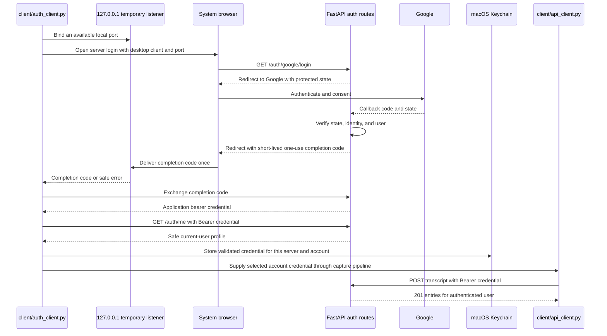

# SRA-303 — Desktop OAuth and authenticated capture client

**Type:** Task
**Phase:** 3 — Multi-tenancy, authentication, RBAC, and rate limiting
**Priority:** High — SRA-302 protects the server, so voice capture needs a secure way to identify its user
**Status:** Implemented — automated checks complete; real browser/Keychain and physical capture evidence pending
**Blocked by:** SRA-302
**Blocks:** SRA-305

## Summary

Add the macOS desktop login flow: open Google sign-in in the system browser,
receive a short-lived completion code on a temporary loopback server, exchange
it directly for the server-issued application credential, store that credential
in Keychain, validate it through `/auth/me`, and attach it to the existing HTTP
client. Preserve Phase 2's one-submission rule and its clear handling of
uncertain POST outcomes.

Before this ticket, the newly protected ingestion endpoint returns `401` to the
menu-bar app. After it, the user signs in once, captures a note through the same
recording/transcription pipeline, and the bearer-authenticated request stores the
entry under that user's Google-backed account.

## Where things stand right now

The auth client, loopback listener, native Keychain adapter, and menu actions are
implemented. The pipeline forwards the selected credential into one HTTP POST.
SRA-305 found and corrected attempt binding, cancellation, backend selection,
cross-account deletion, and credential-error redaction gaps. Automated coverage
now includes these boundaries; real browser/Keychain and physical capture remain
unverified.

SRA-302 provides the server login/callback, bearer credential, and `/auth/me`
contract. This ticket consumes those interfaces; it never receives the Google
client secret and never stores Google's authorization code or identity token.

## What this ticket unlocks

From a logged-out Mac, a developer can invoke desktop sign-in, finish Google
consent in the browser, see the authenticated account returned by `/auth/me`,
and then submit a typed or spoken note. The exact returned entry IDs are visible
only when authenticated as that same user. Quitting and restarting the desktop
app reuses the Keychain credential until it expires or is removed.

## How this fits into the whole app



The loopback server must bind only to `127.0.0.1`, accept a single expected
completion, enforce a finite timeout, and shut down on success, failure,
cancellation, or application exit. The OAuth `state` created by the server must
bind the callback to the requested desktop port; an arbitrary callback must not
be able to redirect secrets to a non-loopback host.

The loopback URL contains only a short-lived, single-use completion code. The
client exchanges it directly with the originating server; replay must fail. This
is a deliberate security refinement over putting the bearer token in browser
history and server/access logs.

Keychain is the long-lived credential owner. The in-memory HTTP wrapper borrows
the resulting bearer token for one request and must never print it, place it in a
URL, persist it in `.env`, or expose it in an exception. Use a service/account key
that separates credentials for different server origins so a localhost token is
not sent to a different deployment.

## Files and why they matter

| File | Role and required change |
|---|---|
| [`src/sra/client/auth_client.py`](../src/sra/client/) | New loopback/browser/Keychain orchestration. Return a credential or typed auth error and own listener cleanup. |
| [`src/sra/client/api_client.py`](../src/sra/client/api_client.py) | Add the bearer header to existing requests, validate `/auth/me`, and preserve response validation, timeouts, no automatic POST retry, and resource cleanup. |
| [`src/sra/config.py`](../src/sra/config.py) | Add client-only login timeout and safe Keychain/service configuration if needed. Never add server OAuth secret fields to `ClientSettings`. |
| [`src/sra/capture/menubar_app.py`](../src/sra/capture/menubar_app.py) | Add sign-in/sign-out/account feedback and handle an expired credential without blocking the UI loop or starting overlapping login/capture work. |
| [`src/sra/capture/pipeline.py`](../src/sra/capture/pipeline.py) | Existing collaborator. It should continue forwarding transcript text to one HTTP call and should not learn OAuth details. |
| [`pyproject.toml`](../pyproject.toml), [`requirements-lock.txt`](../requirements-lock.txt) | Declare/pin any direct secure-storage dependency. Browser and loopback primitives from the standard library need no package entry. |
| [`tests/unit/test_auth_client.py`](../tests/unit/), [`tests/unit/test_api_client.py`](../tests/unit/test_api_client.py), [`tests/unit/test_menubar_app.py`](../tests/unit/test_menubar_app.py) | New auth lifecycle tests plus extensions proving header behavior, redaction, no retries, UI handoff, and cleanup. |
| [`tests/e2e/test_authenticated_capture_e2e.py`](../tests/e2e/) | Drive a stored test application credential through the real client, protected API, ingestion graph, database, schedule, and search with only transport location/model/provider boundaries substituted. |
| [`README.md`](../README.md), [`.env.example`](../.env.example) | Explain desktop sign-in, Keychain prompts, logout/removal, expiry, and separate client/server configuration. |

## TDD starting point

Prepare typed stubs with teaching docstrings for login orchestration, credential
storage/loading/deletion, and token validation. Supply fake loopback, browser,
Keychain, clock, and HTTP boundaries; tests must not launch a browser, alter the
developer's Keychain, or contact Google by default.

Extend the current API-client tests rather than replacing their Phase 2
contracts. A test credential may be injected through the auth boundary, but the
e2e test must keep the real authorization header, `require_user`, route, graph,
repository, and scheduler in the path.

## What to implement

- Start a one-use loopback receiver on `127.0.0.1` with an OS-selected port;
  never bind all interfaces. Construct the login URL through the configured API
  base URL and percent-encode query parameters.
- Open the system browser only after the listener is ready. Wait for a bounded
  duration and return useful cancellation, timeout, bind, malformed-callback,
  and server-auth errors.
- Accept only the expected completion path and server-bound login attempt. Send
  a minimal success/error page to the browser, then release the port and thread.
  Exchange the short-lived completion code with the originating server exactly
  once; never accept or place the bearer credential in a URL.
- Store only the server-issued application credential in macOS Keychain, keyed
  by normalized server origin and account/subject. Never persist Google tokens,
  authorization codes, signing secrets, or bearer tokens in config files/logs.
- Load the stored credential and call `/auth/me` to validate it. Missing,
  expired, invalid, or wrong-server credentials become a typed "sign in again"
  result; delete unusable Keychain entries where appropriate.
- Attach `Authorization: Bearer ...` to ingestion. Keep audio and caller-supplied
  user IDs out of the request.
- On `401`, do not silently repeat an ingestion POST after interactive login: the
  server may have processed a request whose response was lost. Report the state
  and let the user check search before explicitly trying again.
- Add nonblocking sign-in/sign-out/account UI actions and safe status feedback.
  Prevent capture/login overlap and clean up the listener on quit.
- Preserve every Phase 2 error, timeout, validation, cleanup, and single-submit
  contract not explicitly changed by authentication.

## Where to look

- Technical design §1.3 and §3.28–§3.29.
- SRA-201 for the HTTP client's ownership and uncertain-outcome rules.
- SRA-205 for the UI-loop/background-worker and shutdown rules.
- SRA-302 for the server credential and `/auth/me` contract.

## Acceptance criteria

- [ ] Desktop login binds loopback only on localhost, exchanges one valid short-lived completion code, rejects replay, and releases every resource on all exits
- [ ] The application credential is stored in Keychain per server/account and is absent from URLs, config files, UI errors, and captured logs
- [ ] `/auth/me` validates a loaded credential; missing/expired/wrong-server credentials produce a clear sign-in requirement and recovery succeeds
- [ ] Typed and spoken ingestion send one authenticated POST and persist entries under the signed-in user, with exact IDs verifiable through authenticated search
- [ ] Authentication failures never trigger an automatic duplicate POST; Phase 2 timeout/response-shape semantics remain intact
- [ ] Sign-in, sign-out, capture, and quit remain responsive and do not leak listeners, threads, credentials, audio files, or HTTP clients
- [ ] Default tests use fake browser/Keychain/provider boundaries; real macOS/browser evidence is recorded separately

## How to test this ticket alone

```bash
source .venv/bin/activate
pytest tests/unit/test_auth_client.py tests/unit/test_api_client.py tests/unit/test_menubar_app.py -v
pytest tests/e2e/test_authenticated_capture_e2e.py -v
pytest tests/e2e/test_client_ingestion_e2e.py tests/e2e/test_terminal_capture_e2e.py -v
ruff check .
pyright
```

Expected automated checks never open the real browser or Keychain. Include a
test that binds a real ephemeral localhost socket if stable in CI, while keeping
Google and credential storage substituted.

## Manual verification

Run the SRA-302 server with a Google test application, remove only this test
server's prior Keychain entry through the documented command/UI, and start the
desktop app. Complete sign-in, verify the account display, submit a uniquely
worded typed note, then perform a real hotkey/microphone capture when Phase 2
hardware acceptance is available. Record returned IDs and find those exact IDs
through authenticated search.

Restart the desktop app and verify the stored credential works without another
Google prompt. Then sign out, confirm protected requests return a sign-in state,
sign in again, and verify recovery. Also exercise a cancelled browser login and
a loopback timeout; confirm the listener port is released and the next login
succeeds. Do not paste a live bearer token into the verification record.

## Verification record

- **SRA-305 follow-up, 2026-10-14:** local nonce binding is preserved through signed
  server state and rejected before exchange on mismatch. Real localhost tests
  exercise success, drip-fed incomplete headers, absolute timeout, cancellation,
  and port/watchdog-thread cleanup. Menu-adapter tests verify quit cancellation
  and restored-token forwarding into the pipeline. Native Cocoa/browser/Keychain
  are substituted, never silently opened by these tests.
- The full desktop auth roundtrip keeps listener, server login/callback/state,
  one-use exchange, credential validation, and stored-selector reuse real;
  Google identity, browser delivery, HTTP server location, and Keychain backend
  are controlled test boundaries. Recreating the adapter validates reuse but is
  not evidence of a real OS/app restart.
- A stored-credential voice E2E test uses the real transcription wrapper,
  pipeline, HTTP client, auth dependencies, graph, repository, schedules, and
  SQLite; model inference is substituted. Two users' new entry IDs remain
  isolated through broad search, foreign-ID chat tools, and next-day digest.
- Native Keychain selection is explicit; deleting account A preserves active
  account B. Authenticated transport/body/validation failures suppress upstream
  secret text, retain HTTP status and one-POST uncertainty, and never retry.
- Exact current full-suite, real-Whisper, lint/type results and remaining manual
  prerequisites are recorded in [SRA-305](SRA-305-phase-3-integration-verification.md).

- Date, macOS version, server origin, and browser (no secrets):
- Redacted signed-in account and `/auth/me` result:
- Keychain service/account convention and restart result:
- Typed/spoken entry IDs and authenticated search result:
- Cancellation/expiry/logout/recovery observations:
- Listener, worker, HTTP, and temporary-file cleanup:
- Automated/manual results, skips, and limitations:

## Definition of Done

- [ ] Acceptance criteria are met with real browser and Keychain evidence recorded
- [ ] Focused, Phase 2 regression, lint, and type checks pass
- [ ] Login/logout/recovery and credential-removal documentation is accurate
- [ ] Ticket board and progress documentation reflect the verified state
