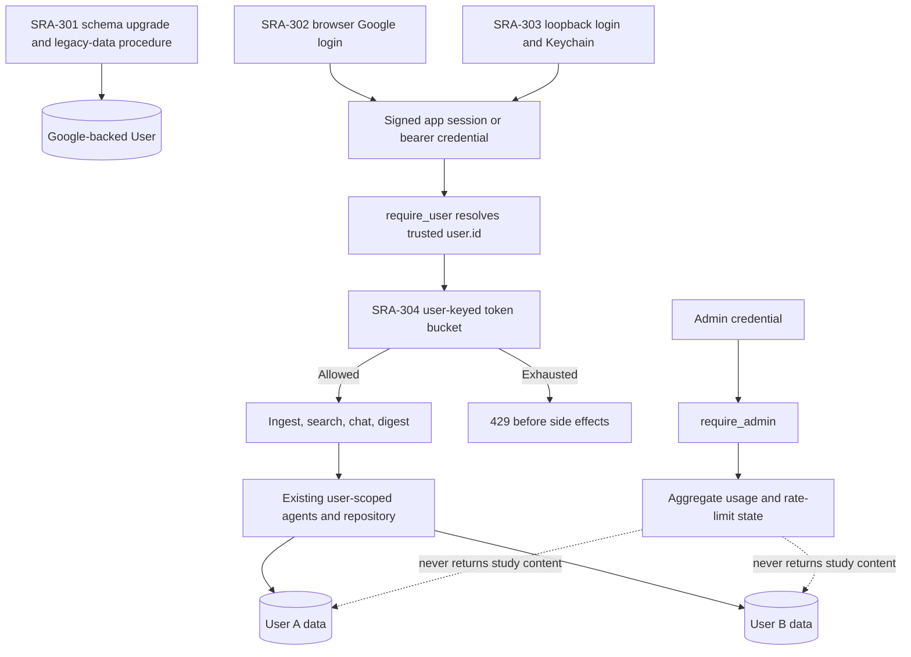

# SRA-305 — Phase 3 integration verification

**Type:** Verification (no new feature code expected)
**Phase:** 3 — Multi-tenancy, authentication, RBAC, and rate limiting
**Priority:** Highest — this is the "shared server is actually private and bounded" checkpoint
**Status:** Automated verification complete — open for real Google/two-account/Keychain/physical desktop acceptance
**Blocked by:** SRA-303, SRA-304 (transitively: SRA-301 and SRA-302)
**Blocks:** Phase 4 kickoff

## Summary

Verify the complete Phase 3 result across schema migration, real Google sign-in,
web sessions, desktop loopback login and Keychain reuse, authenticated voice
capture, per-user storage/retrieval, user/admin authorization, and rate limiting.
Close the phase only when two real accounts and the actual macOS client establish
the security properties that isolated unit tests cannot.

## Where things stand right now

SRA-301–SRA-304 are implemented. This verification found and repaired SRA-302/303
security and lifecycle defects and updated the opt-in audio harness for the
authenticated API. Full default and cached-Whisper automation pass. Real Google
accounts, browser cookie behavior, native Keychain, and physical microphone/
hotkey acceptance remain outstanding; SRA-206 is also still open. Neither this
ticket nor Phase 3 is complete, and Phase 4 remains blocked.

## What this ticket confirms

Two people can use one server without sharing study data. Each signs in with
Google, and the server—not the client or model—selects the owning user. The
desktop client keeps its application credential in Keychain, voice capture saves
under the signed-in account, ordinary users cannot access operational admin
routes, and abusive request bursts are rejected before expensive or mutating
work. Existing data survives the schema upgrade through the documented operator
procedure.

## How this fits into the whole app



Implementation order runs from SRA-301 to SRA-304. Runtime order begins with a
previously issued credential, then authentication, rate-limit selection, route
logic, and user-scoped storage. Verification must test both orders: an upgrade
must make login possible, and a request must be rejected before any downstream
side effect when identity, role, or capacity is invalid.

### Evidence layers

| Evidence | Establishes | Does not establish alone |
|---|---|---|
| Model/migration tests | Schema invariants and upgrade preservation | Google, cookie, or desktop behavior |
| Auth unit tests | State/token/profile/role contracts with controlled provider responses | Real Google Console configuration or browser cookies |
| Authenticated e2e tests | Actual dependency → route → agent → repository isolation for two users | Real external identity or Keychain behavior |
| Limiter unit/integration tests | Deterministic math, concurrency, key independence, and pre-side-effect rejection | Multi-process/global enforcement |
| Real browser and desktop checks | Google redirect/callback, cookie flags in context, loopback delivery, and Keychain reuse | A second account's isolation unless explicitly tested |
| Two-account product flow | User-visible privacy across ingest/search/chat/digest | Formal proof against every future route |
| Restart/failure checks | Credential, migration, cleanup, and recovery behavior | Distributed rate-limit persistence, which is intentionally absent |

## Files and why they matter

| File | Verification role |
|---|---|
| [`tests/integration/test_phase3_migration.py`](../tests/) | Rehearses upgrade from the prior Alembic revision with owned data intact. |
| [`tests/unit/test_auth.py`](../tests/unit/), [`tests/integration/test_authenticated_routes.py`](../tests/) | Establish provider/dependency behavior and two-user route isolation. |
| [`tests/unit/test_auth_client.py`](../tests/unit/), [`tests/e2e/test_authenticated_capture_e2e.py`](../tests/e2e/) | Establish desktop credential lifecycle and capture-to-storage ownership. |
| [`tests/unit/test_rate_limit.py`](../tests/unit/), [`tests/integration/test_rate_limited_routes.py`](../tests/) | Establish token math, concurrency, HTTP response, and no-side-effect ordering. |
| [`tests/e2e/`](../tests/e2e/) | Re-run Phase 1/2 product flows under authentication so security wiring does not regress scheduling or voice capture. |
| [`src/sra/api/routers/`](../src/sra/api/routers/) | Audit every mounted route for its explicit anonymous, user, admin, and limiter policy. |
| [`PROGRESS.md`](../PROGRESS.md), [`tickets/README.md`](README.md), [`README.md`](../README.md), [`tests/README.md`](../tests/README.md) | Record exact completion evidence, setup, expected substitutions, and known limitations. |
| [This ticket](SRA-305-phase-3-integration-verification.md) | Permanent record of accounts/environments, commands, IDs, failures, recovery, cleanup, and remaining limits without storing secrets. |

## Verification preparation

This ticket should not add a new implementation layer. If a check discovers a
defect, fix the ticket that owns the behavior, add its regression test, rerun
that ticket, and then repeat this complete verification.

Prepare two non-sensitive Google test accounts and one explicitly promoted admin
test account, a disposable upgraded database, an exact OAuth callback
configuration, and a Mac able to grant browser/Keychain/microphone/global-hotkey
permissions. Never place client secrets, bearer tokens, authorization codes, or
session cookies in tickets, terminal transcripts, screenshots, or CI artifacts.

## Acceptance criteria

- [x] A database created at the Phase 2 revision upgrades with existing ownership intact and follows the documented legacy-data procedure without automatic claiming
- [x] The full default suite passes offline, with provider/model/hardware boundaries replaced only where documented; lint and type checks pass
- [ ] Two real Google accounts can sign in and `/auth/me` returns the correct stable application users; logout, expiry, and invalid state fail safely and recover
- [ ] User A and user B create uniquely identifiable entries and cannot retrieve or infer each other's IDs/content through ingestion, search, chat, or digest
- [ ] The real desktop loopback/Keychain flow survives restart and a real capture stores data under the selected account without exposing the credential
- [x] User/admin behavior is correct and operational endpoints reveal aggregates only, never another user's study content
- [x] Authenticated and anonymous limits are independent, return correct `429`/`Retry-After`, block work before side effects, refill/recover, and state the single-process limitation
- [x] Every API route has an audited anonymous/user/admin and limiting policy; health remains usable
- [ ] Failure/recovery checks leave no listener, thread, HTTP client, credential log, temporary audio file, or duplicate submission
- [x] Setup, test, ticket-board, progress, and security-limitation documentation matches observed behavior

## Automated verification

Run the commands currently documented by the implementation tickets, followed
by the whole project:

```bash
source .venv/bin/activate
pytest tests/unit/test_user_model.py tests/unit/test_auth.py tests/unit/test_auth_client.py tests/unit/test_rate_limit.py -v
pytest tests/integration/test_phase3_migration.py tests/integration/test_authenticated_routes.py tests/integration/test_rate_limited_routes.py -v
pytest tests/e2e/test_authenticated_capture_e2e.py -v
pytest -q
ruff check .
pyright
```

If Phase 2 retains opt-in real Whisper or desktop checks, run them as documented
in [`tests/README.md`](../tests/README.md). Record actual test counts and skips;
do not copy expected counts from an older phase.

Add a route-policy audit test or explicit review table that fails when a newly
mounted route lacks its intended auth/rate-limit dependency. The objective is to
prevent future Phase 4 routes from silently becoming public.

## End-to-end manual flow

1. Back up a disposable Phase 2 database, run the Phase 3 migration, and record
   preserved user/entry/review IDs. Complete the operator-controlled legacy-data
   procedure and verify its recovery path.
2. Start one server process with normal OAuth and rate-limit settings. Sign in as
   user A in a browser and verify `/auth/me`.
3. Through the authenticated desktop app, capture a unique note such as
   "Phase three account A studied chloroplast thylakoid proton gradients." Record
   the returned entry IDs; verify those IDs through search, a grounded chat
   answer, and the correct next-day digest/schedule behavior.
4. Sign out and sign in as user B. Capture a different unique note, record its
   IDs, and prove broad and targeted search/chat/digest requests do not reveal
   user A's marker or IDs. Return to user A and prove the reverse.
5. Restart the desktop app and server as documented. Confirm Keychain reuse or
   expected reauthentication, correct account selection, preserved database
   ownership, and another successful capture.
6. As an ordinary user, call both admin routes and observe `403`. As the explicit
   admin, observe aggregate usage/rate-limit information and inspect it for study
   content or sensitive identifiers.
7. On the disposable server, lower thresholds, exhaust user A's bucket, and
   verify `429`, `Retry-After`, no new entry/model call, and user B independence.
   Exercise anonymous limiting and recovery, then restore normal settings.
8. Test invalid/expired login state, cancelled desktop login, unavailable server,
   and a lost/late ingestion response. Confirm safe feedback, no secret logging,
   no automatic duplicate POST, resource cleanup, and a successful later action.

Use exact newly returned IDs for persistence checks. A matching older topic or a
nonempty response is not sufficient. Do not alter stored ownership or schedules
to manufacture a successful result.

## Verification record

**2026-10-14, macOS development runner, Python 3.13, single-process app/test servers.**
No real browser, Google account, Keychain prompt, microphone or hotkey was opened.
Tests used ephemeral loopback ports and disposable SQLite databases. Localhost
tests ran after automatic approval permitted binding outside the restricted sandbox.

- `pytest -q -rs`: **386 passed, 9 skipped**. Eight skips are opt-in audio-flow
  cases (one live OpenAI); one is the opt-in Whisper test. No platform/listener
  skip remained in this run.
- `pytest -m phase3 -q`: **112 passed, 283 deselected**.
- `make test-data`: **394 passed, 1 deselected**. Real cached Whisper ran offline through
  controller/recorder/WAV, authenticated TCP HTTP, graph/storage/schedules,
  search/chat/digest and application/engine/server recreation. The remaining
  deselection is the live OpenAI case. The physical device and extraction/query
  models were substituted. The first attempt revealed five `401` failures in
  the outdated Phase 2 harness; it now supplies real signed test credentials and
  asserts the OAuth-shaped owner's ID instead of assuming `local@localhost`.
- `ruff check .`, `pyright`, and `git diff --check`: passed. No commit was made.
- Migration rehearsal uses revision `067a64508521` → `8cb1b420d9d2`, preserving
  user **41**, entry **51** owned by 41, and review **61** linked to 51, including
  timestamps and scheduled date. A stopped-database file backup is copied back
  into a separate recovery file and its old revision/IDs/ownership verified.
  Explicit linking retains user 41; relinking and duplicate subjects fail.
- Automated A/B identities are synthetic `subject-a`/`subject-b`; the E2E
  checks capture exact newly returned entry IDs (normally **1 and 2** in each
  fresh fixture), assert their resolved user IDs and six schedules, and exercise
  both broad search and foreign-entry-ID chat calls. Real query tools cannot
  retrieve the other user's row; next-day digest returns exactly the owner's
  newly created ID without editing stored dates. These are not real Google
  accounts and do not satisfy the outstanding two-account product acceptance.
- The stored-credential voice test recreates a Keychain adapter around a fake
  secure backend, validates `/auth/me`, forwards its token through the real
  transcription wrapper/pipeline/client, and checks ownership. The native-menu
  adapter test verifies the restored credential reaches `process_recording` and
  quit signals a pending login. No real OS process restart is claimed.
- A complete automated desktop sign-in roundtrip keeps the actual localhost
  listener, nonce, signed server state, callback, one-use completion exchange,
  credential validation and stored-selector reuse. Browser delivery, Google
  identity, secure backend and API network location are substituted. Separate
  real TCP tests drip-feed incomplete callback headers and verify absolute
  timeout/cancellation, closed ports and no surviving deadline thread.
- Owning-component fixes: web callbacks require the initiating browser's
  HttpOnly login cookie; desktop callbacks require the client-generated nonce;
  OAuth state/code consumption is synchronized (16 consumers, exactly one
  success); expired pending state is pruned on issue. The native Keychain backend
  is selected explicitly. Removing inactive account A preserves active account
  B. Authenticated error paths no longer reflect upstream bodies, validation
  payloads or transport exception strings into UI/tracebacks. No retry was added.
- RBAC tests exercise both admin endpoints (`403` user, `200` admin), aggregate
  response shapes, and rejection before user-owned content/work. Current limiter
  regressions cover independent user/IP buckets, expiry/refill/reset, spoofed
  forwarding headers, concurrency, `429`/`Retry-After`, and no writes/model calls
  after denial. The earlier SRA-304 real HTTP smoke is preserved in that ticket:
  A `201,201,429`, independent B `200`, anonymous `302,302,429`, `Retry-After: 2`,
  two entries/twelve schedules/two inference calls at denial, then recovery.

The route inventory is enforced by
[`test_route_policy_audit.py`](../tests/integration/test_route_policy_audit.py),
including dependencies inherited from nested routers; an unlisted route fails.

| Mounted paths | Authentication | Rate limit |
|---|---|---|
| `/api/health` | Public health only | Exempt |
| `/docs`, `/docs/oauth2-redirect`, `/redoc`, `/openapi.json` | Public framework documentation/schema | Exempt; no user data |
| `/api/v1/auth/google/login`, `/google/callback`, `/desktop/exchange`, `/logout` (all under `/api/v1/auth`) | Anonymous auth lifecycle | Shared peer-IP bucket |
| `/api/v1/auth/me`, `/entries/ingest`, `/search`, `/chat`, `/digest` (all under `/api/v1`) | Trusted authenticated user | Shared user-ID bucket |
| `/api/v1/admin/usage`, `/api/v1/admin/rate-limits` | Trusted admin; role checked before limit | Shared user-ID bucket |

**Remaining acceptance:** run the manual flow above with two real Google test
accounts, an explicitly promoted admin and a configured Mac. Record exact
new IDs, browser cookie/expiry/logout recovery, real Keychain restart reuse,
microphone/global-hotkey/native-UI behavior and cleanup. Real provider-backed
`make test-live` was not rerun in this verification. OAuth replay stores and rate
limits remain process-local; application bearer logout cannot revoke a stolen
stateless credential before expiry. Auth HTTP operations retain 15-second
network timeouts; cancellation checks occur between operations, and native OS
prompts may need operator dismissal. README disables server access logging and
requires proxy/tracing redaction of auth query strings/headers. No claim is made
about a user's existing logs or Git history, which were not inspected for live secrets.

## Definition of Done

- [ ] Every acceptance criterion has current evidence or the ticket remains open
- [ ] Each implementation ticket has its own completed verification record
- [ ] Secrets and live credentials are absent from repository/history/artifacts
- [ ] Full regression, lint, type, migration, real OAuth, and desktop checks are recorded
- [ ] Phase 3 is marked complete only after documentation matches verified behavior
