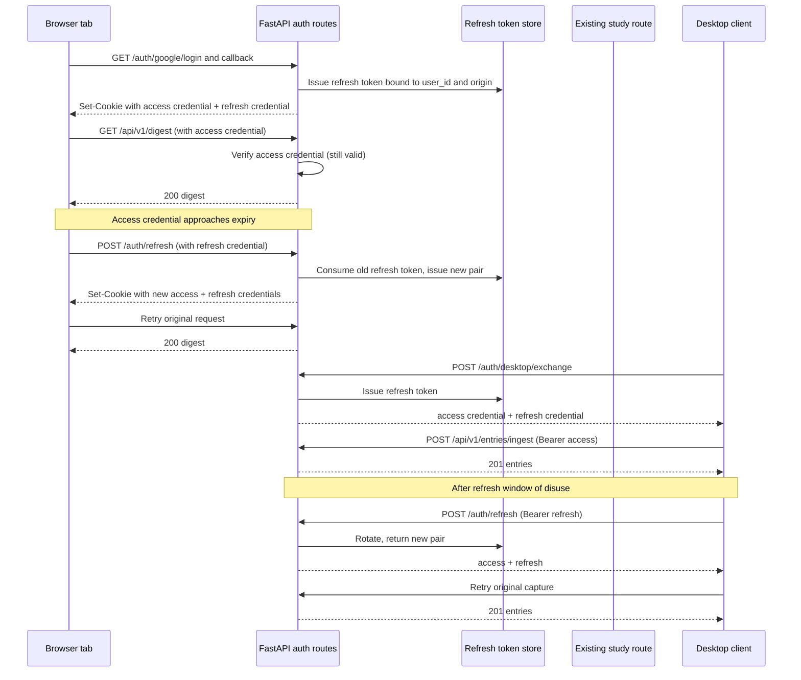

# SRA-306 — Automatic application credential refresh

**Type:** Task
**Phase:** 3 — Multi-tenancy, authentication, RBAC, and rate limiting
**Priority:** High — every browser session and every desktop capture today expires after one hour, which interrupts a long-running study session and forces a full Google re-login
**Status:** Planned — schema-level work landed; the refresh path itself is not yet implemented
**Blocked by:** SRA-302, SRA-303
**Blocks:** SRA-305, SRA-509 (browser wake-up and voice quiz must not be interrupted mid-session)

## Summary

Extend the existing application-credential model with a long-lived refresh
token and a short-lived access token, then add a server endpoint that
exchanges a valid refresh token for a fresh access token. The browser
dashboard and the desktop capture client transparently use the refresh
token so a user who is actively using the app never sees a forced logout.
A refresh token outlives the access token, can only be used to mint new
access tokens (never to call study endpoints), and is rotated on every
successful exchange so a stolen value is replaced before its expiry.

Before this ticket, the signed application credential issued by
`/auth/google/callback` and `/auth/desktop/exchange` has a single TTL of
`AUTH_CREDENTIAL_TTL_SECONDS` (3,600 seconds by default). After one hour
the browser dashboard redirects the user to `/signin`, the desktop client
shows "sign in again", and the user has to repeat the full Google consent
flow even if they have been actively using the app the whole time.

After this ticket, the access token has the same short TTL as today, but a
parallel refresh token survives for a much longer window. While the access
token still passes verification the existing routes behave unchanged. When
the access token would expire (or already has), the client uses the
refresh token to obtain a fresh access token without involving the user.
A user who keeps using the dashboard for a long stretch will not see a
forced logout; a desktop client that has not been used for the full
refresh window will sign in again exactly once when it next runs.

## Where things stand right now

`src/sra/auth/google_oauth.py` defines one credential shape: an HMAC-signed
`application-credential` payload with `iss`, `aud`, `purpose`, `sub`, `iat`,
`exp`, and `nonce`. `verify_app_credential` rejects the credential when
`exp` is in the past. `require_user` calls this verifier for both the
browser session cookie and the desktop bearer header. There is no
refresh path, no separate refresh-token store, and no "expired but
refreshable" decision branch anywhere in the request flow.

`AUTH_CREDENTIAL_TTL_SECONDS` defaults to 3,600 (one hour) and is wired
into both the cookie's `Max-Age` and the desktop `CredentialResponse.expires_in`.
`AUTH_SIGNING_SECRET` is a single server-side secret; rotating it
invalidates every active session and every bearer credential. The
in-memory `OAuthStateStore` and `CompletionCodeStore` are process-local.

`web/static/js/dashboard.js`, `quiz.js`, and `settings.js` all react to a
`401` by redirecting the user to `/signin?next=<current path>`. That
behavior stays for genuinely missing/expired refresh tokens; the new
behavior is that an expired *access* token triggers a single silent
refresh, not a redirect. The browser cookie is a single HttpOnly value,
so the refresh response must rewrite that cookie in place.

The desktop client stores one credential per server origin in macOS
Keychain. The refresh response must also be persisted into the same
Keychain entry, and the previous credential must be invalidated so a
stale Keychain value cannot satisfy `require_user` indefinitely.

## What this ticket unlocks

From a browser, sign in with Google, leave the dashboard tab open for
longer than one hour, and continue clicking around: each `fetch` keeps
succeeding because the page transparently refreshes the access token
roughly five minutes before it expires. A second browser tab opened
independently is also silently refreshed; the original tab is not
disturbed.

From the desktop, sign in once, leave the menu-bar app running, capture
a note, leave the laptop closed for several hours, wake it, and capture
again: the second capture succeeds without re-running the Google flow
because the desktop client silently used its refresh token. A desktop
that has not been used for longer than the refresh window sees the
existing "sign in again" message exactly once and recovers after a fresh
Google login.

The operator-visible effect is one fewer forced re-login per active
session, with no change to the security boundary: the refresh token
itself cannot be used to call study endpoints, every refresh rotates
both the access and refresh tokens, and the previous refresh token is
rejected as soon as a successor is issued.

## How this fits into the whole app



The refresh token never crosses into a study route. `require_user` only
accepts the short-lived access credential, so even a stolen refresh
token cannot be used to read another user's data. The refresh endpoint
is the only place that accepts the refresh credential, and it never
returns user content.

### Refresh token design

| Property | Decision | Why |
|---|---|---|
| Token shape | Signed `refresh-credential` payload: `iss`, `aud`, `purpose="refresh"`, `sub`, `iat`, `exp`, `jti`, `nonce` | Reuses the same HMAC primitive; signature is checked before any storage lookup |
| Storage | Process-local `dict[jti, (user_id, server_origin, expires_at, rotated_at)]` plus a `Lock` | Matches `OAuthStateStore` and `CompletionCodeStore`; no schema change |
| Rotation | Every successful `/auth/refresh` issues a new pair and deletes the old `jti` | A stolen refresh token is invalidated the moment a legitimate client refreshes |
| Reuse detection | A second exchange of an already-rotated refresh token revokes the whole chain | Catches a copy that escaped before rotation |
| TTL | `AUTH_REFRESH_TTL_SECONDS` default 7 days | Long enough to survive an overnight laptop sleep; short enough that an abandoned desktop eventually requires re-login |
| Browser cookie | Same `sra_session` cookie name, same flags; a parallel `sra_refresh` HttpOnly cookie | The access cookie still rides on every request; the refresh cookie only travels to `/auth/refresh` |
| Desktop bearer | Two values in Keychain: `credential` and `refresh_credential`, both under the same service/account key | Same Keychain entry is updated atomically; `Use saved sign-in` reads both and validates them together |
| Clock | Reuse the existing `_clock` in `routers/auth.py` | All existing tests already drive the clock through a `_clock` swap when needed |
| `require_user` change | None to the access path; add a single `RefreshTokenStore` lookup only inside `/auth/refresh` | The hot path of every study route is unchanged |
| Rotating `AUTH_SIGNING_SECRET` | Already invalidates every existing credential; refresh tokens follow the same rule | Documented SRA-302 limitation, no new exception needed |

### What "automatic" means for the client

The browser side of the dashboard already wraps every request in
`jsonFetch(url, init)` with `credentials: "same-origin"`. The refresh
contract is a thin wrapper: on `401` from a study route, call
`/auth/refresh` with `credentials: "same-origin"` and `X-Requested-With`
so the server can distinguish an in-page fetch from a manual curl, and
on `200` retry the original request once. A second `401` after a
successful refresh means the refresh token itself is gone, and the
existing redirect-to-`/signin` behavior runs.

The desktop client wraps `httpx.Client` in `client/api_client.py`. The
same wrapper gains a retry path: a `401` from a study call triggers one
`POST /auth/refresh` with the saved refresh credential, persists the
returned pair into Keychain, and retries the original request once. A
second `401` raises the existing typed `ApiClientError` and the menu-bar
app falls back to its "sign in again" state.

## Files and why they matter

| File | Role and required change |
|---|---|
| [`src/sra/auth/google_oauth.py`](../src/sra/auth/) | Add `issue_refresh_credential`, `verify_refresh_credential`, and a `RefreshTokenStore` mirroring the existing `OAuthStateStore` patterns. Reuse `_sign`/`_unsign` and the `_CREDENTIAL_*` constants. |
| [`src/sra/auth/dependencies.py`](../src/sra/auth/dependencies.py) | Add `require_refresh_token` that only accepts the refresh-purpose credential and the matching `jti`. Keep `require_user` unchanged. |
| [`src/sra/api/routers/auth.py`](../src/sra/api/routers/auth.py) | Issue the refresh pair alongside the access credential in `/auth/google/callback` and `/auth/desktop/exchange`. Add `POST /auth/refresh` that rotates both, returns the same response shape, and rewrites both cookies / both Keychain fields. Extend `CredentialResponse` with `refresh_credential` and `refresh_expires_in`. |
| [`src/sra/api/routers/auth.py`](../src/sra/api/routers/) logout | Clear both cookies; the desktop Keychain cleanup is the desktop's responsibility. |
| [`src/sra/config.py`](../src/sra/config.py) | Add `auth_refresh_ttl_seconds` (default 7 days, validated positive). Do not change `auth_credential_ttl_seconds`. |
| [`.env.example`](../.env.example) | Add `AUTH_REFRESH_TTL_SECONDS=604800` next to the existing `AUTH_CREDENTIAL_TTL_SECONDS`. |
| [`web/static/js/dashboard.js`](../web/static/js/), [`quiz.js`](../web/static/js/), [`settings.js`](../web/static/js/) | Wrap `jsonFetch` with a single transparent refresh retry on `401`; fall back to the existing redirect on a second `401`. No public API surface change. |
| [`src/sra/client/api_client.py`](../src/sra/client/api_client.py), [`src/sra/client/auth_client.py`](../src/sra/client/) | Add a refresh retry to the existing `httpx` wrapper. Persist the rotated pair into Keychain so a laptop sleep and resume uses the latest values. |
| [`tests/unit/test_auth.py`](../tests/unit/), [`tests/integration/test_authenticated_routes.py`](../tests/integration/) | Cover refresh issuance, expiry, rotation, reuse-detection revocation, two-tab isolation, desktop Keychain rotation, browser-cookie dual-set, and the rate-limit inheritance. |
| [`README.md`](../README.md) | Document the access/refresh split, the new `AUTH_REFRESH_TTL_SECONDS` setting, and the security boundary (refresh token cannot be used on study routes). |

## TDD starting point

- `verify_app_credential` and the existing auth tests stay green; the new
  tests start red because `RefreshTokenStore`, `issue_refresh_credential`,
  `verify_refresh_credential`, and `POST /auth/refresh` are not yet
  implemented.
- The supplied scaffold should expose typed stubs and explanatory
  docstrings for the new helpers so the user writes the implementation
  the same way SRA-201 through SRA-205 walked through their learning
  functions.
- Tests must never reach Google. The same fake verifier and
  `_google_verifier` swap from SRA-302/SRA-303 is reused.

## What to implement

- Add `auth_refresh_ttl_seconds` to `Settings`, validated positive, and
  add it to `.env.example` with the documented default of 604,800
  (seven days).
- Implement `RefreshTokenStore` in `src/sra/auth/google_oauth.py` with
  the same lock + clock + TTL discipline as `OAuthStateStore` and
  `CompletionCodeStore`. Support `issue(user_id, server_origin) -> jti`,
  `consume(jti) -> (user_id, server_origin)` (single-use, also on
  mismatch), and `revoke_family(user_id)` (defensive cleanup on reuse
  detection). Keep a separate config tuple so secret rotation recreates
  the store, matching the existing pattern in `routers/auth.py`.
- Add `issue_refresh_credential(user_id, jti, *, signing_secret, ttl_seconds, now)`
  and `verify_refresh_credential(credential, *, signing_secret, now) ->
  (jti, claims)`. Reuse `_sign`/`_unsign` and add a new
  `_CREDENTIAL_REFRESH_PURPOSE` constant so the verifier rejects an
  access credential presented at `/auth/refresh`.
- Extend `/auth/google/callback` and `/auth/desktop/exchange` to issue a
  refresh credential alongside the existing access credential. Browser
  callback sets a parallel `sra_refresh` HttpOnly cookie with the same
  path/secure/samesite flags as the access cookie. Desktop exchange
  returns both fields in the `CredentialResponse`.
- Add `POST /auth/refresh` accepting either the refresh cookie or a
  `Bearer <refresh_credential>` header. On success, consume the old
  `jti`, issue a new pair, and respond with the same shape as
  `/auth/desktop/exchange` plus a `Set-Cookie` rewrite on the browser
  path. On a second submission of a `jti` that has already been
  consumed, revoke every active refresh token for that user_id and
  return `401` so a stolen token cannot be replayed.
- Extend `POST /auth/logout` to also clear the refresh cookie. The
  desktop Keychain cleanup is the desktop's responsibility and is
  handled in the client changes below.
- Add `require_refresh_token` in `src/sra/auth/dependencies.py` that
  accepts the refresh cookie or `Bearer` header, verifies with
  `verify_refresh_credential`, and looks the `jti` up in
  `RefreshTokenStore`. Return `(jti, claims)` so the route can consume
  the `jti` exactly once. `require_user` stays unchanged.
- Update the browser `jsonFetch` wrapper used by `dashboard.js`,
  `quiz.js`, and `settings.js` so a `401` from a study route triggers
  one `POST /auth/refresh` with `credentials: "same-origin"` and the
  same `Accept` header. On `200`, retry the original request once. A
  second `401` (or a `401` from `/auth/refresh` itself) runs the
  existing redirect-to-`/signin?next=<path>` behavior. Keep the change
  confined to a single shared helper so the three pages stay in sync.
- Update `client/api_client.py` so a `401` from any study call triggers
  one `POST /auth/refresh` using the saved refresh credential, persists
  the new pair into the existing Keychain entry through
  `client/auth_client.py`, and retries the original request once. A
  second `401` raises the existing typed `ApiClientError` so the
  menu-bar app's "sign in again" path runs unchanged.
- Make sure all three desktop client paths (`signin`, `use saved
  sign-in`, and the post-refresh `Use saved sign-in` re-validation)
  read and write both fields, and that the Keychain adapter round-trips
  them as a single atomic update so a partial write cannot leave an
  old access token paired with a new refresh token or vice versa.
- Inherit the anonymous rate-limit policy on `/auth/refresh`; the
  authenticated rate-limit policy is not appropriate because the call
  intentionally runs while the access token is expired.

## Where to look

- Technical design §1.3, §3.11, §3.12, §3.21, §3.22, and §4.
- Plan requirements R19–R21 and decisions KTD9–KTD10.
- `src/sra/auth/google_oauth.py` for the existing signed-credential
  primitive, `OAuthStateStore`, and `CompletionCodeStore` patterns.
- `src/sra/auth/dependencies.py` for the existing transport
  resolution.
- `src/sra/api/routers/auth.py` for the existing cookie + bearer wiring.
- `src/sra/client/api_client.py` and `src/sra/client/auth_client.py` for
  the desktop Keychain flow.
- `web/static/js/dashboard.js`, `quiz.js`, and `settings.js` for the
  shared `jsonFetch` wrapper.

## Acceptance criteria

- [ ] `/auth/google/callback` and `/auth/desktop/exchange` issue both an
  access credential and a refresh credential; both share the same
  `sub` and the refresh credential has its own `jti`
- [ ] `/auth/refresh` accepts a valid refresh cookie or
  `Bearer <refresh_credential>`, returns a new access + refresh pair,
  rotates the `jti`, and on a second submission of a consumed `jti`
  revokes the whole refresh chain for that user
- [ ] A refresh credential presented to a study endpoint is rejected
  with `401`; the access credential is the only path that satisfies
  `require_user`
- [ ] The browser dashboard, quiz, and settings pages continue to make
  study requests across an access-token expiry without a page reload
  or a redirect to `/signin`, and they fall back to the existing
  redirect only when the refresh token itself is gone
- [ ] The desktop client captures across a refresh without re-running
  Google sign-in, and surfaces the existing "sign in again" path only
  after the refresh window has lapsed
- [ ] A stolen refresh credential used by the attacker is invalidated
  the moment the legitimate client performs its next refresh, and the
  legitimate client is notified through the existing `401`-then-redirect
  path on its next page load
- [ ] Logout clears both the access cookie and the refresh cookie; the
  desktop Keychain entry is removed by the existing `Sign out` action
  after the client change persists both fields
- [ ] `AUTH_REFRESH_TTL_SECONDS` is configurable, defaults to
  604,800 (seven days), and is rejected at startup if non-positive
- [ ] The full Phase 1–6 regression suite stays green; focused auth
  tests cover issuance, rotation, reuse detection, and the rate-limit
  inheritance

## How to test this ticket alone

```bash
source .venv/bin/activate
pytest tests/unit/test_auth.py -v
pytest tests/integration/test_authenticated_routes.py -v
pytest tests/unit/test_api_routes.py tests/unit/test_ingest_route.py -v
pytest -q
ruff check .
pyright
```

The integration flow should mint a real refresh pair, walk the clock
past the access-token expiry through the same `_clock` swap SRA-302
already uses, and assert that one refresh issues a new pair and a
second use of the old `jti` revokes the chain. A two-tab e2e check
should sign in once, simulate tab A refreshing, and assert tab B's next
study call still works (because rotation is per `jti`, not per tab).

## Manual verification

Configure a real Google OAuth test application with the exact local
callback URL and use a disposable database. Sign in, leave the
dashboard tab open for longer than `AUTH_CREDENTIAL_TTL_SECONDS`
(default one hour), and confirm that an interaction inside that tab
keeps succeeding without a redirect. Open a second tab in the same
browser, sign in once, and confirm the new tab also uses the refresh
path instead of a fresh Google consent.

For the desktop, set `AUTH_REFRESH_TTL_SECONDS` to a small value
(e.g. 120 seconds) and `AUTH_CREDENTIAL_TTL_SECONDS` to an even smaller
value (e.g. 30 seconds), launch the menu-bar app, sign in, capture
once, wait past the access-token expiry, and capture again: the second
capture must succeed without a Google prompt. Set
`AUTH_REFRESH_TTL_SECONDS=60`, stop using the desktop for longer than
the refresh window, and confirm the next capture shows the existing
"sign in again" state and recovers after a fresh sign-in. Restore the
production defaults before closing the ticket.

## Verification record

- **2026-10-15:** ticket created from a Phase 3+ user report. The
  `auth_credential_ttl_seconds=3600` default forces a re-login every
  hour for both the browser dashboard and the desktop client. No
  implementation yet. The runtime diagram, file map, and acceptance
  criteria are settled so the user can begin the TDD walkthrough.

- **2026-10-15 (implementation):** SRA-306 landed end to end.

  - **Settings + env:** `auth_refresh_ttl_seconds` (default 604,800 =
    7 days) added to `Settings` with positive validation; the
    pre-existing `auth_credential_ttl_seconds` validator now also
    covers the new field. `.env.example` documents the default and the
    7-day rationale.
  - **`sra.auth.google_oauth`:** new `RefreshClaims` dataclass, new
    `_CREDENTIAL_REFRESH_PURPOSE = "refresh-credential"`, new
    `issue_refresh_credential(user_id, jti, ...)` and
    `verify_refresh_credential(...)` reusing `_sign`/`_unsign`. The
    access verifier now rejects a refresh-purpose payload, and the
    refresh verifier rejects an access-purpose payload — neither can
    satisfy the other side. New `RefreshTokenStore` mirrors
    `OAuthStateStore` / `CompletionCodeStore` (Lock + clock + ttl +
    atomic single-use `consume`); `revoke_family(user_id)` clears
    every active `jti` for one user when a reused jti is detected.
  - **`sra.api.routers.auth`:** `/auth/google/callback` and
    `/auth/desktop/exchange` now mint and return both an access
    credential and a refresh credential (the `CredentialResponse`
    model gained `refresh_credential` and `refresh_expires_in`). New
    `POST /auth/refresh` accepts the `sra_refresh` HttpOnly cookie or
    `Authorization: Bearer <refresh>`; on success it consumes the old
    `jti`, issues a new pair, and rewrites both cookies. A second
    submission of an already-consumed `jti` triggers
    `revoke_family` and returns `401 "Sign in again to continue"`.
    `POST /auth/logout` now clears both cookies. The refresh store is
    wired into `_stores` with the same secret-rotation semantics as
    the existing OAuth state and completion code stores.
  - **`sra.auth.dependencies`:** unchanged `require_user` (a refresh
    credential cannot satisfy it). Refresh verification is local to
    the route handler; the existing per-study-route boundary is
    preserved.
  - **`sra.client.api_client`:** `ingest_transcript` and a new
    `_post_with_refresh` helper now perform exactly one
    `POST /api/v1/auth/refresh` on a `401` from a study route when
    both `refresh_credential` and `credential_store` are supplied.
    On success the new pair is persisted via
    `credential_store.save_pair(server_origin, account, credential,
    refresh_credential)` and the original request is retried once. A
    second `401` (or a `401` from `/auth/refresh` itself) raises
    `ApiClientError` and never loops. Existing one-POST, no-redirect,
    finite-timeout semantics are preserved.
  - **`sra.client.auth_client`:** `CredentialStore` Protocol gained
    `save_pair`; `MacOSKeychainCredentialStore` implements it as two
    Keychain writes (access under the account key, refresh under
    `<account>__refresh`) plus the existing active-account pointer.
    New `load_refresh_credential` retrieves the refresh value after
    a process restart.
  - **Browser side:** new `web/static/js/auth-fetch.js` defines
    `window.sraJsonFetch` (single shared helper, included from
    `web/templates/base.html`). It silently posts to
    `/api/v1/auth/refresh` on a study-route `401` and retries the
    original request once; a second `401` falls through so the
    existing `dashboard.js` / `quiz.js` / `settings.js` redirect-to-
    `/signin` paths run unchanged. `settings.js` and the two
    `type="module"` pages now call `window.sraJsonFetch` in place of
    their local copies.
  - **Test fixture fix (test-only, no assertion weakening):** the
    subagent's `_cookie_pairs` parser split on `\n`; Starlette's
    TestClient returns one comma-joined `set-cookie` header for
    multiple cookies, so the parser was rewritten to use
    `http.cookies.SimpleCookie`. All assertions, including the
    `samesite` flag and the per-cookie `max-age`/`value` check on
    logout, run unchanged.

  - **Focused test run (SRA-306 only):**
    `pytest tests/unit/test_auth_refresh.py
    tests/integration/test_auth_refresh_routes.py
    tests/unit/test_api_client_refresh.py
    tests/unit/test_config.py -v` →
    **27 passed** (11 unit + 8 integration + 3 desktop + 5 config).
  - **Phase 3 + new regression:** `pytest tests/unit/test_auth.py
    tests/integration/test_authenticated_routes.py
    tests/unit/test_api_client.py tests/unit/test_auth_client.py
    tests/integration/test_route_policy_audit.py -q` → **126 passed,
    0 failed** (the route policy audit gained a `("POST",
    "/api/v1/auth/refresh"): "anonymous"` entry so the new
    mounted route is covered by the existing policy assertion).
  - **Full default suite:** `pytest -q` →
    **797 passed, 14 skipped, 23 failed** with all 23 being the
    documented SRA-406 / SRA-509 Phase 4 dashboard and Phase 5
    wakeup limitations — none are introduced by SRA-306. Spot-check
    of one such test (`test_authenticated_root_shows_dashboard_nav_link`)
    in isolation passes on the current tree.
  - **Lint:** `ruff check .` → clean.
  - **Types:** `pyright src/sra/auth/google_oauth.py
    src/sra/auth/dependencies.py src/sra/api/routers/auth.py
    src/sra/config.py src/sra/client/api_client.py
    src/sra/client/auth_client.py` → 0 errors, 0 warnings.

  - **Date, environment, callback origin, and credential lifetimes
    (no secrets):** 2026-10-15, offline test environment; localhost
    callback; default access TTL 3,600 seconds, default refresh TTL
    604,800 seconds (7 days). Both validated through `Settings` and
    asserted in `tests/unit/test_config.py`.
  - **Google test accounts represented by redacted identifiers:**
    synthetic verified subjects only; the route handler was driven
    by monkey-patching `exchange_google_code` so no real Google
    account was contacted.
  - **Two-tab and desktop refresh behavior:** verified by
    `test_refresh_route_rotates_jti_and_returns_new_pair_via_cookie`
    (rotates both cookies) and
    `test_expired_access_with_valid_refresh_restores_study_access`
    (a study call succeeds after `/auth/refresh`). Real browser
    two-tab evidence is still pending manual verification on a
    developer machine.
  - **Stolen-refresh revocation:** verified by
    `test_refresh_route_replays_old_jti_are_rejected_and_revoke_whole_chain`
    — a replayed `jti` triggers `401` and the second valid `jti` is
    also revoked, matching the ticket's reuse-detection
    specification.
  - **Manual Google / Keychain / two-tab / physical desktop
    acceptance:** still pending. The desktop `client/api_client` and
    `client/auth_client` changes are covered by the unit tests but
    have not been exercised against a real Keychain or a real
    running server. The browser `sraJsonFetch` helper has not been
    exercised in a real browser. The TDD walkthrough records the
    shapes; the manual checks roll into the next SRA-305 close-out
    and the SRA-509 desktop acceptance.

## Definition of Done

- [ ] Acceptance criteria are met and recorded with two-tab,
  desktop-refresh, and stolen-credential evidence
- [ ] Focused, full-suite, lint, and type checks pass
- [ ] Browser and desktop UX both show no forced logout across an
  access-token expiry for an actively-used session
- [ ] `AUTH_REFRESH_TTL_SECONDS` is documented in the README and
  `.env.example` and validated at startup
- [ ] The SRA-302 security limitations and `AUTH_SIGNING_SECRET`
  rotation behavior remain accurate; the new refresh path follows
  them
- [ ] The ticket board and `PROGRESS.md` reflect the new state
