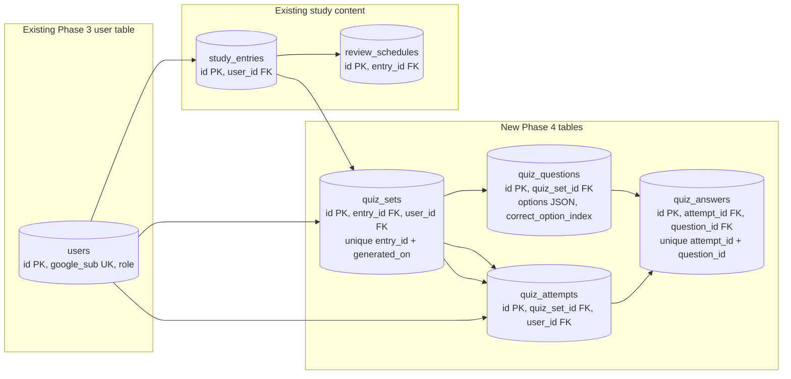

# SRA-401 — Quiz schema and safe migration

**Type:** Task
**Phase:** 4 — Daily MCQ quiz (web)
**Priority:** Highest — every later quiz ticket depends on durable storage for sets, questions, attempts, and answers
**Status:** Planned
**Blocked by:** SRA-305 (Phase 3 completion)
**Blocks:** SRA-402, SRA-403, SRA-404, SRA-405, SRA-406

## Summary

Add the four tables the quiz feature needs (`quiz_sets`, `quiz_questions`, `quiz_attempts`, `quiz_answers`) to the existing SQLModel metadata, and ship an Alembic migration that preserves every Phase 1–3 row in place. After this ticket, the database can store one quiz set per `(entry_id, generated_on)` per user, hold the question text and option list together, record each attempt with its mode and snapshot counts, and keep one `QuizAnswer` per question per attempt.

This ticket is **schema only**. No quiz is generated, no API exposes it, no user can start an attempt yet. The route and agent work come in later tickets.

## Where things stand right now

- [`src/sra/db/models.py`](../src/sra/db/models.py) defines `User` (Phase 3 identity), `StudyEntry`, and `ReviewSchedule`. Every write goes through `repository.create_entry`, which is already user-scoped.
- The two existing Alembic revisions live at [`src/sra/alembic/versions/067a64508521_initial_schema.py`](../src/sra/alembic/versions/067a64508521_initial_schema.py) and [`src/sra/alembic/versions/8cb1b420d9d2_add_oauth_identity_fields.py`](../src/sra/alembic/versions/8cb1b420d9d2_add_oauth_identity_fields.py). New revisions chain off the latest one.
- The Phase 3 model file already follows the `<Name>Base`/`<Name>Create`/`<Name>` convention (no caller-supplied IDs or timestamps, `extra="forbid"` on Create types) — Phase 4 follows the same pattern.
- [`tests/conftest.py`](../tests/conftest.py) builds an isolated in-memory SQLite engine per test and creates the schema via `SQLModel.metadata.create_all`, so adding tables is observable immediately for unit tests; a separate file-database integration test must rehearse the migration path because in-memory `create_all` is not evidence that an existing database upgrades correctly.
- The user-preference fields `quiz_question_count` and `quiz_option_count` are **not** part of this ticket. The Phase 3 `User` row carries only identity and authorization fields. Phase 4 stores a snapshot of those preferences on each `QuizSet` at generation time, so changing the preference later does not change already-saved quizzes; the preference table itself belongs to a future preferences ticket, not Phase 4.

## What this ticket unlocks

Run a temporary file database seeded with one Phase 3 user, one entry, and six pending reviews. Apply `alembic upgrade head`. Verify:

1. `quiz_sets`, `quiz_questions`, `quiz_attempts`, and `quiz_answers` exist with the columns and unique constraints defined in [technical-design §2.2](../docs/design/technical-design.md#22-table-definitions).
2. The pre-existing `users`, `study_entries`, and `review_schedules` rows have the **same** IDs, timestamps, and foreign keys.
3. Inserting a second `QuizSet` with the same `(entry_id, generated_on)` fails on its unique constraint — the idempotency guard that the SRA-403 pregeneration job will rely on.
4. Inserting two `QuizAnswer` rows for the same `(attempt_id, question_id)` fails — the per-question-per-attempt uniqueness guard.
5. `alembic downgrade -1` cleanly removes the four new tables without touching the existing ones; `alembic upgrade head` restores them.

SRA-402 will reuse these tables when it persists a generated quiz. SRA-403 will rely on the `(entry_id, generated_on)` unique constraint for idempotency. SRA-404's routes will only resolve to quizzes owned by the authenticated user. None of those will work without the durable schema this ticket ships.

## How this fits into the whole app

The four quiz tables sit beside the existing study-entry tables; they never replace them. A `QuizSet` always points at an existing `StudyEntry`, and a `QuizAttempt` always points at an existing `QuizSet`. The user-scoped boundary the rest of the app already honors extends naturally: `QuizSet.user_id` is denormalized so ownership checks do not need a join through `study_entries`.



The solid arrows are the new Phase 4 foreign keys; everything else already exists. The denormalized `quiz_sets.user_id` is what makes "list today's quizzes for the signed-in user" a single-table scan. The unique `(quiz_sets.entry_id, generated_on)` constraint is what makes nightly pregeneration idempotent — re-running the same job cannot create a second set for the same entry on the same day.

### Why denormalize `quiz_sets.user_id`?

`study_entries.user_id` already carries ownership. Adding `quiz_sets.user_id` is a deliberate redundancy: it lets `GET /api/v1/quiz/today` filter `WHERE user_id = :uid AND generated_on = today` without joining through `study_entries`. Phase 3's protected routes filter on ownership at every layer; this is the same pattern applied at the storage level so the quiz list endpoint stays a single indexed query. The redundancy is **only** enforced by application code at insert time — the foreign key on `quiz_sets.entry_id` plus `study_entries.user_id` is what guarantees consistency if the application code is wrong.

### Why snapshot `question_count` and `option_count` on `quiz_sets`?

A user's preferred quiz size and option count may change tomorrow. A quiz saved today must keep the shape it was created with so that the option list of every question still has the length the schema recorded. Snapshotted values also mean the pregeneration job can size the generation request from the user's preference at the time of generation, not from a moving target.

## Files and why they matter

| File | Role and required change |
|---|---|
| [`src/sra/db/models.py`](../src/sra/db/models.py) | Extend the module with `QuizSet`, `QuizQuestion`, `QuizAttempt`, and `QuizAnswer` SQLModel classes. Each follows the existing `<Name>Base`/`<Name>Create`/`<Name>` convention; only the `table=True` class carries server-owned columns. Use `JSON` (the SQLModel-imported one already used for `StudyEntry.tags`) for `quiz_questions.options` so the list lives in a single column. Use `_utcnow()` for `QuizAttempt.started_at` and `QuizAnswer.answered_at` — the project's SQLModel setup rejects naive datetimes on write. |
| [`src/sra/alembic/versions/`](../src/sra/alembic/versions/) | Add one new reviewed revision chaining off `8cb1b420d9d2`. It creates the four tables, the indexes the design calls out (`quiz_sets.user_id`, `quiz_questions.quiz_set_id`, `quiz_attempts.user_id`, `quiz_answers.attempt_id`), and the two unique constraints (`quiz_sets (entry_id, generated_on)`, `quiz_answers (attempt_id, question_id)`). The downgrade must drop the new tables only — never touch `users`, `study_entries`, or `review_schedules`. |
| [`tests/unit/test_quiz_models.py`](../tests/unit/) | New focused contract tests: defaults, foreign-key targets, the JSON column accepts and round-trips a list of strings, the unique `(entry_id, generated_on)` constraint rejects a duplicate, the unique `(attempt_id, question_id)` constraint rejects a duplicate, `QuizAttempt` and `QuizAnswer` default timestamps are timezone-aware, and `extra="forbid"` on each Create type rejects caller-supplied server-owned fields. |
| [`tests/integration/test_phase4_migration.py`](../tests/integration/) | New migration rehearsal against a temporary file database created at the previous revision, including a Phase 3 user with a Google subject, a study entry, and the six pending review schedules. Run `alembic upgrade head`, then assert: the four tables exist with the expected columns/indexes/unique constraints, every pre-existing row has identical IDs and timestamps, and inserting a second `QuizSet` with the same `(entry_id, generated_on)` violates the unique constraint. `alembic downgrade -1` must remove only the new tables; `alembic upgrade head` must restore them. |
| [`tests/conftest.py`](../tests/conftest.py) | Existing collaborator to read. No change required for this ticket. The `seeded_user` and `client` fixtures remain valid because the Phase 3 `User` model is unchanged. |
| [`.env.example`](../.env.example), [`README.md`](../README.md), [`PROGRESS.md`](../PROGRESS.md) | Document the new revision ID in the migration command line; record the rehearsal result in `PROGRESS.md` once verified. |
| [`src/sra/api/routers/__init__.py`](../src/sra/api/routers/__init__.py) | Existing collaborator to inspect. The quiz router is **not** added here yet — it ships with SRA-404 so the application cannot route to a non-existent module before the schema lands. |

## TDD starting point

No Phase 4 test or learning stub exists today. Prepare the typed model declarations, the migration revision, the focused model unit tests, and the file-database migration integration test before any implementation work. None of these are `NotImplementedError` exercises — they are schema decisions and migration mechanics. The learning work is reasoning about uniqueness constraints, ownership boundaries, snapshot semantics, and upgrade/downgrade symmetry.

## What to implement

- Add `QuizSet` SQLModel: `id` (PK, autoincrement), `entry_id` (FK `study_entries.id`, not null), `user_id` (FK `users.id`, not null, indexed), `generated_on` (date, not null), `question_count` (int, not null), `option_count` (int, not null). Add a `UniqueConstraint("entry_id", "generated_on", name="uq_quiz_sets_entry_generated_on")` on the `table=True` class. The `Create` type covers the caller-supplied subset.
- Add `QuizQuestion` SQLModel: `id` (PK, autoincrement), `quiz_set_id` (FK `quiz_sets.id`, not null, indexed), `question_text` (text, not null), `options` (JSON, not null, default `[]`), `correct_option_index` (int, not null), `explanation` (text, nullable), `order_index` (int, not null). The `Create` type covers the caller-supplied subset.
- Add `QuizAttempt` SQLModel: `id` (PK, autoincrement), `quiz_set_id` (FK `quiz_sets.id`, not null), `user_id` (FK `users.id`, not null, indexed), `mode` (varchar(8), not null — accept only `"web"` or `"voice"` at the API layer, not here), `started_at` (datetime, default `_utcnow`), `completed_at` (datetime, nullable), `score` (int, nullable), `total_questions` (int, not null). The `Create` type covers the caller-supplied subset.
- Add `QuizAnswer` SQLModel: `id` (PK, autoincrement), `attempt_id` (FK `quiz_attempts.id`, not null, indexed), `question_id` (FK `quiz_questions.id`, not null), `selected_option_index` (int, nullable), `is_correct` (bool, not null), `answered_at` (datetime, default `_utcnow`). Add a `UniqueConstraint("attempt_id", "question_id", name="uq_quiz_answers_attempt_question")` on the `table=True` class.
- Generate and review an Alembic revision manually rather than relying on `alembic revision --autogenerate`, because autogenerate on SQLite can elide `CheckConstraint` expressions and JSON column nuances. Hand-write the `upgrade()` and `downgrade()` functions so the operations are explicit and reviewable.
- The downgrade must `op.drop_table("quiz_answers")`, `op.drop_table("quiz_attempts")`, `op.drop_table("quiz_questions")`, `op.drop_table("quiz_sets")` — in that order to satisfy foreign-key dependencies — and nothing else. The pre-Phase-4 rows must remain intact and reachable after `alembic downgrade -1` plus a subsequent `alembic upgrade head`.
- Validate the migration rehearsal end to end against a temporary SQLite file. Do not touch the developer's normal `sra.db`. The integration test must clean up its database in `finally` and skip automatically on environments where SQLite cannot create a file database.
- Update [`PROGRESS.md`](../PROGRESS.md) and [`README.md`](../README.md) with the new revision ID only after the integration test has confirmed the rehearsal passes.

## Where to look

- Technical design [§2.1](../docs/design/technical-design.md#21-entity-relationship-diagram) for the ER diagram, [§2.2](../docs/design/technical-design.md#22-table-definitions) for the table definitions, and [§3.2](../docs/design/technical-design.md#32-srcsradbmodelspy--new) for the model shape and the `<Name>Base`/`<Name>Create`/`<Name>` convention.
- [`src/sra/db/models.py`](../src/sra/db/models.py) for the current model conventions, especially the `_utcnow()` helper and the JSON column on `StudyEntry.tags`.
- [`src/sra/alembic/versions/8cb1b420d9d2_add_oauth_identity_fields.py`](../src/sra/alembic/versions/8cb1b420d9d2_add_oauth_identity_fields.py) for the chained revision style and `batch_alter_table` use on SQLite.
- Plan [§U14](../docs/plans/2026-09-25-1616-feat-study-agent-scaffold-plan.md#u14-mcq-generation-agent--nightly-pre-generation) and [KTD14](../docs/plans/2026-09-25-1616-feat-study-agent-scaffold-plan.md) for the idempotency invariant on `(entry_id, generated_on)`.
- [`CONTRIBUTING.md`](../CONTRIBUTING.md) for the repository's migration workflow.

## Acceptance criteria

- [ ] `quiz_sets`, `quiz_questions`, `quiz_attempts`, and `quiz_answers` exist with the columns, indexes, and unique constraints from technical design §2.2
- [ ] A fresh `alembic upgrade head` succeeds and creates the four tables with their foreign keys pointing at the existing tables
- [ ] A Phase 3 database with one user, one entry, and six pending reviews upgrades without losing IDs, foreign keys, or schedules; the same pre-existing rows survive a downgrade and a subsequent upgrade
- [ ] Inserting a second `QuizSet` with the same `(entry_id, generated_on)` violates the unique constraint; inserting a second `QuizAnswer` for the same `(attempt_id, question_id)` violates the unique constraint
- [ ] `QuizAttempt.started_at` and `QuizAnswer.answered_at` defaults are timezone-aware, matching the project's `_utcnow()` convention
- [ ] `QuizSet.question_count` and `QuizSet.option_count` snapshot the user's preference at generation time; `options` JSON round-trips a list of strings
- [ ] No production credentials, no live OpenAI calls, and no Phase 3 regression tests are broken by this ticket

## How to test this ticket alone

```bash
source .venv/bin/activate
pytest tests/unit/test_quiz_models.py -v
pytest tests/integration/test_phase4_migration.py -v
pytest -m 'not phase4' -q
ruff check .
pyright
```

Expected: focused model tests and the migration rehearsal pass. The `phase4` marker is added in this ticket so the rest of the suite stays grouped during early Phase 4 work. Phase 1/2/3 regressions remain green. Pyright and Ruff pass without new warnings.

## Manual verification

Back up a disposable copy of any local database that already ran Phase 3, point `DATABASE_URL` at the copy, and run `alembic upgrade head`. Inspect `users`, `study_entries`, and `review_schedules` before and after, recording IDs and counts. Inspect the four new tables; insert a duplicate `(entry_id, generated_on)` row by hand and confirm the unique constraint fires. Run `alembic downgrade -1`; confirm the four new tables disappear and the existing rows are still readable. Run `alembic upgrade head` again; confirm the four tables return. Do not use a production or only copy of study data for the first migration run.

## Verification record

- Date, environment, and old/new revision IDs: _to be filled in once the rehearsal passes._
- Pre-upgrade user, entry, and review IDs/counts: _to be filled in._
- Post-upgrade four-table inventory (columns/indexes/unique constraints) and preserved ownership: _to be filled in._
- Idempotency guard verification: a second `QuizSet` with the same `(entry_id, generated_on)` violated the unique constraint; a second `QuizAnswer` with the same `(attempt_id, question_id)` violated the unique constraint.
- Downgrade-then-upgrade cycle: the four tables were removed and recreated without touching `users`, `study_entries`, or `review_schedules`.
- Automated results, skips, and limitations: focused unit tests and the migration rehearsal passed. No live OAuth, no OpenAI calls. Real-acceptance gap: a hand-driven rehearsal against a copy of a Phase 3 database must be recorded here before this ticket closes.

## Definition of Done

- [ ] All acceptance criteria met and actual migration evidence recorded
- [ ] Focused, regression, lint, and type checks pass
- [ ] Migration and recovery instructions match the verified behavior
- [ ] Ticket board and progress documentation reflect the actual state