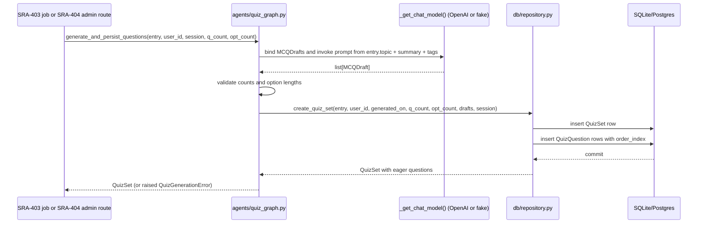

# SRA-402 — MCQ generation agent and quiz repository

**Type:** Task
**Phase:** 4 — Daily MCQ quiz (web)
**Priority:** High — generation is the one place where the quiz feature talks to a model; every later ticket depends on its output shape
**Status:** Planned
**Blocked by:** SRA-401
**Blocks:** SRA-403, SRA-404

## Summary

Add the MCQ generation LangGraph agent and the quiz repository functions the rest of Phase 4 depends on. After this ticket, a developer can call one function with an entry and a question/option count, get a list of persisted `QuizQuestion` rows attached to a saved `QuizSet`, and read them back by `quiz_set_id` or by user/date. The agent uses the same `_get_chat_model()` seam the ingestion and query agents already use, so tests can swap a fake model in.

This ticket does **not** wire any HTTP route, does **not** schedule a job, and does **not** mount a UI. Those land in SRA-403/404/405. The Phase 1/2/3 routes, agents, and ingestion pipeline must remain green throughout.

## Where things stand right now

- [`src/sra/db/models.py`](../src/sra/db/models.py) carries `User`, `StudyEntry`, `ReviewSchedule` and (once SRA-401 lands) `QuizSet`, `QuizQuestion`, `QuizAttempt`, `QuizAnswer`. The new tables are not yet implemented in this ticket — SRA-401 supplies them, so any module-level `import` of the new names depends on SRA-401 first.
- [`src/sra/agents/schemas.py`](../src/sra/agents/schemas.py) defines `StudyEntryDraft` and `StudyEntryDrafts`. Phase 4 adds `MCQDraft` and `MCQDrafts` next to them, following the same Pydantic + `Field(default_factory=list)` shape.
- [`src/sra/agents/ingestion_graph.py`](../src/sra/agents/ingestion_graph.py) and [`src/sra/agents/query_graph.py`](../src/sra/agents/query_graph.py) already establish the `_get_chat_model()` seam, the structured-output binding pattern, and the LangGraph `StateGraph(...).compile(name=...)` wiring convention. The quiz graph is one node plus a small state.
- [`src/sra/db/repository.py`](../src/sra/db/repository.py) is user-scoped and write-through. Phase 4 extends it with quiz helpers, mirroring the existing style: every function takes `user_id` first and never trusts a caller-supplied row's ownership.

## What this ticket unlocks

Given a single seeded entry and one Python call:

```python
from sra.agents.quiz_graph import generate_and_persist_questions
from sra.db.session import get_session

with next(get_session()) as session:
    quiz_set = generate_and_persist_questions(
        entry=entry, user_id=entry.user_id, session=session,
        question_count=2, option_count=4,
    )
    assert quiz_set.id is not None
    assert len(quiz_set.questions) == 2
    assert all(len(q.options) == 4 for q in quiz_set.questions)
    assert all(0 <= q.correct_option_index < 4 for q in quiz_set.questions)
```

After the call: a new `QuizSet` row exists with `question_count=2`, `option_count=4`, `user_id=entry.user_id`, `entry_id=entry.id`, and `generated_on=date.today()`. The related `QuizQuestion` rows have `order_index` 0 and 1, each with exactly four options and a `correct_option_index` in range. A second call the same day **fails fast** because the `(entry_id, generated_on)` unique constraint fires — the idempotency guard SRA-403 will rely on.

A separate run from a unit test that monkeypatches `sra.agents.quiz_graph._get_chat_model` with a fake model can assert the prompt is shaped correctly and that an LLM-level failure returns an empty drafts list with an `error` field instead of raising.

## How this fits into the whole app

The MCQ generator composes the same OpenAI model seam Phase 1 already uses and persists through a new repository helper. Its input is one `StudyEntry`, its output is a `QuizSet` plus its `QuizQuestion` rows. There is no HTTP boundary in this ticket — the function takes a session and a user id directly, so it can be reused by the nightly pregeneration job (SRA-403), by an admin endpoint, or by a future tests script.



The diagram shows the **success path**. On an LLM failure the agent returns an empty drafts list and a typed error; the caller decides whether to surface that as a job-level log or as a `502` response from the admin route.

### Why a graph at all for one node?

The technical design's [§3.9](../docs/design/technical-design.md#39-srcsraagentsquiz_graphpy) deliberately wraps `generate_questions` in `build_quiz_graph()` rather than calling the model directly. The graph keeps the agent composable — future tickets may add a difficulty pass, a quality filter, or a self-critique loop without changing call sites. Following the same pattern as the ingestion and query graphs keeps the four agents symmetric.

### Why snapshot preferences in the database and not read them at runtime?

A user's `quiz_question_count` and `quiz_option_count` may change tomorrow. A quiz saved today must keep the shape it was generated with so its option list still has the recorded length and its score is comparable against its `total_questions`. The snapshot is the user's preference **at generation time**, and the database stores it.

## Files and why they matter

| File | Role and required change |
|---|---|
| [`src/sra/agents/schemas.py`](../src/sra/agents/schemas.py) | Add `MCQDraft` (`question_text: str`, `options: list[str]`, `correct_option_index: int`, `explanation: str`) and `MCQDrafts` (a container with `drafts: list[MCQDraft]`) next to the existing `StudyEntryDraft` types. The container shape matches `StudyEntryDrafts` so the existing structured-output pattern works without further changes. |
| [`src/sra/agents/quiz_graph.py`](../src/sra/agents/quiz_graph.py) | New module. Define `MCQState(TypedDict)` with `entry`, `user_id`, `session`, `question_count`, `option_count`, `drafts`, `quiz_set`, `error`. Define `_get_chat_model()` mirroring [`ingestion_graph._get_chat_model`](../src/sra/agents/ingestion_graph.py) so tests can monkeypatch it. Implement `generate_questions(state)` (LLM call, structured output, validate counts/lengths) and `persist_quiz_set(state)` (call repository). Implement `build_quiz_graph()` returning the compiled graph. Implement `generate_and_persist_questions(entry, user_id, session, question_count, option_count) -> QuizSet` as the public entry point that invokes the graph. |
| [`src/sra/db/repository.py`](../src/sra/db/repository.py) | Extend with `create_quiz_set(*, entry, user_id, session, generated_on, question_count, option_count, drafts: list[MCQDraft]) -> QuizSet`, `get_quiz_set(user_id, quiz_set_id, session) -> QuizSet \| None`, `list_today_quiz_sets(user_id, today, session) -> list[QuizSet]`, `save_quiz_answer(*, attempt, question, selected_option_index, is_correct, session) -> QuizAnswer`, `complete_quiz_attempt(*, attempt, score, session) -> QuizAttempt`, and `get_quiz_attempt(user_id, attempt_id, session) -> QuizAttempt \| None`. Each takes `user_id` first and never trusts caller-supplied ownership. |
| [`tests/unit/test_quiz_schemas.py`](../tests/unit/) | New focused tests for `MCQDraft` / `MCQDrafts`: defaults, validation that `correct_option_index` is in range when serialized, and that the container carries a list. |
| [`tests/unit/test_quiz_graph.py`](../tests/unit/) | New focused tests for the agent: monkeypatch `_get_chat_model` with a fake; assert a generated prompt covers topic + summary + tags; assert successful invocation produces the expected number of drafts with the right option count and in-range correct indices; assert LLM failure sets `state["error"]` and does not raise; assert `create_quiz_set` is called with the snapshot counts; assert the repository receives each draft's `order_index` set to its position in the list. |
| [`tests/unit/test_quiz_repository.py`](../tests/unit/) | New focused tests for the new repository helpers: `create_quiz_set` persists a `QuizSet` plus its `QuizQuestion` rows in one transaction and assigns `order_index`; `get_quiz_set` enforces ownership by user_id and returns `None` for another user's set; `list_today_quiz_sets` filters by `user_id` and `generated_on=today`; `save_quiz_answer` enforces the `(attempt_id, question_id)` uniqueness; `complete_quiz_attempt` stamps `completed_at` and `score`; `get_quiz_attempt` enforces ownership. |
| [`src/sra/api/routers/__init__.py`](../src/sra/api/routers/__init__.py) | Existing collaborator to read. The quiz router is **not** added in this ticket — it ships with SRA-404. |
| [`src/sra/agents/ingestion_graph.py`](../src/sra/agents/ingestion_graph.py), [`src/sra/agents/query_graph.py`](../src/sra/agents/query_graph.py), [`src/sra/agents/schemas.py`](../src/sra/agents/schemas.py) | Existing collaborators to inspect. The new module mirrors the existing seam style and must not break the existing tests. |
| [`tests/conftest.py`](../tests/conftest.py) | Existing collaborator. `seeded_user` and the `client` fixture continue to work because the model layer only adds new tables and new repository helpers; existing routes are not modified. |

## TDD starting point

No Phase 4 test or learning stub exists today. Prepare typed stubs, the new `MCQDraft`/`MCQDrafts` schema, the typed state and graph function signatures, the typed repository helpers, and the focused unit tests before any implementation work. The learning work is reasoning about prompt shape, structured-output validation, snapshot semantics, and the idempotency-by-unique-constraint invariant — not chasing a `NotImplementedError`. Mark the failing tests with the `phase4` marker so Phase 1/2/3 regressions stay visible.

## What to implement

- `MCQDraft` / `MCQDrafts` schemas with sensible defaults and `Field` descriptions so the structured-output schema is self-documenting in any trace.
- `_get_chat_model()` in `quiz_graph.py` mirroring the ingestion graph: read `settings.openai_model`, `settings.openai_api_key`, `max_completion_tokens=2048`, `timeout=30`, `max_retries=1`. The same call shape keeps all four agents cheap to test with a single fake-model fixture.
- `generate_questions(state)`:
  - Build a system prompt that asks for exactly `state["question_count"]` MCQDraft objects from `state["entry"]`'s topic, summary, and tags, each with exactly `state["option_count"]` options and a brief `explanation`.
  - Bind `MCQDrafts` via `model.with_structured_output(MCQDrafts, method="function_calling")` so validation lives in Pydantic, not in string parsing.
  - Drop any draft whose `question_text` is empty, whose `options` length doesn't equal `state["option_count"]`, or whose `correct_option_index` is out of range — return the survivors.
  - If the LLM call raises, set `state["error"]` to a short message and return an empty `drafts` list rather than propagating — the caller decides whether to retry, log, or fail.
- `persist_quiz_set(state)`:
  - Call `repository.create_quiz_set(entry=state["entry"], user_id=state["user_id"], session=state["session"], generated_on=date.today(), question_count=state["question_count"], option_count=state["option_count"], drafts=state["drafts"])`.
  - Store the returned object (eager-loading questions) in `state["quiz_set"]`.
- `build_quiz_graph()`:
  - Wire `START -> generate_questions -> persist_quiz_set -> END`.
  - Compile with `name="sra-quiz"`.
- `generate_and_persist_questions(entry, user_id, session, question_count, option_count)`:
  - Build the graph, invoke with the typed initial state, return `result["quiz_set"]` or raise `QuizGenerationError(result["error"])` when `result["error"]` is set.
- Repository helpers:
  - `create_quiz_set`: build a `QuizSet` row with `user_id=entry.user_id`, `entry_id=entry.id`, `generated_on=date.today()`, snapshot counts, and `model_validate(QuizSetCreate(...), update={...})` to keep server-owned columns server-set. Insert one `QuizQuestion` per draft with `order_index = i`. Commit once. Return the `QuizSet` with eager questions.
  - `get_quiz_set(user_id, quiz_set_id, session)`: select by id, joined to user ownership; return `None` when not owned or not found.
  - `list_today_quiz_sets(user_id, today, session)`: filter by `user_id` and `generated_on == today`, order by `entry_id`.
  - `save_quiz_answer`: enforce `(attempt_id, question_id)` uniqueness via a try/insert pattern that surfaces the constraint as a typed `ValueError` rather than a raw SQLAlchemy error.
  - `complete_quiz_attempt`: stamp `completed_at` to `_utcnow()`, set `score`, commit, refresh, return.
  - `get_quiz_attempt`: enforce ownership by `user_id`; return `None` when not owned or not found.
- Add the `phase4` pytest marker in [`pyproject.toml`](../pyproject.toml) so the existing regression command (`pytest -m 'not phase4' -q`) keeps Phase 1/2/3 visible.

## Where to look

- Technical design [§3.9](../docs/design/technical-design.md#39-srcsraagentsquiz_graphpy) for the intended graph shape, [§3.6](../docs/design/technical-design.md#36-srcsraagentsschemaspy--new--concrete) for `MCQDraft`, and [§2.2](../docs/design/technical-design.md#22-table-definitions) for snapshot semantics.
- [`src/sra/agents/ingestion_graph.py`](../src/sra/agents/ingestion_graph.py) for the `_get_chat_model` seam and the `with_structured_output` call style to copy.
- [`src/sra/db/repository.py`](../src/sra/db/repository.py) for the user-scoped write/read pattern.
- Plan [KTD14](../docs/plans/2026-09-25-1616-feat-study-agent-scaffold-plan.md) for the idempotency invariant and [§U14](../docs/plans/2026-09-25-1616-feat-study-agent-scaffold-plan.md#u14-mcq-generation-agent--nightly-pre-generation) for the snapshot semantics.

## Acceptance criteria

- [ ] `MCQDraft` and `MCQDrafts` round-trip with the expected field set, defaults, and validation
- [ ] `_get_chat_model()` in `quiz_graph.py` returns the same configured OpenAI model as the other agents, and tests can monkeypatch it without contacting OpenAI
- [ ] `generate_questions` builds a prompt that includes the entry's topic, summary, and tags; binds the structured-output schema; drops drafts whose `question_text` is empty, whose `options` length differs from `state["option_count"]`, or whose `correct_option_index` is out of range
- [ ] LLM failures set `state["error"]` and return an empty drafts list without raising
- [ ] `generate_and_persist_questions(entry, user_id, session, question_count, option_count)` produces a persisted `QuizSet` and its questions, with `order_index` set to each draft's position
- [ ] `create_quiz_set` is idempotent: a second call the same day with the same `(entry_id, generated_on)` raises a typed `ValueError` rather than creating a duplicate `QuizSet`
- [ ] `get_quiz_set`, `list_today_quiz_sets`, `save_quiz_answer`, `complete_quiz_attempt`, and `get_quiz_attempt` all enforce ownership by `user_id` and return `None` (or raise a typed error on duplicate) for another user's data
- [ ] Existing Phase 1/2/3 unit, e2e, and integration tests remain green; Pyright and Ruff pass without new warnings

## How to test this ticket alone

```bash
source .venv/bin/activate
pytest tests/unit/test_quiz_schemas.py tests/unit/test_quiz_graph.py tests/unit/test_quiz_repository.py -v
pytest -m 'not phase4' -q
ruff check .
pyright
```

Expected: focused Phase 4 tests pass against a fake LLM and an in-memory SQLite DB; Phase 1/2/3 regressions stay green. Lint and type checks clean.

## Manual verification

Run the script form once against a real Phase 3 database to prove the prompt is shape-stable and the persisted rows match the design:

```bash
DATABASE_URL=sqlite:////tmp/sra-402.db LANGSMITH_TRACING=false LANGCHAIN_TRACING_V2=false \
  OPENAI_API_KEY="$OPENAI_API_KEY" \
  .venv/bin/python - <<'PY'
from datetime import date
from sqlmodel import select as s
from sra.db.session import get_session, init_db
from sra.db.models import StudyEntry, User
from sra.agents.quiz_graph import generate_and_persist_questions

init_db()
with next(get_session()) as session:
    user = session.exec(s(User).where(User.google_sub == "manual")).first()
    if user is None:
        user = User(email="manual@example.com", display_name="Manual", google_sub="manual")
        session.add(user); session.commit(); session.refresh(user)
    entry = session.exec(s(StudyEntry).where(StudyEntry.user_id == user.id)).first()
    if entry is None:
        from sra.db.repository import create_entry
        from sra.db.models import StudyEntryCreate
        entry = create_entry(
            entry_create=StudyEntryCreate(topic="Photosynthesis", summary="Light and dark reactions.", raw_transcript="I studied photosynthesis."),
            user_id=user.id, session=session,
        )
    qs = generate_and_persist_questions(
        entry=entry, user_id=user.id, session=session, question_count=3, option_count=4,
    )
    print("quiz_set_id:", qs.id, "questions:", len(qs.questions))
PY
```

Inspect the four new tables; confirm one `QuizSet` row with `question_count=3`, `option_count=4`, `user_id` matching the entry's user, and three `QuizQuestion` rows with `order_index` 0, 1, 2, each with four options and a `correct_option_index` in range. Re-run the script and confirm the second invocation raises on the unique constraint, not a duplicate `QuizSet`. This uses the configured OpenAI key and incurs the usual small charge. Do not use a production database for the first run.

## Verification record

- Date, environment, and configured model: _to be filled in once the manual run passes._
- Generated `QuizSet.id`, `user_id`, `entry_id`, `generated_on`, snapshot values: _to be filled in._
- Question count, option count per question, `correct_option_index` range, `order_index` assignment: _to be filled in._
- Idempotency guard verification: the second invocation failed on the `(entry_id, generated_on)` unique constraint and did not create a duplicate row.
- Automated results, skips, and limitations: focused unit tests and Phase 1/2/3 regressions passed. No live OAuth was exercised; real-acceptance verification (the manual run above) must be recorded here before this ticket closes.

## Definition of Done

- [ ] All acceptance criteria met and actual evidence recorded
- [ ] Focused, regression, lint, and type checks pass
- [ ] Setup and usage documentation match the verified behavior
- [ ] Ticket board and progress documentation reflect the actual state