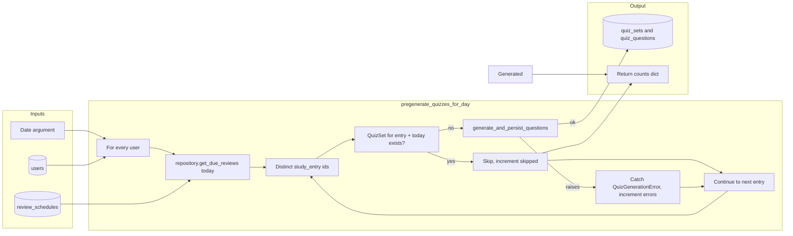

# SRA-403 — Quiz pregeneration job

**Type:** Task
**Phase:** 4 — Daily MCQ quiz (web)
**Priority:** Medium — without pregeneration the API has nothing to serve; with it, today's quizzes are ready before the user opens the dashboard
**Status:** Planned
**Blocked by:** SRA-402
**Blocks:** SRA-404, SRA-406

## Summary

Add the nightly batch job that, for each user, walks every entry due today and generates one `QuizSet` per entry that does not already have one for today. The job is **idempotent**: running it twice the same day never creates a second `QuizSet` for the same entry. It uses the same `repository.get_due_reviews` query the digest route already trusts, so "an entry is due today" has one definition across the app.

This ticket does **not** schedule the job — APScheduler wiring and the `preferred_review_time` window belong to Phase 5. It does **not** add an HTTP route — SRA-404 will. After this ticket, a developer can invoke the function from a Python script and observe persisted `QuizSet` rows for every due entry.

## Where things stand right now

- [`src/sra/db/repository.py`](../src/sra/db/repository.py) already exposes `get_due_reviews(user_id, as_of, session) -> list[ReviewSchedule]`. It returns each user's pending reviews whose `scheduled_date <= as_of`. The pregeneration job reuses it to enumerate due entries.
- [`src/sra/agents/quiz_graph.py`](../src/sra/agents/quiz_graph.py) (SRA-402) exposes `generate_and_persist_questions(entry, user_id, session, question_count, option_count) -> QuizSet` and raises a typed `QuizGenerationError` on LLM failure.
- The repository function `create_quiz_set` (SRA-402) raises a typed `ValueError` on the `(entry_id, generated_on)` unique constraint, which the job catches to make idempotency free.
- Phase 3 user identity is durable: every user has a stable `id`. The job walks users by selecting all rows from `users` — `repository` already filters by `user_id` on every read, so the job's loop does not need to re-derive ownership.
- The Phase 3 query agent's "due reviews" tool already calls `repository.get_due_reviews`. Reusing it here means the digest's view of "due today" and the pregenerator's view are identical.
- User preferences (`quiz_question_count`, `quiz_option_count`) are not yet a column on `users`; the design specifies them but they are out of scope for Phase 4. Until the preferences ticket lands, the job uses the design defaults (`question_count=10`, `option_count=4`) via a small helper that the preferences ticket can replace without changing call sites.

## What this ticket unlocks

A developer script:

```python
from datetime import date
from sra.db.session import get_session
from sra.jobs.quiz_pregeneration import pregenerate_quizzes_for_day

with next(get_session()) as session:
    summary = pregenerate_quizzes_for_day(today=date.today(), session=session)
    print(summary)
# {'users': 2, 'entries_seen': 3, 'sets_created': 2, 'sets_skipped': 1, 'errors': 0}
```

The script walks two seeded users; user A has one due entry with no `QuizSet` yet (one set created), user B has one due entry with a `QuizSet` already for today (one set skipped) plus one entry that is not due today (one entry ignored). No HTTP server runs, no APScheduler thread starts, no OpenAI key is required by the job itself — the actual model call is the same `_get_chat_model()` seam tests already substitute.

A second run the same day with no changes produces `{'sets_created': 0, 'sets_skipped': 1}` for user B, and `{'sets_created': 0, 'sets_skipped': 1}` for user A, because each user's due entry now has a `QuizSet`. Re-running the job does not duplicate or overwrite quizzes.

A run where one user's LLM call fails for one of two due entries produces `{'errors': 1, 'sets_created': 1}`, persists the success, and continues to the next entry rather than aborting the whole job.

## How this fits into the whole app

The pregeneration job is the **only** producer of `QuizSet` rows in Phase 4. The route layer in SRA-404 only reads. The job owns the responsibility of turning a "due entry" into "a saved quiz set with N questions ready to ask". It does not score attempts, grade answers, or finalize attempts — those belong to SRA-404's submission routes.



The diagram shows how the job avoids duplicates: a `QuizSet` already exists for `(entry_id, generated_on=today)` short-circuits to "skip". The repository's unique constraint is the durable backstop — if two jobs ever raced, the second insert would fail at the database level rather than silently duplicating.

### Why per-user, not per-instance?

A "per-entry for the entire instance" loop would generate the same quiz for every user who happens to share an `entry_id` — but `study_entries.user_id` enforces that each user owns their own entry rows, so a "shared entry" cannot exist. Walking users one at a time keeps the boundary obvious, keeps `user_id` flowing into every helper, and matches the existing repository convention. It is also the only way to make the "snapshot the user's preference at generation time" semantics in SRA-402 actually snapshot the right value.

### Why not generate on demand in the route?

Generating per request would couple every dashboard open to a multi-second model call. The design's [§1.4](../docs/design/technical-design.md#14-key-flows) commits to **pre-generation**: by the time they look at the dashboard, the quiz exists and the request is a fast read. The job's idempotency lets a retry of the same day's batch cost nothing.

## Files and why they matter

| File | Role and required change |
|---|---|
| [`src/sra/jobs/__init__.py`](../src/sra/jobs/) | New empty package marker. Phase 5 will add `digest_scheduler.py` and Phase 6 `demo_reset.py` next to `quiz_pregeneration.py`. |
| [`src/sra/jobs/quiz_pregeneration.py`](../src/sra/jobs/quiz_pregeneration.py) | New module. Define a `PregenerationSummary` `TypedDict` (or Pydantic model) with `users: int`, `entries_seen: int`, `sets_created: int`, `sets_skipped: int`, `errors: int`. Implement `pregenerate_quizzes_for_day(*, today: date, session) -> PregenerationSummary` and `pregenerate_quizzes_for_user(*, user, today: date, session) -> PregenerationSummary` (the per-user helper the top-level function iterates). Implement a small `_resolve_user_quiz_preferences(user) -> tuple[int, int]` returning `(question_count, option_count)` from user-owned fields today via the established defaults — designed to be replaced by a future preferences helper without changing call sites. |
| [`src/sra/db/repository.py`](../src/sra/db/repository.py) | Existing collaborator. Reuse `get_due_reviews` (already user-scoped) to find due entries. The job **must not** re-implement the join — using the existing function is the contract that the digest's view of "due today" and the job's view stay identical. |
| [`src/sra/agents/quiz_graph.py`](../src/sra/agents/quiz_graph.py) | Existing collaborator (SRA-402). Call `generate_and_persist_questions(entry, user_id, session, question_count, option_count)`. Catch `QuizGenerationError` to keep the batch going on a single entry failure. |
| [`tests/unit/test_quiz_pregeneration.py`](../tests/unit/) | New focused tests. Cover: an entry with no `QuizSet` for today gets one created; an entry with an existing `QuizSet` for today is skipped; two due entries for one user both get sets; the job reports `sets_skipped` for entries that already have a set; an LLM failure for one entry does not stop the next user; the affected entry's row count is unchanged after the failure; running twice the same day produces `sets_created=0` on the second run; an entry not due today is ignored; `pregenerate_quizzes_for_user` works in isolation. Use a monkeypatched `_get_chat_model` from `sra.agents.quiz_graph` so no OpenAI key is required. |
| [`tests/integration/test_quiz_pregeneration_e2e.py`](../tests/integration/) | New integration test that runs the job against a temporary SQLite file with two users, three entries (one not due, two due, one already has a set), invokes the job, and asserts the resulting `(users, sets_created, sets_skipped)` summary plus the rows in the four quiz tables. Mark this test with `@pytest.mark.phase4` and skip cleanly on environments without a writable temp directory. |
| [`src/sra/api/routers/__init__.py`](../src/sra/api/routers/__init__.py) | Existing collaborator. No change in this ticket. |
| [`src/sra/api/app.py`](../src/sra/api/app.py) | Existing collaborator. No change in this ticket. The job is not started by `create_app()`; APScheduler wiring is Phase 5. |
| [`tests/conftest.py`](../tests/conftest.py) | Existing collaborator. The `seeded_user` and `client` fixtures continue to work; the new module does not import any of them. |

## TDD starting point

No Phase 4 pregeneration test or learning stub exists today. Prepare typed stubs for `PregenerationSummary`, `pregenerate_quizzes_for_day`, `pregenerate_quizzes_for_user`, and `_resolve_user_quiz_preferences`, plus the focused unit and integration tests, before implementation. The LLM seam already exists from SRA-402. The learning work is reasoning about idempotency invariants, per-user boundaries, error containment, and the "reuse the existing repository query" discipline — not chasing a `NotImplementedError`.

## What to implement

- `pregenerate_quizzes_for_day(*, today: date, session) -> PregenerationSummary`:
  - Select all users (`select(User)`); for each, call `pregenerate_quizzes_for_user(user=user, today=today, session=session)` and accumulate the per-user summary.
  - Aggregate counts across users into one summary dict and return it. Errors that escape `pregenerate_quizzes_for_user` (which should not happen in normal operation) are caught at this level, logged via the project's standard logging, and counted as one error — the loop never aborts.
- `pregenerate_quizzes_for_user(*, user, today: date, session) -> PregenerationSummary`:
  - Call `repository.get_due_reviews(user_id=user.id, as_of=today, session=session)`.
  - Build a `set[StudyEntry.id]` from the result (distinct entries — an entry with two reviews pending for today still generates one quiz).
  - For each entry id: check whether a `QuizSet` exists for `(entry_id, generated_on=today)` via the repository's `has_quiz_set_for_entry_today` helper (added in SRA-402 — confirm before this ticket ships and add it now if it is missing). If yes, increment `sets_skipped`; if no, call `generate_and_persist_questions`.
  - On `QuizGenerationError`, increment `errors` and continue.
  - Return the per-user summary. `entries_seen` is the count of distinct entries inspected (due + skipped + errored), so the operator can verify scope.
- `_resolve_user_quiz_preferences(user) -> tuple[int, int]`:
  - Return `(10, 4)` today (the design defaults).
  - Add a one-line comment naming the future preferences ticket and explaining that this helper is the seam to replace — keeping the helper itself so call sites do not move when the preferences column lands.
- The job must not start an APScheduler thread, must not open an HTTP server, and must not call OpenAI itself — every model invocation goes through `_get_chat_model()`, which the unit and integration tests monkeypatch.

## Where to look

- Technical design [§1.4](../docs/design/technical-design.md#14-key-flows) for the "quizzes pre-generated" decision, [§3.24](../docs/design/technical-design.md#324-srcsrajobsquiz_pregenerationpy) for the intended function shape, and [KTD14](../docs/plans/2026-09-25-1616-feat-study-agent-scaffold-plan.md) for the idempotency invariant.
- [`src/sra/db/repository.py`](../src/sra/db/repository.py) for `get_due_reviews` — the single source of "due today" used by the digest route and this job.
- [`src/sra/agents/quiz_graph.py`](../src/sra/agents/quiz_graph.py) (SRA-402) for the generation entry point and the typed error to catch.
- [`src/sra/agents/ingestion_graph.py`](../src/sra/agents/ingestion_graph.py) for the project's `_get_chat_model()` seam convention.

## How to test this ticket alone

```bash
source .venv/bin/activate
pytest tests/unit/test_quiz_pregeneration.py -v
pytest tests/integration/test_quiz_pregeneration_e2e.py -v
pytest -m 'not phase4' -q
ruff check .
pyright
```

Expected: focused tests and the integration test pass with a monkeypatched LLM. Phase 1/2/3 regressions stay green. Lint and type checks clean.

## Manual verification

Use the script form once against a real database to prove the LLM-backed path is shape-stable:

```bash
DATABASE_URL=sqlite:////tmp/sra-403.db LANGSMITH_TRACING=false LANGCHAIN_TRACING_V2=false \
  OPENAI_API_KEY="$OPENAI_API_KEY" \
  .venv/bin/python - <<'PY'
from datetime import date, timedelta
from sra.db.session import get_session, init_db
from sra.db.models import StudyEntry, User
from sra.jobs.quiz_pregeneration import pregenerate_quizzes_for_day

init_db()
with next(get_session()) as session:
    user = session.exec(__import__("sqlmodel").select(User).where(User.google_sub == "manual-403")).first()
    if user is None:
        user = User(email="manual-403@example.com", display_name="Manual", google_sub="manual-403")
        session.add(user); session.commit(); session.refresh(user)
    entries = list(session.exec(__import__("sqlmodel").select(StudyEntry).where(StudyEntry.user_id == user.id)).all())
    print("entries before:", [(e.id, e.topic) for e in entries])
    summary = pregenerate_quizzes_for_day(today=date.today(), session=session)
    print("summary:", summary)
    summary_again = pregenerate_quizzes_for_day(today=date.today(), session=session)
    print("summary again:", summary_again)
PY
```

Inspect the four new tables. Confirm one `QuizSet` row per due entry on the first run, none added on the second run. Inspect one set's `quiz_questions` to confirm a sensible `order_index`, `correct_option_index`, and option count. Do not use a production database for the first run.

## Verification record

- Date, environment, and configured model: _to be filled in once the manual run passes._
- Number of users, due entries, sets created, sets skipped, errors: _to be filled in._
- Idempotency verification: a second `pregenerate_quizzes_for_day(today=...)` call the same day produced `sets_created=0` and matched `sets_skipped` to the prior run's `sets_created`.
- Error-containment verification: with the LLM forced to raise for one entry, the job reported one per error, persisted the success for the next entry, and the failed entry's row count was unchanged.
- Automated results, skips, and limitations: focused unit tests and the integration test passed. No APScheduler thread was started; no HTTP request was sent. Real-acceptance verification (the manual run above) must be recorded here before this ticket closes.

## Definition of Done

- [ ] All acceptance criteria met and actual evidence recorded
- [ ] Focused, regression, lint, and type checks pass
- [ ] Setup and usage documentation match the verified behavior
- [ ] Ticket board and progress documentation reflect the actual state