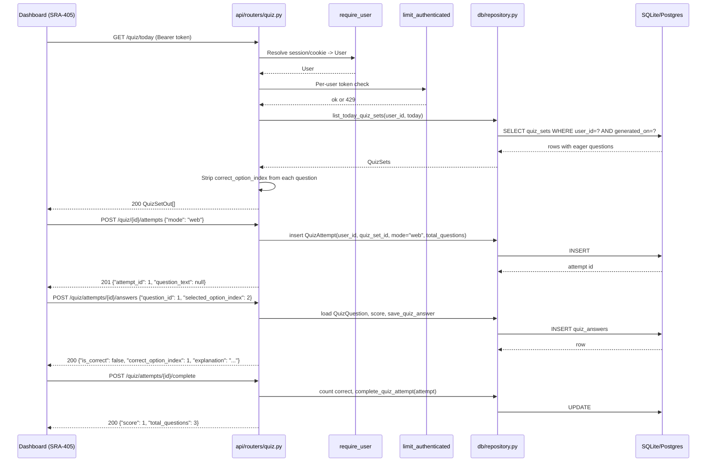

# SRA-404 — Quiz API endpoints (web)

**Type:** Task
**Phase:** 4 — Daily MCQ quiz (web)
**Priority:** Highest — the API is what SRA-405's dashboard and SRA-406's verification talk to
**Status:** Planned
**Blocked by:** SRA-402, SRA-403
**Blocks:** SRA-405, SRA-406

## Summary

Wire the quiz router into the API so a signed-in dashboard can list today's quizzes, fetch one quiz, start an attempt, submit per-question answers, complete an attempt, and read the attempt summary. The router sits behind the same `require_user` dependency the rest of the authenticated routes use and under the same per-user rate limit. **Voice mode** is intentionally not implemented in this ticket — it is Phase 5's `quiz_conversation_graph` plus a `voice-turn` endpoint. The `StartAttemptRequest.mode` field is accepted and validated today, but only `"web"` succeeds at the route boundary for `submit_answer`, `complete_attempt`, and `voice_turn`.

This ticket does **not** touch the dashboard. SRA-405 ships the JavaScript that consumes these endpoints. After this ticket, a `curl` run against a running server can complete the entire web-quiz loop.

## Where things stand right now

- [`src/sra/api/routers/__init__.py`](../src/sra/api/routers/__init__.py) mounts `auth`, `admin`, `entries`, `digest`, `search`, and `chat`. The protected routers are guarded by `Depends(limit_authenticated)`. The quiz router joins the same guard.
- [`src/sra/api/schemas.py`](../src/sra/api/schemas.py) holds the existing `IngestRequest`, `EntryOut`, `ReviewOut`, `ChatRequest`, and `ChatResponse`. Phase 4 adds the quiz DTOs next to them, mirroring the Phase 1 style (Pydantic `BaseModel`, no behavior).
- [`src/sra/api/deps.py`](../src/sra/api/deps.py) re-exports `require_user` and `get_session`. The router imports them from there.
- [`src/sra/api/rate_limit.py`](../src/sra/api/rate_limit.py) supplies `limit_authenticated`, used by the existing `__init__.py` to guard `entries`, `digest`, `search`, and `chat`. The quiz router is added to that same group so it inherits the per-user bucket.
- [`src/sra/db/repository.py`](../src/sra/db/repository.py) (SRA-402) provides `get_quiz_set`, `list_today_quiz_sets`, `save_quiz_answer`, `complete_quiz_attempt`, `get_quiz_attempt`, and the helpers the routes need.
- [`src/sra/api/routers/entries.py`](../src/sra/api/routers/entries.py) shows the established `Depends(require_user)`, `Depends(get_session)` dependency-injection style. The quiz router mirrors it.

## What this ticket unlocks

Run a real server, sign in as a user with two pre-generated quiz sets, and complete a full web-quiz loop end to end through `curl`:

```bash
# 1. Today's quizzes (no correct_option_index in payload)
curl -sS -b "Authorization: Bearer $TOKEN" http://127.0.0.1:8000/api/v1/quiz/today | jq

# 2. One quiz's details (options only, no correct index)
curl -sS -b "Authorization: Bearer $TOKEN" http://127.0.0.1:8000/api/v1/quiz/$QUIZ_ID | jq

# 3. Start a web attempt
curl -sS -b "Authorization: Bearer $TOKEN" -H "Content-Type: application/json" \
     -d '{"mode": "web"}' \
     -X POST http://127.0.0.1:8000/api/v1/quiz/$QUIZ_ID/attempts | jq
# { "attempt_id": 1, "question_text": null }

# 4. Submit one answer
curl -sS -b "Authorization: Bearer $TOKEN" -H "Content-Type: application/json" \
     -d '{"question_id": 1, "selected_option_index": 2}' \
     -X POST http://127.0.0.1:8000/api/v1/quiz/attempts/1/answers | jq

# 5. Complete the attempt
curl -sS -b "Authorization: Bearer $TOKEN" -X POST \
     http://127.0.0.1:8000/api/v1/quiz/attempts/1/complete | jq
# { "score": 1, "total_questions": 3 }

# 6. Read the attempt summary
curl -sS -b "Authorization: Bearer $TOKEN" \
     http://127.0.0.1:8000/api/v1/quiz/attempts/1 | jq
```

A second user calling `GET /api/v1/quiz/{first_user_quiz_id}` gets `403`. A signed-out request to the same URL gets `401`. Submitting to a `quiz_set_id` owned by a different user gets `403`. A `voice_turn` request on a web attempt gets `400` because Phase 5 owns that flow.

## How this fits into the whole app

The quiz router is the **only** HTTP entry point to quiz data in Phase 4. The job in SRA-403 writes; the routes here read and grade. There is no score-taking shortcut that bypasses the routes — even an in-process test must go through FastAPI to prove the dependency wiring, the rate limiter, and the user-scoping behave correctly.



The diagram shows the successful path. The dashed flow (a missing quiz set, a different user's id, an unauthenticated request, a rate-limited burst) returns `404`, `403`, `401`, or `429` respectively, all matching the Phase 1/2/3 routes' standard error envelope.

### Why strip `correct_option_index` from the public payload?

The technical design's [§3.19](../docs/design/technical-design.md#319-srcsapiroutersquizpy) commits to it explicitly: `QuizQuestionOut` must not include `correct_option_index`. The dashboard receives question text and options only; the answer and explanation are returned by the per-question submission route, after the user has actually answered. This is enforced in the response shape, not by client-side trust. The `quiz_attempts/{id}/answers` route is the only place a client ever sees a `correct_option_index`.

### Why does the router validate `mode` even though Phase 5 owns voice?

A `mode="voice"` attempt now needs to be rejected with a typed `400 Bad Request` so the dashboard does not silently accept a value that has no route yet. The Phase 5 voice-quiz implementation will land the `voice-turn` endpoint, at which point the same `StartAttemptRequest.mode="voice"` will succeed and route to that endpoint. Keeping the validation in one place today means Phase 5 only changes the route, not the schema.

## Files and why they matter

| File | Role and required change |
|---|---|
| [`src/sra/api/schemas.py`](../src/sra/api/schemas.py) | Add `QuizQuestionOut` (id, question_text, options, order_index — no `correct_option_index`), `QuizSetOut` (id, entry: EntryOut, generated_on: date, questions: list[QuizQuestionOut]), `StartAttemptRequest` (mode: Literal["web", "voice"]), `SubmitAnswerRequest` (question_id: int, selected_option_index: int), `AnswerResult` (is_correct: bool, correct_option_index: int, explanation: str \| None), `QuizAttemptOut` (id, quiz_set_id, mode, started_at, completed_at, score, total_questions). |
| [`src/sra/api/routers/quiz.py`](../src/sra/api/routers/quiz.py) | New module. Mount the six endpoints. Use `Depends(require_user)` and `Depends(get_session)` like [`entries.py`](../src/sra/api/routers/entries.py). Map `QuizSet` → `QuizSetOut` via a small helper that strips `correct_option_index`. Return `404` when the quiz set is not found, `403` when it belongs to another user, `401` when unauthenticated. |
| [`src/sra/api/routers/__init__.py`](../src/sra/api/routers/__init__.py) | Add `from sra.api.routers import quiz` and include `quiz.router` in the same `limit_authenticated` group the existing protected routers use. The router's URL prefix is `/quiz`; the version prefix `/api/v1` is applied by `create_app()`. |
| [`src/sra/api/app.py`](../src/sra/api/app.py) | Existing collaborator. No change in this ticket. The new router is included transitively through `api_router`. |
| [`src/sra/db/repository.py`](../src/sra/db/repository.py) | Existing collaborator (SRA-402). Reuse `get_quiz_set`, `list_today_quiz_sets`, `save_quiz_answer`, `complete_quiz_attempt`, `get_quiz_attempt`. The router does not bypass the repository. |
| [`src/sra/agents/quiz_graph.py`](../src/sra/agents/quiz_graph.py) | Existing collaborator. The router does not call it directly — SRA-403's job does. |
| [`tests/unit/test_quiz_routes.py`](../tests/unit/) | New focused tests for each route. Cover: `GET /quiz/today` returns only the authenticated user's sets for today with `correct_option_index` stripped; `GET /quiz/{id}` returns the set, returns `404` when missing, `403` when owned by another user, `401` when unauthenticated; `POST /quiz/{id}/attempts {"mode": "web"}` creates the attempt and returns `{attempt_id, question_text: null}`; same call with `mode: "voice"` returns `400` and no row is created; `POST /quiz/attempts/{id}/answers` records an answer, returns `is_correct`, the real `correct_option_index`, and the explanation, returns `400` when the attempt is in voice mode, returns `404` when the attempt is missing; `POST /quiz/attempts/{id}/complete` stamps `completed_at` and returns `{score, total_questions}`, returns `400` when the attempt is in voice mode, returns `409` when the attempt is already completed; `GET /quiz/attempts/{id}` returns the attempt summary, returns `404` for missing, `403` for another user's attempt. |
| [`tests/e2e/test_quiz_web_e2e.py`](../tests/e2e/test_quiz_web_e2e.py) | New end-to-end test that seeds a user with one entry, runs the pregeneration job against that entry, then drives the **complete** web-quiz loop through the real router, dependency overrides, repository, and SQLite. Verifies: today's list contains the set, the set has the right question count and option count, starting an attempt returns `attempt_id`, every answer's response carries `is_correct` and `correct_option_index`, completing the attempt returns `score == total_questions` when every answer is correct, and a second user cannot read or start attempts on the first user's quiz. Uses a fake LLM seam. |
| [`tests/conftest.py`](../tests/conftest.py) | Existing collaborator. The `client` fixture continues to work; the router module is added at module-load time when `create_app()` instantiates, and the existing dependency override for `get_session` is honored. |
| [`src/sra/api/rate_limit.py`](../src/sra/api/rate_limit.py) | Existing collaborator. The new router inherits the per-user bucket by being added to the same `include_router(..., dependencies=[Depends(limit_authenticated)])` group in `__init__.py`. |

## TDD starting point

No Phase 4 router test or learning stub exists today. Prepare the typed schemas, the typed route handler signatures, the focused route tests, and the end-to-end test before implementation. The repository helpers and the agent are already implemented by SRA-402/403. The learning work is reasoning about response shape (`correct_option_index` stripping), status-code mapping (401/400/403/404/409), the per-user rate limit inheritance, and the dashboard's contract — not chasing a `NotImplementedError`.

## What to implement

- `QuizQuestionOut`, `QuizSetOut`, `StartAttemptRequest`, `SubmitAnswerRequest`, `AnswerResult`, and `QuizAttemptOut` Pydantic models in `src/sra/api/schemas.py`. `QuizQuestionOut` does not include `correct_option_index`; `QuizSetOut` does not either; `AnswerResult` does because it is the post-answer envelope.
- `GET /api/v1/quiz/today`:
  - Call `repository.list_today_quiz_sets(user_id=user.id, today=date.today(), session=session)`.
  - Map each `QuizSet` to `QuizSetOut`, dropping `correct_option_index` from each `QuizQuestion` and using the existing `EntryOut` for the nested entry.
  - Return the list. An empty list is a valid `200` with `[]`.
- `GET /api/v1/quiz/{quiz_set_id}`:
  - Call `repository.get_quiz_set(user_id=user.id, quiz_set_id=quiz_set_id, session=session)`.
  - Raise `HTTPException(404, "Quiz not found")` when the result is `None`.
  - Map to `QuizSetOut` and return.
- `POST /api/v1/quiz/{quiz_set_id}/attempts`:
  - Validate the `QuizSet` exists and belongs to `user.id` (404/403).
  - Validate `body.mode in {"web", "voice"}`. Reject `voice` with `HTTPException(400, "Voice mode is not yet supported. See Phase 5.")` — Phase 5 will remove this branch.
  - Create a `QuizAttempt(mode=body.mode, user_id=user.id, quiz_set_id=quiz_set_id, total_questions=quiz_set.question_count)`. Return `{attempt_id: attempt.id, question_text: None}` (the voice envelope is reserved for Phase 5).
- `POST /api/v1/quiz/attempts/{attempt_id}/answers`:
  - Load the attempt via `repository.get_quiz_attempt(user_id=user.id, attempt_id=attempt_id, session=session)`. Raise `404` when missing, `403` when owned by another user.
  - Reject with `400` when `attempt.mode != "web"` (Phase 5 owns voice).
  - Reject with `409` when `attempt.completed_at is not None`.
  - Load the `QuizQuestion` by id, scoped to the attempt's `quiz_set_id`. Raise `404` when the question is not part of the attempt's quiz set.
  - Compute `is_correct = (selected_option_index == question.correct_option_index)`. Call `repository.save_quiz_answer(attempt=attempt, question=question, selected_option_index=selected_option_index, is_correct=is_correct, session=session)`.
  - Return `AnswerResult(is_correct=is_correct, correct_option_index=question.correct_option_index, explanation=question.explanation)`.
- `POST /api/v1/quiz/attempts/{attempt_id}/complete`:
  - Load the attempt via the repository, same status-code discipline as above.
  - Reject with `400` when `attempt.mode != "web"`.
  - Reject with `409` when already completed.
  - Count `QuizAnswer` rows for the attempt; sum `is_correct` to derive `score`. Call `repository.complete_quiz_attempt(attempt=attempt, score=score, session=session)`.
  - Return `{score: attempt.score, total_questions: attempt.total_questions}`.
- `GET /api/v1/quiz/attempts/{attempt_id}`:
  - Load the attempt via the repository; `404`/`403` discipline.
  - Return `QuizAttemptOut` with the recorded `score`, `completed_at`, `started_at`, `total_questions`, `mode`, `quiz_set_id`.
- `src/sra/api/routers/__init__.py`: add the new import and include `quiz.router` in the same `limit_authenticated` group as the existing protected routers. The version prefix `/api/v1` is applied by `create_app()`.

## Where to look

- Technical design [§3.19](../docs/design/technical-design.md#319-srcsapiroutersquizpy) for the intended endpoints, [§3.14](../docs/design/technical-design.md#314-srcsraapischemaspy--new--concrete) for the DTOs, and [§4](../docs/design/technical-design.md#4-api-contract) for the standard status-code envelope.
- [`src/sra/api/routers/entries.py`](../src/sra/api/routers/entries.py) for the established dependency-injection style.
- [`src/sra/api/routers/digest.py`](../src/sra/api/routers/digest.py) for the `Depends(require_user)` + `Depends(get_session)` pattern with a date filter.
- [`src/sra/db/repository.py`](../src/sra/db/repository.py) (SRA-402) for the helpers to reuse.
- [`src/sra/api/rate_limit.py`](../src/sra/api/rate_limit.py) and [`src/sra/api/routers/__init__.py`](../src/sra/api/routers/__init__.py) for the per-user bucket inheritance pattern.

## Acceptance criteria

- [ ] `GET /api/v1/quiz/today` returns the authenticated user's pre-generated sets for today, scoped by `user_id`, with `correct_option_index` stripped from each question
- [ ] `GET /api/v1/quiz/{quiz_set_id}` returns the set for the owner, `404` when missing, `403` when owned by another user, `401` when unauthenticated
- [ ] `POST /api/v1/quiz/{quiz_set_id}/attempts {"mode": "web"}` creates a `QuizAttempt` and returns `{attempt_id, question_text: null}`; the same call with `mode: "voice"` returns `400` and does not create a row
- [ ] `POST /api/v1/quiz/attempts/{attempt_id}/answers` records one `QuizAnswer`, returns `is_correct`, the real `correct_option_index`, and the explanation; rejects `voice` mode with `400`; rejects a completed attempt with `409`; rejects a question that does not belong to the attempt's quiz set with `404`
- [ ] `POST /api/v1/quiz/attempts/{attempt_id}/complete` counts correct answers, stamps `completed_at`, returns `{score, total_questions}`; rejects `voice` mode with `400`; rejects a completed attempt with `409`
- [ ] `GET /api/v1/quiz/attempts/{attempt_id}` returns the attempt summary for the owner, `404`/`403` discipline
- [ ] The new router shares the per-user rate-limit bucket used by `entries`, `digest`, `search`, and `chat`
- [ ] The end-to-end test completes the full web-quiz loop through the real router, repository, and SQLite, with only the model substituted
- [ ] Phase 1/2/3 unit, e2e, and integration tests remain green; Pyright and Ruff pass without new warnings

## How to test this ticket alone

```bash
source .venv/bin/activate
pytest tests/unit/test_quiz_routes.py -v
pytest tests/e2e/test_quiz_web_e2e.py -v
pytest -m 'not phase4' -q
ruff check .
pyright
```

Expected: focused route tests and the end-to-end test pass; Phase 1/2/3 regressions stay green. Lint and type checks clean.

## Manual verification

Run the curl loop in the **What this ticket unlocks** section against a real server backed by a real database, after running SRA-403's pregeneration once. Use the same `Authorization: Bearer <token>` shape the dashboard will use, since this is the path the dashboard will exercise in SRA-405. Record the returned `attempt_id`, every `is_correct`, the final `score`, and the response when a second user's token requests the first user's quiz. Do not use a production database for the first run.

## Verification record

- Date, environment, and configured model: _to be filled in once the curl loop passes._
- Returned `attempt_id`, per-question `is_correct` and `correct_option_index`, final `score` and `total_questions`: _to be filled in._
- Cross-user rejection: a request from user B for user A's quiz returned `403`; an unauthenticated request returned `401`.
- Voice-mode rejection: `POST /quiz/{id}/attempts {"mode": "voice"}` returned `400`; the route handler did not insert a `QuizAttempt` row.
- Rate-limit inheritance: a short burst from one user produced `429` for the quiz routes at the same threshold as `entries`/`digest`/`search`/`chat`.
- Automated results, skips, and limitations: focused route tests, end-to-end test, and Phase 1/2/3 regressions passed. No real OAuth, Keychain, or APScheduler behavior was exercised. Real-acceptance verification (the curl loop above) must be recorded here before this ticket closes.

## Definition of Done

- [ ] All acceptance criteria met and actual evidence recorded
- [ ] Focused, regression, lint, and type checks pass
- [ ] Setup and usage documentation match the verified behavior
- [ ] Ticket board and progress documentation reflect the actual state