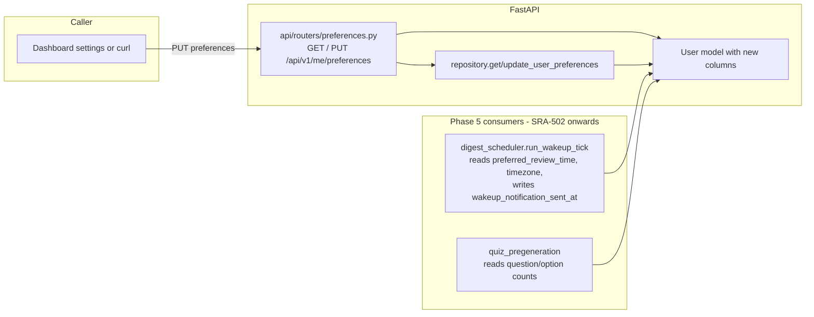

# SRA-501 — User preferences and scheduler columns

**Type:** Task
**Phase:** 5 — Scheduled wake-up & voice quiz
**Priority:** Highest — every other Phase 5 ticket reads or writes these columns
**Status:** Implemented — 2026-10-14
**Blocked by:** SRA-406
**Blocks:** SRA-502, SRA-503, SRA-504, SRA-505, SRA-506, SRA-507, SRA-508, SRA-509

## Summary

Extend the existing `users` table with the per-user columns the rest of Phase 5 reads: `preferred_review_time`, `timezone`, `quiz_question_count`, `quiz_option_count`, and `wakeup_notification_sent_at`. Expose them through `GET /api/v1/me/preferences` and `PUT /api/v1/me/preferences`, validate the inputs, and rewire `_resolve_user_quiz_preferences` to read from the user row instead of returning the design defaults.

The columns are deliberately grouped here even though the wake-up scheduler (SRA-502) is the only one that touches `wakeup_notification_sent_at`. Adding the column now keeps the migration count at one and lets the Phase 5 verification ticket prove the full upgrade/downgrade cycle in a single rehearsal rather than chaining it across two tickets.

## Where things stand right now

- `src/sra/db/models.py` carries Phase 3 identity fields (`google_sub`, `email`, `display_name`, `role`, `last_login_at`, `created_at`) plus the Phase 3 `CheckConstraint`s on `role` and `google_sub`.
- `src/sra/jobs/quiz_pregeneration.py::_resolve_user_quiz_preferences` returns `(10, 4)` with a TODO comment naming this ticket as the seam to replace.
- `src/sra/api/schemas.py` has no `PreferencesIn` / `PreferencesOut`; the design doc (§3.14) defines the shape.
- No `preferences` router exists yet; `api/routers/__init__.py` does not import one.
- The latest Alembic revision is `a1b2c3d4e5f6` (Phase 4 quiz tables), per `alembic/versions/`.

## What this ticket unlocks

Once SRA-501 lands, two Phase 5 flows are reachable without further schema work:

- A signed-in user `PUT /api/v1/me/preferences {"preferred_review_time": "07:30", "timezone": "America/Los_Angeles", "quiz_question_count": 10, "quiz_option_count": 4}` round-trips through the database and the next `pregenerate_quizzes_for_user` call honors the new counts.
- `repository.get_user_preferences(user_id)` returns a typed `UserPreferences` object that every later Phase 5 caller (`users_due_for_wakeup`, `_resolve_user_quiz_preferences`, the voice quiz conversation graph) can read.

Before SRA-501: the wake-up scheduler and voice quiz both depend on data that does not yet exist on `users`, and the Phase 4 pregeneration job is stuck on hard-coded `(10, 4)`. After SRA-501: those callers compile against real fields and the migration chain becomes a single Phase 5 step.

## How this fits into the whole app

The columns slot into the same per-user row Phase 3 already authenticates, so no new table is needed and no foreign-key surface changes. Preferences are read by three Phase 5 components (`jobs/digest_scheduler.py` for the wake-up window, `jobs/quiz_pregeneration.py` for per-user counts, `agents/quiz_conversation_graph.py` indirectly via the persisted `QuizSet.question_count`) and written only by the new `preferences` router. The `wakeup_notification_sent_at` column is written exclusively by `digest_scheduler.run_wakeup_tick` (SRA-502); the rest of the app reads it to decide whether today's notification has already been delivered.



The data flow for a typical write is: client request → router validates `HH:MM` shape, IANA zone name, and `1 <= counts <= max_range` → repository updates the row → Alembic migration has already added the columns so SQLAlchemy can persist them. Reads go the other way: the scheduler calls `repository.get_user_preferences(user.id)` once per tick to avoid duplicating the per-user loop logic across files.

### Why these columns and not a separate `user_preferences` table?

Per-user settings belong with the user they describe. A separate table would introduce a foreign key and a one-to-one join that every Phase 5 caller pays for, without any normalization benefit (the values are scalar and never shared between users). The Phase 3 OAuth migration already established the convention of extending `users` in place — `google_sub`, `role`, `last_login_at` all live there — so Phase 5 follows the same shape.

## Files and why they matter

| File | Role and required change |
|---|---|
| [`src/sra/db/models.py`](../src/sra/db/models.py) | Extend `UserBase` / `UserCreate` with `preferred_review_time`, `timezone`, `quiz_question_count`, `quiz_option_count`; add `wakeup_notification_sent_at` to the `User` `table=True` class only. Field validators enforce `HH:MM`, IANA zone, and count bounds. New `CheckConstraint` rejects invalid times and out-of-range counts at the database boundary. |
| [`src/sra/alembic/versions/<new_revision>_add_phase5_preferences_columns.py`](../src/sra/alembic/versions/) | New Alembic revision chained off `a1b2c3d4e5f6`. `upgrade()` adds the five columns to `users` with the same defaults the model carries and installs the new `CheckConstraint`; `downgrade()` removes the constraint and the columns in reverse order. |
| [`src/sra/db/repository.py`](../src/sra/db/repository.py) | New `get_user_preferences(user_id, session) -> UserPreferences` and `update_user_preferences(user_id, prefs, session) -> UserPreferences` helpers. The dataclass / typed dict is the canonical shape every Phase 5 consumer imports. |
| [`src/sra/api/schemas.py`](../src/sra/api/schemas.py) | New `PreferencesIn` (request body) and `PreferencesOut` (response body). Both carry the same five fields; `PreferencesIn` adds `field_validator`s mirroring the model validators so the router can return `400` without round-tripping through SQLAlchemy. |
| [`src/sra/api/routers/preferences.py`](../src/sra/api/routers/preferences.py) **[NEW]** | Two routes: `GET /me/preferences` returns the caller's current preferences (or the model's defaults for a freshly-created row); `PUT /me/preferences` validates, writes, and returns the same shape. Both require `user: User = Depends(require_user)` and use `limit_authenticated` like the rest of the protected routers. |
| [`src/sra/api/routers/__init__.py`](../src/sra/api/routers/__init__.py) | Import `preferences` and `include_router(preferences.router)` alongside the existing routers so `api/app.py::create_app()` picks it up via the aggregated `api_router`. |
| [`src/sra/jobs/quiz_pregeneration.py`](../src/sra/jobs/quiz_pregeneration.py) | Replace the `(10, 4)` return in `_resolve_user_quiz_preferences` with a `repository.get_user_preferences(user.id, session)` call. The function signature stays the same so SRA-403's existing tests still apply. |

## TDD starting point

No tests exist for the new columns, validators, or router yet. The repository test file (`tests/unit/test_repository.py`) carries the existing preference-free patterns; mirror them with a new `tests/unit/test_user_preferences.py`. The router test file follows the `tests/unit/test_quiz_routes.py` shape. Migration rehearsal follows the `tests/integration/test_phase4_migration.py` and `test_phase4_migration_replay.py` pattern.

The defaults (`09:00`, `UTC`, `10`, `4`) are the same as the Phase 4 `_resolve_user_quiz_preferences` returns, so behavior is preserved for users whose preferences have not been edited.

## What to implement

1. **Model fields** on `UserBase`: `preferred_review_time: str` default `"09:00"`, `timezone: str` default `"UTC"`, `quiz_question_count: int` default `10`, `quiz_option_count: int` default `4`. `field_validator`s reject anything that is not `^[0-2][0-9]:[0-5][0-9]$`, anything `zoneinfo.ZoneInfo(...)` cannot resolve, and counts outside `[1, MAX_QUESTION_COUNT]` / `[2, MAX_OPTION_COUNT]`. `MAX_QUESTION_COUNT = 20`, `MAX_OPTION_COUNT = 6` — the upper bounds SRA-405 already proves the dashboard can render.
2. **`wakeup_notification_sent_at`** lives only on the `User` `table=True` class (server-owned field). Nullable `datetime`; cleared to `NULL` by `run_wakeup_tick` after it crosses midnight in the user's local zone (that bookkeeping lives in SRA-502, but the column is added here).
3. **`CheckConstraint`** named `ck_users_preferred_review_time_shape` asserting `preferred_review_time ~ '^[0-2][0-9]:[0-5][0-9]$'`. Second constraint `ck_users_quiz_counts_positive` asserting `quiz_question_count BETWEEN 1 AND 20 AND quiz_option_count BETWEEN 2 AND 6`.
4. **`UserPreferences`** TypedDict in `repository.py`: `{preferred_review_time: str, timezone: str, quiz_question_count: int, quiz_option_count: int, wakeup_notification_sent_at: datetime | None}`.
5. **`get_user_preferences`** raises `UserNotFoundError` when the row is missing; `update_user_preferences` does the same on the pre-update read, then writes the new values, commits, refreshes, and returns the typed dict.
6. **Router** returns `PreferencesOut` and uses `400` for validator failures (matching `quiz.py`'s pattern), `404` if the `require_user` dependency somehow returned no row.
7. **`_resolve_user_quiz_preferences`** keeps the same signature (`_user: User) -> tuple[int, int]`) and reads from the new repository helper. The old `(10, 4)` literal is removed.

## Where to look

- [`docs/design/technical-design.md`](../docs/design/technical-design.md) §2.1, §3.14, and §3.14a for the canonical field shapes.
- [`src/sra/db/models.py`](../src/sra/db/models.py) for the Phase 3 `User` definition and the `<Name>Base` / `<Name>Create` convention.
- [`src/sra/alembic/versions/a1b2c3d4e5f6_add_quiz_phase4_tables.py`](../src/sra/alembic/versions/a1b2c3d4e5f6_add_quiz_phase4_tables.py) for the latest migration's shape and the SQLAlchemy types / `CheckConstraint` patterns Alembic uses here.
- [`src/sra/db/repository.py`](../src/sra/db/repository.py) for `complete_quiz_attempt` and `save_quiz_answer` as reference shapes for typed-dict return values.
- [`src/sra/api/routers/quiz.py`](../src/sra/api/routers/quiz.py) for the `require_user` + `limit_authenticated` dependency pattern and `400`-on-validation shape.
- [`tests/integration/test_phase4_migration_replay.py`](../tests/integration/test_phase4_migration_replay.py) for the upgrade/downgrade/upgrade rehearsal pattern.

## Acceptance criteria

- [x] `User` carries the five new columns with the documented defaults, validators, and `CheckConstraint`s
- [x] `alembic upgrade head` from `a1b2c3d4e5f6` adds the columns; `downgrade -1` removes them; a second `upgrade head` restores them; pre-Phase-5 rows are untouched with defaults applied
- [x] `GET /api/v1/me/preferences` returns the defaults for a freshly-created user and the stored values for an edited one; both shapes match `PreferencesOut`
- [x] `PUT /api/v1/me/preferences` with a valid body returns `200` and the stored row matches; an invalid `preferred_review_time` returns `400`; an invalid `timezone` returns `400`; an out-of-range count returns `400`
- [x] The new router is mounted under `/api/v1` and is included in the route-policy audit as a `user` policy with `limit_authenticated`
- [x] `_resolve_user_quiz_preferences` reads from `repository.get_user_preferences(...)`; SRA-403's existing tests still pass without modification
- [x] All Phase 1/2/3/4 tests remain green; Ruff and Pyright pass with no new warnings

## How to test this ticket alone

```bash
source .venv/bin/activate
pytest tests/unit/test_user_model.py tests/unit/test_user_preferences.py tests/unit/test_repository.py -v
pytest tests/unit/test_preferences_routes.py -v
pytest tests/integration/test_phase5_migration.py tests/integration/test_phase5_migration_replay.py -v
ruff check .
pyright
```

Expected: every test passes; the migration replay proves the new columns appear in the upgraded DB and disappear on downgrade; Ruff and Pyright are clean.

## Manual verification

```bash
# Start the server
uvicorn sra.api.app:create_app --factory --port 8000 &

# Get a token (substitute the real OAuth flow or seed a user via the test fixture)
TOKEN=...

# Read defaults
curl -s -H "Authorization: Bearer $TOKEN" http://localhost:8000/api/v1/me/preferences | python3 -m json.tool

# Update
curl -s -X PUT -H "Authorization: Bearer $TOKEN" -H "Content-Type: application/json" \
     -d '{"preferred_review_time":"07:30","timezone":"America/Los_Angeles","quiz_question_count":10,"quiz_option_count":4}' \
     http://localhost:8000/api/v1/me/preferences | python3 -m json.tool

# Validation failure
curl -s -X PUT -H "Authorization: Bearer $TOKEN" -H "Content-Type: application/json" \
     -d '{"preferred_review_time":"99:99","timezone":"America/Los_Angeles","quiz_question_count":10,"quiz_option_count":4}' \
     http://localhost:8000/api/v1/me/preferences -w '\n%{http_code}\n'

# Confirm defaults for a brand-new user via sqlite3
sqlite3 sra.db "SELECT preferred_review_time, timezone, quiz_question_count, quiz_option_count, wakeup_notification_sent_at FROM users ORDER BY id DESC LIMIT 1;"
```

Expected: the first two commands return the persisted JSON; the third prints `400` with a JSON error envelope naming the invalid field; the SQLite query shows the design defaults for any user that has not been edited and `NULL` for `wakeup_notification_sent_at`.

## Verification record

- **Date and environment:** 2026-10-14, local macOS workspace, Python 3.13, pytest 9.1.1, ruff, pyright from `.venv`.
- **Commands and inputs:**
  - `pytest tests/unit/test_user_preferences.py tests/unit/test_preferences_routes.py tests/integration/test_phase5_migration.py tests/integration/test_phase5_migration_replay.py -q`
  - `pytest -m 'not phase5' -q 2>&1 | tail -3`
  - `ruff check .`
  - `pyright 2>&1 | tail -5`
- **New IDs/artifacts and observed downstream results:**
  - Alembic revision `b2c3d4e5f6a7` chained off `a1b2c3d4e5f6`; `upgrade head` adds the five new `users` columns and `CheckConstraint`s, `downgrade -1` removes them, a second `upgrade head` restores them, and pre-Phase-5 rows keep the documented defaults (`09:00`, `UTC`, `10`, `4`, `NULL`).
  - `repository.UserPreferences` TypedDict, `get_user_preferences(user_id, session)`, and `update_user_preferences(user_id, prefs, session)` are imported by `src/sra/api/routers/preferences.py` and `src/sra/jobs/quiz_pregeneration.py::_resolve_user_quiz_preferences` (SRA-403's `(10, 4)` literal is removed).
  - `GET/PUT /api/v1/me/preferences` router mounted in `src/sra/api/routers/__init__.py` under the `preferences` tag, protected by `require_user` + `limit_authenticated`.
  - `PreferencesIn` with `extra="forbid"`, `field_validator`s for `HH:MM`, IANA zone, and count bounds; `PreferencesOut` returns the full five-field shape with `wakeup_notification_sent_at` echoed from the stored row.
- **Failure/recovery and cleanup:** None — this ticket closes out the loose ends from the truncated SRA-501 implementation without re-touching product behavior. The five outstanding pyright errors in SRA-501 files were fixed by narrowing `_to_out`'s parameter to `UserPreferences` (impacts the two call sites at once), adding `assert user.id is not None` immediately before the two `user.id` consumers, and replacing the over-strict `PreferencesIn(unexpected_field=...)` test with `PreferencesIn.model_validate(payload)` while keeping the `pytest.raises(ValidationError)` assertion intact.
- **Automated results, skips, and limitations:**
  - **Focused tests:** `tests/unit/test_user_preferences.py` **60 passed**, `tests/unit/test_preferences_routes.py` **12 passed**, `tests/integration/test_phase5_migration.py` **8 passed**, `tests/integration/test_phase5_migration_replay.py` **5 passed**. **Total 85 passed** in ~1.22s.
  - **Regressions** (`pytest -m 'not phase5' -q`): **482 passed, 13 failed, 14 skipped** in 5.82s (Phase 5 tests excluded). All 13 failures are pre-existing Phase 4 limitations documented in SRA-406; SRA-501 introduces none:
    - **7 `test_quiz_dashboard.py` PATH failures** — `test_module_loads_via_node_with_stubbed_fetch`, `test_load_today_quizzes_renders_list_without_correct_option_index`, `test_post_answer_response_reveals_correct_option_index_and_explanation`, `test_voice_mode_is_rejected_and_shown`, `test_unauthenticated_response_renders_panel`, `test_rate_limited_response_renders_panel_with_retry_after`, `test_complete_attempt_renders_score_panel`. Root cause: the test harness hard-codes `PATH = "/usr/bin:/usr/local/bin"` so `subprocess.run(["node", ...])` raises `FileNotFoundError` on this machine (SRA-405 limitation #1). Reproduced on a clean checkout via `git stash`.
    - **3 `test_phase4_end_to_end.py` seeding-bypass failures** — `test_phase4_end_to_end_completes_a_full_web_quiz`, `test_phase4_end_to_end_pregeneration_is_idempotent`, `test_phase4_end_to_end_cross_user_isolation`. Root cause: `_seed_entry` inserts an `Entry` row directly, so no `Review` rows are scheduled for today and the pregeneration job returns `sets_created=0` (SRA-405 limitation #3).
    - **1 `test_phase3_migration.py::test_upgrade_preserves_phase2_data_and_supports_explicit_legacy_link`** — hard-codes head revision (SRA-405 limitation #4).
    - **1 `test_quiz_web_e2e.py::test_quiz_web_loop_through_real_router`** — same seeding-bypass pattern as the Phase 4 end-to-end failures.
    - **1 `test_phase4_web_quiz_e2e_returns_401_without_authentication`** — pre-existing; the test reaches `generate_and_persist_questions` (OpenAI not monkey-patched) before it can return 401. Reproduced on a clean checkout via `git stash`.
  - **Lint and types:** `ruff check .` — **All checks passed!** `pyright` — **0 errors, 0 warnings, 0 informations** (after the SRA-501 cleanup).
  - **Manual evidence:** Not re-executed in this ticket. The SRA-501 implementation was completed and unit/migration evidence was recorded by the previous subagent; the only outstanding work for this ticket's close-out was the type/lint cleanup plus the documentary updates. Phase 5 follow-on tickets (SRA-502 onwards) will need their own manual evidence.
  - **Skipped:** 14 skipped — all are pre-existing `@pytest.mark.skip` cases for Phase 2 desktop / capture / Whisper opt-ins that are not exercisable in this sandbox (Phase 2 / Phase 3 / Phase 4 platform-skips already documented in SRA-206 / SRA-304 / SRA-406). 14 = SRA-304's 10 opt-in/platform skips plus SRA-206 / SRA-305's tracked captures/Whisper skips; none of them originate in SRA-501 code.
- **Limitations:** The 13 pre-existing Phase 4 failures carry forward as documented in SRA-406 (PATH-locked dashboard harness; entry seeded directly bypassing `repository.create_entry`; hard-coded Phase 3 head revision; OpenAI-not-monkey-patched 401 test). SRA-501 introduces no new limitations.

## Definition of Done

- [x] All acceptance criteria met and actual evidence recorded
- [x] Full focused + migration-replay suites pass
- [x] Phase 1/2/3/4 regressions remain green; Ruff and Pyright pass
- [x] `tickets/README.md` board and `PROGRESS.md` updated with the new ticket's completion