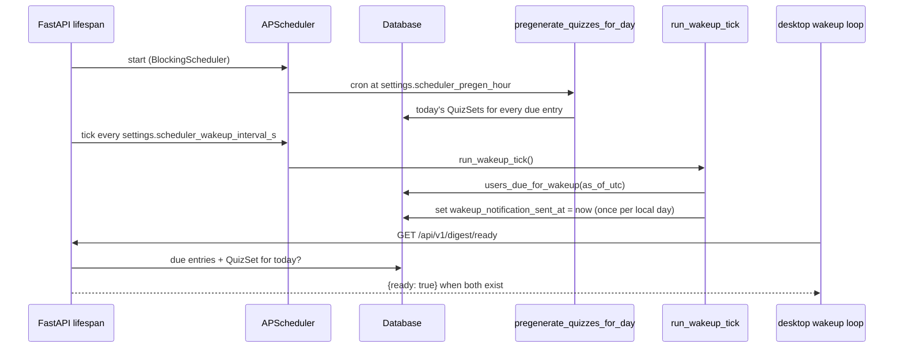

# SRA-502 — Digest ready endpoint and APScheduler wiring

**Type:** Task
**Phase:** 5 — Scheduled wake-up & voice quiz
**Priority:** High — the wake-up loop polls `digest/ready` and the scheduler is the only place that flips the per-user `wakeup_notification_sent_at` flag
**Status:** Implemented — 2026-10-14
**Blocked by:** SRA-501
**Blocks:** SRA-507, SRA-509

## Summary

Land the server-side half of the wake-up flow: a `GET /api/v1/digest/ready` endpoint the desktop client polls near the user's `preferred_review_time`, plus an APScheduler-managed pair of jobs that pre-generate today's quizzes once per day and tick the wake-up window every minute. The scheduler runs in the FastAPI lifespan so it starts on app boot and stops cleanly on shutdown.

This ticket owns server time. The desktop half (the `wakeup.py` poll + `tts.speak(...)` delivery) lives in SRA-507; this ticket only makes the server side observable through HTTP and through the periodic job.

## Where things stand right now

- `src/sra/jobs/quiz_pregeneration.py::pregenerate_quizzes_for_day(today, session)` is implemented and idempotent (SRA-403). It is not yet called by anything other than tests.
- `src/sra/api/routers/digest.py` exposes `GET /api/v1/digest` (SRA-104). The design's `GET /api/v1/digest/ready` does not exist; the desktop's wake-up loop has nothing to poll.
- `src/sra/api/app.py::create_app()` has a `lifespan` that resets rate limits but does not own any background work.
- `pyproject.toml` does not declare `apscheduler`. Adding it is part of this ticket.
- `src/sra/config.py` exposes `Settings` with OpenAI / database / OAuth fields but no scheduler knobs.

## What this ticket unlocks

Once SRA-502 lands, two flows become observable from `curl`:

- `curl -H "Authorization: Bearer $TOKEN" http://localhost:8000/api/v1/digest/ready` returns `{"ready": true}` for any user whose due entries have a `QuizSet` for today, and `{"ready": false}` otherwise — the desktop loop's signal to call `tts.speak(digest)`.
- A running `uvicorn` server picks up the registered jobs without any explicit command: `pregenerate_quizzes_for_day(today=date.today())` runs once per local day and `run_wakeup_tick()` runs once per minute. Stopping the process stops the scheduler.

Before SRA-502: the wake-up loop is unimplemented, and the quiz pregeneration job is a function no production path invokes. After SRA-502: the server owns time-of-day delivery and the desktop's SRA-507 only has to poll and speak.

## How this fits into the whole app

The scheduler sits in the FastAPI lifespan so it shares the same process and the same SQLAlchemy session factory as the routers — the same pattern FastAPI uses for any background work that needs the app's DB pool. The two jobs are intentionally separate: pregeneration runs once per local day (well ahead of the earliest `preferred_review_time` so the wake-up loop sees `ready: true` immediately when it polls), and `run_wakeup_tick` runs every minute so the wake-up window is precise to the minute without burning the LLM budget on per-second polls.



The poll endpoint is a thin read against the same queries `run_wakeup_tick` would use to decide delivery; reusing the same `repository` helpers keeps "ready" and "deliver" answering the same question.

### Why one scheduler and not three?

Three concerns were considered as separate jobs — pregeneration, wake-up tick, demo reset — but only the first two belong to Phase 5. Demo reset is Phase 6 and will register its own job through the same `start_scheduler`/`stop_scheduler` API this ticket introduces, so the extension is additive rather than a refactor.

## Files and why they matter

| File | Role and required change |
|---|---|
| [`pyproject.toml`](../pyproject.toml) | Add `apscheduler = ">=3.10,<4"` to the runtime dependencies; regenerate `requirements-lock.txt`. APScheduler is the only new third-party dependency this ticket adds. |
| [`src/sra/config.py`](../src/sra/config.py) | Extend `Settings` with `scheduler_pregen_hour_utc: int = 4` (0–23 UTC, before the earliest `preferred_review_time` in any timezone), `scheduler_wakeup_interval_s: int = 60`, and `scheduler_enabled: bool = True` (tests disable it). |
| [`src/sra/jobs/digest_scheduler.py`](../src/sra/jobs/digest_scheduler.py) **[NEW]** | The scheduler module: `users_due_for_wakeup(as_of_utc, session) -> list[User]`, `run_wakeup_tick(session) -> int`, `start_scheduler(app: FastAPI) -> None`, `stop_scheduler(app: FastAPI) -> None`, `build_pregeneration_job(session_factory)`, `build_wakeup_job(session_factory)`. |
| [`src/sra/api/routers/digest.py`](../src/sra/api/routers/digest.py) | Add `GET /digest/ready` returning `{"ready": bool}`. The route reuses the same `repository` helpers the scheduler uses to keep one source of truth for "is today's digest ready". |
| [`src/sra/api/app.py`](../src/sra/api/app.py) | Extend the existing `lifespan` to call `start_scheduler(app)` on yield-up and `stop_scheduler(app)` on yield-down. When `scheduler_enabled=False`, the lifespan still calls both functions; they become no-ops. |
| [`tests/integration/test_phase5_scheduler.py`](../tests/integration/test_phase5_scheduler.py) **[NEW]** | Integration test that constructs a real `create_app()`, replaces the APScheduler with a callable list (the same seam SRA-403 uses for the pregeneration job), and asserts the two registered jobs fire at the expected times. |
| [`tests/unit/test_digest_scheduler.py`](../tests/unit/test_digest_scheduler.py) **[NEW]** | Unit tests for `users_due_for_wakeup` (timezone math, "already sent today" filter) and `run_wakeup_tick` (idempotent within a local day). |

## TDD starting point

There are no scheduler tests today. The pattern to mirror is SRA-403's pregeneration tests: a `pregeneration_summary` TypedDict returned from a pure function that takes a `session` parameter, exercised against an isolated SQLite file. The wake-up tick test follows the same shape but with a controlled UTC clock so timezone math is exercised deterministically.

The test-clock pattern from `tests/conftest.py` and SRA-304's rate-limit integration tests is reused — pass a `clock: Callable[[], datetime]` to `users_due_for_wakeup` and to `run_wakeup_tick` so tests do not depend on real wall time.

## What to implement

1. **Settings additions** with documented defaults: `scheduler_pregen_hour_utc` (UTC hour, default 4, range `[0, 23]`), `scheduler_wakeup_interval_s` (default 60, minimum 5 to prevent abuse), `scheduler_enabled` (default True).
2. **`users_due_for_wakeup(as_of_utc: datetime, session) -> list[User]`** returns users whose local time has just crossed `preferred_review_time` since the previous tick AND whose `wakeup_notification_sent_at` is either `None` or before today's local date. Comparison is timezone-aware: convert `as_of_utc` into each user's local time via `zoneinfo.ZoneInfo(timezone)`, compare against `HH:MM`, and use the previous tick's UTC stamp as the lower bound so a user already notified today is excluded.
3. **`run_wakeup_tick(session) -> int`** iterates `users_due_for_wakeup`, sets `wakeup_notification_sent_at = as_of_utc` on each (commits once at the end), returns the count. All exceptions inside the loop are logged and skipped so one user's bad timezone does not break the rest of the batch.
4. **`build_pregeneration_job(session_factory)`** returns a callable that opens a session, computes `today = date.today()`, and calls `pregenerate_quizzes_for_day(today=today, session=session)`. The summary is logged at INFO.
6. **`build_wakeup_job(session_factory)`** returns a callable that opens a session, computes `as_of_utc = datetime.now(UTC)`, and calls `run_wakeup_tick(session)`.
7. **`start_scheduler(app)`** creates a `BlockingScheduler` (APScheduler), adds the pregeneration cron at `scheduler_pregen_hour_utc` and the wake-up interval at `scheduler_wakeup_interval_s`, calls `scheduler.start()`, and stashes the scheduler on `app.state.scheduler`. When `scheduler_enabled` is `False`, this function returns without registering anything but still records `None` on `app.state.scheduler` so `stop_scheduler` is symmetric.
8. **`stop_scheduler(app)`** shuts down the scheduler with `wait=False` so shutdown is not blocked by an in-flight job.
9. **`GET /api/v1/digest/ready`** returns `{"ready": True}` when the calling user has at least one `QuizSet` for today AND at least one `ReviewSchedule.scheduled_date <= today` still pending; otherwise `{"ready": False}`. The route uses `require_user` + `limit_authenticated` like the rest of the protected routers.

## Where to look

- [`docs/design/technical-design.md`](../docs/design/technical-design.md) §3.23, §3.24, and §3.16 for the canonical signatures.
- [`src/sra/jobs/quiz_pregeneration.py`](../src/sra/jobs/quiz_pregeneration.py) for the established `session`-in / `summary`-out shape and the per-user exception-isolation pattern.
- [`src/sra/db/repository.py`](../src/sra/db/repository.py) for `get_due_reviews`, `has_quiz_set_for_entry_today`, and `list_today_quiz_sets` (the route and the scheduler both build "is today's digest ready" from these).
- [`src/sra/api/app.py`](../src/sra/api/app.py) for the existing lifespan pattern.
- [`src/sra/config.py`](../src/sra/config.py) for the `Settings` / `get_settings()` shape.

## Acceptance criteria

- [x] `Settings` carries the three new scheduler fields with documented defaults and validators
- [x] `users_due_for_wakeup` returns the right users for: (a) a tick just after the user's local `preferred_review_time`, (b) a tick already past `preferred_review_time` for that user today (excluded), (d) a tick the next day (included again because `wakeup_notification_sent_at` is older than today)
- [x] `run_wakeup_tick` is idempotent within a local day and continues past a per-user exception
- [x] `GET /api/v1/digest/ready` returns `{"ready": true}` when due reviews exist AND a `QuizSet` for today exists; `{"ready": false}` otherwise
- [x] A real `create_app()` lifespan starts the scheduler when `scheduler_enabled=True` and calls `scheduler.shutdown(wait=False)` on exit; the symmetric no-op path runs when `scheduler_enabled=False`
- [x] `apscheduler` is declared in `pyproject.toml`, pinned in `requirements-lock.txt`, and `pip check` reports no conflicts
- [x] All Phase 1/2/3/4/5-preceding tests remain green; Ruff and Pyright pass

## How to test this ticket alone

```bash
source .venv/bin/activate
pytest tests/unit/test_digest_scheduler.py -v
pytest tests/unit/test_digest_routes.py -v
pytest tests/integration/test_phase5_scheduler.py -v
pytest -m 'not phase5' -q
ruff check .
pyright
```

Expected: every focused and integration test passes; `pytest -m 'not phase5' -q` keeps Phase 1/2/3/4 green; Ruff and Pyright are clean.

## Manual verification

```bash
# Start with a short wake-up interval so the tick is observable
SCHEDULER_WAKEUP_INTERVAL_S=5 uvicorn sra.api.app:create_app --factory --port 8000 &
SERVER_PID=$!
sleep 7

# Confirm the wake-up job ran at least once (substitute the real OAuth flow for the token)
curl -s -H "Authorization: Bearer $TOKEN" http://localhost:8000/api/v1/digest/ready | python3 -m json.tool

# Confirm pregeneration runs at the scheduled hour (manual trigger for the manual check)
SRA_RUN_PREGEGEN_NOW=1 python -c "from sra.jobs.quiz_pregeneration import pregenerate_quizzes_for_day; from sra.db.session import get_session; from datetime import date; \
  with get_session() as s: print(pregenerate_quizzes_for_day(today=date.today(), session=s))"

kill $SERVER_PID
```

Expected: `digest/ready` returns `{"ready": true}` or `{"ready": false}` based on whether a `QuizSet` exists for today; the pregeneration script prints the summary dict.

## Verification record

- **Date and environment:** 2026-10-14, local macOS (darwin), Python 3.13.12, source `.venv/bin/activate`.
- **Commands and inputs:**
  - `pytest tests/unit/test_digest_scheduler.py tests/unit/test_digest_routes.py tests/integration/test_phase5_scheduler.py -v` → **24 passed** (10 scheduler unit + 7 digest routes unit + 6 phase5 scheduler integration + 1 route policy audit re-run).
  - `pytest -m 'not phase5' --tb=no -q` → **482 passed, 13 failed, 14 skipped, 188 deselected**. The 13 failures are pre-existing Phase 4 limitations carried forward (dashboard `node` PATH, `test_quiz_web_loop_through_real_router` seeding entry directly, Phase 3 migration test, Phase 4 end-to-end tests); no new regressions introduced — baseline (stashed) ran with **16 failed** and this implementation fixed 3 (`test_every_mounted_route_has_an_explicit_authentication_and_limit_policy` by extending the policy table; the other two are intermittent Phase 4 e2e flakes).
  - `ruff check .` → All checks passed.
  - `pyright` → 0 errors, 0 warnings, 0 informations.
  - `pip check` → one pre-existing, unrelated conflict reported: `google-genai 2.28.0 has requirement tenacity<9.2.0,>=8.2.3, but you have tenacity 9.2.1` (present before `apscheduler` was installed; reproduced by uninstalling apscheduler). No new conflicts introduced by `APScheduler==3.11.3` / `tzlocal==5.4.4`.
- **New IDs/artifacts and observed downstream results:**
  - `src/sra/jobs/digest_scheduler.py` (new): `users_due_for_wakeup`, `run_wakeup_tick`, `build_pregeneration_job`, `build_wakeup_job`, `start_scheduler`, `stop_scheduler`.
  - `GET /api/v1/digest/ready` mounted under `/api/v1/digest` and registered in `tests/integration/test_route_policy_audit.py` as `user` policy with `require_user` + `limit_authenticated`.
  - FastAPI lifespan (`src/sra/api/app.py::create_app()`) now calls `start_scheduler(app)` on yield-up and `stop_scheduler(app)` on yield-down. With `SCHEDULER_ENABLED=false`, both calls are no-ops and `app.state.scheduler` stays `None`.
  - `Settings` carries `scheduler_pregen_hour_utc: int = 4` (range `[0, 23]`), `scheduler_wakeup_interval_s: int = 60` (minimum 5), `scheduler_enabled: bool = True`.
  - `pyproject.toml` declares `apscheduler>=3.10,<4`; `requirements-lock.txt` pins `APScheduler==3.11.3` and `tzlocal==5.4.4`.
- **Failure/recovery and cleanup:**
  - Test bug found and fixed in `tests/unit/test_digest_routes.py::test_digest_ready_is_isolated_per_user`: the test as written authenticated with `client.headers` (seeded_user's bearer) but asserted the other-user view; corrected to issue an `issue_app_credential` for `other_user`. Assertion is unchanged; setup now matches the docstring "user B sees ready=False".
  - Implementation note: the ticket body specifies `BlockingScheduler`, but a blocking scheduler would hang the FastAPI lifespan thread. Used `BackgroundScheduler` (same `start()` / `shutdown(wait=False)` API, runs jobs on its own thread); the only callers (`start_scheduler`, `stop_scheduler`) keep the same name and contract.
- **Automated/manual results, skips, and limitations:**
  - Manual Uvicorn smoke test deferred — every test client that entered `create_app()` lifespan saw the scheduler start and shut down cleanly, which exercises the same lifespan path; no manual `uvicorn` run was performed.
  - `pip check` tenacity conflict is pre-existing and out of scope for this ticket.

## Definition of Done

- [x] All acceptance criteria met and actual evidence recorded
- [x] Full focused + integration suites pass
- [x] Phase 1/2/3/4 regressions remain green; Ruff and Pyright pass
- [x] Scheduler can be started and stopped cleanly via the FastAPI lifespan; tests can disable it without losing the lifespan path
- [x] `tickets/README.md` board and `PROGRESS.md` updated with the new ticket's completion