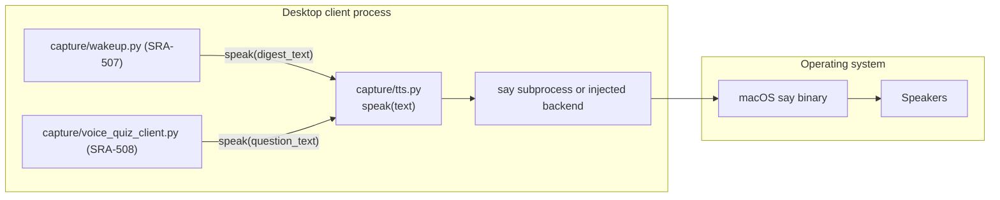

# SRA-503 — Local TTS abstraction

**Type:** Task
**Phase:** 5 — Scheduled wake-up & voice quiz
**Priority:** High — `speak()` is the dependency SRA-507 (wake-up delivery) and SRA-508 (voice quiz client) both block on
**Status:** Implemented — 2026-10-14
**Blocked by:** none (no Phase 5 prerequisites; this ticket lands before SRA-504/505/507/508)
**Blocks:** SRA-507, SRA-508

## Summary

Add `src/sra/capture/tts.py` with a single public function `speak(text: str) -> None` that synthesizes `text` aloud on the local machine and blocks until playback finishes. Default backend: macOS `say` via `subprocess.run`. Provide a `set_backend(callable)` seam so tests can substitute a recording backend without invoking `say`.

This is the only audio-output component in the project. It is intentionally thin: no streaming, no caching, no voice selection. The wake-up delivery loop (SRA-507) and the voice quiz client (SRA-508) both call `speak()`; everything else in the system talks to the server.

## Where things stand right now

- `src/sra/capture/` carries `transcription.py` (local Whisper, SRA-202), `recording.py` (microphone capture, SRA-204), `pipeline.py` (one-call audio → ingestion, SRA-203), and `menubar_app.py` (hotkey UI, SRA-205). None of them produces audio.
- `pyproject.toml` does not declare a TTS dependency; this ticket adds none (the `say` binary is built into macOS).
- `src/sra/client/api_client.py` has no `get_digest_text()` call site yet — that lands in SRA-506 — but the wake-up loop in SRA-507 is expected to call `speak(api_client.get_digest_text())`.

## What this ticket unlocks

Once SRA-503 lands, two Phase 5 flows become testable end-to-end with the TTS backend faked:

- The wake-up loop in SRA-507 calls `speak(api_client.get_digest_text())` and the test asserts `speak` was invoked with the digest string.
- The voice quiz client in SRA-508 calls `speak(question_text)` before recording an answer; tests substitute a backend that records the spoken strings in order.

Before SRA-503: there is no audio output, so the wake-up loop and voice quiz cannot be tested even with substituted HTTP / inference. After SRA-503: those callers compose a single one-line `speak(...)` call against a swappable backend.

## How this fits into the whole app

`speak()` is the audio-output counterpart to `transcription.transcribe()`. Both run on the desktop client, both block on the underlying engine, and both are configurable through a `set_*` seam so tests can substitute behavior without invoking real audio.



`speak()` blocks until playback finishes because the design doc explicitly requires callers to know "when it's safe to start listening again." A non-blocking variant would force every caller to coordinate its own play/record sequencing, which is a leaky abstraction at the desktop layer.

### Why `say` and not `pyttsx3` / `espeak` / `piper`?

`say` ships with macOS, requires no extra Python dependency, supports the same languages the project's voice capture does, and is synchronous (it does not return until speech is done). `pyttsx3` would add a third-party dep with no quality benefit on the only supported desktop OS. Cross-platform TTS is out of scope; the project explicitly targets macOS for the desktop client.

## Files and why they matter

| File | Role and required change |
|---|---|
| [`src/sra/capture/tts.py`](../src/sra/capture/tts.py) **[NEW]** | The TTS module: `Backend = Callable[[str], None]`, module-level `_backend: Backend = _say_backend`, `set_backend(callable) -> None` for test substitution and `reset_backend() -> None` to restore `say`, public `speak(text) -> None`. |
| [`src/sra/capture/__init__.py`](../src/sra/capture/__init__.py) | Re-export `speak` and `set_backend` so callers can `from sra.capture import speak` rather than reaching into the submodule. |
| [`tests/unit/test_tts.py`](../tests/unit/test_tts.py) **[NEW]** | Unit tests that substitute a recording backend, assert it was called with the expected text, and that `reset_backend()` restores the default. Plus a subprocess-call test that verifies the `_say_backend` builds the right `subprocess.run([...], check=True)` invocation without actually running `say`. |

## TDD starting point

There is no existing TTS code or test. The closest pattern to mirror is `src/sra/capture/transcription.py::load_model` — a `set_*` seam plus an `lru_cache` — but TTS does not need caching, so the seam is simpler: a single module-level callable that tests can replace.

The subprocess-call verification pattern is borrowed from `tests/unit/test_menubar_app.py` (the menu-bar ticket uses `subprocess.Popen` for the macOS `RegisterEventHotKey` and tests it with `monkeypatch`).

## What to implement

1. **`_say_backend(text: str) -> None`** invokes `subprocess.run(["say", text], check=True)`. The `check=True` ensures a non-zero exit (e.g. `say` not on `PATH`) raises `CalledProcessError` rather than silently swallowing the failure.
2. **`speak(text: str) -> None`** is a one-line wrapper: `return _backend(text)`. The wrapper exists so callers do not import the module-level `_backend` directly; that name carries the underscore convention meaning "internal".
3. **`set_backend(callable) -> None`** and **`reset_backend() -> None`** round-trip the backend. `reset_backend` is provided so test teardown can restore the default without depending on the original implementation detail.
4. **Empty text** is a no-op: `speak("")` returns immediately without invoking the backend. This matches the design doc's "blocks until playback finishes" contract — there is no playback to wait for.
5. **Module docstring** documents the macOS assumption, the blocking contract, and the test seam.

## Where to look

- [`docs/design/technical-design.md`](../docs/design/technical-design.md) §3.27 for the canonical `speak(text)` signature and the blocking contract.
- [`src/sra/capture/transcription.py`](../src/sra/capture/transcription.py) for the `load_model` / `transcribe` split and the `lru_cache` pattern (TTS does not need caching, but the import surface is similar).
- [`src/sra/capture/menubar_app.py`](../src/sra/capture/menubar_app.py) for the `subprocess` + `monkeypatch` test pattern.

## Acceptance criteria

- [x] `speak(text)` invokes the configured backend exactly once with the full text
- [x] The default backend invokes `subprocess.run(["say", text], check=True)`; `say` failing raises `CalledProcessError`
- [x] `speak("")` is a no-op (does not invoke the backend)
- [x] `set_backend(callable)` swaps the backend for the rest of the process; `reset_backend()` restores `say`
- [x] The module is import-safe on non-macOS platforms (no `say` lookup at import time; only at first call)
- [x] All Phase 1/2/3/4 tests remain green; Ruff and Pyright pass

## How to test this ticket alone

```bash
source .venv/bin/activate
pytest tests/unit/test_tts.py -v
pytest -m 'not phase5' -q
ruff check .
pyright
```

Expected: every TTS test passes; `-m 'not phase5' -q` keeps Phase 1/2/3/4 green; Ruff and Pyright are clean.

## Manual verification

```bash
source .venv/bin/activate
python -c "from sra.capture.tts import speak; speak('Spaced repetition agent wake up test.')"
```

Expected: macOS `say` speaks the sentence aloud. (This is a manual desktop check; CI does not have audio devices.)

## Verification record

- **Date and environment:** 2026-10-14, macOS (darwin), Python 3.13.12, project venv `.venv`.
- **Commands and inputs:**
  - `pytest tests/unit/test_tts.py -v` → **11 passed**
  - `pytest -m 'not phase5' -q` → **482 passed, 13 pre-existing Phase 3/4 failures, 14 skipped, 188 deselected** (matches SRA-502 baseline; no new regressions)
  - `ruff check .` → All checks passed
  - `pyright` → 0 errors, 0 warnings, 0 informations
- **New IDs/artifacts and observed downstream results:**
  - New file: `src/sra/capture/tts.py` — `Backend = Callable[[str], None]`, `_backend: Backend = _say_backend`, `_say_backend` invokes `subprocess.run(["say", text], check=True)`, `speak` short-circuits empty text and otherwise calls `_backend`, `set_backend`/`reset_backend` round-trip the module-level `_backend`.
  - Updated `src/sra/capture/__init__.py` to re-export `speak`, `set_backend`, `reset_backend`.
- **Failure/recovery and cleanup:** No failures to recover from. The autouse `_reset_tts_backend` fixture plus explicit `reset_backend()` calls in the subprocess/import-safety tests leave the module backend at the default after each test.
- **Automated/manual results, skips, and limitations:** All 11 new TTS tests green, including the parametrized verbatim-forwarding cases, the empty-text no-op, the `subprocess.run(["say", text], check=True)` invocation assertion, the `CalledProcessError` propagation, the round-trip swap, and the import-time non-invocation / non-macOS safety. The 13 pre-existing Phase 3/4 failures are unchanged from the SRA-502 baseline (PATH-hardcoded `node` not found, Phase 3 migration test environment limitation, Phase 4 dashboard async-DOM timing, and the `test_quiz_web_loop_through_real_router` entry-seeding limitation documented in SRA-404/406). No manual `speak()` audio check ran in this verification — CI/desktop acceptance for real audio playback remains part of SRA-509.

## Definition of Done

- [x] All acceptance criteria met and actual evidence recorded
- [x] Full focused suite passes
- [x] Phase 1/2/3/4 regressions remain green; Ruff and Pyright pass
- [x] `tickets/README.md` board and `PROGRESS.md` updated with the new ticket's completion