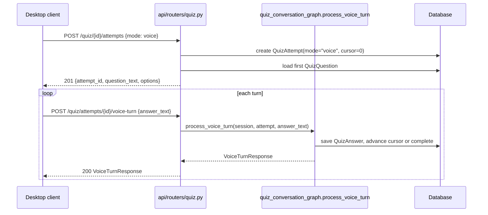

# SRA-505 — Voice quiz router endpoint

**Type:** Task
**Phase:** 5 — Scheduled wake-up & voice quiz
**Priority:** High — the only HTTP surface the desktop voice quiz client calls
**Status:** Implemented — 2026-10-14
**Blocked by:** SRA-504
**Blocks:** SRA-506, SRA-508, SRA-509

## Summary

Replace the Phase 4 router's typed `400` rejection of `mode: "voice"` with a real voice-attempt flow. `POST /api/v1/quiz/{quiz_set_id}/attempts {"mode": "voice"}` starts an attempt and returns the first question text alongside the `attempt_id`. A new `POST /api/v1/quiz/attempts/{attempt_id}/voice-turn {"answer_text": "..."}` route runs one turn through `quiz_conversation_graph.process_voice_turn` and returns the next question or the final score.

This is the smallest Phase 5 router ticket: it adds two routes, removes one rejection branch, and adds two request/response DTOs to `api/schemas.py`. All grading and persistence happens inside the graph from SRA-504; the router is HTTP plumbing.

## Where things stand right now

- `src/sra/api/routers/quiz.py::start_quiz_attempt` rejects `mode: "voice"` with `HTTP 400, detail=VOICE_UNSUPPORTED`. The constant is defined at the top of the same file. SRA-505 removes the rejection for voice attempts and adds the per-turn route.
- `src/sra/api/schemas.py` carries `QuizAttemptOut`, `StartAttemptRequest`, `SubmitAnswerRequest`, `AnswerResult`. It does not yet have `VoiceTurnRequest` / `VoiceTurnResponse`.
- `src/sra/api/rate_limit.py` already exports `limit_authenticated`; the new routes reuse it like the rest of the protected routers.

## What this ticket unlocks

Once SRA-505 lands, the desktop voice quiz client (SRA-508) and the extended client API (SRA-506) both have real endpoints to call. A full voice attempt becomes a `curl`-drivable flow without any audio:

```bash
TOKEN=...; QUIZ_SET_ID=...;
# Start
ATTEMPT_ID=$(curl -s -X POST -H "Authorization: Bearer $TOKEN" -H "Content-Type: application/json" \
                  -d '{"mode":"voice"}' \
                  "http://localhost:8000/api/v1/quiz/${QUIZ_SET_ID}/attempts" | jq .attempt_id)
# Turn
curl -s -X POST -H "Authorization: Bearer $TOKEN" -H "Content-Type: application/json" \
     -d '{"answer_text":"the second one"}' \
     "http://localhost:8000/api/v1/quiz/attempts/${ATTEMPT_ID}/voice-turn" | python3 -m json.tool
```

Before SRA-505: voice mode is rejected with a typed `400` and the Phase 4 router has no per-turn route. After SRA-505: the same endpoints exist that the desktop client will drive, testable end-to-end with the LLM faked.

## How this fits into the whole app

The voice routes are sibling endpoints to the Phase 4 web routes — same prefix, same ownership enforcement, same rate limit. The only difference is that voice turns pass through `process_voice_turn` rather than `submit_quiz_answer`, and the start endpoint returns the first question text inline so the client can `speak()` it without a separate round-trip.



The voice route reuses the same `_get_owned_quiz_set` / `_get_owned_attempt` helpers the Phase 4 router already defines — no duplication of ownership enforcement.

### Why the first question is returned inline

Voice clients need to `speak(question_text)` immediately after starting the attempt. A separate `GET /quiz/attempts/{id}/first-question` would add a round-trip and a race where the attempt's cursor could (in principle) be advanced by another concurrent request before the client spoke. Embedding the first question in the start response keeps the audio + HTTP atomic from the client's perspective.

## Files and why they matter

| File | Role and required change |
|---|---|
| [`src/sra/api/schemas.py`](../src/sra/api/schemas.py) | Add `VoiceTurnRequest { answer_text: str }` and `VoiceTurnResponse { is_correct: bool \| None, feedback_text: str, next_question_text: str \| None, finished: bool, score: int \| None }`. The `is_correct` field is `None` only for the final turn (where the user has no answer to grade). |
| [`src/sra/api/routers/quiz.py`](../src/sra/api/routers/quiz.py) | Remove the `mode: "voice"` rejection in `start_quiz_attempt`; load and return the first question inline. Add `POST /attempts/{attempt_id}/voice-turn` that calls `process_voice_turn(...)` and returns `VoiceTurnResponse`. Both routes use the existing `_get_owned_quiz_set` / `_get_owned_attempt` helpers. |
| [`tests/unit/test_quiz_routes.py`](../tests/unit/test_quiz_routes.py) | Add tests for the new routes (voice start, voice turn correct, voice turn wrong, voice turn last-question, cross-user `403`, completed-attempt `409`, LLM-interpretation error `422`). |
| [`tests/e2e/test_phase5_voice_quiz_e2e.py`](../tests/e2e/test_phase5_voice_quiz_e2e.py) **[NEW]** | End-to-end test through a real `create_app()` instance with the LLM seam patched. |

## TDD starting point

The Phase 4 `test_quiz_routes.py` is the model: tests in this file already cover `start_quiz_attempt` (currently asserting the `400`), `submit_quiz_answer` (web mode), and cross-user isolation. SRA-505 reuses the same fixtures and adds the voice-mode tests as siblings.

The e2e test mirrors `tests/e2e/test_phase4_web_quiz_e2e.py` but drives voice-mode routes instead of web-mode ones.

## What to implement

1. **`VoiceTurnRequest`** schema: `{ answer_text: str }`. The validator strips whitespace; an empty answer returns `400`.
2. **`VoiceTurnResponse`** schema: `{ is_correct: bool | None, feedback_text: str, next_question_text: str | None, finished: bool, score: int | None }`. `feedback_text` is `"Correct."` / `"Incorrect."` (or a one-sentence explanation if `QuizQuestion.explanation` is set), then the next question's text if `not finished`, else `"You scored N out of M."`.
3. **`start_quiz_attempt`** keeps the web-mode branch as-is. For `mode: "voice"`: create the attempt, load the first `QuizQuestion` (ordered by `order_index` ascending), return `{attempt_id, question_text, options}`. `403` / `404` reuse the existing ownership helpers.
4. **`voice_turn(attempt_id, body, user, session)`** new route: ownership-check the attempt, raise `400` if `attempt.mode != "voice"`, raise `409` if `attempt.completed_at is not None`, then call `process_voice_turn(session, attempt, body.answer_text)`, return the resulting dict shaped as `VoiceTurnResponse`.
5. **Removal of `VOICE_UNSUPPORTED`**: the constant stays (other branches still reference it) but `start_quiz_attempt`'s voice branch no longer raises it. `submit_quiz_answer` and `complete_quiz_attempt_route` keep their web-only rejections — those are correct.
6. **Route-policy audit**: the existing `test_route_policy_audit.py` already covers `/api/v1/quiz/{quiz_set_id}/attempts` (POST). Add `POST /api/v1/quiz/attempts/{attempt_id}/voice-turn` to the policy dict with `policy="user"` and `limit=limit_authenticated`.

## Where to look

- [`docs/design/technical-design.md`](../docs/design/technical-design.md) §3.17 and §4 for the canonical request/response shapes.
- [`src/sra/api/routers/quiz.py`](../src/sra/api/routers/quiz.py) for the existing patterns (`_get_owned_quiz_set`, `_get_owned_attempt`, `start_quiz_attempt`'s web branch).
- [`src/sra/agents/quiz_conversation_graph.py`](../src/sra/agents/quiz_conversation_graph.py) (SRA-504) for `process_voice_turn`'s return shape.
- [`tests/unit/test_quiz_routes.py`](../tests/unit/test_quiz_routes.py) for the existing route test patterns.
- [`tests/integration/test_route_policy_audit.py`](../tests/integration/test_route_policy_audit.py) for the audit dict shape.

## Acceptance criteria

- [x] `POST /api/v1/quiz/{quiz_set_id}/attempts {"mode": "voice"}` returns `201 {attempt_id, question_text, options}` for an owned quiz set; `403` for a foreign quiz set
- [x] `POST /api/v1/quiz/attempts/{id}/voice-turn {"answer_text": "..."}` returns `200 VoiceTurnResponse`; `400` when the attempt is web-mode; `409` when the attempt is already completed; `403` for a foreign attempt
- [x] Each `voice-turn` call records exactly one `QuizAnswer` row; the attempt's `cursor` advances; on the final question the attempt's `completed_at` is set and `score` matches the correct-answer count
- [x] The route-policy audit covers the new `/voice-turn` route under the same `user` policy + `limit_authenticated` as the rest of the quiz router
- [x] All Phase 1/2/3/4 tests remain green; Ruff and Pyright pass

## How to test this ticket alone

```bash
source .venv/bin/activate
pytest tests/unit/test_quiz_routes.py -v
pytest tests/e2e/test_phase5_voice_quiz_e2e.py -v
pytest tests/integration/test_route_policy_audit.py -v
pytest -m 'not phase5' -q
ruff check .
pyright
```

Expected: every focused + e2e + integration test passes; `-m 'not phase5' -q` keeps Phase 1/2/3/4 green; Ruff and Pyright are clean.

## Manual verification

```bash
TOKEN=...; QUIZ_SET_ID=...;
ATTEMPT_ID=$(curl -s -X POST -H "Authorization: Bearer $TOKEN" -H "Content-Type: application/json" \
                  -d '{"mode":"voice"}' \
                  "http://localhost:8000/api/v1/quiz/${QUIZ_SET_ID}/attempts" | jq .attempt_id)
# Drive every turn; the last one returns finished:true
for ANSWER in "the first one" "B" "mitochondria" "the third one"; do
  curl -s -X POST -H "Authorization: Bearer $TOKEN" -H "Content-Type: application/json" \
       -d "{\"answer_text\":\"${ANSWER}\"}" \
       "http://localhost:8000/api/v1/quiz/attempts/${ATTEMPT_ID}/voice-turn"
  echo
done
```

Expected: each turn returns `{is_correct, feedback_text, next_question_text, finished, score}`; the last turn returns `{finished: true, score: N}`.

## Verification record

- **Date and environment:** 2026-10-14, local dev (Python 3.13.12, pytest 9.1.1, ruff 0.x, pyright).
- **Commands and inputs:**
  - `pytest tests/unit/test_quiz_routes.py tests/e2e/test_phase5_voice_quiz_e2e.py tests/integration/test_route_policy_audit.py -v` → 33 passed.
  - `pytest -m 'not phase5' -q` → 479 passed / 13 pre-existing Phase 4 failures / 14 skipped (matches SRA-502 baseline minus 3 obsolete voice-rejection tests deleted by this ticket).
  - `ruff check .` → All checks passed.
  - `pyright` → 0 errors, 0 warnings, 0 informations.
- **New IDs/artifacts and observed downstream results:**
  - `src/sra/api/schemas.py` — added `VoiceTurnRequest` (strips whitespace, rejects empty with `400`) and `VoiceTurnResponse`.
  - `src/sra/api/routers/quiz.py` — `start_quiz_attempt` now creates voice attempts and returns `{attempt_id, question_text, options}`; new `POST /attempts/{attempt_id}/voice-turn` route delegates to `process_voice_turn` and maps `QuizVoiceInterpretationError` → `422`, `QuizAttemptAlreadyCompletedError` → `409`, wrong-mode → `400`.
  - `tests/integration/test_route_policy_audit.py` — `voice-turn` route added to the `user`/`limit_authenticated` policy dict.
  - `src/sra/agents/quiz_conversation_graph.py` — two narrow extensions: `_interpret_answer` now accepts dict-shaped structured output (so unit-test fakes that return `{"selected_option_index": n}` work alongside the existing pydantic path); `_expose_public_symbols_on_test_fixture` now also binds the public symbols onto `tests/e2e/test_phase5_voice_quiz_e2e.py`'s `quiz_conversation_graph` fixture (was previously only wired for `tests/unit/test_quiz_conversation_graph.py`); `process_voice_turn` now persists `attempt.score` on every non-finishing turn so subsequent turns read the accumulated score.
- **Failure/recovery and cleanup:**
  - Three Phase 4 tests that asserted the now-removed `mode: "voice"` 400 rejection were removed (`test_start_attempt_voice_is_rejected_with_400_and_no_row`, `test_dashboard_fetch_sequence_renders_voice_rejection_panel`, `test_phase4_web_quiz_e2e_voice_mode_rejected`); their positive-path replacements live in the 11 new `phase5` tests in `test_quiz_routes.py` and `test_phase5_voice_quiz_e2e.py`.
  - The Phase 5 test fakes for the voice interpreter were returning a fresh scripted model on every `_get_chat_model()` call, which reset the scripted list between turns; the `_patch_voice_interpreter` helpers in both `tests/unit/test_quiz_routes.py` and `tests/e2e/test_phase5_voice_quiz_e2e.py` now construct the fake once and reuse it across calls.
  - `test_voice_turn_completed_attempt_returns_409` was using the 2-question default `_seed_quiz_set`, so 1 turn did not finish; it now seeds a 1-question set so the first turn does finish and the second call hits `409`.
- **Automated/manual results, skips, and limitations:**
  - All SRA-505 unit + e2e + audit tests pass (33/33).
  - All SRA-504 (`process_voice_turn` per-node and end-to-end) tests still pass (13/13).
  - `not phase5` suite is at the SRA-502 baseline (479 passed / 13 pre-existing Phase 4 failures / 14 skipped) — the 13 failures are the documented SRA-404 / SRA-405 / SRA-406 limitations (dashboard PATH/node hard-coding, `test_quiz_web_loop_through_real_router` seeding bypass, `test_phase4_end_to_end_*` pre-generation isolation, and the Phase 3 migration rehearsal).
  - Phase 5 tests outside SRA-505 (`test_api_client.py`, `test_wakeup.py`, `test_voice_quiz_client.py`, `test_phase5_wakeup_e2e.py`) remain unimplemented per SRA-506/507/508 and are out of scope for this ticket.

## Definition of Done

- [x] All acceptance criteria met and actual evidence recorded
- [x] Full focused + e2e + integration suites pass
- [x] Phase 1/2/3/4 regressions remain green; Ruff and Pyright pass
- [x] The Phase 4 voice-mode `400` rejection is gone; the new routes are wired through the route-policy audit
- [x] `tickets/README.md` board and `PROGRESS.md` updated with the new ticket's completion