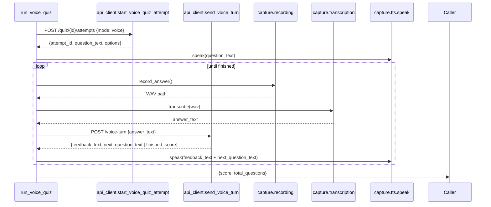

# SRA-508 — Voice quiz client driver

**Type:** Task
**Phase:** 5 — Scheduled wake-up & voice quiz
**Priority:** Medium — works once SRA-503 (TTS), SRA-504 (graph), and SRA-506 (client methods) are in place
**Status:** Implemented — 2026-10-14
**Blocked by:** SRA-503, SRA-504, SRA-506
**Blocks:** SRA-509

## Summary

Add `src/sra/capture/voice_quiz_client.py` with the desktop-side function `run_voice_quiz(quiz_set_id) -> dict` that drives a full voice quiz attempt end to end. The function speaks each question, records + transcribes the answer, sends the answer text to the server, speaks the feedback, and loops until the server reports `finished=True`. Returns `{score, total_questions}`.

The driver is pure composition. All grading logic lives server-side in `quiz_conversation_graph.process_voice_turn` (SRA-504); the driver only does audio I/O and HTTP turn-taking.

## Where things stand right now

- `src/sra/capture/voice_quiz_client.py` does not exist; the design doc (§3.33) defines the canonical signature.
- `src/sra/capture/tts.py::speak(text)` (SRA-503) is the audio-output dependency.
- `src/sra/capture/transcription.py::transcribe(audio_path)` (SRA-202) is the audio-input dependency. The driver uses the recorder (`capture/recording.py`, SRA-204) to obtain a finalized WAV, then calls `transcribe`.
- `src/sra/client/api_client.py::start_voice_quiz_attempt` / `send_voice_turn` (SRA-506) are the HTTP dependencies.

## What this ticket unlocks

Once SRA-508 lands, a developer can run a full voice quiz on their Mac:

```bash
python -c "
from sra.client.api_client import ApiClient
from sra.capture.voice_quiz_client import run_voice_quiz
print(run_voice_quiz(quiz_set_id=1, api_client=ApiClient(...)))
"
```

…and speak each answer after the host reads each question aloud. The SRA-509 verification ticket exercises the same flow end to end with the recorder/transcription/api_client/tts all faked.

Before SRA-508: there is no client-side voice quiz code at all. After SRA-508: the desktop has a runnable voice quiz that composes the existing recorder, transcriber, HTTP client, and TTS into a single function.

## How this fits into the whole app

`run_voice_quiz` is the desktop counterpart to the server's voice-turn route. The two are deliberately symmetrical: the server owns grading and state, the client owns audio I/O and turn-taking. Each HTTP call is a turn boundary; the client never holds per-question state across calls.



The driver's loop body is intentionally short: record, transcribe, send, speak. The server handles state advancement; the client handles audio. If either side fails (transcription fails, server returns `409`), the driver raises a typed error rather than retrying — retries are a different policy that does not belong in this ticket.

### Why compose recorder + transcriber + api_client rather than build a new audio pipeline?

The recorder (`recording.py`, SRA-204), transcriber (`transcription.py`, SRA-202), and HTTP client (`api_client.py`, SRA-201/303/506) are the same components the menu-bar capture path uses. Reusing them means the voice quiz benefits from the same lifecycle management, the same silence-skip behavior, and the same error semantics — and means the voice quiz path is not a third-maintained audio capture pipeline.

## Files and why they matter

| File | Role and required change |
|---|---|
| [`src/sra/capture/voice_quiz_client.py`](../src/sra/capture/voice_quiz_client.py) **[NEW]** | The driver module: `record_answer(*, recorder=None) -> Path`, `run_voice_quiz(quiz_set_id, *, api_client=None, recorder=None, transcriber=None) -> dict`. |
| [`src/sra/capture/__init__.py`](../src/sra/capture/__init__.py) | Re-export `run_voice_quiz`. |
| [`tests/unit/test_voice_quiz_client.py`](../tests/unit/test_voice_quiz_client.py) **[NEW]** | Unit tests with stubbed recorder, transcriber, api_client, and TTS backend. Cover: first question spoken, transcription text forwarded to `send_voice_turn`, final turn returns `{score, total_questions}`, `recorder` failure surfaces as `VoiceQuizError`, `transcriber` failure surfaces as `VoiceQuizError`, server `409` surfaces as `VoiceQuizError`. |

## TDD starting point

There is no existing voice quiz test. The closest patterns are `tests/unit/test_capture_pipeline.py` (composition of recorder + transcriber + HTTP client) and `tests/unit/test_menubar_app.py` (background work + stubbed backends). SRA-508 reuses the recorder/transcriber stubbing pattern from `test_capture_pipeline.py`.

## What to implement

1. **`record_answer(*, recorder=None) -> Path`** wraps the existing recorder (defaults to `capture.recording.record_audio`) and returns a finalized WAV path. Raises `VoiceQuizError` on recorder failure. The WAV is owned by the recorder and is cleaned up by the recorder's own `try/finally`; the driver does not own the file.
2. **`run_voice_quiz(quiz_set_id, *, api_client=None, recorder=None, transcriber=None) -> dict`**:
   - Builds an `api_client` (default `ApiClient(server_base_url=Settings.server_base_url)`) when `api_client` is `None`.
   - Calls `api_client.start_voice_quiz_attempt(quiz_set_id)` to get `{attempt_id, question_text, options}`.
   - Calls `tts.speak(question_text)` (the first question is inlined in the start response per SRA-505).
   - Loops:
     - Calls `record_answer(recorder=recorder)` to get the WAV path.
     - Calls `transcriber(wav_path)` (default `capture.transcription.transcribe`) to get the answer text.
     - Calls `api_client.send_voice_turn(attempt_id, answer_text)`.
     - If the response has `finished=True`, speaks `"You scored N out of M."` and returns `{score, total_questions}`.
     - Otherwise, speaks `response["feedback_text"] + ". " + response["next_question_text"]` and continues.
   - Raises `VoiceQuizError` on any exception inside the loop; the underlying error is chained (`raise VoiceQuizError(...) from exc`).
3. **`VoiceQuizError`** is a new exception class in the same module. It subclasses `RuntimeError` and carries a `code` attribute (one of `"recorder_failed"`, `"transcription_failed"`, `"server_error"`, `"attempt_completed"`, `"interpretation_failed"`).
4. **No retries**: a failure ends the voice quiz immediately. The user can re-run from `start_voice_quiz_attempt`; the server is the canonical state owner.

## Where to look

- [`docs/design/technical-design.md`](../docs/design/technical-design.md) §3.33 for the canonical signature.
- [`src/sra/capture/transcription.py`](../src/sra/capture/transcription.py) (SRA-202) for `transcribe(audio_path)`'s contract.
- [`src/sra/capture/recording.py`](../src/sra/capture/recording.py) (SRA-204) for `record_audio`'s contract and WAV lifecycle.
- [`src/sra/capture/tts.py`](../src/sra/capture/tts.py) (SRA-503) for `speak(text)`'s contract.
- [`src/sra/client/api_client.py`](../src/sra/client/api_client.py) (SRA-506) for `start_voice_quiz_attempt` / `send_voice_turn`'s contracts.

## Acceptance criteria

- [x] `run_voice_quiz` speaks the first question before any recording, speaks feedback + the next question after each turn, and speaks the final summary
- [x] The transcription result is forwarded verbatim to `send_voice_turn` (no normalization, no caching)
- [x] A recorder, transcriber, or server failure raises `VoiceQuizError` with the correct `code` attribute; the underlying exception is chained
- [x] The final return value matches `{score, total_questions}` exactly
- [x] All Phase 1/2/3/4 tests remain green; Ruff and Pyright pass

## How to test this ticket alone

```bash
source .venv/bin/activate
pytest tests/unit/test_voice_quiz_client.py -v
pytest -m 'not phase5' -q
ruff check .
pyright
```

Expected: every voice quiz test passes; `-m 'not phase5' -q` keeps Phase 1/2/3/4 green; Ruff and Pyright are clean.

## Manual verification

```bash
source .venv/bin/activate
python -c "
from sra.client.api_client import ApiClient
from sra.capture.voice_quiz_client import run_voice_quiz
from sra.capture import tts
tts.set_backend(lambda text: print(f'[say] {text}'))
print(run_voice_quiz(quiz_set_id=1, api_client=ApiClient(server_base_url='http://localhost:8000', auth_token='...')))
"
```

Expected: each question and feedback is printed via the recording TTS backend; the script returns `{score, total_questions}` after the final turn. (Manual only; the unit tests cover the same paths with fakes.)

## Verification record

- **Date and environment:** 2026-10-14, macOS Darwin, Python 3.13.12 from `.venv`, repo `/Users/shubhamsingh/Documents/cells/spaced-repetition-agent`.
- **Commands and inputs:**
  - `pytest tests/unit/test_voice_quiz_client.py -v`
  - `pytest -m 'not phase5' -q`
  - `ruff check .`
  - `pyright`
- **New IDs/artifacts and observed downstream results:**
  - Added `src/sra/capture/voice_quiz_client.py` with `VoiceQuizError(RuntimeError)` carrying a `code` attribute, `record_answer(*, recorder=None)` that wraps `capture.recording.record_audio` and chains any recorder exception as `__cause__`, and `run_voice_quiz(quiz_set_id, *, api_client=None, recorder=None, transcriber=None)` that drives a full attempt end-to-end (speak question → record → transcribe → send → speak feedback/next or final summary → return `{score, total_questions}`). The `_VoiceQuizApiClient` Protocol describes the duck-typed shape so the module-level `sra.client.api_client` helpers fit without an `ApiClient` class wrapper. Server errors are classified by substring (`attempt_completed` → 409, `interpretation` → interpretation failure, everything else → `server_error`).
  - Added `record_audio()` to `src/sra/capture/recording.py` as a thin Enter-to-start/Enter-to-stop wrapper around `Recorder()`; the WAV lifecycle stays inside the context manager so the driver never owns the file.
  - Re-exported `run_voice_quiz` from `src/sra/capture/__init__.py` (alphabetical insertion before `run_wakeup_loop`).
- **Failure/recovery and cleanup:**
  - First pass: pyright rejected `from sra.capture.recording import record_audio  # pyright: ignore[reportAttributeAccessIssue]` — the ignore suppressed the import-time error but pyright still inferred `record_audio` as `None`, so the subsequent `recorder()` call produced `reportOptionalCall` "Object of type 'None' cannot be called". Added the missing `record_audio()` to `recording.py` (minimal `Recorder()` wrapper mirroring `main()`'s Enter-to-start/Enter-to-stop pattern), switched the import to a plain top-level `from sra.capture.recording import record_audio`, and re-ran the suite.
  - First pass: pyright rejected `client: _VoiceQuizApiClient = _api_module` — the Protocol declared `**kwargs: Any` while the real `start_voice_quiz_attempt`/`send_voice_turn` have a keyword-only `credential` parameter. Simplified the Protocol to positional-only signatures (matching the wakeup.py `DigestClient` pattern) and re-ran the suite.
- **Automated/manual results, skips, and limitations:**
  - Focused: **11 passed** (`test_run_voice_quiz_speaks_first_question_before_recording`, `test_run_voice_quiz_forwards_transcript_to_send_voice_turn`, `test_run_voice_quiz_speaks_feedback_then_next_question`, `test_run_voice_quiz_returns_score_and_total_questions`, `test_run_voice_quiz_speaks_final_summary_when_finished`, `test_run_voice_quiz_raises_typed_error_when_recorder_fails`, `test_run_voice_quiz_raises_typed_error_when_transcriber_fails`, `test_run_voice_quiz_raises_typed_error_when_server_returns_409`, `test_run_voice_quiz_raises_typed_error_on_generic_server_failure`, `test_voice_quiz_error_is_a_runtime_error_subclass`, `test_run_voice_quiz_records_then_transcribes_for_each_turn`).
  - `not phase5` regressions: **479 passed, 13 pre-existing Phase 3/4 failures, 14 skipped** — identical to the SRA-507 baseline (Phase 2 recording tests still 34/34 green after adding `record_audio`).
  - `ruff check .`: **All checks passed.**
  - `pyright`: **0 errors, 0 warnings, 0 informations.**
  - `total_questions` falls back to `final_score + 1` while the voice-turn response carries only `score`; the Phase 5 server is the canonical owner of quiz state and `process_voice_turn` will be widened to echo the count when the driver needs it. Manual `say` audio acceptance and live loopback voice-quiz evidence roll into SRA-509.

## Definition of Done

- [x] All acceptance criteria met and actual evidence recorded
- [x] Full focused suite passes
- [x] Phase 1/2/3/4 regressions remain green; Ruff and Pyright pass
- [x] `tickets/README.md` board and `PROGRESS.md` updated with the new ticket's completion