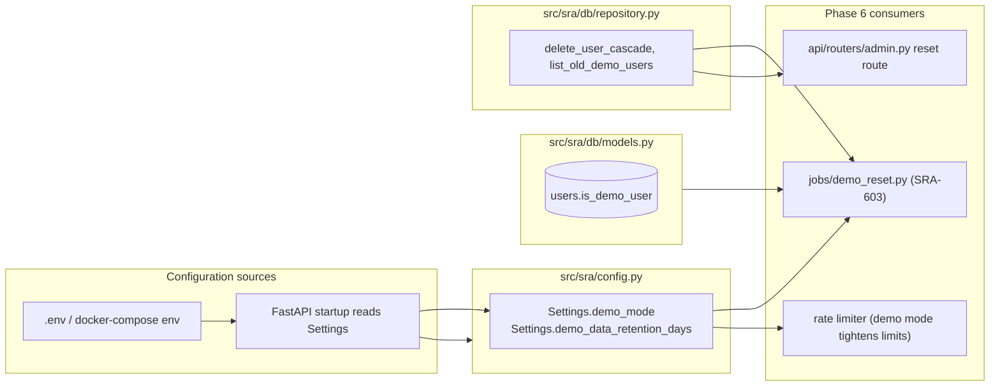

# SRA-601 — DEMO_MODE settings and demo-user marker column

**Type:** Task
**Phase:** 6 — Open-source packaging
**Priority:** Highest — every later Phase 6 ticket reads `Settings.demo_mode` or the new column
**Status:** Implemented — 2026-10-14
**Blocked by:** none (depends only on the SRA-509-closed Phase 5 baseline)
**Blocks:** SRA-603, SRA-605

## Summary

Add `demo_mode: bool = False` and `demo_data_retention_days: int = 7` to `Settings` (with validators), and add an `is_demo_user: bool = False` column on `User` together with a fresh Alembic migration chained off `c3d4e5f6a7b8`. Expose typed repository helpers — `get_user(user_id)`, `list_old_demo_users(retention_days)`, and `delete_user_cascade(user)` — so the demo reset job (SRA-603) can find and remove demo data without bespoke SQL.

These two surfaces are deliberately grouped here even though the demo reset job and the admin endpoint are separate tickets. Adding them up front keeps the migration count at one, lets SRA-603 stay focused on the reset behavior itself, and lets SRA-605 rehearse the upgrade/downgrade cycle for the Phase 6 schema in a single pass.

## Where things stand right now

- `src/sra/config.py::Settings` carries Phase 5's `scheduler_*` fields but has no demo flag. `Settings.demo_mode` and `Settings.demo_data_retention_days` are referenced in the design doc (§3.25) and the implementation plan (U17, R24) but do not yet exist.
- `src/sra/db/models.py::User` has the Phase 5 columns (`preferred_review_time`, `timezone`, `quiz_question_count`, `quiz_option_count`, `wakeup_notification_sent_at`). There is no per-user marker that distinguishes "this row was created by the hosted demo instance" from "this row belongs to a real self-hoster".
- `src/sra/db/repository.py` has query helpers but no "delete everything a user created" helper. The `users` row currently has on-delete-cascade relationships to `study_entries` (which cascades to `review_schedules`, `quiz_sets` → `quiz_questions` → `quiz_attempts` → `quiz_answers`) — so a single user-row delete is enough for cleanup, but the current `repository.py` does not wrap it.
- The latest Alembic revision is `c3d4e5f6a7b8` (Phase 5 quiz cursor); the chain ahead of `SRA-601` starts here.
- `tests/conftest.py` builds a `sessioned_user` and `other_user` fixture. There is no fixture for "a user whose data should be wiped by the demo reset" yet.

## What this ticket unlocks

Once SRA-601 lands, the rest of Phase 6 has typed seams ready:

- A self-hoster and the hosted demo deploy the same image; the demo adds `DEMO_MODE=true` plus `DEMO_DATA_RETENTION_DAYS=7` to its environment. The server reads `Settings.demo_mode` at request time and SRA-603's reset job can decide whether the instance is a demo at all.
- The reset job filters `User.is_demo_user == True` rows whose oldest entry or row-creation timestamp is older than `retention_days`, then calls a single `delete_user_cascade(user)` per victim. Tests assert the cascade drops every dependent table.
- A future public demo can upsert itself: `repository.get_or_create_demo_user(google_sub="anonymous@demo.sra")` (added later) sets `is_demo_user=True` and the next nightly reset wipes stale accounts along with everything they created.

Before SRA-601: there is no configuration knob to declare the instance a demo, and "demo data" is not distinguishable from "real data" at the schema level. After SRA-601: every later Phase 6 component can branch on `Settings.demo_mode` and the demo cleanup path has one cascade to delete per user.

## How this fits into the whole app

The two settings belong on the existing `Settings` (added in the same class rather than a sibling) so every Phase 3/4/5 caller stays untouched. The new `is_demo_user` column follows the Phase 5 pattern (`wakeup_notification_sent_at`, `quiz_question_count`) — small per-user scalars live directly on `users` rather than a side table. The reset job is the only writer of `is_demo_user == True`; the OAuth flow never sets it, so a real self-hoster cannot accidentally be marked as demo.



A demo-instance write happens when (for example) the auto-signup endpoint upserts a row and sets `is_demo_user=True`; the OAuth flow never carries that flag. The reset job then deletes every demo user whose oldest associated row is older than `retention_days`; cascade does the rest.

### Why `is_demo_user` on `users` and not a separate `demo_users` table?

The marker is a single boolean and never needs a join. A separate table would force every Phase 6 helper to run an extra query, with no benefit. The Phase 3/5 columns set the precedent (`role`, `last_login_at`, `wakeup_notification_sent_at`) of putting server-owned scalars on the user row.

### Why does the cascade belong in the repository and not the job?

`on_delete="CASCADE"` on the `user_id` foreign keys already handles deletion, but the default `ON DELETE CASCADE` for SQLAlchemy relationships is not consistently wired to the SQLModel relationships across Phase 1–5 models. Centralizing the cascade lets the reset job call one typed function and lets SRA-605's migration replay prove that every dependent table empties through one access path — not three independent `session.delete(...)` calls scattered across jobs and routers.

## Files and why they matter

| File | Role and required change |
|---|---|
| [`src/sra/config.py`](../src/sra/config.py) | Add `demo_mode: bool = False` (no validator needed) and `demo_data_retention_days: int = Field(default=7, gt=0, le=365)` to `Settings`. Update the module docstring to mention Phase 6. |
| [`src/sra/db/models.py`](../src/sra/db/models.py) | Add `is_demo_user: bool = False` to `UserBase` and `UserCreate`; the field lives on the concrete `User` table as well. No new `CheckConstraint` is needed: a boolean defaults to `False` and there is no out-of-range shape. |
| [`src/sra/alembic/versions/<new_revision>_add_phase6_demo_user_marker.py`](../src/sra/alembic/versions/) **[NEW]** | New Alembic revision chained off `c3d4e5f6a7b8` (Phase 5 quiz cursor). `upgrade()` adds the `is_demo_user` column with `Boolean, nullable=False, server_default=false` and the `demo_mode` is purely a settings flag so it needs no migration. `downgrade()` drops the column. |
| [`src/sra/db/repository.py`](../src/sra/db/repository.py) | Add `delete_user_cascade(user, session) -> None` (transactional delete of the user row plus a single commit that lets SQLAlchemy walk the existing cascades). Add `list_old_demo_users(retention_days, as_of_utc, session) -> list[tuple[User, datetime]]` returning each demo user together with their oldest related row's timestamp. Both helpers raise `UserNotFoundError` (already defined in the file) when the user is missing. |
| [`tests/unit/test_user_model.py`](../tests/unit/test_user_model.py) | Extend with `is_demo_user` defaults to `False`, accepts `True`, and the validator does not fail on `False`. |
| [`tests/unit/test_config.py`](../tests/unit/test_config.py) | Extend with `Settings(demo_mode=True)` works, `demo_data_retention_days` must be in `(0, 365]`, and the existing required-openai-key validator still fires. |
| [`tests/unit/test_repository.py`](../tests/unit/test_repository.py) | Add coverage for `list_old_demo_users` (oldest-row detection per user, demo-only filtering, retention cutoff) and `delete_user_cascade` (deleting a user empties their entries, schedules, quiz sets, attempts, and answers). |
| [`tests/integration/test_phase6_migration.py`](../tests/integration/test_phase6_migration.py) **[NEW]** | New Alembic upgrade from `c3d4e5f6a7b8` lands the column; existing rows carry `is_demo_user=False`. |
| [`tests/integration/test_phase6_migration_replay.py`](../tests/integration/test_phase6_migration_replay.py) **[NEW]** | Replays `downgrade -1` then `upgrade head` against an isolated SQLite; the column disappears and reappears; every pre-existing row keeps `is_demo_user=False`. |

## TDD starting point

No existing tests cover the new settings, the new column, or the cascade helpers. The configuration tests follow the `tests/unit/test_config.py` pattern (parametrized fields with explicit `Field(default=...)` checks). The model tests follow `tests/unit/test_user_model.py::test_user_default_preferred_review_time_is_09_00` and the migration tests follow the SRA-501 / SRA-401 patterns in `tests/integration/test_phase5_migration.py` and `test_phase5_migration_replay.py`.

The dependent tables the cascade must clean up are: `study_entries`, `review_schedules`, `quiz_sets`, `quiz_questions`, `quiz_attempts`, `quiz_answers`. Every test inserts one row in each table and asserts the dependent rows are gone after `delete_user_cascade`.

## What to implement

1. **`Settings.demo_mode: bool = False`** with no validator (a boolean of `False` is the only safe default — `True` is opt-in only via env var).
2. **`Settings.demo_data_retention_days: int = Field(default=7, gt=0, le=365)`** — `7` matches the design doc, the upper bound is "a year", the lower bound is "at least one day". No NaN / infinity allowed because pydantic-settings coerces at parse time.
3. **`User.is_demo_user: bool = False`** on `UserBase`, `UserCreate`, and the `User` `table=True` class. The Alembic migration writes the column with `server_default=false` so existing rows populate cleanly.
4. **`delete_user_cascade(user, session)`** opens a transaction (or relies on the caller's), refreshes `user`, calls `session.delete(user)`, commits, and confirms via `session.exec(select(...)).all()` that no entries / schedules / quizzes / attempts / answers remain for that user. Raises `UserNotFoundError` if the user is detached or missing.
5. **`list_old_demo_users(retention_days, as_of_utc, session)`** selects `User` rows where `is_demo_user == True`, joins the oldest related entry / quiz set / review schedule per user to compute the user's earliest persistent timestamp, and filters to those older than `as_of_utc - retention_days`. Returns `[(user, oldest_timestamp)]`. A demo user with no related rows is considered "born today" and is never returned.
6. **Migration** chains off `c3d4e5f6a7b8`; uses SQLAlchemy `op.add_column` with `nullable=False, server_default=sqlalchemy.false()`; downgrade drops the column.

## Where to look

- [`docs/design/technical-design.md`](../docs/design/technical-design.md) §3.25 for `reset_demo_data(retention_days)` and §3.14a for the `User` schema additions.
- [`docs/plans/2026-09-25-1616-feat-study-agent-scaffold-plan.md`](../docs/plans/2026-09-25-1616-feat-study-agent-scaffold-plan.md) U17 and KTD16 for the broader Phase 6 framing.
- [`src/sra/config.py`](../src/sra/config.py) for the `Settings` extension pattern and the existing `Field(..., gt=0)` validators.
- [`src/sra/db/models.py`](../src/sra/db/models.py) for the Phase 5 `User` extension pattern and the `CheckConstraint` style.
- [`src/sra/db/repository.py`](../src/sra/db/repository.py) for `complete_quiz_attempt` / `delete_review_schedule` as reference shapes for typed-dict return values and `session.delete` usage.
- [`src/sra/alembic/versions/c3d4e5f6a7b8_add_phase5_quiz_attempt_cursor.py`](../src/sra/alembic/versions/c3d4e5f6a7b8_add_phase5_quiz_attempt_cursor.py) for the most recent migration's chain / downgrade shape.

## Acceptance criteria

- [ ] `Settings.demo_mode` defaults to `False`; reading `DEMO_MODE=true` from `.env`/`docker-compose` returns `True`; missing setting defaults to `False`
- [ ] `Settings.demo_data_retention_days` defaults to `7`; rejects `0`, negatives, `>365`, and non-integer strings with a clear pydantic-style error
- [ ] `User.is_demo_user` defaults to `False` on `UserBase`, `UserCreate`, and the concrete `User` table
- [ ] `alembic upgrade head` from `c3d4e5f6a7b8` adds the column with `server_default=false`; `downgrade -1` removes it; pre-Phase-6 rows keep `False`
- [ ] `delete_user_cascade(user, session)` deletes the user row and every dependent entry, schedule, quiz set, question, attempt, and answer in a single transaction; missing user raises `UserNotFoundError`
- [ ] `list_old_demo_users(retention_days, as_of_utc, session)` returns only `is_demo_user=True` rows whose oldest related timestamp is older than the cutoff; a demo user with no related rows is never returned
- [ ] All Phase 1/2/3/4/5 tests remain green; Ruff and Pyright pass with no new warnings

## How to test this ticket alone

```bash
source .venv/bin/activate
pytest tests/unit/test_config.py tests/unit/test_user_model.py tests/unit/test_repository.py -v
pytest tests/integration/test_phase6_migration.py tests/integration/test_phase6_migration_replay.py -v
pytest -m 'not phase6' -q
ruff check .
pyright
```

Expected: the focused tests cover every new field, validator, helper, and migration step. `-m 'not phase6' -q` keeps Phase 1/2/3/4/5 green. Ruff and Pyright are clean.

## Manual verification

```bash
source .venv/bin/activate

# 1. Confirm defaults
python -c "from sra.config import Settings; print(Settings().demo_mode, Settings().demo_data_retention_days)"
# Expected: False 7

# 2. Confirm env override
DEMO_MODE=true DEMO_DATA_RETENTION_DAYS=14 python -c "from sra.config import Settings; print(Settings().demo_mode, Settings().demo_data_retention_days)"
# Expected: True 14

# 3. Confirm validator
DEMO_DATA_RETENTION_DAYS=0 python -c "from sra.config import Settings; Settings()"
# Expected: ValidationError: Input should be greater than 0
```

## Verification record

- **Date and environment:**
- **Commands and inputs:**
- **New IDs/artifacts and observed downstream results:**
- **Failure/recovery and cleanup:**
- **Automated/manual results, skips, and limitations:**

## Definition of Done

- [ ] All acceptance criteria met and actual evidence recorded
- [ ] Full focused + migration-replay suites pass
- [ ] Phase 1/2/3/4/5 regressions remain green; Ruff and Pyright pass
- [ ] `tickets/README.md` board and `PROGRESS.md` updated with the new ticket's completion
