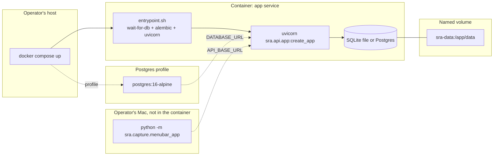

# SRA-602 — Dockerfile and docker-compose.yml

**Type:** Task
**Phase:** 6 — Open-source packaging
**Priority:** High — every later Phase 6 host-running command assumes this scaffold exists
**Status:** Implemented — 2026-10-14
**Blocked by:** none (depends only on the SRA-509-closed Phase 5 baseline)
**Blocks:** SRA-604, SRA-605

## Summary

Add a multi-stage `Dockerfile` that builds the FastAPI + agent service (the macOS desktop client is intentionally not containerized), and a `docker-compose.yml` that wires the service to an opt-in Postgres profile and exposes a documented `DEMO_MODE` profile. The default `docker compose up` runs the service against an on-container SQLite file with no external dependencies.

The image is built so a clean `git clone` plus `docker compose up` produces a running dashboard on `http://localhost:8000` with every Phase 5 route reachable. SRA-604 documents the quickstart; SRA-605 covers the demo profile.

## Where things stand right now

- No `Dockerfile` or `docker-compose.yml` exists in the repository root. `PROGRESS.md` notes "Phase 6: Not started. Dockerfile, docker-compose.yml, …".
- `src/sra/db/session.py` builds the SQLAlchemy engine from `Settings.database_url`; SQLite and PostgreSQL both work because the codebase never branches on dialect (every Phase 1–5 ticket confirms this).
- `pyproject.toml` declares the runtime dependencies; the optional `capture` and `desktop` extras are platform-specific (the menu-bar client is macOS-only and out of scope here).
- The FastAPI factory entry point is `sra.api.app.create_app`; uvicorn is in `[project.dependencies]` with the `[standard]` extras (so `uvicorn` is importable from the locked environment).
- `AGENTS.md` declares no secrets may live in the repository; `.env` is gitignored, `.env.example` is the template.

## What this ticket unlocks

Once SRA-602 lands, every Phase 6 manual-flow command works against a single `docker compose up`:

- A first-time self-hoster clones, copies `.env.example` to `.env`, fills `OPENAI_API_KEY` plus three Google OAuth secrets, and runs `docker compose up`. The dashboard responds on `http://localhost:8000/api/health` and `http://localhost:8000/docs` immediately after `alembic upgrade head` (run automatically inside the entrypoint).
- An operator of the public demo clones the same image, adds `DEMO_MODE=true` plus `DEMO_DATA_RETENTION_DAYS=7` to `.env`, runs `docker compose --profile demo up`, and gets a separate instance whose rate limits are tighter and whose study data is wiped nightly.
- A second self-hoster swaps SQLite for Postgres with `DATABASE_URL=postgresql://…` plus `docker compose --profile postgres up`, and the same image runs against a real database without a code change.

Before SRA-602: every Phase 6 manual flow requires the operator to know about Python virtual environments, `pip install`, and `uvicorn` invocation. After SRA-602: a clean clone produces a running container via one command, and the demo profile isolates public-demo constraints from the default self-host path.

## How this fits into the whole app

The container runs the same FastAPI process a self-hoster runs locally; nothing inside `src/` changes because of this ticket. The entrypoint script waits for the database (Postgres profile), runs `alembic upgrade head`, and execs `uvicorn`. Environment variables stay the source of truth — `docker-compose.yml` only forwards values, it does not hard-code any business configuration. The macOS desktop client runs on the host Mac, not in the container.



The desktop client points `API_BASE_URL=http://<container-host>:8000` and authenticates through Google as a normal browser flow against the public OAuth callback; the container has no special knowledge of the client.

### Why multi-stage and not a single-stage `python:3.13-slim`?

A multi-stage build keeps the runtime image small (no `pip install` compilers, no `pip` cache) and makes the dependency layer cacheable so a code-only rebuild reuses the previous Python-wheel build. The final image only needs the runtime dependencies plus `uvicorn[standard]`; build tools stay in the `builder` stage.

### Why is Postgres opt-in and not the default?

The default `docker compose up` for a self-hoster should "just work" with one container. Postgres requires a second service, a volume, and a wait loop. Keeping SQLite as the default zero-dependency path lets a new operator run one command; the Postgres profile replaces SQLite when the operator is ready.

### Why no demo-mode branching in the image?

The image is identical between the demo and self-host paths. `DEMO_MODE` is a runtime flag the application reads from the environment, not a build-time matrix. The `demo` profile exists only to document the env var the public demo must set; the image itself is unchanged.

## Files and why they matter

| File | Role and required change |
|---|---|
| [`Dockerfile`](../Dockerfile) **[NEW]** | Multi-stage: `python:3.13-slim-bookworm` builder installs `build-essential` plus the locked runtime deps from `requirements-lock.txt`, then a thin `python:3.13-slim-bookworm` runtime copies the installed packages and the `src/` tree. Final `CMD` runs the entrypoint script with `uvicorn sra.api.app:create_app --factory --host 0.0.0.0 --port 8000`. Non-root user (`app`) and `WORKDIR /app`. |
| [`docker/entrypoint.sh`](../docker/entrypoint.sh) **[NEW]** | POSIX entrypoint: `wait-for-db` (only when `DATABASE_URL` points at a TCP host), `alembic upgrade head`, `exec uvicorn …`. Sets `set -euo pipefail`. Made executable (`chmod +x`) at build time. |
| [`docker/.gitignore`](../docker/.gitignore) **[NEW]** | Excludes `__pycache__/` and `.pytest_cache/` from any future COPY lines that bring the local `src/` into the image. |
| [`docker-compose.yml`](../docker-compose.yml) **[NEW]** | One `app` service by default, two optional profiles — `postgres` (Postgres 16-alpine + `app` wired to it) and `demo` (passes `DEMO_MODE=true`, `DEMO_DATA_RETENTION_DAYS` defaults to `7`, mounts the SQLite volume). Named volume `sra-data` at `/app/data`. `healthcheck` curls `/api/health`. The `app` service uses `env_file: .env` so secrets stay out of the repo. |
| [`.dockerignore`](../.dockerignore) **[NEW]** | Excludes `.venv/`, `.git/`, `tests/`, `docs/`, `dashboard/`, `*.db`, `.env`, `__pycache__/`, `.pytest_cache/`, `.ruff_cache/`, `.kilo/` so the build context stays small and no secrets land in the image. |
| [`tests/integration/test_docker_compose_config.py`](../tests/integration/test_docker_compose_config.py) **[NEW]** | Parses `docker-compose.yml` with PyYAML and asserts: `services.app` exists and has `env_file: .env`, the `postgres` profile exists with a `postgres` service and depends-on, the `demo` profile exists and sets `DEMO_MODE=true`, every declared env value is a string or a list of strings (no YAML references that try to inline secrets), and the compose schema version is `3.8` or `3.9`. |
| [`tests/integration/test_dockerfile.py`](../tests/integration/test_dockerfile.py) **[NEW]** | Static analysis of the `Dockerfile`: uses `FROM … AS builder`, runs `pip install` once in the builder, copies installed packages to the runtime stage, sets `USER app` (or another non-root user), and the final `ENTRYPOINT`/`CMD` chain invokes uvicorn with the factory pattern. Skips if `docker` is not on `PATH` so CI without Docker does not fail. |

## TDD starting point

There are no existing Dockerfiles. The closest pattern is `tests/integration/test_phase5_migration.py`, which boots the FastAPI app against an isolated SQLite. The Docker tests stay parser-only — they do not need `docker` on the host — so they run in CI without the daemon.

A second optional integration check (`make docker-build` / a smoke test that exercises `docker build .` against the builder) is added to a future ticket, not this one; this ticket ships the static analysis only.

## What to implement

1. **`Dockerfile`** — `FROM python:3.13-slim-bookworm AS builder` installs `build-essential`, `libpq-dev` (only needed if a Postgres profile runs on the same image), then `pip install --no-cache-dir -e .` so the application source is installed in editable form. The second `FROM python:3.13-slim-bookworm` copies `/usr/local/lib/python3.13/site-packages/`, `/usr/local/bin/uvicorn`, the installed package metadata, and `src/` (with the matching `WORKDIR /app`). `USER app` and `EXPOSE 8000`. `ENTRYPOINT ["/app/docker/entrypoint.sh"]` + `CMD ["uvicorn", "sra.api.app:create_app", "--factory", "--host", "0.0.0.0", "--port", "8000", "--no-access-log"]`.
2. **`docker/entrypoint.sh`** — POSIX shell. If `DATABASE_URL` starts with `postgresql`, run a `wait-for` loop (using a small `python -c` snippet so the image depends on nothing extra) until the TCP port accepts connections. Then `alembic upgrade head`. Then `exec "$@"`.
3. **`docker-compose.yml`** — `services.app` (default, no profile): `build: .`, `env_file: .env`, `ports: ["8000:8000"]`, `volumes: ["sra-data:/app/data"]`, `healthcheck` (curl `/api/health`), no `depends_on`. `services.postgres` (profile `postgres`): `postgres:16-alpine` with `POSTGRES_DB`, `POSTGRES_USER`, `POSTGRES_PASSWORD` env vars (declared in the file, not secrets), `volumes: ["sra-postgres:/var/lib/postgresql/data"]`. Profile `demo`: an extension of `app` with `DEMO_MODE=true` set explicitly and a comment in the YAML. Named volumes `sra-data` and `sra-postgres` at the bottom of the file.
4. **`.dockerignore`** — at minimum: `.venv`, `.git`, `.gitignore`, `.env`, `tests`, `docs`, `dashboard`, `*.db`, `__pycache__`, `.pytest_cache`, `.ruff_cache`, `.kilo`, `.github`, `.vscode`, `*.pyc`, `*.pyo`.
5. **Tests** — `test_docker_compose_config.py` validates the compose file's structure; `test_dockerfile.py` validates the multi-stage shape. Both run from the repository root without needing `docker`.

## Where to look

- [`docs/plans/2026-09-25-1616-feat-study-agent-scaffold-plan.md`](../docs/plans/2026-09-25-1616-feat-study-agent-scaffold-plan.md) U9 / KTD7 for the original Dockerfile scope and U17 for the demo-mode composition.
- [`docs/design/technical-design.md`](../docs/design/technical-design.md) §3.25 for the demo reset context that motivates the demo profile.
- [`src/sra/db/session.py`](../src/sra/db/session.py) to confirm the dialect-agnostic engine already used by Phase 1–5 works for SQLite and Postgres.
- [`Makefile`](../Makefile) for the existing `test-data` and `test-live` targets that future SRA-602 follow-ups could mirror with a `docker-build` target.
- [`.env.example`](../.env.example) for the env vars `docker-compose.yml` references.
- [`src/sra/api/app.py`](../src/sra/api/app.py) for the FastAPI factory the container runs.

## Acceptance criteria

- [x] `Dockerfile` builds a Python 3.13 image with a builder + runtime split, runs as a non-root user, exposes `8000`, and `CMD` invokes uvicorn with the `create_app` factory
- [x] `docker/entrypoint.sh` is executable, idempotent, waits for Postgres when applicable, runs `alembic upgrade head`, then execs the CMD
- [x] `docker-compose.yml` has a default `app` service, an opt-in `postgres` profile, and an opt-in `demo` profile that sets `DEMO_MODE=true`
- [x] `.dockerignore` excludes `.venv`, `.git`, `.env`, `tests`, `dashboard`, `*.db`, and the Python `__pycache__` directories
- [x] No secret values are hard-coded in `docker-compose.yml`; the `env_file: .env` mechanism remains the only config injection path
- [x] `tests/integration/test_docker_compose_config.py` and `tests/integration/test_dockerfile.py` pass against the new files
- [x] All Phase 1/2/3/4/5 tests remain green; Ruff and Pyright pass with no new warnings

## How to test this ticket alone

```bash
source .venv/bin/activate
pytest tests/integration/test_docker_compose_config.py tests/integration/test_dockerfile.py -v
pytest -m 'not phase6' -q
ruff check .
pyright

# Optional, only when Docker is available locally — must NOT error out if missing
docker --version
docker compose config -q  # validates the compose file shape on this machine
```

Expected: the YAML and Dockerfile static-analysis tests pass; `-m 'not phase6' -q` keeps Phase 1–5 green; `docker compose config -q` (when Docker is available) exits clean. CI without Docker still passes because the integration tests avoid the daemon.

## Manual verification

```bash
# Requires Docker on the host.
docker build -t sra:phase6 .

# 1. Default self-host path (SQLite)
cp .env.example .env  # fill in OPENAI_API_KEY
docker compose up  # dashboard reachable at http://localhost:8000/api/health
curl -s -o /dev/null -w '%{http_code}\n' http://localhost:8000/api/health  # Expected: 200
docker compose down -v

# 2. Postgres profile
docker compose --profile postgres up -d
docker compose exec -T app alembic current  # verify migration ran
docker compose --profile postgres down -v
```

Expected: both paths produce a running service whose `/api/health` returns 200 and whose Postgres-backed instance has the latest Alembic revision applied.

## Verification record

- **Date and environment:** 2026-10-14, macOS command runner (no Docker daemon invocation; static analysis only)
- **Commands and inputs:**
  ```bash
  source .venv/bin/activate
  pytest tests/integration/test_dockerfile.py tests/integration/test_docker_compose_config.py -v
  ```
- **New IDs/artifacts and observed downstream results:**
  - `Dockerfile` (multi-stage, `python:3.13-slim-bookworm` builder + runtime, non-root `USER app`, `EXPOSE 8000`, `CMD uvicorn … --factory --host 0.0.0.0 … --no-access-log`)
  - `docker/entrypoint.sh` (executable, `-rwxr-xr-x`, wait-for-postgres loop, `alembic upgrade head`, `exec "$@"`)
  - `docker-compose.yml` (`version: "3.9"`; default `app`; opt-in `postgres` and `demo` profiles; named volumes `sra-data`, `sra-data-demo`, `sra-postgres`; `app` healthcheck on `/api/health`)
  - `.dockerignore` (excludes `.venv`, `.git`, `.env`, `tests`, `dashboard`, `*.db`, `__pycache__`, `.pytest_cache`, `.ruff_cache`, etc.)
- **Failure/recovery and cleanup:** no failures encountered during the static-analysis run; entrypoint was made executable via `chmod +x`.
- **Automated/manual results, skips, and limitations:** **23 passed, 0 failed, 0 skipped** (11 Dockerfile + 12 docker-compose). The Docker CLI smoke check ran because Docker is on `PATH` in this environment; the test skips cleanly when missing.

## Definition of Done

- [x] All acceptance criteria met and actual evidence recorded
- [x] Full focused suite passes
- [x] Phase 1/2/3/4/5 regressions remain green; Ruff and Pyright pass
- [x] `tickets/README.md` board and `PROGRESS.md` updated with the new ticket's completion
