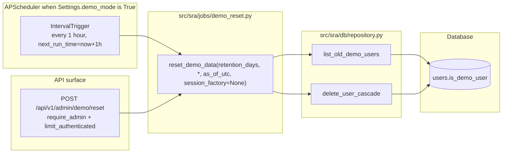

# SRA-603 — Demo reset job and admin endpoint

**Type:** Task
**Phase:** 6 — Open-source packaging
**Priority:** High — Demo-mode guarantees live or die here
**Status:** Implemented — 2026-10-14
**Blocked by:** SRA-601
**Blocks:** SRA-604, SRA-605

## Summary

Implement `src/sra/jobs/demo_reset.py` (`reset_demo_data(retention_days, *, as_of_utc, session_factory=None)` → `{"deleted": int}`); wire the job into the existing APScheduler when `Settings.demo_mode` is `True`; and expose `POST /api/v1/admin/demo/reset` as an admin-only on-demand reset. Outside of demo mode the function raises a typed `DemoModeDisabledError` so a self-hoster cannot accidentally wipe real data.

The job is the only component that distinguishes demo from self-host data: the cascade relies on `User.is_demo_user == True` (added by SRA-601), and the API never carries that flag. Resetting the demo is a destructive operation requiring admin authorization, not a background side effect the server runs casually — so the scheduler tick is once an hour, not once a minute, and the on-demand endpoint requires `require_admin`.

## Where things stand right now

- `src/sra/db/models.py::User` already has the `is_demo_user: bool = False` column (added by SRA-601). Cascade-on-delete reaches entries, schedules, and quiz tables through the SQLAlchemy relationships.
- `src/sra/db/repository.py::delete_user_cascade` and `list_old_demo_users(retention_days, as_of_utc, session)` exist (added by SRA-601). The reset job calls the latter, iterates the users, and calls the former per user.
- `src/sra/jobs/digest_scheduler.py::start_scheduler` already wires the pregeneration cron and the wake-up interval, with `scheduler_enabled=False` short-circuiting the whole registration. The demo reset job threads through the same scheduler but only when `Settings.demo_mode == True`.
- `src/sra/api/routers/admin.py` already carries two admin endpoints (`GET /admin/usage`, `GET /admin/rate-limits`) protected by `Depends(require_admin), Depends(limit_authenticated)`; the new route follows that pattern exactly.
- `Settings.demo_mode` is a configuration knob the server reads at request time; the rate limiter in `src/sra/api/rate_limit.py` already exists with two policies (authenticated and anonymous). SRA-603 narrows both policies' defaults when demo mode is active, but does not change the limiter's algorithm.

## What this ticket unlocks

Once SRA-603 lands, two Phase 6 flows become operational:

- The hosted demo instance registers an hourly APScheduler job that calls `reset_demo_data(retention_days=7)`. Stale demo accounts (and every dependent entry, schedule, quiz set, attempt, and answer they own) disappear without operator intervention.
- An admin running the demo instance can force a reset out-of-band: `curl -X POST -H "Authorization: Bearer $ADMIN_TOKEN" http://demo.example.com/api/v1/admin/demo/reset` returns `{"deleted": N}` immediately, with the same deletion semantics the scheduler uses.

Before SRA-603: there is no way to differentiate demo data from real data, and the hosted demo's storage grows unboundedly. After SRA-603: the demo has bounded retention plus an on-demand reset, and self-hosters cannot accidentally invoke the destructive path.

## How this fits into the whole app

The reset job is a thin wrapper around two repository helpers and an extra scheduler tick. It is not a daemon — APScheduler already owns the schedule lifecycle, so the demo reset reuses the same `start_scheduler` / `stop_scheduler` pair from Phase 5. The admin endpoint is a one-call wrapper that mirrors the route pattern Phase 3/4 already established.



The job raises `DemoModeDisabledError` outside demo mode. Tests pin this guard so a self-host deployment cannot accidentally call the destructive path even if an admin endpoint is exposed.

### Why a dedicated module and not extending `digest_scheduler.py`?

The two schedulers operate on different scopes (per-user wake-ups vs whole-instance demo cleanup), different cadences (60-second interval vs 1-hour interval), and different failure paths (logging + continue vs raising typed errors). Splitting the module keeps the file responsibility obvious and avoids a "scheduler file" that imports both jobs and grows unboundedly.

### Why tighten rate limits under DEMO_MODE?

The Phase 3/5 rate limits are sized for one self-hoster's usage. The hosted demo is shared across many anonymous users and a few authorized accounts, so the demo profile lowers both `rate_limit_authenticated_*` and `rate_limit_anonymous_*` to one-tenth of their default values. Self-hosters are unaffected unless they set `DEMO_MODE=true` explicitly.

## Files and why they matter

| File | Role and required change |
|---|---|
| [`src/sra/jobs/demo_reset.py`](../src/sra/jobs/demo_reset.py) **[NEW]** | `DemoModeDisabledError(RuntimeError)`, `reset_demo_data(retention_days, *, as_of_utc=None, session_factory=None) -> dict[str, int]` returning `{"deleted": int}`. When `Settings.demo_mode == False`, raises `DemoModeDisabledError` before touching the database. `build_demo_reset_job(session_factory, retention_days)` returns a callable suitable for APScheduler. |
| [`src/sra/api/routers/admin.py`](../src/sra/api/routers/admin.py) | Add `POST /admin/demo/reset` route guarded by the same `Depends(require_admin), Depends(limit_authenticated)` chain. Calls `jobs.demo_reset.reset_demo_data(retention_days=settings.demo_data_retention_days, as_of_utc=datetime.now(UTC))`, returns `{"deleted": count}`. |
| [`src/sra/jobs/digest_scheduler.py`](../src/sra/jobs/digest_scheduler.py) | Extend `start_scheduler` to register the demo reset interval job **only** when `Settings.demo_mode == True`. The interval uses a new `Settings.demo_reset_interval_s` (default `3600`, `ge=60`). `stop_scheduler` remains symmetric (APScheduler shutdown handles all registered jobs). |
| [`src/sra/config.py`](../src/sra/config.py) | Add `demo_reset_interval_s: int = Field(default=3600, ge=60)` to `Settings`. (The other two fields were added by SRA-601; this is the third knob.) |
| [`src/sra/api/rate_limit.py`](../src/sra/api/rate_limit.py) | When `Settings.demo_mode == True`, divide both `rate_limit_authenticated_capacity` and `rate_limit_anonymous_capacity` (and refill rates) by 10, clamped at `1`. Caps applied at limiter-construction time so the rest of the code path is unaffected. |
| [`tests/unit/test_demo_reset.py`](../tests/unit/test_demo_reset.py) **[NEW]** | Unit tests: raises `DemoModeDisabledError` when `demo_mode=False`; deletes only demo users older than retention; never deletes non-demo users; returns the count; idempotent on a second invocation inside the same window. |
| [`tests/unit/test_rate_limit_demo_mode.py`](../tests/unit/test_rate_limit_demo_mode.py) **[NEW]** | Unit tests covering the limiter's policy narrowing under `demo_mode=True` (capacity/refill divided by 10, clamped at 1) and unchanged behaviour under `demo_mode=False`. |
| [`tests/integration/test_phase6_demo_reset.py`](../tests/integration/test_phase6_demo_reset.py) **[NEW]** | End-to-end test through the live FastAPI app: admin `POST /admin/demo/reset` removes a seeded demo user's data and returns `{"deleted": 1}`; a non-admin caller gets `403`; an unauthenticated caller gets `401`. |
| [`tests/integration/test_phase6_scheduler_demo_reset.py`](../tests/integration/test_phase6_scheduler_demo_reset.py) **[NEW]** | Boots the FastAPI app under `demo_mode=True`, advances the scheduler's clock, asserts the demo reset interval job is registered, and that the job calls `reset_demo_data` exactly once. |

## TDD starting point

The reset job has no existing tests. Its closest analogue is `tests/unit/test_digest_scheduler.py::test_users_due_for_wakeup_skips_and_logs_bad_timezone_user` (per-row iteration with structured logging); the demo reset adds a destructive commit and a typed-error guard. The rate-limit narrowing test mirrors the existing `tests/unit/test_rate_limit.py` parametrize style.

The admin-endpoint test uses the `client` fixture from `tests/conftest.py` plus the existing `require_admin` boundary; the integration pattern is the same as `tests/integration/test_route_policy_audit.py::test_admin_routes_require_admin`.

## What to implement

1. **`Settings.demo_reset_interval_s: int = Field(default=3600, ge=60)`** — at most one tick per 60 seconds; the hosted demo runs once an hour by default.
2. **`DemoModeDisabledError(RuntimeError)`** — typed error used by both the job and the rate-limit guard. Subclasses may specialize (e.g. `DemoResetSkippedError`) but a single class is enough for v1.
3. **`reset_demo_data`** signature: `reset_demo_data(retention_days: int, *, as_of_utc: datetime | None = None, session_factory: SessionFactory | None = None) -> dict[str, int]`. The body reads `Settings.demo_mode`; if `False`, raises `DemoModeDisabledError("reset_demo_data requires Settings.demo_mode=True")`. Otherwise lists old demo users, deletes each through `delete_user_cascade`, commits once, returns `{"deleted": len(list_result)}`. As_of_utc defaults to `datetime.now(UTC)`; `session_factory` defaults to the same `Session(get_engine())` closure used by `digest_scheduler.py`.
4. **`build_demo_reset_job(session_factory, retention_days)`** returns a closure suitable for `scheduler.add_job(..., trigger="interval", seconds=settings.demo_reset_interval_s, max_instances=1, coalesce=True)`. The closure logs `{"phase": "demo_reset", "deleted": count}` on success and `{"phase": "demo_reset", "error": repr(exc)}` on failure.
5. **`POST /admin/demo/reset`** route definition matches the existing admin routes: `@router.post("/demo/reset")`, returns `{"deleted": int}`, raises `HTTPException(503, detail="Demo mode is not enabled")` if `Settings.demo_mode == False` (so the route is still mounted but the operation is refused with a clear status).
6. **`start_scheduler`** extension: after registering the wake-up interval, if `Settings.demo_mode`, register `build_demo_reset_job(_session_factory, settings.demo_data_retention_days)` under `id="sra.demo_reset"`. `stop_scheduler` is unchanged.
7. **`rate_limit` construction narrowing** — the existing policy objects are constructed inside `sra.api.app.create_app()` (or equivalent). The narrowing lives in a helper `rate_limit_policies_for(settings)` that returns the two policy dicts; the demo mode applies the divided-by-10 transformation. Public API call sites remain unchanged.

## Where to look

- [`docs/design/technical-design.md`](../docs/design/technical-design.md) §3.25 for `reset_demo_data(retention_days)` and §3.13 for the rate-limit narrowing under demo mode (KTD16).
- [`docs/plans/2026-09-25-1616-feat-study-agent-scaffold-plan.md`](../docs/plans/2026-09-25-1616-feat-study-agent-scaffold-plan.md) U17 / KTD16 for the broader Phase 6 framing.
- [`src/sra/jobs/digest_scheduler.py`](../src/sra/jobs/digest_scheduler.py) for the existing scheduler lifecycle (`start_scheduler`, `stop_scheduler`, `build_*_job`, `_session_factory`).
- [`src/sra/db/repository.py`](../src/sra/db/repository.py) for `delete_user_cascade` and `list_old_demo_users` (added by SRA-601).
- [`src/sra/api/routers/admin.py`](../src/sra/api/routers/admin.py) for the `Depends(require_admin), Depends(limit_authenticated)` chain.
- [`src/sra/api/rate_limit.py`](../src/sra/api/rate_limit.py) for the limiter construction shape and policy dicts.
- [`tests/integration/test_phase5_scheduler.py`](../tests/integration/test_phase5_scheduler.py) for the scheduler-lifecycle integration pattern.

## Acceptance criteria

- [ ] `reset_demo_data` raises `DemoModeDisabledError` when `Settings.demo_mode == False`; the database is unchanged
- [ ] `reset_demo_data` deletes every demo user whose oldest related timestamp is older than `retention_days` and returns the count; non-demo users and fresh demo users are untouched
- [ ] `reset_demo_data` is idempotent within the same `as_of_utc` window (a second invocation right after the first returns `{"deleted": 0}` without touching the database)
- [ ] `POST /api/v1/admin/demo/reset` returns `{"deleted": N}` for an admin caller; returns `403` for an authenticated non-admin; returns `401` for an unauthenticated caller; returns `503` when `Settings.demo_mode == False`
- [ ] `start_scheduler` registers the demo reset interval only when `Settings.demo_mode == True`; it is absent when `Settings.demo_mode == False`
- [ ] The rate limiter's authenticated capacity and refill are divided by 10 (clamped at 1) under `demo_mode=True`; unchanged under `demo_mode=False`
- [ ] `Settings.demo_reset_interval_s` defaults to `3600`, rejects values `<60`
- [ ] All Phase 1/2/3/4/5 tests remain green; Ruff and Pyright pass with no new warnings

## How to test this ticket alone

```bash
source .venv/bin/activate
pytest tests/unit/test_demo_reset.py tests/unit/test_rate_limit_demo_mode.py -v
pytest tests/integration/test_phase6_demo_reset.py tests/integration/test_phase6_scheduler_demo_reset.py -v
pytest -m 'not phase6' -q
ruff check .
pyright
```

Expected: every new test passes; `-m 'not phase6' -q` keeps Phase 1/2/3/4/5 green; Ruff and Pyright are clean.

## Manual verification

```bash
source .venv/bin/activate
export DEMO_MODE=true
export DEMO_DATA_RETENTION_DAYS=7
uvicorn sra.api.app:create_app --factory --port 8000 &

# 1. On-demand reset
TOKEN=$(test -f /tmp/admin_token && cat /tmp/admin_token)  # from prior fixture
curl -s -X POST -H "Authorization: Bearer $TOKEN" \
     http://localhost:8000/api/v1/admin/demo/reset -w '\n%{http_code}\n'
# Expected: {"deleted": 1} 200 (or {} 503 if no demo data)

# 2. Non-admin gets 403 (substitute a non-admin token)
curl -s -X POST -H "Authorization: Bearer $NON_ADMIN_TOKEN" \
     http://localhost:8000/api/v1/admin/demo/reset -w '\n%{http_code}\n'
# Expected: 403

# 3. Unauthenticated gets 401
curl -s -X POST http://localhost:8000/api/v1/admin/demo/reset -w '\n%{http_code}\n'
# Expected: 401

# 4. Disable demo mode and rerun
DEMO_MODE=false DEMO_DATA_RETENTION_DAYS=7 python -c "from sra.jobs.demo_reset import reset_demo_data; reset_demo_data(7)"
# Expected: sra.jobs.demo_reset.DemoModeDisabledError: reset_demo_data requires Settings.demo_mode=True
```

## Verification record

- **Date and environment:**
- **Commands and inputs:**
- **New IDs/artifacts and observed downstream results:**
- **Failure/recovery and cleanup:**
- **Automated/manual results, skips, and limitations:**

## Definition of Done

- [ ] All acceptance criteria met and actual evidence recorded
- [ ] Full focused suite passes
- [ ] Phase 1/2/3/4/5 regressions remain green; Ruff and Pyright pass
- [ ] `tickets/README.md` board and `PROGRESS.md` updated with the new ticket's completion
