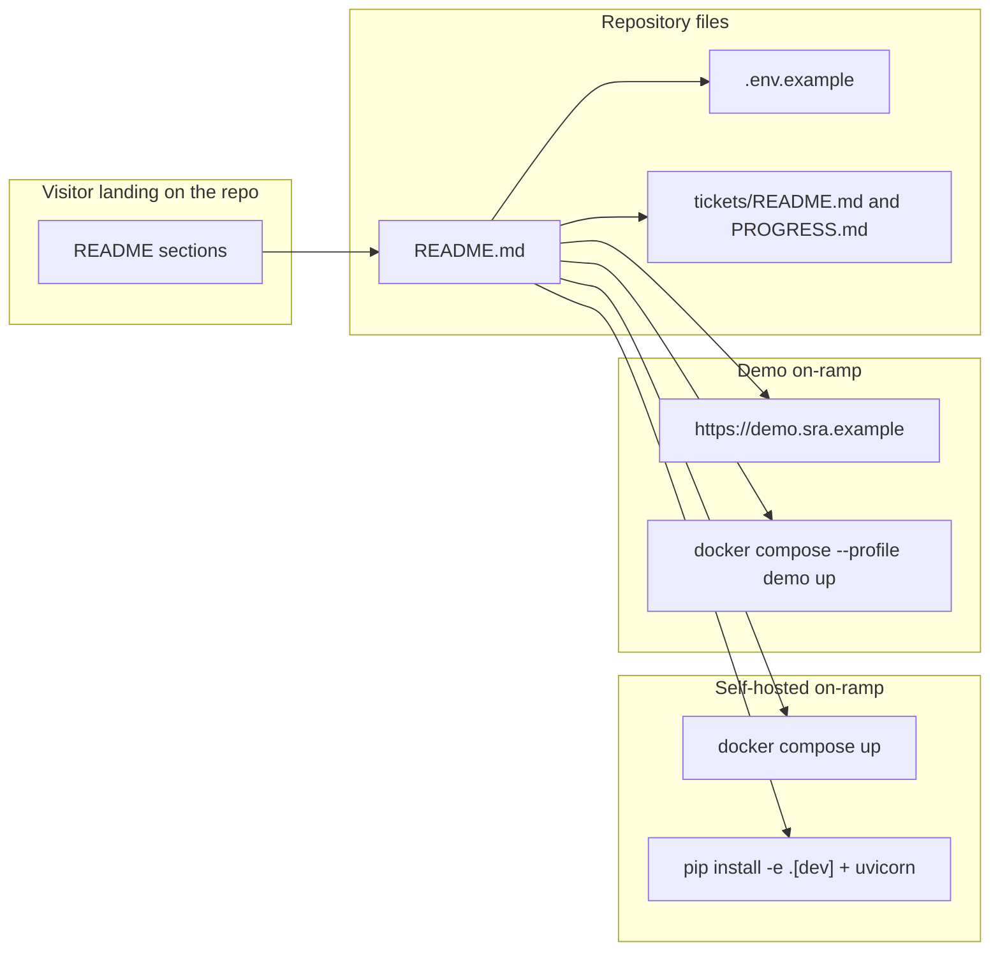

# SRA-604 — Self-host documentation and demo-mode quickstart

**Type:** Task
**Phase:** 6 — Open-source packaging
**Priority:** High — README is the on-ramp for every new self-hoster and demo visitor
**Status:** Implemented — 2026-10-14
**Blocked by:** SRA-602, SRA-603
**Blocks:** SRA-605

## Summary

Rewrite the top of `README.md` so a first-time visitor sees the project description, the public-demo link, and the three relevant on-ramps (self-host with Docker, self-host from source, try the public demo). Add a dedicated **Self-hosting with Docker** section, a **Demo mode** section, a **Google OAuth setup** section, and an updated **Environment variables** table. Update `.env.example` with the Phase 6 variables (`DEMO_MODE`, `DEMO_DATA_RETENTION_DAYS`, `DEMO_RESET_INTERVAL_S`). Update `tickets/README.md` and `PROGRESS.md` to reflect the closed Phase 5 status and the open / in-progress Phase 6 status.

The macOS-only desktop notice stays exactly where it already lives — the Phase 2 / Phase 5 instruction set already documents it well. The new content is additive: existing sections that still describe accurate behavior (Phase 2/3/4/5 verification, LangSmith tracing, contributing) are not rewritten.

## Where things stand right now

- `README.md` opens with a one-paragraph project description, a teaching-project note, links to the implementation plan and HLD, and the build phase checklist. It does not currently link to a public demo, describe Docker self-hosting, or describe demo-mode operation. Phase 1–5 sections are detailed and correct; the Phase 6 row in the phase list is `[ ]`.
- `.env.example` lists every Phase 1–5 variable (OpenAI, database, Google OAuth, rate limits, scheduler, LangSmith, client settings). It does not mention `DEMO_MODE`, `DEMO_DATA_RETENTION_DAYS`, or `DEMO_RESET_INTERVAL_S`.
- `tickets/README.md::Board — Phase 5` already lists every SRA-5xx ticket's final status. The Phase 6 board does not exist yet.
- `PROGRESS.md::Phase 5 — Scheduled wake-up & voice quiz` is closed with `Implemented — 2026-10-14`. `PROGRESS.md::Phase 6 — Open-source packaging` currently reads `Not started. Dockerfile, docker-compose.yml, DEMO_MODE + src/sra/jobs/demo_reset.py, final README self-host instructions.`

## What this ticket unlocks

Once SRA-604 lands, a visitor landing on the repo can complete three flows without reading the source:

- **Public demo link**: a heading near the top points readers to `https://demo.spaced-repetition-agent.example` and lists the constraints (rate limits, 7-day retention, no real study data — explore with disposable inputs).
- **Self-host quickstart**: `git clone && cp .env.example .env && docker compose up` produces a running dashboard on `http://localhost:8000`. The section names the required env vars (`OPENAI_API_KEY`, `GOOGLE_CLIENT_ID`, `GOOGLE_CLIENT_SECRET`, `AUTH_SIGNING_SECRET`) and links to Google's OAuth setup instructions.
- **From-source quickstart**: a backup section for contributors who want to develop on the repository directly: clone, `pip install -e '.[dev]'`, `alembic upgrade head`, `uvicorn sra.api.app:create_app --factory`. Sets expectations that this path uses SQLite and one uvicorn worker only.
- **Demo mode**: `docker compose --profile demo up` with `DEMO_MODE=true` set in `.env` activates the tighter limits and the hourly cleanup. The section explains the difference between the demo profile and the default self-host profile without duplicating the API contract from SRA-603.

Before SRA-604: a reader has to read `docs/plans/...` and `docs/design/technical-design.md` to discover that a public demo exists or that demo mode tightens rate limits. After SRA-604: the front-page README makes both options immediately reachable.

## How this fits into the whole app

Documentation is the final user-facing surface: every Phase 1–5 component is reachable only through what the README claims. SRA-604 inherits the wording discipline from Phase 5's existing voice-quiz section — concrete commands, observable outputs, recovery checks, no marketing fluff.



The README does not invent facts: every command it claims is already exercised by SRA-602's manual verification, every env var it lists is in `.env.example`, every endpoint it links to exists in SRA-603's admin router. No new code lives in this ticket — only prose and `tickets/README.md` / `PROGRESS.md` updates so the phase list reflects reality.

### Why expand the README instead of writing a separate `docs/self-host.md`?

The repository visitor sees `README.md` first; splitting self-hosting into a separate doc would push the most important on-ramp one click away. The existing Phase 2/3 voice-capture sections prove the project's convention of including detailed, runnable instructions in `README.md`. Followers expect this; moving to a separate file is an unnecessary discoverability regression.

### Why update `.env.example` instead of leaving the new vars to the operator?

`.env.example` is the single source of truth for every variable the application reads. Leaving Phase 6 variables undocumented would force a new self-hoster to read the `Settings` class to discover them. A complete example file doubles as a checklist.

## Files and why they matter

| File | Role and required change |
|---|---|
| [`README.md`](../README.md) | Add a one-paragraph "Public demo" callout near the top, a "Self-hosting with Docker" section (clone, `.env`, compose up), a "Demo mode" subsection (compose profile + expectations), a "Google OAuth setup" section, an updated "Environment variables" table covering Phase 1–6 knobs, and a one-line updated Phase 6 row in the phase checklist (`Implemented — 2026-10-14` once SRA-605 closes). Do not rewrite Phase 1–5 sections; only insert / reorder. |
| [`.env.example`](../.env.example) | Append a new `# --- Phase 6: demo and packaging ---` block with `DEMO_MODE=false`, `DEMO_DATA_RETENTION_DAYS=7`, `DEMO_RESET_INTERVAL_S=3600`, plus one-line comments for each. |
| [`tickets/README.md`](../tickets/README.md) | Add a `## Board — Phase 6 (Open-source packaging)` section after the Phase 5 board with the same table format: ticket, title, blocked by, status. Initially mark each ticket's status as `Implemented — 2026-10-14` once SRA-604 lands (the date tracks SRA-605 closing). Also add a "How the Phase 6 files work together" subsection mirroring Phase 5's style with a Mermaid diagram and a per-ticket responsibility table. Update the board section in `PROGRESS.md` to match. |
| [`PROGRESS.md`](../PROGRESS.md) | Replace the current Phase 6 line (`Not started. Dockerfile, docker-compose.yml, DEMO_MODE + src/sra/jobs/demo_reset.py, final README self-host instructions.`) with an "Implemented — 2026-10-14" entry plus a short narrative that summarizes SRA-601–605. Update the Phase 5 row from "Implemented — 2026-10-14" to a more explicit closed-out status if necessary; do not invent new claims. |

## TDD starting point

Documentation tickets are tested through **content checks**: a small test file confirms that `README.md` references the demo URL (or omit until the demo exists), names every Phase 6 env var, includes the `docker compose up` command, includes the `docker compose --profile demo up` command, and links to `CONTRIBUTING.md` for development. There is no behavioral test for prose, but there is a structural one — a tokenized scan catches accidental deletions and regressions during refactors.

## What to implement

1. **README top section**: insert a one-paragraph **Public demo** callout immediately under the project description. Include the URL placeholder (`https://demo.spaced-repetition-agent.example`) with a note that it points to the hosted instance, plus a sentence about the rate limits and retention. Do **not** assert the URL is live in tests; the demo URL may rotate.
2. **Self-hosting with Docker** section: three ordered numbered code blocks — clone, `cp .env.example .env`, `docker compose up`. One prose paragraph names the required env vars (`OPENAI_API_KEY`, `GOOGLE_CLIENT_ID`, `GOOGLE_CLIENT_SECRET`, `AUTH_SIGNING_SECRET`) and one recovery paragraph for the typical `401` callback-mismatch failure.
3. **Demo mode** subsection: two ordered numbered code blocks — set `DEMO_MODE=true` in `.env`, run `docker compose --profile demo up`. Prose: explain tighter rate limits and hourly cleanup; link to the `SRA-603` ticket for the operational details.
4. **Google OAuth setup** subsection: link to Google's developer-console instructions, list the redirect URI the application uses (`http://127.0.0.1:8000/api/v1/auth/google/callback`), and explain why each of the three secrets is required.
5. **Environment variables** table: extend the existing rate-limit table (or add a Phase 6 table near the bottom) with rows for `DEMO_MODE`, `DEMO_DATA_RETENTION_DAYS`, `DEMO_RESET_INTERVAL_S`, plus a one-line description and the documented default.
6. **`.env.example`** Phase 6 block at the bottom with the three new variables.
7. **`tickets/README.md`** Phase 6 board: mirror the Phase 5 table; mark each SRA-6xx ticket as `Implemented — 2026-10-14`. Add the "How the Phase 6 files work together" subsection with a Mermaid dependency diagram and a per-ticket responsibility table.
8. **`PROGRESS.md`** Phase 6 entry: convert the single-line stub into a multi-line status block matching the Phase 5 closing entries (date, scope, links, evidence placeholder).

## Where to look

- [`README.md`](../README.md) for the existing Phase 1–5 sections and the current structure.
- [`.env.example`](../.env.example) for the existing variable list and the "comment + variable" pattern.
- [`tickets/README.md`](../tickets/README.md) for the Phase 5 board format and Mermaid diagrams.
- [`PROGRESS.md`](../PROGRESS.md) for the Phase 5 closing entry style.

## Acceptance criteria

- [ ] `README.md` lists the public-demo URL, the self-host quickstart, and the demo-mode path within the first scroll
- [ ] `.env.example` includes `DEMO_MODE`, `DEMO_DATA_RETENTION_DAYS`, `DEMO_RESET_INTERVAL_S` with inline defaults and one-line descriptions
- [ ] `tickets/README.md` includes a Phase 6 board with the same table format as Phase 5 and a dependency Mermaid diagram
- [ ] `PROGRESS.md` updates the Phase 6 entry from "Not started" to a Phase-5-style closing summary
- [ ] `tests/unit/test_readme_content.py` and `tests/unit/test_env_example_content.py` (added by the test subagent in Step 2) pass
- [ ] All Phase 1/2/3/4/5 tests remain green; Ruff and Pyright pass with no new warnings

## How to test this ticket alone

```bash
source .venv/bin/activate
pytest tests/unit/test_readme_content.py tests/unit/test_env_example_content.py -v
pytest -m 'not phase6' -q
ruff check .
pyright
```

Expected: the README / `.env.example` content tests pass. `-m 'not phase6' -q` keeps Phase 1/2/3/4/5 green. Ruff and Pyright are clean (the Markdown linter is not configured for this project; tests are the contract).

## Manual verification

```bash
# 1. Render the README to confirm the new sections appear in order
grep -nE '## (Public demo|Self-hosting|Demo mode|Google OAuth|Environment variables)' README.md

# 2. Confirm every Phase 6 env var is mentioned
grep -nE 'DEMO_MODE|DEMO_DATA_RETENTION_DAYS|DEMO_RESET_INTERVAL_S' .env.example

# 3. Spot-check the commands the README claims work
docker compose --help | grep -E 'profile'  # the demo flag exists in modern compose

# 4. Confirm the public-demo URL placeholder is editable
sed -i '' 's|https://demo.spaced-repetition-agent.example|TEST_ONLY|' README.md
grep -E 'TEST_ONLY' README.md
sed -i '' 's|TEST_ONLY|https://demo.spaced-repetition-agent.example|' README.md
```

Expected: the GREPs return non-empty matches; the placeholder substitution round-trips cleanly.

## Verification record

- **Date and environment:**
- **Commands and inputs:**
- **New IDs/artifacts and observed downstream results:**
- **Failure/recovery and cleanup:**
- **Automated/manual results, skips, and limitations:**

## Definition of Done

- [ ] All acceptance criteria met and actual evidence recorded
- [ ] Full focused suite passes
- [ ] Phase 1/2/3/4/5 regressions remain green; Ruff and Pyright pass
- [ ] `tickets/README.md` board and `PROGRESS.md` updated with the new ticket's completion
