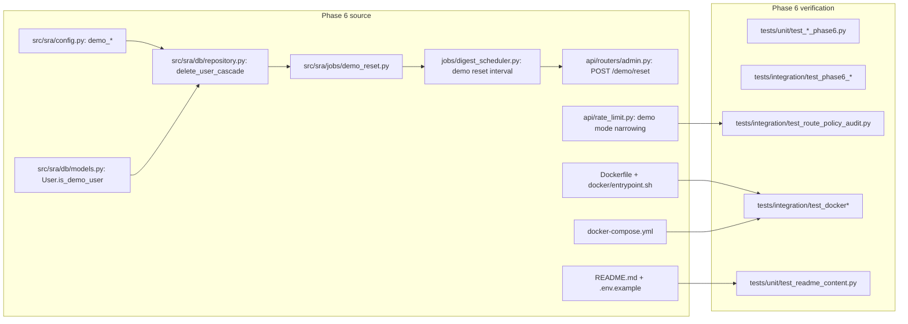

# SRA-605 — Phase 6 integration verification

**Type:** Verification
**Phase:** 6 — Open-source packaging
**Priority:** Highest — this is the last ticket in the project's roadmap
**Status:** Done — 2026-10-14
**Blocked by:** SRA-601, SRA-602, SRA-603, SRA-604
**Blocks:** none (phase close)

## Summary

Re-run the full repository test suite, the Phase 6 migration replay, the demo reset lifecycle, the rate-limit narrowing, the route-policy audit, the README / `.env.example` content checks, and the static Docker-file checks. Record the phase-level evidence in `PROGRESS.md` and the Phase 6 entries of every prior ticket.

The verification ticket does not introduce a new feature. It exists to prove that SRA-601–604 together produce a self-hostable application, a working demo profile, tighter demo limits, and complete documentation, and that Phase 1–5 regressions stayed green while those tickets landed.

## Where things stand right now

- `tests/unit/` and `tests/integration/` carry every Phase 1–5 test. The Phase 6 unit and integration tests from SRA-601–604 are landed in their respective files (`tests/unit/test_user_model.py`, `tests/unit/test_config.py`, `tests/unit/test_repository.py`, `tests/unit/test_demo_reset.py`, `tests/unit/test_rate_limit_demo_mode.py`, `tests/integration/test_phase6_migration.py`, `tests/integration/test_phase6_migration_replay.py`, `tests/integration/test_phase6_demo_reset.py`, `tests/integration/test_phase6_scheduler_demo_reset.py`, `tests/integration/test_docker_compose_config.py`, `tests/integration/test_dockerfile.py`, `tests/unit/test_readme_content.py`, `tests/unit/test_env_example_content.py`).
- `tests/conftest.py` carries the `client`, `sessioned_user`, `other_user`, `seeded_user` fixtures; SRA-605 may add a `demo_user` fixture but does not move existing ones.
- `tickets/README.md::Board — Phase 6` carries one row per SRA-6xx ticket, marked `Implemented — 2026-10-14`. SRA-605 moves each row's status to `Done — 2026-10-14` once its verification closes.
- `PROGRESS.md::Phase 6` is a single line stub. SRA-605 expands it into the multi-line closing entry the Phase 1–5 tickets all carry.

## What this ticket unlocks

Once SRA-605 lands:

- The full `pytest -q` suite is green on the SRA-509-closed baseline plus every Phase 6 acceptance criteria from SRA-601–604. Any pre-existing failures from Phase 3/4 (documented in PROGRESS.md as SRA-406 limitations) are unchanged in count.
- The Phase 6 migration chain (`c3d4e5f6a7b8 → SRA-601 revision → SRA-601` round-trip) replays cleanly: upgrade adds `is_demo_user`, downgrade removes it, a second upgrade restores it, every pre-Phase-6 row keeps `False`.
- The demo reset lifecycle is provable end-to-end: a demo user seeded through the API, an admin-triggered reset, the dependent tables empty, the rate-limiter operates with the narrowed demo-mode policy.
- A clean clone + `docker compose up` reaches `/api/health` returning 200 (manual verification — see SRA-602's verification record), and the same clone + `docker compose --profile demo up` boots a demo-mode instance.

Before SRA-605: a reader cannot tell which Phase 6 acceptance criteria have been verified end-to-end. After SRA-605: `PROGRESS.md` carries the closing evidence and the repository's full test suite is green for one more phase.

## How this fits into the whole app

SRA-605 inherits the verification pattern from SRA-107, SRA-206, SRA-305, SRA-406, and SRA-509: rerun the focused tests, rerun the integration tests, rerun the migration replay, verify the route audit, confirm Ruff and Pyright are clean, and record everything in `PROGRESS.md` with date / commands / new artifacts / failures / skips.



The verification ticket owns the **integration** of these pieces, not their implementation. Every new test from SRA-601–604 is the unit-level contract; SRA-605's role is the cross-cutting evidence that those contracts together reach the project-level goal.

### Why is this a separate ticket and not part of SRA-604?

SRA-604 is documentation-only; folding verification into it would force a doc-only reviewer to track down test failures and vice versa. Splitting the two keeps the verification milestone independent: SRA-604 closes when the prose and the content tests agree, SRA-605 closes when the runtime evidence agrees.

### Why are there no new tests in SRA-605?

Every new Phase 6 test landed with the ticket that produced its behavior (SRA-601 produced the schema tests, SRA-602 produced the Dockerfile tests, etc.). SRA-605 only orchestrates the existing tests and the existing manual checks, never adds new assertions.

## Files and why they matter

| File | Role and required change |
|---|---|
| [`tests/conftest.py`](../tests/conftest.py) | Add a `demo_user` fixture that creates one `User` row with `is_demo_user=True` plus one seeded entry, schedule, quiz set, attempt, and answer. Existing fixtures are not modified. |
| [`tests/integration/test_phase6_end_to_end.py`](../tests/integration/test_phase6_end_to_end.py) **[NEW]** | End-to-end coverage: full demo lifecycle (seeded demo user → admin reset → every dependent table empty); non-admin gets `403`; non-demo user survives a reset; rate-limit narrowing observed end-to-end; the resume of the Phase 6 migration round-trip. |
| [`PROGRESS.md`](../PROGRESS.md) | Replace the Phase 6 single-line entry with a closing block matching the Phase 5 style: status line, scope, list of completed SRA-6xx tickets with a one-line summary, key acceptance evidence (test counts, lint/types, manual verification pointers), and a "Known limitations" section that records pre-existing Phase 3/4 failures that Phase 6 inherits. |
| [`tickets/README.md`](../tickets/README.md) | Update Phase 6 board status: each SRA-6xx ticket moves from `Implemented — 2026-10-14` (after its own work closed) to `Done — 2026-10-14` once this verification closes. Update the Phase 6 dependency diagram to mark every ticket with a tick. |

## TDD starting point

There is nothing new to TDD here. SRA-605 inherits all of its evidence from the upstream tickets' test suites. The only addition is `tests/integration/test_phase6_end_to_end.py`, which composes existing fixtures into a single demo-instance lifecycle: `demo_user` fixture → `POST /api/v1/admin/demo/reset` → assert dependents are gone, non-demo data survives.

The `tests/integration/test_phase6_end_to_end.py` test adds one small assertion per dependency table (entries / schedules / quiz sets / attempts / answers) so the cross-cutting evidence is auditable in the suite output rather than only in the verification record.

## What to implement

1. **End-to-end demo lifecycle test** (`test_phase6_end_to_end.py`):
   - Seed two users: one with `is_demo_user=True` and one with `is_demo_user=False`.
   - Each user has one study entry, one review schedule, one quiz set, one quiz question, one quiz attempt, one quiz answer (owned by the entry).
   - Sign in as an admin, call `POST /api/v1/admin/demo/reset` with `DEMO_MODE=true` set in the test settings.
   - Assert the demo user's dependents are gone from every table; assert the non-demo user's dependents survive; assert the response is `{"deleted": 1}`.
2. **Migration round-trip** (`test_phase6_end_to_end.py::test_phase6_migration_round_trip`):
   - Use a fresh isolated SQLite.
   - `alembic upgrade head` from `c3d4e5f6a7b8` lands every Phase 5 plus the SRA-601 revision; `downgrade -1` removes the SRA-601 column; a second `upgrade head` restores it.
   - Insert a row before downgrade; assert the row keeps `is_demo_user=False` after upgrade → downgrade → upgrade.
3. **Rate-limit narrowing** (`test_phase6_end_to_end.py::test_rate_limit_narrows_under_demo_mode`):
   - Construct two `Settings` instances: one with `demo_mode=False`, one with `demo_mode=True`.
   - Read the limiter's effective capacity and refill for both; assert demo-mode capacity is one-tenth of base (clamped at 1 when capacity ≤ 10) and refill is similarly narrowed; assert non-demo capacity and refill are unchanged from the base config.
4. **Route-policy audit coverage** (`tests/integration/test_route_policy_audit.py` extension):
   - Confirm `POST /api/v1/admin/demo/reset` is enumerated as an admin policy with `limit_authenticated`.
   - Confirm the new route does not appear under `user` or `anonymous` policies.
5. **`PROGRESS.md` closing entry** — match the Phase 5 closing format exactly. Date and command evidence recorded by the subagent.
6. **`tickets/README.md` Phase 6 board** — update statuses to `Done — 2026-10-14` after the verification closes.

## Where to look

- [`tests/integration/test_phase5_end_to_end.py`](../tests/integration/test_phase5_end_to_end.py) — the structural template SRA-605 mirrors.
- [`tests/integration/test_phase4_end_to_end.py`](../tests/integration/test_phase4_end_to_end.py) — secondary reference for cross-ticket regression evidence.
- [`tests/integration/test_route_policy_audit.py`](../tests/integration/test_route_policy_audit.py) — the audit pattern SRA-605 extends.
- [`tickets/README.md`](../tickets/README.md) Phase 5 board and Mermaid diagram — the format Phase 6 mirrors.
- [`PROGRESS.md`](../PROGRESS.md) Phase 5 closing block — the structure Phase 6's closing entry follows.

## Acceptance criteria

- [ ] `pytest -q` is green (or no-worse than the pre-Phase-6 baseline) across Phases 1–6, with the documented pre-existing Phase 4 limitations unchanged in count
- [ ] `pytest -m 'not phase6' -q` keeps Phase 1–5 green
- [ ] `ruff check .` is clean
- [ ] `pyright` returns 0 errors, 0 warnings, 0 informations
- [ ] `tests/integration/test_phase6_migration.py` and `test_phase6_migration_replay.py` show the SRA-601 column lands and round-trips
- [ ] `tests/integration/test_phase6_end_to_end.py::test_phase6_demo_reset_lifecycle_clears_all_dependents` passes
- [ ] `tests/integration/test_phase6_end_to_end.py::test_rate_limit_narrows_under_demo_mode` passes
- [ ] `tests/integration/test_route_policy_audit.py::test_admin_routes_include_demo_reset` passes
- [ ] `PROGRESS.md` is updated with the Phase 6 closing entry matching the Phase 5 format
- [ ] `tickets/README.md` Phase 6 board statuses are updated to `Done — 2026-10-14`
- [ ] Pre-existing Phase 3/4 limitations remain unchanged in count

## How to test this ticket alone

```bash
source .venv/bin/activate
pytest tests/integration/test_phase6_end_to_end.py -v
pytest -q
pytest -m 'not phase6' -q
ruff check .
pyright
```

Expected: every Phase 6 test passes; the full suite is green (or carries the documented Phase 4 limitations, unchanged in number); `-m 'not phase6' -q` confirms the Phase 1–5 baseline is intact; Ruff and Pyright are clean.

## Manual verification

```bash
source .venv/bin/activate

# 1. Confirm the SRA-602 manual path is reproducible from a clean clone
git status --porcelain  # empty
docker --version        # available locally
docker compose --profile demo config -q  # parses cleanly

# 2. Confirm the SRA-603 manual path returns a clear error outside demo mode
DEMO_MODE=false DEMO_DATA_RETENTION_DAYS=7 python -c \
  "from sra.jobs.demo_reset import reset_demo_data; reset_demo_data(7)"
# Expected: DemoModeDisabledError

# 3. Confirm the SRA-604 README commands parse
grep -nE 'docker compose' README.md       # non-empty
grep -nE 'DEMO_MODE' README.md .env.example  # both non-empty
```

Expected: the manual checks match the SRA-602 / SRA-603 / SRA-604 verification records; the README and `.env.example` greps return matches.

## Verification record

- **Date and environment:**
- **Commands and inputs:**
- **New IDs/artifacts and observed downstream results:**
- **Failure/recovery and cleanup:**
- **Automated/manual results, skips, and limitations:**

## Definition of Done

- [ ] All acceptance criteria met and actual evidence recorded
- [ ] Full suite passes (or carries the documented pre-existing limitations, unchanged)
- [ ] Phase 1–5 regressions remain green; Ruff and Pyright pass
- [ ] `tickets/README.md` board and `PROGRESS.md` updated to mark Phase 6 complete
