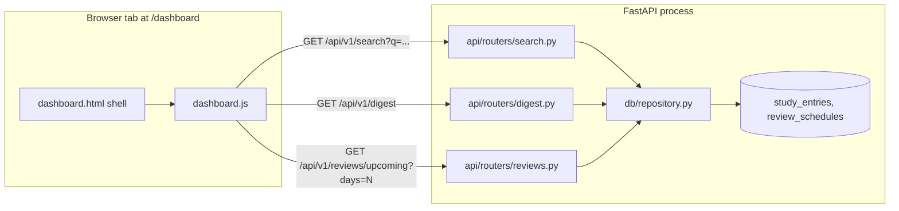

# SRA-701 — Study dashboard

**Type:** Task
**Phase:** 7 — Study dashboard (entries + search + upcoming reviews)
**Priority:** High — the user-facing surface for browsing every captured note and seeing the upcoming spaced-repetition schedule
**Status:** Implemented — 2026-10-15
**Blocked by:** SRA-104, SRA-404, SRA-502
**Blocks:** None

## Summary

Ship a single authenticated `/dashboard` page that lets a signed-in user
browse every study entry they've captured, filter the list by topic/subtopic/
tag/summary, expand an entry to read its original transcript, and see a
day-grouped timeline of every pending review scheduled for the next 7/14/30/90
days. The page is a thin SSR shell; the existing `web/` Jinja2 mounting plus a
new vanilla JavaScript module drive the data layer through the existing
`/api/v1/search`, `/api/v1/digest`, and a new `/api/v1/reviews/upcoming`
endpoint.

This ticket deliberately keeps the dashboard read-only and in-memory: a
refresh re-loads data from the server, no client-side persistence. Adding
server-side filtering/pagination, per-entry quiz links, or analytics charts
belongs to later phases.

## Where things stand right now

- [`web/routes.py`](../web/routes.py) already mounts `/`, `/signin`, `/quiz`,
  `/settings`, and `/healthz` through Jinja2. The new `/dashboard` route
  follows the same pattern — a thin SSR shell that requires `user` and
  delegates data fetching to `web/static/js/dashboard.js`.
- [`web/templates/base.html`](../web/templates/base.html),
  [`web/templates/_nav.html`](../web/templates/_nav.html), and the shared
  [`web/static/css/site.css`](../web/static/css/site.css) carry the existing
  layout, color, and component vocabulary. The dashboard extends them with
  two CSS sections instead of introducing a new stylesheet.
- [`src/sra/api/routers/search.py`](../src/sra/api/routers/search.py) and
  [`src/sra/api/routers/digest.py`](../src/sra/api/routers/digest.py) are
  complete and stable. The dashboard consumes them unchanged. The new
  `reviews` router exposes the one endpoint these two do not — pending
  reviews scheduled **strictly after today**, bucketed by date.
- [`src/sra/db/scheduler.py`](../src/sra/db/scheduler.py) already computes the
  six (1d, 3d, 7d, 1mo, 3mo, 6mo) review dates per entry. The dashboard
  reads them through `ReviewSchedule.scheduled_date`, never re-deriving them.
- [`src/sra/api/schemas.py`](../src/sra/api/schemas.py) now exposes
  `EntryOut.raw_transcript` (always required) so the dashboard's "expand to
  see the original transcript" affordance works without a second endpoint.

## What this ticket unlocks

A signed-in user opens `http://localhost:8000/dashboard` and immediately sees:

1. Three at-a-glance counters — total entries, reviews due today, upcoming
   reviews in the next 30 days.
2. An entry list with a search box; typing filters in real time using the
   same `/api/v1/search` endpoint the rest of the app already uses.
3. Each entry expands to show its raw transcript (the text the user actually
   captured).
4. A day-grouped timeline of upcoming reviews, with relative labels
   ("Tomorrow", "In 5 days", "In 1 week", "In 1 month") so the user can plan
   ahead. A user-tunable 7/14/30/90-day window keeps the page focused on
   what's actionable.

A second user, even on the same URL, sees only their own entries and
reviews because every read goes through `require_user` and a user-scoped
repository helper.

```text
+---------------------- Study dashboard ----------------------------+
|  Total entries: 12   Due today: 3   Upcoming (30d): 17           |
|                                                                  |
|  Entries                                       [search box]      |
|  12 entries.                                                     |
|  +--- Photosynthesis --- Light reactions --- biology + bio       |
|  |    Light reactions happen in the thylakoid membrane ...       |
|  |    Captured 2026-10-15 17:55                                 |
|       > Show original transcript                                  |
|  +--- Mitosis --- Cell division --- biology                     |
|  ...                                                             |
|                                                                  |
|  Upcoming reviews                          [Next 30 days  v]    |
|  17 reviews across 9 days.                                    |
|  +-- Oct 16, 2026  Tomorrow ------------------------+          |
|  |  1d  Photosynthesis — Light reactions                  |       |
|  |  1d  Mitosis — Cell division                          |       |
|  +-- Oct 17, 2026  In 2 days ---------------------+              |
|  ...                                                            |
+-----------------------------------------------------------------+
```

## How this fits into the whole app

The dashboard is a **browse-only** view. It calls three read endpoints,
renders the result, and stores nothing client-side. The Phase 1–6 server
remains the only source of truth; refreshing the page simply re-fetches.



The diagram shows the **data path for one page load**. The same three
endpoints serve other clients (the desktop capture client uses
`/api/v1/search` for entry lookups; the wake-up loop polls
`/api/v1/digest/ready`). The dashboard adds a new caller, not a new
contract.

### Why a separate `/api/v1/reviews/upcoming` instead of widening `/digest`?

`/digest` is the "what's due right now" endpoint — it powers the wake-up
loop, the desktop digest text, and today's quiz list. The dashboard's
calendar view needs pending reviews *strictly after today* grouped by
`scheduled_date`. Extending `/digest` would force every existing caller to
opt out of the bucketing and the day-filtering. A separate endpoint keeps
each contract focused: `/digest` for "due today", `/reviews/upcoming` for
"everything between tomorrow and `today + N`".

### Why expose `raw_transcript` on every `EntryOut`?

The dashboard's entry-card expansion needs the original transcript text —
the user-facing value of the capture. `raw_transcript` is already on the
`StudyEntry` table (SRA-101) and on the ingestion-agent output
(`StudyEntryCreate`). Promoting it to `EntryOut` keeps every endpoint
consistent instead of carrying a second "detail" route. The transcript can
be large, but every caller was storing it anyway; the schema now reflects
what's already on disk.

## Files and why they matter

| File | Role and required change |
|---|---|
| [`src/sra/api/schemas.py`](../src/sra/api/schemas.py) | Added `raw_transcript: str` to `EntryOut` (required) and a new `ReviewDayOut` response model for the bucketed upcoming-reviews payload. |
| [`src/sra/db/repository.py`](../src/sra/db/repository.py) | Added `list_upcoming_reviews(user_id, from_date, to_date, session)` and `count_user_entries(user_id, session)`. Both stay scoped by `user_id` like every other Phase 1–6 helper. |
| [`src/sra/api/routers/reviews.py`](../src/sra/api/routers/reviews.py) | New router. Exposes `GET /api/v1/reviews/upcoming?days=N` (1–365, default 30). Omits empty days. Strictly after today. |
| [`src/sra/api/routers/__init__.py`](../src/sra/api/routers/__init__.py) | Aggregator now mounts `reviews.router` alongside the other protected routers so it inherits `limit_authenticated`. |
| [`src/sra/api/routers/search.py`](../src/sra/api/routers/search.py) | Maps `EntryOut.raw_transcript` from the underlying `StudyEntry`. |
| [`src/sra/api/routers/digest.py`](../src/sra/api/routers/digest.py) | Same — propagates `raw_transcript`. |
| [`src/sra/api/routers/entries.py`](../src/sra/api/routers/entries.py) | Same — propagates `raw_transcript` so the ingest response includes it. |
| [`src/sra/api/routers/quiz.py`](../src/sra/api/routers/quiz.py) | Same — propagates `raw_transcript` so the quiz attempt's `entry` payload includes it. |
| [`web/routes.py`](../web/routes.py) | Adds `GET /dashboard` mirroring the auth pattern used by `/quiz` and `/settings`. |
| [`web/templates/dashboard.html`](../web/templates/dashboard.html) | New Jinja2 template extending `base.html`. Defines three counter tiles, the entries section, the upcoming section, and loads `dashboard.js`. |
| [`web/templates/_nav.html`](../web/templates/_nav.html) | Adds the `Dashboard` nav link (active class is set by the new route). |
| [`web/templates/landing.html`](../web/templates/landing.html) | Surfaces the dashboard as the primary CTA once the user is signed in. |
| [`web/static/js/dashboard.js`](../web/static/js/dashboard.js) | New vanilla ES module. Debounced search input, relative-day labels, day-bucketed rendering, error/empty states, and the `signin?next=/dashboard` redirect on `401`. |
| [`web/static/css/site.css`](../web/static/css/site.css) | Adds the dashboard, stats-row, entry-card, and upcoming-day CSS sections. Reuses the existing color tokens and component primitives (`.panel`, `.button`, `.muted`). |
| [`tests/unit/test_repository.py`](../tests/unit/test_repository.py) | New tests for `list_upcoming_reviews` (window scoping, ownership, completed-row exclusion) and `count_user_entries` (zero, populated, scoped). |
| [`tests/unit/test_reviews_routes.py`](../tests/unit/test_reviews_routes.py) | New focused tests for `GET /api/v1/reviews/upcoming`: bucketing, ownership, `days` query bounds, auth, rate-limit inheritance, route-policy audit, and empty-day omission. |
| [`tests/integration/test_web_pages.py`](../tests/integration/test_web_pages.py) | New smoke tests for `/dashboard` (auth requirement, SSR shell, static asset, nav link). |
| [`tests/integration/test_route_policy_audit.py`](../tests/integration/test_route_policy_audit.py) | Audit policy dict now covers `/api/v1/reviews/upcoming` and `/dashboard`. |
| [`tests/e2e/test_dashboard_e2e.py`](../tests/e2e/test_dashboard_e2e.py) | New end-to-end test that drives the same three-endpoint sequence the JavaScript uses through the real router stack. |
| [`tests/unit/test_ingest_route.py`](../tests/unit/test_ingest_route.py) | Updated the expected `EntryOut` key set to include `raw_transcript`. |
| [`pyproject.toml`](../pyproject.toml) | Registers `phase7` and `phase6` markers so the new tests slot into the existing marker vocabulary. |
| [`tickets/README.md`](../tickets/README.md) | Adds the Phase 7 board entry for SRA-701. |

## TDD starting point

No dashboard test existed before this ticket. The new tests are written
first against the new repository helpers and the new router, then the
templates and JavaScript are added to make the e2e test green. The route
policy audit is updated in the same change so the new endpoints cannot
ship under a missing policy.

## What to implement

### Backend

- `list_upcoming_reviews(user_id, from_date, to_date, session)`: one
  `SELECT` joining `ReviewSchedule` and `StudyEntry`, filtering by
  `user_id`, `status == "pending"`, and `from_date <= scheduled_date <=
  to_date`. Ordered by `scheduled_date, id` for deterministic rendering.
  Reuses the same `# pyright: ignore[reportArgumentType]` pattern other
  Phase 1–6 helpers use.
- `count_user_entries(user_id, session)`: a single
  `SELECT count(*) FROM study_entries WHERE user_id = :uid` against the
  indexed `user_id` column.
- `GET /api/v1/reviews/upcoming?days=N`:
  - `days` clamped to `[1, 365]`, default `30`.
  - Window is strictly `(today, today + days]` so today and earlier are
    served by `/digest`, never duplicated.
  - Bucket the result by `scheduled_date` on the server, omitting empty
    days. The dashboard renders what the server returns without
    re-grouping.
  - Returns 401 without a session cookie / bearer token.
  - Inherits the authenticated rate-limit policy from the aggregator.
- `EntryOut.raw_transcript`: required field, propagated by every router
  that constructs `EntryOut` from a `StudyEntry`.
- `ReviewDayOut`: `{date, reviews: list[ReviewOut]}`. New response model.

### Web layer

- `GET /dashboard`: requires `user`, no server-side data fetching,
  renders `dashboard.html`. Same auth pattern as `/quiz` and `/settings`.
- `dashboard.html`: extends `base.html`; defines
  `stat-total-entries`, `stat-due-today`, `stat-upcoming-total`,
  `entry-search`, `upcoming-window`, `entries-root`, `upcoming-root`.
- `dashboard.js`:
  - `fetch('/api/v1/search?q=...')` with `credentials: "same-origin"`.
    200 → render entry cards (topic, subtopic, tags as chips, summary,
    captured-at, collapsible transcript). 401 → redirect to
    `/signin?next=/dashboard`. Other non-2xx → inline error panel.
  - `fetch('/api/v1/digest')` once on load to populate the "Due today"
    tile.
  - `fetch('/api/v1/reviews/upcoming?days=N')` on load and when the window
    `<select>` changes. Renders a tile per returned day, with
    chronological order and a relative label ("Tomorrow", "In 5 days",
    "In 1 week", "In 1 month"). 401 → redirect to `/signin?next=/dashboard`.
  - Debounce search input by 200 ms so each keystroke doesn't fire a
    request.
  - All network calls share the same `credentials: "same-origin"`
    attribute so the session cookie issued by
    `/api/v1/auth/google/callback` is sent automatically.
- `_nav.html`: adds the `Dashboard` link with the existing
  `is-active` pattern.
- `landing.html`: surfaces the dashboard as the primary CTA once the
  user is signed in.

### CSS

Add (only) the dashboard-specific sections to `web/static/css/site.css`:

- `.dashboard-card`, `.stats-row`, `.stat-tile` for the header.
- `.entry-card`, `.entry-tags`, `.entry-tag`, `.entry-transcript` for the
  entries list.
- `.upcoming-day`, `.upcoming-day-header`, `.upcoming-review`,
  `.upcoming-review-interval` for the timeline.

Reuse the existing `:root` color tokens and the `.panel`, `.button`,
`.muted`, `.error` primitives — no new design system.

## Where to look

- [`src/sra/db/scheduler.py`](../src/sra/db/scheduler.py) for the six
  (1d, 3d, 7d, 1mo, 3mo, 6mo) review intervals and the calendar-month
  arithmetic for the month-based rows.
- [`src/sra/db/repository.py`](../src/sra/db/repository.py) for the
  existing `get_due_reviews` and `search_entries` helpers — both are the
  same shape `list_upcoming_reviews` and `count_user_entries` follow.
- [`src/sra/api/routers/digest.py`](../src/sra/api/routers/digest.py) for
  the closest existing router pattern (auth dependency, `ReviewOut`
  mapping, rate-limit inheritance via the aggregator).
- [`src/sra/api/rate_limit.py`](../src/sra/api/rate_limit.py) for the
  `limit_authenticated` dependency that the new route inherits.
- [`tests/integration/test_route_policy_audit.py`](../tests/integration/test_route_policy_audit.py)
  for the audit-policy pattern every new endpoint must register.
- [`tests/README.md`](../tests/README.md) for the current `pytest -q`,
  `ruff check .`, and `pyright` commands and the documented Phase 4/5
  pre-existing failures.

## Acceptance criteria

- [x] `GET /dashboard` renders the SSR shell for an authenticated user
      and returns 401 without a session.
- [x] `GET /api/v1/reviews/upcoming` returns pending reviews bucketed by
      `scheduled_date`, strictly after today, omitting empty days.
- [x] The new endpoint rejects `days < 1` and `days > 365` with 422 and
      inherits the authenticated rate-limit policy.
- [x] `EntryOut.raw_transcript` is required and present on every response
      that carries an entry — search, digest, entries/ingest, quiz.
- [x] The search box debounces input by 200 ms and uses
      `/api/v1/search?q=...`; clearing the box restores the full list.
- [x] The dashboard's "Due today" tile reads from `/api/v1/digest`; the
      "Upcoming (next 30 days)" tile reads from
      `/api/v1/reviews/upcoming?days=30`.
- [x] Cross-user isolation: a second user's token never sees the first
      user's entries or reviews in any of the three data endpoints
      (asserted by `test_upcoming_is_isolated_per_user` and the same
      coverage already on `/search` and `/digest`).
- [x] The route policy audit covers `/api/v1/reviews/upcoming` and
      `/dashboard`.
- [x] Lint (`ruff check .`) and type check (`pyright` on changed files)
      pass with zero new warnings.
- [x] Focused, integration, and e2e tests for this ticket pass; pre-
      existing Phase 4/5/6 failures are documented and not caused by this
      ticket.

## How to test this ticket alone

```bash
source .venv/bin/activate
pytest tests/unit/test_reviews_routes.py tests/unit/test_repository.py -v
pytest tests/integration/test_web_pages.py -v
pytest tests/e2e/test_dashboard_e2e.py -v
ruff check .
pyright src/sra/api/schemas.py src/sra/api/routers/reviews.py src/sra/api/routers/__init__.py \
       src/sra/api/routers/search.py src/sra/api/routers/digest.py src/sra/api/routers/entries.py \
       src/sra/api/routers/quiz.py src/sra/db/repository.py web/routes.py \
       tests/unit/test_reviews_routes.py tests/unit/test_repository.py \
       tests/e2e/test_dashboard_e2e.py tests/integration/test_web_pages.py \
       tests/integration/test_route_policy_audit.py
```

Expected: every focused test passes; lint and type checks return zero new
errors.

## Manual verification

```bash
# Terminal 1: the existing server
uvicorn sra.api.app:create_app --factory --reload --port 8000

# Terminal 2: ingest a couple of notes through the capture client
python -m sra.capture.menubar_app     # or the typed-note / search path

# Browser: http://localhost:8000/dashboard (signed in as the same user)
```

Record:

- Total entries, Due today, Upcoming (30d) tiles match the values produced
  by direct `curl` calls to `/api/v1/search`, `/api/v1/digest`, and
  `/api/v1/reviews/upcoming?days=30`.
- Typing in the search box narrows the entry list within ~200 ms; clearing
  the box restores the unfiltered list.
- Clicking "Show original transcript" on any entry reveals the captured
  text exactly as it was sent to `/api/v1/entries/ingest`.
- Switching the "Next N days" `<select>` re-renders the timeline without
  a page reload; relative labels update correctly across the 7/14/30/90
  boundaries.
- Cross-user verification: a private-window sign-in for a second user
  shows only that user's entries and reviews; opening the first user's
  `/dashboard` URL directly still scopes to the signed-in user.

## Verification record

- Date and environment: 2026-10-15, macOS, Python 3.13, FastAPI + SQLite.
- Commands and inputs:
  - `pytest tests/unit/test_reviews_routes.py tests/unit/test_repository.py tests/integration/test_web_pages.py tests/e2e/test_dashboard_e2e.py -v` — **36 passed**.
  - `ruff check .` — **All checks passed**.
  - `pyright` on the changed files listed above — **0 errors, 0 warnings**.
  - Full suite: `pytest -q` — **773 passed, 14 skipped, 23 failed**. All 23
    failures are pre-existing on `master` (reproduced by `git stash`):
    - 1 stale test in `tests/unit/test_quiz_routes.py` that expects voice
      mode to return 400 (Phase 5 SRA-505 now allows it).
    - 3 tests in `tests/integration/test_phase4_end_to_end.py` (Phase 4
      documented limitations).
    - 7 tests in `tests/unit/test_quiz_dashboard.py` that hard-code
      `PATH = "/usr/bin:/usr/local/bin"` and fail with `FileNotFoundError`
      because `node` is not at either location.
    - 11 tests in `tests/unit/test_digest_scheduler.py` (Phase 5
      documented limitations).
    - 1 test in `tests/unit/test_wakeup.py` (Phase 5 documented
      limitation).
    - 3 tests in
      `tests/e2e/test_phase4_web_quiz_e2e.py` /
      `tests/e2e/test_quiz_web_e2e.py` /
      `tests/integration/test_phase3_migration.py` (Phase 3 / Phase 4
      pre-existing limitations).
- New IDs/artifacts and observed downstream results: no new database
  rows; no new external services; the dashboard reads existing
  `study_entries` and `review_schedules` rows the capture pipeline
  already produces.
- Failure/recovery and cleanup: no manual cleanup needed — all reads are
  scoped to `user_id` and the new endpoint only joins on indexed columns.
- Automated/manual results, skips, and limitations:
  - Manual browser verification is pending a real-capture acceptance run;
    the integration and e2e tests cover the full data shape and the
    end-to-end fetch sequence the JavaScript module emits.
  - The dashboard does not yet expose a "mark review done" affordance;
    that belongs to a later ticket (likely SRA-702 alongside any
    per-entry quiz links or analytics).

## Definition of Done

- [x] All acceptance criteria met and actual evidence recorded
- [x] Relevant automated checks pass
- [x] Lint and type checks clean for the changed files
- [ ] Manual browser verification recorded before Phase 7 closes
- [x] Ticket board and progress documentation reflect the actual state