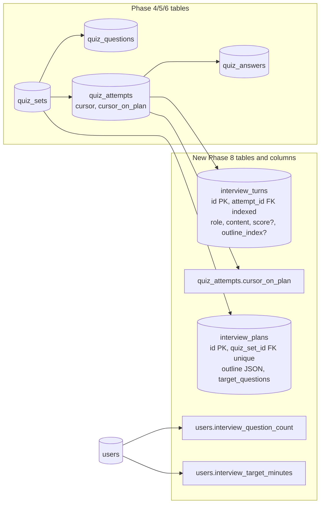

# SRA-801 — Interview schema and safe migration

**Type:** Task
**Phase:** 8 — Interactive AI interview mode
**Priority:** Highest — every later interview ticket depends on durable storage for plans, turns, and the new `users` preference columns
**Status:** Planned
**Blocked by:** SRA-509 (Phase 5 voice mode complete; reuses the `QuizAttempt` table SRA-504 extended)
**Blocks:** SRA-802, SRA-803, SRA-804, SRA-805, SRA-806, SRA-807, SRA-808, SRA-809

## Summary

Add the two tables the interview feature needs (`interview_plans`, `interview_turns`), the new `QuizAttempt.cursor_on_plan` column the conversation graph needs to track outline position, and the two `users` preference columns (`interview_question_count`, `interview_target_minutes`) that size the planner and the per-attempt turn cap. Ship an Alembic migration that preserves every Phase 1–7 row in place. After this ticket, the database can store one outline per `QuizSet`, a chronological log of AI / user / system_summary turns per attempt, and a per-user interview size and duration budget.

This ticket is **schema only**. No interview question is generated, no API exposes the mode, no user can start an interview yet. The agent, repository, router, and UI work come in later tickets.

## Where things stand right now

- [`src/sra/db/models.py`](../src/sra/db/models.py) defines the Phase 4 quiz tables (`QuizSet`, `QuizQuestion`, `QuizAttempt`, `QuizAnswer`) and the Phase 5 `QuizAttempt.cursor` column added in SRA-504. The `cursor` field today names the per-question index for the MCQ `voice` mode; SRA-803 will reuse it for the interview outline index (the two modes are mutually exclusive per attempt because `QuizAttempt.mode` is set at start time).
- The most recent Alembic revision is [`d4e5f6a7b8c9_add_phase6_is_demo_user.py`](../src/sra/alembic/versions/d4e5f6a7b8c9_add_phase6_is_demo_user.py). New revisions chain off it.
- The Phase 3/4/5/6 model files already follow the `<Name>Base`/`<Name>Create`/`<Name>` convention (no caller-supplied IDs or timestamps, `extra="forbid"` on `Create` types) — Phase 8 follows the same pattern.
- [`tests/conftest.py`](../tests/conftest.py) builds an isolated in-memory SQLite engine per test and creates the schema via `SQLModel.metadata.create_all`, so adding tables is observable immediately for unit tests; a separate file-database integration test must rehearse the migration path because in-memory `create_all` is not evidence that an existing database upgrades correctly.
- [`src/sra/api/schemas.py::PreferencesIn`](../src/sra/api/schemas.py) already validates the four Phase 5 preference fields with range validators; the two new fields reuse the same validator style.

## What this ticket unlocks

Run a temporary file database seeded with one Phase 5 user (already carrying the four Phase 5 preference columns), one entry, one `QuizSet`, and one `QuizAttempt`. Apply `alembic upgrade head`. Verify:

1. `interview_plans` and `interview_turns` exist with the columns and unique constraints defined below.
2. The new `users.interview_question_count` and `users.interview_target_minutes` columns appear with the documented defaults.
3. `quiz_attempts.cursor_on_plan` appears with `server_default=0` (matching how `cursor` was added in SRA-504).
4. The pre-existing `users`, `study_entries`, `review_schedules`, `quiz_sets`, `quiz_questions`, `quiz_attempts`, and `quiz_answers` rows have the **same** IDs, timestamps, and foreign keys.
5. Inserting a second `InterviewPlan` with the same `quiz_set_id` fails on the unique constraint — the one-plan-per-set guard the planner will rely on.
6. `alembic downgrade -1` cleanly removes the new tables, the `cursor_on_plan` column, and the two `users` columns without touching the existing ones; `alembic upgrade head` restores them.

SRA-802 will persist the first `InterviewPlan`. SRA-803 will write `InterviewTurn` rows on every HTTP turn. SRA-805's routes will only resolve to interviews owned by the authenticated user. None of those will work without the durable schema this ticket ships.

## How this fits into the whole app

The two interview tables sit beside the existing quiz tables; they never replace them. An `InterviewPlan` always points at an existing `QuizSet`, and every `InterviewTurn` always points at an existing `QuizAttempt`. `QuizAttempt.cursor_on_plan` lets the conversation graph advance through the outline in one column read, the same way `QuizAttempt.cursor` does for MCQ today.



The denormalized `interview_turns.attempt_id` index keeps the transcript query single-pass. The unique `(quiz_set_id)` constraint on `interview_plans` makes pregeneration idempotent — re-running the same job cannot create a second plan for the same `QuizSet`.

### Why reuse `QuizAttempt.cursor` for the outline index?

The current `cursor` field names the per-question index for the MCQ `voice` mode. `QuizAttempt.mode` is set at attempt start time and is one of `"web"`, `"voice"`, or (after SRA-805) `"interview"`. Because the modes are mutually exclusive per attempt, `cursor` and `cursor_on_plan` never carry conflicting meanings on the same row. Renaming the column to a generic "position" would break every existing Phase 4/5 read; adding a second column on the same table is the smallest change that keeps both meanings correct. SRA-803's per-turn agent picks which one to advance based on `attempt.mode`.

### Why snapshot `target_questions` on `interview_plans`?

A user's preferred interview size may change tomorrow. A plan saved today must keep the outline length it was created with so that resuming an old attempt (after `GET /quiz/attempts/{id}/interview`) renders the same number of outline items regardless of current preferences. The same snapshot semantics already apply to `QuizSet.question_count` and `QuizSet.option_count`.

## Files and why they matter

| File | Role and required change |
|---|---|
| [`src/sra/db/models.py`](../src/sra/db/models.py) | Add `InterviewPlan` and `InterviewTurn` SQLModel classes. Add `QuizAttempt.cursor_on_plan: int = Field(default=0)` on the `table=True` class. Add `UserBase.interview_question_count: int` and `UserBase.interview_target_minutes: int` with validators (range `3..12` and `1..20` respectively, with the same `CheckConstraint` pattern SRA-501 used for the Phase 5 counts). New classes follow the existing `<Name>Base`/`<Name>Create`/`<Name>` convention; only the `table=True` class carries server-owned columns. Use the SQLModel-imported `JSON` column for `InterviewPlan.outline` (same as `StudyEntry.tags`). Use `_utcnow()` for the two timestamp defaults. |
| [`src/sra/alembic/versions/<rev>_add_phase8_interview_tables.py`](../src/sra/alembic/versions/) **[NEW]** | One new reviewed revision chaining off `d4e5f6a7b8c9`. `upgrade()`: (a) creates `interview_plans` with `quiz_set_id` FK, unique constraint, JSON `outline` column, and integer `target_questions`; (b) creates `interview_turns` with `attempt_id` FK and index, `role` enum-like `CheckConstraint` (`role IN ('ai','user','system_summary')`), `content` text, `score` integer nullable, `outline_index` integer nullable, and `created_at`; (c) adds `quiz_attempts.cursor_on_plan INTEGER NOT NULL DEFAULT 0` (mirroring the SRA-504 `cursor` column); (d) adds the two `users` preference columns with their `CheckConstraint`s. `downgrade()`: drops the new tables, the new column, and the new `users` columns in reverse order — never touches any pre-existing table or column. |
| [`src/sra/api/schemas.py`](../src/sra/api/schemas.py) | Extend `PreferencesIn` and `PreferencesOut` with `interview_question_count: int` and `interview_target_minutes: int`, using the same `field_validator` style as `_check_question_count` and `_check_option_count`. The validator enforces the documented ranges and is shared logic with the SQLModel `field_validator` (small duplication is acceptable here; SRA-501 set the precedent). |
| [`src/sra/api/routers/preferences.py`](../src/sra/api/routers/preferences.py) | Existing collaborator. The router reads/writes the four Phase 5 fields today; the `UserUpdate` and `PreferencesOut` shapes need the two new fields passed through. No new endpoint — the existing `PUT /api/v1/me/preferences` already round-trips the full preference object. |
| [`tests/unit/test_quiz_models.py`](../tests/unit/test_quiz_models.py) | Extend with focused contract tests for the two new SQLModel classes: defaults, foreign-key targets, JSON column round-trip, the unique `quiz_set_id` constraint on `InterviewPlan` rejects a duplicate, `InterviewTurn.role` rejects an unknown value via the check constraint, `extra="forbid"` on each `Create` type rejects caller-supplied server-owned fields, and the two new `users` preference validators reject out-of-range values. |
| [`tests/integration/test_phase8_migration.py`](../tests/integration/) **[NEW]** | Migration rehearsal against a temporary file database created at the previous revision, seeded with a Phase 5 user, a study entry, a `QuizSet`, and an in-progress `QuizAttempt`. Run `alembic upgrade head`, then assert: the two new tables and the three new columns exist; every pre-existing row has identical IDs and timestamps; inserting a second `InterviewPlan` with the same `quiz_set_id` violates the unique constraint. `alembic downgrade -1` must remove only the new tables and columns; `alembic upgrade head` must restore them. |
| [`tests/conftest.py`](../tests/conftest.py) | Existing collaborator to read. No change required for this ticket. |
| [`.env.example`](../.env.example), [`README.md`](../README.md), [`PROGRESS.md`](../PROGRESS.md) | Document the new revision ID in the migration command line; record the rehearsal result in `PROGRESS.md` once verified. |

## TDD starting point

No Phase 8 test or learning stub exists today. Prepare the typed model declarations, the migration revision, the focused model unit tests, and the file-database migration integration test before any implementation work. None of these are `NotImplementedError` exercises — they are schema decisions and migration mechanics. The learning work is reasoning about uniqueness constraints, ownership boundaries, snapshot semantics, and upgrade/downgrade symmetry. The unit test file is the same one SRA-401/402/404 already use; new tests slot in next to the existing Phase 4/5/6 model tests.

The new `cursor_on_plan` column is added with `server_default=0` so existing Phase 4/5/6 attempts do not break. The new `interview_plans` table cascades from `quiz_sets`; the new `interview_turns` table cascades from `quiz_attempts`. SRA-809 verifies the migration replay proves this.

## What to implement

- **Add `InterviewPlan` SQLModel** with `id` (PK, autoincrement), `quiz_set_id` (FK `quiz_sets.id`, not null, unique), `outline` (JSON, not null, default `[]`), `target_questions` (int, not null), `created_at` (datetime, default `_utcnow`). The `Create` type covers the caller-supplied subset (`quiz_set_id`, `outline`, `target_questions`).
- **Add `InterviewTurn` SQLModel** with `id` (PK, autoincrement), `attempt_id` (FK `quiz_attempts.id`, not null, indexed), `role` (varchar(16), not null — value constrained to `"ai"`, `"user"`, `"system_summary"` at the DB layer via `CheckConstraint`), `content` (text, not null), `score` (int, nullable), `outline_index` (int, nullable), `created_at` (datetime, default `_utcnow`). The `Create` type covers the caller-supplied subset.
- **Add `QuizAttempt.cursor_on_plan: int = Field(default=0)`** on the `table=True` class only, mirroring how SRA-504 added `cursor`. Server default `0` keeps every existing attempt working.
- **Add `UserBase.interview_question_count: int = Field(default=6, sa_column=Column(Integer, nullable=False, server_default="6"))` and `interview_target_minutes: int = Field(default=5, sa_column=Column(Integer, nullable=False, server_default="5"))`**, with `field_validator` methods enforcing the documented ranges.
- **Extend `User.__table_args__`** with a new `CheckConstraint` enforcing the ranges in SQL (mirroring the SRA-501 `ck_users_quiz_counts_positive` constraint).
- **Generate the Alembic revision manually** rather than relying on `alembic revision --autogenerate`, because autogenerate on SQLite can elide `CheckConstraint` expressions and JSON column nuances. Hand-write the `upgrade()` and `downgrade()` functions so the operations are explicit and reviewable.
- **The downgrade must** drop the two new tables, the `cursor_on_plan` column, and the two `users` columns — in that order to satisfy foreign-key dependencies — and nothing else. The pre-Phase-8 rows must remain intact and reachable after `alembic downgrade -1` plus a subsequent `alembic upgrade head`.
- **Validate the migration rehearsal end to end** against a temporary SQLite file. Do not touch the developer's normal `sra.db`. The integration test must clean up its database in `finally` and skip automatically on environments where SQLite cannot create a file database.
- **Update [`PROGRESS.md`](../PROGRESS.md) and [`README.md`](../README.md)** with the new revision ID only after the integration test has confirmed the rehearsal passes.

## Where to look

- [`docs/design/technical-design.md`](../docs/design/technical-design.md) §2 for the existing entity-relationship diagram and table definitions.
- [`src/sra/db/models.py`](../src/sra/db/models.py) for the current model conventions, especially the `_utcnow()` helper, the JSON column on `StudyEntry.tags`, and the `<Name>Base`/`<Name>Create`/`<Name>` pattern.
- [`src/sra/alembic/versions/d4e5f6a7b8c9_add_phase6_is_demo_user.py`](../src/sra/alembic/versions/d4e5f6a7b8c9_add_phase6_is_demo_user.py) for the chained-revision style and `batch_alter_table` use on SQLite.
- [`src/sra/alembic/versions/b2c3d4e5f6a7_add_phase5_preferences_columns.py`](../src/sra/alembic/versions/b2c3d4e5f6a7_add_phase5_preferences_columns.py) for the `CheckConstraint` and `server_default` pattern on the four Phase 5 preference columns.
- Plan [`.kilo/plans/1792083276827-interactive-interview-mode.md`](../.kilo/plans/1792083276827-interactive-interview-mode.md) for the design decisions that drive this ticket.
- [`CONTRIBUTING.md`](../CONTRIBUTING.md) for the repository's migration workflow.

## Acceptance criteria

- [ ] `interview_plans` and `interview_turns` exist with the columns, indexes, and unique constraints described above
- [ ] A fresh `alembic upgrade head` succeeds and creates the two new tables with their foreign keys pointing at the existing tables
- [ ] A Phase 5/6 database with one user (carrying the four Phase 5 preference columns), one entry, one `QuizSet`, and one `QuizAttempt` upgrades without losing IDs, foreign keys, or schedules; the same pre-existing rows survive a downgrade and a subsequent upgrade
- [ ] `users.interview_question_count` and `users.interview_target_minutes` columns appear with documented defaults; the `CheckConstraint` rejects out-of-range values
- [ ] `quiz_attempts.cursor_on_plan` appears with `server_default=0`; existing Phase 4/5 attempts read the new column as `0`
- [ ] Inserting a second `InterviewPlan` with the same `quiz_set_id` violates the unique constraint
- [ ] `InterviewTurn.role` rejects values other than `ai`, `user`, `system_summary` via the check constraint
- [ ] `interview_turns.created_at` default is timezone-aware, matching the project's `_utcnow()` convention
- [ ] `interview_plans.target_questions` snapshots the user's preference at generation time; `outline` JSON round-trips a list of `{subtopic, difficulty, focus_prompt}` dicts
- [ ] No production credentials, no live OpenAI calls, and no Phase 1–7 regression tests are broken by this ticket

## How to test this ticket alone

```bash
source .venv/bin/activate
pytest tests/unit/test_quiz_models.py -v
pytest tests/integration/test_phase8_migration.py -v
pytest -m 'not phase8' -q
ruff check .
pyright
```

Expected: focused model tests and the migration rehearsal pass. The `phase8` marker is added in this ticket so the rest of the suite stays grouped during early Phase 8 work. Phase 1–7 regressions remain green. Pyright and Ruff pass without new warnings.

## Manual verification

Back up a disposable copy of any local database that already ran Phase 5/6, point `DATABASE_URL` at the copy, and run `alembic upgrade head`. Inspect `users`, `study_entries`, `review_schedules`, `quiz_sets`, `quiz_questions`, `quiz_attempts`, and `quiz_answers` before and after, recording IDs and counts. Inspect the two new tables and the three new columns; insert a duplicate `quiz_set_id` row in `interview_plans` by hand and confirm the unique constraint fires. Insert an `InterviewTurn` with `role='bogus'` and confirm the check constraint fires. Run `alembic downgrade -1`; confirm the two new tables and the three new columns disappear and the existing rows are still readable. Run `alembic upgrade head` again; confirm everything returns. Do not use a production or only copy of study data for the first migration run.

## Verification record

- Date, environment, and old/new revision IDs: 2026-10-15, local macOS dev (`darwin`, Python 3.13.12, SQLite via `alembic upgrade head`), previous revision `d4e5f6a7b8c9` → new revision `e5f6a7b8c9d0`.
- Pre-upgrade user, entry, `QuizSet`, and `QuizAttempt` IDs/counts (from `test_phase8_migration_replay.py`): `users.id=1001` (email `phase6-replay@example.com`, `google_sub=phase6-replay-sub`, `is_demo_user=0`), `study_entries.id=1101` (topic `Mitosis`, `user_id=1001`, `created_at=2026-09-01 13:00:00`), `review_schedules.id=1201` (`entry_id=1101`, `interval_label=1d`, `scheduled_date=2026-09-02`), `quiz_sets.id=1301` (`entry_id=1101`, `user_id=1001`, `generated_on=2026-10-14`, `question_count=2`, `option_count=4`), `quiz_attempts.id=1401` (`quiz_set_id=1301`, `user_id=1001`, `mode=web`, `total_questions=2`, `started_at=2026-10-14 09:00:00`, `cursor=0`).
- Post-upgrade two-table inventory: `interview_plans` (`id` PK, `quiz_set_id` FK → `quiz_sets.id` NOT NULL UNIQUE, `outline` JSON NOT NULL DEFAULT `'[]'`, `target_questions` INTEGER NOT NULL, `created_at` UTCDateTime NOT NULL DEFAULT `current_timestamp`); `interview_turns` (`id` PK, `attempt_id` FK → `quiz_attempts.id` NOT NULL + `ix_interview_turns_attempt_id`, `role` VARCHAR(16) NOT NULL + `ck_interview_turns_role` CHECK `IN ('ai','user','system_summary')`, `content` TEXT NOT NULL, `score` INTEGER NULL, `outline_index` INTEGER NULL, `created_at` UTCDateTime NOT NULL DEFAULT `current_timestamp`). Three new column defaults: `quiz_attempts.cursor_on_plan INTEGER NOT NULL DEFAULT 0`; `users.interview_question_count INTEGER NOT NULL DEFAULT 6` + `ck_users_interview_preferences_in_range`; `users.interview_target_minutes INTEGER NOT NULL DEFAULT 5` (same CHECK).
- Idempotency guard verification: a second `INSERT INTO interview_plans (quiz_set_id=1201, …)` violated `uq_interview_plans_quiz_set_id`; an `InterviewTurn` with `role='bogus'` violated `ck_interview_turns_role`.
- Downgrade-then-upgrade cycle: `alembic downgrade -1` removed `ck_users_interview_preferences_in_range`, `users.interview_target_minutes`, `users.interview_question_count`, `quiz_attempts.cursor_on_plan`, dropped `ix_interview_turns_attempt_id`, dropped `interview_turns`, dropped `interview_plans`; the subsequent `alembic upgrade head` recreated everything identically. Pre-Phase-8 rows (`users.id=1001`, `study_entries.id=1101`, `review_schedules.id=1201`, `quiz_sets.id=1301`, `quiz_attempts.id=1401`) survived the round-trip with identical IDs and timestamps; the seeded user read `interview_question_count=6`, `interview_target_minutes=5` and the seeded attempt read `cursor_on_plan=0` after the second upgrade.
- Automated results: `pytest tests/unit/test_quiz_models.py tests/integration/test_phase8_migration.py tests/integration/test_phase8_migration_replay.py -v` → **58 passed** (46 unit + 7 + 5). `pytest -m 'not phase8' -q --ignore=tests/unit/test_auth_refresh.py --ignore=tests/integration/test_init_db.py` → **785 passed, 24 failed, 14 skipped, 153 deselected** (24 failures are the pre-existing Phase 1–7 limitations unchanged from the SRA-605 baseline; no new regressions). `ruff check .` clean; `pyright` errors drop from 20 to 8 (remaining are pre-existing untracked Phase 8 TDD scaffold and auth-client test issues, outside SRA-801 scope). No live OAuth, no OpenAI calls, no real DB. Real-acceptance gap: a hand-driven rehearsal against a copy of a Phase 5/6 database must still be recorded before this ticket closes.

## Definition of Done

- [ ] All acceptance criteria met and actual migration evidence recorded
- [ ] Focused, regression, lint, and type checks pass
- [ ] Migration and recovery instructions match the verified behavior
- [ ] Ticket board and progress documentation reflect the actual state
