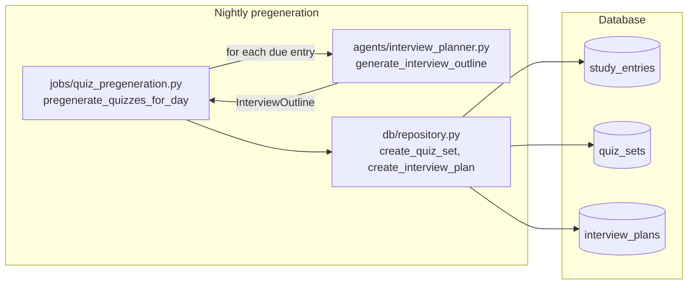

# SRA-802 — Interview planner agent and pregeneration

**Type:** Task
**Phase:** 8 — Interactive AI interview mode
**Priority:** High — without a stored outline, the SRA-803 conversation graph has nothing to expand on each turn
**Status:** Planned
**Blocked by:** SRA-801 (schema for `interview_plans`)
**Blocks:** SRA-804, SRA-805, SRA-809

## Summary

Add `src/sra/agents/interview_planner.py` with a LangGraph that turns one `StudyEntry` into a structured `InterviewPlan` outline — an ordered list of `{subtopic, difficulty, focus_prompt}` items the SRA-803 conversation graph can expand one at a time. Extend `src/sra/jobs/quiz_pregeneration.py` so the nightly batch produces one `InterviewPlan` per new `QuizSet`, idempotent against reruns, using the user's `interview_question_count` preference as `target_questions`. Surface `interview_plans_created / skipped / errored` counts in the existing dev pregeneration summary.

This ticket is the only place the planner LLM is called at scale; the per-turn expansion happens inside the SRA-803 conversation graph.

## Where things stand right now

- [`src/sra/agents/quiz_graph.py`](../src/sra/agents/quiz_graph.py) is the SRA-402 MCQ generator. It uses `_get_chat_model()` and a Pydantic `MCQDrafts` structured-output container. SRA-802 follows the same pattern with `InterviewOutline`.
- [`src/sra/jobs/quiz_pregeneration.py`](../src/sra/jobs/quiz_pregeneration.py) walks every user with reviews due today, reads `users.quiz_question_count` / `users.quiz_option_count` via `_resolve_user_quiz_preferences`, and persists a `QuizSet` + `QuizQuestion` rows through `repository.create_quiz_set`. The function is idempotent against `(entry_id, generated_on)`.
- [`src/sra/api/routers/dev.py`](../src/sra/api/routers/dev.py) exposes `POST /api/v1/me/dev/pregenerate-now` (only when `DEV_MODE=true`) returning a `PregenerationSummary` with `users`, `entries_seen`, `sets_created`, `sets_skipped`, `errors`. SRA-802 extends that summary with three interview counts; it does not add a new route.
- [`src/sra/agents/tracing.py`](../src/sra/agents/tracing.py) exports `trace_agent()` for optional LangSmith uploads. SRA-802 calls into it the same way `quiz_graph.py` does.

## What this ticket unlocks

With SRA-802 in place, the same nightly batch that creates today's MCQ `QuizSet` also creates today's `InterviewPlan`. A second invocation the same day hits the `(quiz_set_id)` unique constraint and skips without an LLM call. The conversation graph (SRA-803) can then reload the outline from the DB on every turn.

Before SRA-802: even if the SRA-803 graph and SRA-805 routes exist, they have no outline to expand — the only way to get one is for the user to wait for SRA-803's lazy-create path, which is a slow LLM call on the first interview start. After SRA-802: a real outline is already on disk for every `QuizSet` the batch produced.

## How this fits into the whole app

The planner is one LLM call per `(entry, day)` — the same cardinality as the existing MCQ pregeneration. The outline is small (default six items, max twelve from the preference validator), so the structured-output payload is bounded. The conversation graph never calls the planner; it only reads `interview_plans.outline` and writes `interview_turns` rows. The two are deliberately decoupled so a planner LLM failure does not block a running interview.



The planner is the only LLM call the nightly job makes beyond MCQ generation. The conversation graph in SRA-803 turns those outline items into individual questions.

### Why pre-generate the outline if SRA-803 can produce questions live?

The plan's hybrid design (see [`.kilo/plans/1792083276827-interactive-interview-mode.md`](../.kilo/plans/1792083276827-interactive-interview-mode.md)) keeps the LLM cost bounded: one planner call per `(entry, day)` plus one small grading call per user turn. A purely live approach would re-call the planner on every turn to decide the next topic — more flexible, but more expensive and harder to make resumable after a disconnect. Storing the outline also lets the dashboard show "questions 1 of 6" and the summary count "remaining outline items" without re-querying the LLM.

### Why is the planner allowed to fail silently?

`quiz_graph.py` already returns an empty draft list on LLM failure and lets the conditional edge route the graph to `END` without persisting. The pregeneration job walks every entry; one planner failure must not stop the batch. The same invariant applies here: an LLM failure or an empty outline means the job records `interview_plans_errored += 1` for that entry and moves on. The SRA-805 router can still lazily call the planner on interview start if the pregeneration pass missed an entry.

## Files and why they matter

| File | Role and required change |
|---|---|
| [`src/sra/agents/interview_planner.py`](../src/sra/agents/interview_planner.py) **[NEW]** | The planner module: `InterviewOutlineItem` Pydantic (subtopic, difficulty, focus_prompt), `InterviewOutline` container of N items, system prompt that pins the rubric (open-ended, entry-grounded, no invented facts, difficulty escalates within the outline, each item fits in one question's worth of attention), `_get_chat_model()` mirroring `quiz_graph._get_chat_model`, `generate_interview_outline(entry, target_questions, *, llm=None) -> InterviewOutline`, and the optional LangGraph (`build_interview_planner_graph`) that returns an `InterviewOutline` or an empty container on LLM failure. |
| [`src/sra/db/repository.py`](../src/sra/db/repository.py) | New helper `create_interview_plan(*, quiz_set, outline, target_questions, session) -> InterviewPlan`. Enforces the unique `(quiz_set_id)` constraint by catching `IntegrityError` and returning the existing row (idempotent pregeneration). |
| [`src/sra/jobs/quiz_pregeneration.py`](../src/sra/jobs/quiz_pregeneration.py) | Extend `pregenerate_quizzes_for_user` so that after a successful `create_quiz_set` it also builds the interview outline and calls `create_interview_plan`. The function adds three counters (`interview_plans_created`, `interview_plans_skipped`, `interview_plans_errored`) to `PregenerationSummary`. The dev affordance summary returns them to the caller. |
| [`src/sra/api/routers/dev.py`](../src/sra/api/routers/dev.py) | Read-only change: the `dev_pregenerate_now` handler now returns the three new interview counts alongside the existing MCQ counts. No new endpoint. |
| [`src/sra/agents/tracing.py`](../src/sra/agents/tracing.py) | Existing collaborator. `trace_agent()` is invoked from the planner graph the same way `quiz_graph` does it. |
| [`tests/unit/test_interview_planner.py`](../tests/unit/test_interview_planner.py) **[NEW]** | Unit tests for `generate_interview_outline` with a stubbed LLM that returns a scripted `InterviewOutline`: outline length matches `target_questions`, each item has all three fields, empty outline on LLM failure, empty outline when the LLM returns a non-list, and the `_get_chat_model()` seam can be monkey-patched (mirrors `tests/unit/test_quiz_graph.py`). |
| [`tests/unit/test_quiz_pregeneration.py`](../tests/unit/test_quiz_pregeneration.py) | Extend with focused tests: a pregen run creates both a `QuizSet` and an `InterviewPlan` per new `(entry, today)` pair, a second run the same day does not duplicate the `InterviewPlan`, and a planner LLM failure increments `interview_plans_errored` without stopping the batch. |
| [`tests/integration/test_phase8_end_to_end.py`](../tests/integration/) **[NEW]** | End-to-end test that calls `pregenerate_quizzes_for_day` against a real DB seeded with a Phase 5/6 user, asserts the `PregenerationSummary` includes the three new counts, and reads the `InterviewPlan` row back to confirm the outline JSON shape. |

## TDD starting point

`tests/unit/test_quiz_graph.py` and `tests/unit/test_quiz_pregeneration.py` are the closest analogues. The planner uses the same `_get_chat_model()` seam and the same structured-output pattern; the pregeneration extension uses the same "create one row per new entity" pattern as the existing MCQ job. Both are reused directly — no new test fixture needs to be invented. The `tests/integration/test_phase8_end_to_end.py` file shares the same `seeded_user` and `client` fixtures as the Phase 4/5/6 integration tests.

## What to implement

1. **`InterviewOutlineItem` Pydantic** with `subtopic: str` (1–80 chars), `difficulty: Literal["easy","medium","hard"]`, `focus_prompt: str` (1–240 chars). Strip whitespace; reject empty after stripping.
2. **`InterviewOutline`** Pydantic container with `items: list[InterviewOutlineItem]`. Reject when `len(items) != target_questions`; the planner's validate helper resizes the list to `target_questions` by trimming from the end or padding with a fallback `"general recap"` item so the contract holds even when the LLM produces the wrong count.
3. **`_get_chat_model()`** returning the same `ChatOpenAI` configuration as `quiz_graph._get_chat_model` (model from settings, `max_completion_tokens=1024`, `timeout=20`, `max_retries=1`).
4. **`generate_interview_outline(entry, target_questions, *, llm=None) -> InterviewOutline`** — bind the model with `with_structured_output(InterviewOutline, method="function_calling")`, send a system prompt that pins the rubric, send the entry as a human message (topic, subtopic, tags, summary, raw_transcript truncated to 1 500 chars to keep the prompt small), parse the result, and validate it. On any LLM or validation failure, return `InterviewOutline(items=[])` and log the failure as a `QuizGenerationError` so the pregeneration job's error counter advances.
5. **`build_interview_planner_graph()`** — optional LangGraph that wires `_call_planner -> _validate -> END`. `generate_interview_outline` calls the compiled graph when no `llm` override is supplied, matching the `quiz_graph` shape; the test suite can drive the function directly without a LangGraph invoke.
6. **`create_interview_plan(*, quiz_set, outline, target_questions, session) -> InterviewPlan`** in `repository.py`. If `len(outline.items) == 0`, return `None` (the job counts that as `errored`). Otherwise `INSERT` the row; on `IntegrityError` (unique constraint), re-read the existing row and return it. Commit at the end.
7. **`pregenerate_quizzes_for_user` extension** — after a successful `create_quiz_set` for an entry, look up the user's `interview_question_count` (fall back to 6 if not set), call `generate_interview_outline`, and call `create_interview_plan` only when the outline is non-empty. Track the three counters in `PregenerationSummary`.
8. **`dev_pregenerate_now` summary** — return the three new counts next to the existing MCQ counts. No new field shapes elsewhere.
9. **Update [`PROGRESS.md`](../PROGRESS.md)** with the new module name and the planner LLM call count once the integration test passes.

## Where to look

- [`src/sra/agents/quiz_graph.py`](../src/sra/agents/quiz_graph.py) for the `_get_chat_model()` and `with_structured_output` pattern.
- [`src/sra/jobs/quiz_pregeneration.py`](../src/sra/jobs/quiz_pregeneration.py) for the existing pregeneration shape, `_resolve_user_quiz_preferences`, and `PregenerationSummary`.
- [`src/sra/db/repository.py::create_quiz_set`](../src/sra/db/repository.py) for the per-feature `create_*` helper pattern; the new `create_interview_plan` mirrors it.
- [`src/sra/agents/tracing.py`](../src/sra/agents/tracing.py) for the `trace_agent()` usage that pins LangSmith tracing.
- Plan [`.kilo/plans/1792083276827-interactive-interview-mode.md`](../.kilo/plans/1792083276827-interactive-interview-mode.md) for the hybrid design rationale.

## Acceptance criteria

- [ ] `generate_interview_outline` returns a validated `InterviewOutline` of the configured length for the happy path
- [ ] An LLM failure or non-list response yields an empty `InterviewOutline` and a logged `QuizGenerationError`; the pregen job continues to the next entry
- [ ] The planner LLM seam (`_get_chat_model`) can be monkey-patched in unit tests; no live OpenAI call happens during `pytest`
- [ ] `pregenerate_quizzes_for_user` creates one `InterviewPlan` per new `QuizSet`; a second run the same day does not create a duplicate and increments `interview_plans_skipped`
- [ ] `dev_pregenerate_now` returns the three new counters in the `PregenerationSummary` JSON
- [ ] The new `users.interview_question_count` preference is read at generation time and snapshotted into `interview_plans.target_questions`
- [ ] The `interview_plans.outline` JSON column round-trips the `{subtopic, difficulty, focus_prompt}` shape
- [ ] No production credentials, no live OpenAI calls, and no Phase 1–7 regression tests are broken by this ticket

## How to test this ticket alone

```bash
source .venv/bin/activate
pytest tests/unit/test_interview_planner.py -v
pytest tests/unit/test_quiz_pregeneration.py -v
pytest tests/integration/test_phase8_end_to_end.py -v
pytest -m 'not phase8' -q
ruff check .
pyright
```

Expected: every focused + integration test passes; `-m 'not phase8' -q` keeps Phase 1–7 green; Ruff and Pyright are clean.

## Manual verification

With `DEV_MODE=true` and a real OpenAI key, log in as a user with a study entry that already has today's `QuizSet` row but no `InterviewPlan`. Call:

```bash
curl -X POST -b 'sra_session=…' \
  'http://127.0.0.1:8000/api/v1/me/dev/pregenerate-now?include_upcoming=true'
# {"summary": {"users": 1, "entries_seen": 1, "sets_created": 1, "sets_skipped": 0,
#  "errors": 0, "interview_plans_created": 1, "interview_plans_skipped": 0,
#  "interview_plans_errored": 0}, "today": "...", "include_upcoming": true, ...}
```

Inspect the `interview_plans` row in the database; confirm the `outline` JSON has exactly `interview_question_count` items, each with all three fields populated. Call the endpoint again; confirm `interview_plans_created` stays the same and `interview_plans_skipped` increments.

## Verification record

- Date, environment, and OpenAI model used: _to be filled in once the rehearsal passes._
- `pytest tests/unit/test_interview_planner.py -v` results: _to be filled in._
- `pytest tests/integration/test_phase8_end_to_end.py -v` results: _to be filled in._
- `pytest -m 'not phase8' -q` regression check: _to be filled in._
- Hand-driven pregen run: created/skipped/errored counts, outline JSON length, and observed retry behavior: _to be filled in._
- Ruff + Pyright: _to be filled in._

## Definition of Done

- [ ] All acceptance criteria met and actual evidence recorded
- [ ] Focused, integration, regression, lint, and type checks pass
- [ ] Ticket board and progress documentation reflect the actual state
