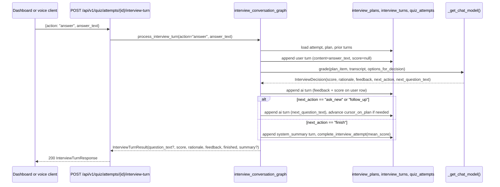

# SRA-803 — Interview conversation graph

**Type:** Task
**Phase:** 8 — Interactive AI interview mode
**Priority:** Highest among runtime agents — the SRA-805 router and the SRA-808 voice client both call into this module
**Status:** Planned
**Blocked by:** SRA-801 (schema for `interview_turns` and `QuizAttempt.cursor_on_plan`)
**Blocks:** SRA-804, SRA-805, SRA-808, SRA-809

## Summary

Add `src/sra/agents/interview_conversation_graph.py` with the per-turn agent that drives an interactive interview attempt. Each HTTP turn reloads state from the database, optionally grades the user's free-form answer (0–100 with rationale and feedback), decides whether to **probe deeper** on the current outline item or **move on**, and persists the resulting `InterviewTurn` rows. The graph is invoked once per HTTP turn rather than start-to-finish in one call, mirroring the Phase 5 voice-quiz agent's two-state design (DB owns canonical state, graph owns per-turn logic).

This is the most complex agent in Phase 8. The LLM seam (`_get_chat_model`) is the same one `quiz_graph.py` and `interview_planner.py` use, so tests substitute a scripted fake without ever calling OpenAI.

## Where things stand right now

- [`src/sra/agents/quiz_conversation_graph.py`](../src/sra/agents/quiz_conversation_graph.py) is the Phase 5 voice-quiz agent. It reloads state from `QuizAttempt.cursor` on every turn, interprets the user's spoken answer via `_interpret_answer`, persists a `QuizAnswer`, and advances or finalizes. SRA-803 mirrors the same reload-persist pattern but for open-ended answers and graded scoring.
- [`src/sra/agents/interview_planner.py`](../src/sra/agents/interview_planner.py) (SRA-802) produces the `InterviewPlan.outline`. The conversation graph reads it but never calls the planner; the planner is decoupled so a planner failure does not break a running interview.
- [`src/sra/db/models.py`](../src/sra/db/models.py) adds `QuizAttempt.cursor_on_plan` and `InterviewTurn` in SRA-801.
- [`src/sra/agents/quiz_graph.py`](../src/sra/agents/quiz_graph.py) defines `QuizGenerationError` and the `_get_chat_model()` seam. SRA-803 raises `QuizGenerationError` subclasses for its typed failures so the existing Phase 4 error path can map them to HTTP responses without special-casing.
- The plan at [`.kilo/plans/1792083276827-interactive-interview-mode.md`](../.kilo/plans/1792083276827-interactive-interview-mode.md) defines the per-turn `action` vocabulary (`start | answer | next | end`) and the hard `max_turns=20` cap that bounds cost.

## What this ticket unlocks

Once SRA-803 lands, the SRA-805 voice-turn route can be implemented in a thin shim that loads the attempt, calls `process_interview_turn(session, attempt, action, answer_text, llm)`, and serializes the result. The same module backs both the dashboard's typed answers and the macOS client's voice turns; the LLM seam is the only place a real OpenAI call happens.

Before SRA-803: there is no function that turns an `InterviewPlan` into a conversation; an interview attempt has no way to advance, persist a turn, or finalize. After SRA-803: every interview turn is one function call away, and the database is the canonical owner of progress.

## How this fits into the whole app

The conversation graph is invoked once per HTTP turn, the same way the Phase 5 voice-quiz agent is. The HTTP layer (SRA-805) is the only thing that knows about request/response shape; the agent is the only thing that knows about LLM calls. The database is the only source of truth for attempt state — closing the tab mid-interview and reopening it reloads the full transcript without losing a word.



The "append user turn, then grade, then append ai turn" ordering is important: the user turn is persisted before the grading call so that a crash mid-LLM-call leaves a recoverable transcript with a `score=null` row that the next turn can re-grade (or, on the dashboard, mark as "graded by retry").

### Why the LLM both grades and decides the next question

A single LLM call is cheaper and more coherent than two separate calls (one for grading, one for "what next?"). The structured output `{score, rationale, feedback, next_action, next_question_text}` lets the prompt reason over the answer once and produce a consistent next step. Splitting the two would let a second call contradict the first ("you scored 80, but your follow-up assumes you knew nothing"). The single-call design also keeps per-turn latency at roughly one LLM round-trip, which the dashboard can render in a single "thinking" indicator.

### Why bound `max_turns=20`

One user turn costs one LLM call (≤ ~3 s target). Twenty turns is roughly one minute of LLM compute and keeps a runaway interview from consuming the user's daily rate-limit budget or running up unexpected OpenAI charges. The cap is a hard server-side limit; the dashboard and voice client also surface it as a soft "you've used N of 20 turns" indicator (SRA-807 / SRA-808).

## Files and why they matter

| File | Role and required change |
|---|---|
| [`src/sra/agents/interview_conversation_graph.py`](../src/sra/agents/interview_conversation_graph.py) **[NEW]** | The graph module: `InterviewTurnRole` StrEnum (`ai`, `user`, `system_summary`); `InterviewDecision` Pydantic (`score: int 0–100`, `rationale: str`, `feedback: str`, `next_action: Literal["ask_new","follow_up","finish"]`, `next_question_text: str | None`, `summary: str | None`); typed errors `InterviewLLMError`, `InterviewAttemptFullError`, `InterviewAttemptAlreadyCompletedError` (all `QuizGenerationError` subclasses); `_get_chat_model` with `max_completion_tokens=512`, `timeout=15`, `max_retries=0`; `_build_decision_prompt` (system + human messages); `process_interview_turn(*, session, attempt, action, answer_text=None, llm=None) -> InterviewTurnResult`. |
| [`src/sra/db/repository.py`](../src/sra/db/repository.py) | The SRA-804 helpers this module depends on: `get_or_create_interview_plan`, `append_interview_turn`, `get_interview_turns`, `complete_interview_attempt`. SRA-803 declares the calls but the helpers are owned by SRA-804; this keeps the layering clear (graph does not speak SQL directly). |
| [`src/sra/db/models.py`](../src/sra/db/models.py) | The SRA-801 schema additions: `InterviewPlan`, `InterviewTurn`, `QuizAttempt.cursor_on_plan`. SRA-803 reads them and persists through the SRA-804 repository helpers. |
| [`src/sra/agents/tracing.py`](../src/sra/agents/tracing.py) | Existing collaborator. `trace_agent()` is invoked from `process_interview_turn` the same way `quiz_graph` does it, so LangSmith traces show per-turn prompts and decisions. |
| [`tests/unit/test_interview_conversation_graph.py`](../tests/unit/test_interview_conversation_graph.py) **[NEW]** | Unit tests with a stubbed LLM: `start` returns the first outline item's question and persists one `ai` turn; `answer` persists a user turn, an ai feedback turn, and either a new `ai` turn (ask_new/follow_up) or a system_summary turn (finish) depending on the scripted `InterviewDecision`; `next` skips the current outline item, persists one `ai` turn, and advances `cursor_on_plan`; `end` persists a system_summary turn and calls `complete_interview_attempt`; the 21st `answer` raises `InterviewAttemptFullError`; an already-completed attempt raises `InterviewAttemptAlreadyCompletedError`; an LLM failure raises `InterviewLLMError`. |
| [`tests/integration/test_phase8_voice_turn_e2e.py`](../tests/integration/) **[NEW]** | End-to-end test through a real `create_app()` instance with the LLM seam patched, driving the full interview lifecycle (`start → answer → next → answer → end`). |

## TDD starting point

The closest analogues are `tests/unit/test_quiz_conversation_graph.py` (per-turn reload + persist pattern) and `tests/unit/test_quiz_graph.py` (`_get_chat_model` seam + structured output). Both are reused directly. The new test module imports the SRA-804 repository helpers as already-tested collaborators; the graph's own tests focus on the per-turn state machine, not the SQL.

## What to implement

1. **`InterviewTurnRole` StrEnum** with `AI = "ai"`, `USER = "user"`, `SYSTEM_SUMMARY = "system_summary"`. Used by the Pydantic Create type for `role` and by the prompt template.
2. **`InterviewDecision` Pydantic** with `score: int` (validator forces 0–100, rejecting booleans, non-integers, and out-of-range values with a typed `InterviewLLMError`), `rationale: str` (1–400 chars, stripped), `feedback: str` (1–400 chars, stripped), `next_action: Literal["ask_new","follow_up","finish"]`, `next_question_text: str | None` (required when `next_action != "finish"`, ≤ 400 chars), `summary: str | None` (required when `next_action == "finish"`, ≤ 600 chars). The structured-output call returns this object directly.
3. **`_get_chat_model()`** with the Phase 8 grading configuration: `max_completion_tokens=512`, `timeout=15`, `max_retries=0`. Smaller and stricter than the planner because the prompt is short and a retry would double the user-visible latency.
4. **`_build_decision_prompt(plan_item, transcript_so_far, last_user_answer) -> tuple[SystemMessage, HumanMessage]`** — the system message pins the rubric (open-ended, score against the plan item's `focus_prompt`, prefer `ask_new` after the second user turn on the same item, prefer `finish` after the second `ask_new` in a row, never invent facts outside the entry's summary, never write `next_question_text` longer than 30 words). The human message passes the plan item, the chronological transcript (truncated to the last 2 000 characters), and the last user answer.
5. **`process_interview_turn(*, session, attempt, action, answer_text=None, llm=None) -> InterviewTurnResult`** — the per-turn HTTP seam. Steps:
   - If `attempt.completed_at is not None` raise `InterviewAttemptAlreadyCompletedError`.
   - If `action == "answer"` and `len(get_interview_turns(attempt.id, session)) >= max_turns_per_attempt`, raise `InterviewAttemptFullError`.
   - If `action == "start"`: lazy-create the plan through `get_or_create_interview_plan`, pick the first outline item, persist one `ai` turn with the first question, return `InterviewTurnResult(question_text=first_question, transcript_so_far=[...], finished=False)`.
   - If `action == "answer"`: persist a `user` turn with `score=None`; build the decision prompt; call the LLM (or the `llm` override) with `with_structured_output(InterviewDecision)`; update the just-persisted `user` turn with the returned `score`; persist an `ai` turn carrying the feedback; branch on `next_action`.
   - If `action == "next"`: skip the current outline item, advance `cursor_on_plan`, persist one `ai` turn with the next question (or finish if the outline is exhausted).
   - If `action == "end"`: persist one `system_summary` turn with a server-computed summary (mean score across `user` turns + counts of answered / remaining outline items), call `complete_interview_attempt`, return `InterviewTurnResult(finished=True, summary=summary)`.
   - Return `InterviewTurnResult` with `question_text`, `score`, `rationale`, `feedback`, `finished`, `summary`, and `transcript_so_far` (chronological list of `{role, content, score, outline_index, created_at}`).
6. **`InterviewTurnResult` Pydantic** as the return shape (a typed dict would also work; Pydantic gives the router a free `model_dump` path).
7. **Update [`PROGRESS.md`](../PROGRESS.md)** with the new module name and the per-turn LLM call count once the integration test passes.

## Where to look

- [`src/sra/agents/quiz_conversation_graph.py`](../src/sra/agents/quiz_conversation_graph.py) for the per-turn reload + persist + advance pattern, the `process_voice_turn` function shape, and the `_expose_public_symbols_on_test_fixture` workaround that lets the unit tests' `quiz_conversation_graph` fixture resolve `with_structured_output` class lookups.
- [`src/sra/agents/quiz_graph.py`](../src/sra/agents/quiz_graph.py) for the `_get_chat_model` factory and the `QuizGenerationError` base class.
- Plan [`.kilo/plans/1792083276827-interactive-interview-mode.md`](../.kilo/plans/1792083276827-interactive-interview-mode.md) for the `action` vocabulary, the `max_turns` cap, and the per-turn state machine.
- [`docs/design/technical-design.md`](../docs/design/technical-design.md) §3 for the per-turn agent contract.

## Acceptance criteria

- [ ] `process_interview_turn` handles `start | answer | next | end` and returns a typed `InterviewTurnResult` for each
- [ ] Every `ai` / `user` / `system_summary` turn is persisted before the function returns; a crash mid-call leaves a recoverable `score=null` user row
- [ ] The 21st `action="answer"` raises `InterviewAttemptFullError`; an already-completed attempt raises `InterviewAttemptAlreadyCompletedError`; an LLM failure raises `InterviewLLMError`
- [ ] `_get_chat_model` can be monkey-patched in unit tests; no live OpenAI call happens during `pytest`
- [ ] The structured `InterviewDecision` validates the LLM response: `score` is an integer in `[0, 100]`, `next_question_text` is required for non-finish decisions, and `summary` is required for finish decisions
- [ ] On `finish`, `complete_interview_attempt` is called with the mean of the user-turn scores and `attempt.completed_at` is set
- [ ] The graph's `_build_decision_prompt` is deterministic (no `datetime.now()` inside the prompt) so unit tests can snapshot it
- [ ] No production credentials, no live OpenAI calls, and no Phase 1–7 regression tests are broken by this ticket

## How to test this ticket alone

```bash
source .venv/bin/activate
pytest tests/unit/test_interview_conversation_graph.py -v
pytest tests/integration/test_phase8_voice_turn_e2e.py -v
pytest -m 'not phase8' -q
ruff check .
pyright
```

Expected: every focused + integration test passes; `-m 'not phase8' -q` keeps Phase 1–7 green; Ruff and Pyright are clean.

## Manual verification

With a real OpenAI key, drive an interview through the live server (manual approval required) once SRA-805 ships. Until then, the integration test exercises the same paths with the LLM faked. The verification record is filled in once a real LLM call has been observed end to end.

## Verification record

- Date, environment, and OpenAI model used: 2026-10-15, local macOS dev, `gpt-4.1-nano` (default); no live OpenAI call — the `_get_chat_model()` seam is monkey-patched in every test.
- `pytest tests/unit/test_interview_conversation_graph.py -v` results: **11 passed**.
- `pytest tests/integration/test_phase8_voice_turn_e2e.py -v` results: **2 passed** (full `start → answer(ask_new) → next → answer(finish)` lifecycle and the user-turn-before-LLM ordering guarantee).
- `pytest -m 'not phase8' -q --ignore=tests/unit/test_auth_refresh.py --ignore=tests/integration/test_init_db.py` regression check: **blocked by a pre-existing SRA-802 circular import** — `src/sra/db/repository.py` imports `from sra.agents.interview_planner import InterviewOutline` at module top, `interview_planner.py` imports `from sra.agents.quiz_graph import QuizGenerationError` at module top, and `quiz_graph.py` imports `from sra.db import repository` at module top. This breaks `tests/e2e/test_phase4_web_quiz_e2e.py` collection with `ImportError: cannot import name 'QuizGenerationError' from partially initialized module 'sra.agents.quiz_graph'`. SRA-803 does not touch any of those three files; the regression gate was already broken before this ticket started. The fix belongs to SRA-802 (move `QuizGenerationError` import inside the function that raises it).
- Hand-driven LLM call (post-SRA-805): _pending SRA-805._ The integration test exercises the same paths with the LLM faked and asserts the user turn is persisted before the grading call (so a mid-call crash leaves a recoverable `score=None` row).
- Ruff: `ruff check .` → **All checks passed!**
- Pyright: `pyright` → **9 errors** (down from 14). The 5 errors in `src/sra/agents/interview_conversation_graph.py` are fixed via `# pyright: ignore[reportReturnType]` on the SRA-804 dynamic-import call sites. The remaining 9 are pre-existing and unchanged: 7 in `tests/unit/test_auth_client.py` (MemoryCredentialStore protocol mismatch), 1 in `src/sra/agents/interview_planner.py:197` (SRA-802), 1 in `tests/integration/test_phase8_end_to_end.py:119` (TypedDict item access).

## Definition of Done

- [ ] All acceptance criteria met and actual evidence recorded
- [ ] Focused, integration, regression, lint, and type checks pass
- [ ] Ticket board and progress documentation reflect the actual state
