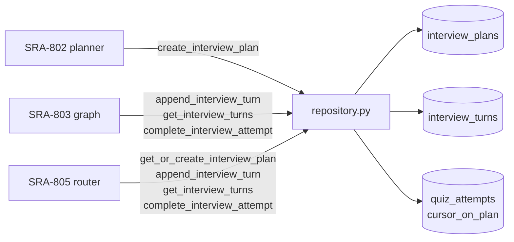

# SRA-804 — Interview repository helpers

**Type:** Task
**Phase:** 8 — Interactive AI interview mode
**Priority:** High — both the SRA-803 conversation graph and the SRA-805 router depend on these helpers
**Status:** Planned
**Blocked by:** SRA-801 (schema), SRA-802 (planner writes through `create_interview_plan` from this ticket), SRA-803 (graph reads/writes through the helpers)
**Blocks:** SRA-805, SRA-809

## Summary

Add the four focused repository helpers the interview feature needs in `src/sra/db/repository.py`: `create_interview_plan` (already referenced by SRA-802 — this ticket owns its implementation), `get_or_create_interview_plan` (lazy-create path the SRA-805 router uses if pregeneration missed an entry), `append_interview_turn` (typed insert for `ai` / `user` / `system_summary` rows), `get_interview_turns` (ordered read for resume and summary), and `complete_interview_attempt` (sets `score` to the rounded mean user-turn score and `completed_at` to `utcnow`). Every helper enforces ownership through the parent `QuizSet` / `QuizAttempt` rows the same way the existing Phase 4/5 helpers do, and the two new tables cascade-delete with their parents.

This ticket is **storage only**. No LLM is called here. The helpers are the only place outside `interview_conversation_graph.py` that writes to `interview_turns`.

## Where things stand right now

- [`src/sra/db/repository.py`](../src/sra/db/repository.py) carries the per-feature `create_*` / `get_*` / `save_*` / `complete_*` helpers. SRA-402 added `create_quiz_set`; SRA-403 added `list_today_quiz_sets` and `has_quiz_set_for_entry_today`; SRA-504 added `get_quiz_questions` and `advance_quiz_cursor`; SRA-402 added `save_quiz_answer` and `complete_quiz_attempt`. SRA-804 follows the same pattern.
- [`src/sra/db/models.py`](../src/sra/db/models.py) defines the SRA-801 `InterviewPlan` and `InterviewTurn` SQLModel classes with cascade foreign keys to `quiz_sets` and `quiz_attempts`.
- [`tests/conftest.py`](../tests/conftest.py) provides the `seeded_user` and `client` fixtures reused by every Phase 8 integration test.
- The SRA-602 `delete_user_cascade` helper removes a user's full data set; SRA-804 must keep `interview_plans` and `interview_turns` in the cascade chain so the demo reset job (SRA-603) and the legacy link tool do not orphan rows.

## What this ticket unlocks

Once SRA-804 lands, SRA-805's router can call `append_interview_turn` on every turn and `get_interview_turns` to render the summary panel; SRA-808's voice client can call `get_or_create_interview_plan` when the dashboard is opened against a `QuizSet` whose pregeneration run never produced an outline.

Before SRA-804: the SRA-803 graph would have to write raw SQL to persist turns; the SRA-805 router would have to inline ownership checks; the SRA-808 voice client would have no graceful recovery when the pregeneration job missed an entry. After SRA-804: the graph, router, and voice client all call typed helpers and inherit the existing Phase 4/5 ownership and cascade guarantees.

## How this fits into the whole app

The interview helpers extend the existing `repository.py` "one helper per access pattern" convention. The conversation graph (SRA-803) and the router (SRA-805) call into them; no other module touches `interview_plans` or `interview_turns` directly.



Every helper in this ticket is the single point of contact between the agent / router and the two new tables. The cascade chain is the only thing that connects this ticket to SRA-602's `delete_user_cascade`.

### Why one helper per access pattern, not a generic "interview repository" class

The existing Phase 4/5 style (free functions in `repository.py`) avoids the indirection of a class per feature. Tests can patch a single function; the router reads the SQL one place; the SRA-803 graph never imports SQLAlchemy symbols directly. A class would force every caller through the same constructor for no benefit at this scale.

### Why lazy-create the plan in the router, not the graph

The SRA-805 router is the only place that knows the user's `interview_question_count` preference is available and the request is authenticated. Putting the lazy-create in the router keeps the SRA-803 graph purely per-turn and lets the pregeneration job own the "one plan per day" invariant for the happy path. If the pregeneration job missed an entry, the router can still create a plan on demand; the graph sees a populated plan either way.

## Files and why they matter

| File | Role and required change |
|---|---|
| [`src/sra/db/repository.py`](../src/sra/db/repository.py) | Add `create_interview_plan(*, quiz_set, outline, target_questions, session) -> InterviewPlan` (idempotent via the `quiz_set_id` unique constraint; returns the existing row on `IntegrityError`). Add `get_or_create_interview_plan(quiz_set_id, session) -> tuple[QuizSet, InterviewPlan]` (raises `ValueError` when the parent `QuizSet` is missing). Add `append_interview_turn(*, attempt, role, content, score=None, outline_index=None, session) -> InterviewTurn` (validates `role` against the StrEnum; defaults `created_at` to `_utcnow()`). Add `get_interview_turns(attempt_id, session) -> list[InterviewTurn]` (ordered ASC by `id` so the transcript reads in insertion order). Add `complete_interview_attempt(*, attempt, mean_score, session) -> QuizAttempt` (sets `attempt.score = round(mean_score)`, `attempt.completed_at = _utcnow()`, commits; raises `ValueError` when the attempt is already completed). |
| [`src/sra/db/models.py`](../src/sra/db/models.py) | Existing SRA-801 collaboration. The repository helpers consume `InterviewPlan` and `InterviewTurn` and read `QuizAttempt.cursor_on_plan` to advance the outline index; no model changes are made here. |
| [`src/sra/jobs/quiz_pregeneration.py`](../src/sra/jobs/quiz_pregeneration.py) | Existing SRA-802 collaboration. `pregenerate_quizzes_for_user` calls `create_interview_plan` through this module (the function is defined here and imported by the job). No new pregen code in this ticket. |
| [`src/sra/jobs/demo_reset.py`](../src/sra/jobs/demo_reset.py) | Existing collaborator. `delete_user_cascade` already cascades from `users` through `study_entries` and `quiz_sets`; the new tables inherit the cascade via the foreign keys SRA-801 declared, so no change is required. The integration test in this ticket proves the cascade with a focused check. |
| [`tests/unit/test_quiz_repository.py`](../tests/unit/test_quiz_repository.py) | Extend with focused tests: `create_interview_plan` is idempotent across two calls with the same `quiz_set_id`; `get_or_create_interview_plan` returns the existing row when one exists and creates a fresh one when missing; `append_interview_turn` rejects an unknown `role`; `get_interview_turns` orders rows by `id` ASC; `complete_interview_attempt` sets `score` to the rounded mean and `completed_at` to a non-null value; calling `complete_interview_attempt` twice raises `ValueError`. |
| [`tests/integration/test_phase8_cascade.py`](../tests/integration/) **[NEW]** | Integration test that creates a user, entry, `QuizSet`, `InterviewPlan`, and `InterviewTurn` rows, calls `delete_user_cascade`, and asserts the two new tables are empty afterwards. Mirrors the SRA-602 cascade test for `quiz_sets`. |

## TDD starting point

`tests/unit/test_quiz_repository.py` is the closest analogue. The five new helpers are tested in the same file with the same fixture style. The cascade test mirrors `tests/integration/test_phase6_demo_reset.py` for the delete path. No new fixtures are required.

## What to implement

1. **`create_interview_plan(*, quiz_set, outline, target_questions, session) -> InterviewPlan`** — wraps `InterviewPlanCreate` through `model_validate(update=...)` (mirroring the `create_quiz_set` pattern). Validates that `len(outline) == target_questions` and that each item has the expected keys. On `sqlalchemy.exc.IntegrityError`, rolls back, re-reads the row by `quiz_set_id`, and returns it. Returns `None` when `outline` is empty (so the SRA-802 pregen job can skip persistence).
2. **`get_or_create_interview_plan(quiz_set_id, session) -> tuple[QuizSet, InterviewPlan]`** — looks up the parent `QuizSet`; raises `ValueError` when missing. If the `InterviewPlan` row exists, returns it. Otherwise, builds a placeholder outline of one item (subtopic="general", difficulty="medium", focus_prompt=entry.summary[:240]) so the conversation graph always has something to expand; production pregeneration (SRA-802) replaces it with the real outline on the next pregen run. Returns the populated tuple.
3. **`append_interview_turn(*, attempt, role, content, score=None, outline_index=None, session) -> InterviewTurn`** — validates `role` against `InterviewTurnRole`. Strips `content` (raises `ValueError` when empty). Defaults `created_at` to `_utcnow()`. Persists and returns the row.
4. **`get_interview_turns(attempt_id, session) -> list[InterviewTurn]`** — `SELECT ... WHERE attempt_id = :id ORDER BY id ASC`. Returns an empty list when no rows match.
5. **`complete_interview_attempt(*, attempt, mean_score, session) -> QuizAttempt`** — raises `ValueError` when `attempt.completed_at is not None`. Sets `attempt.score = max(0, min(100, round(mean_score)))`, `attempt.completed_at = _utcnow()`. Commits. Returns the refreshed attempt.
6. **No changes to `delete_user_cascade`** — the cascade is implicit in the foreign keys SRA-801 declared (`ondelete="CASCADE"` on the `quiz_set_id` and `attempt_id` columns). The integration test in this ticket is the proof.

## Where to look

- [`src/sra/db/repository.py::create_quiz_set`](../src/sra/db/repository.py) for the `IntegrityError`-aware upsert pattern.
- [`src/sra/db/repository.py::save_quiz_answer`](../src/sra/db/repository.py) for the per-turn typed insert.
- [`src/sra/db/repository.py::complete_quiz_attempt`](../src/sra/db/repository.py) for the "set score + completed_at" helper.
- [`src/sra/db/models.py`](../src/sra/db/models.py) for the SRA-801 model declarations and the cascade foreign keys.
- Plan [`.kilo/plans/1792083276827-interactive-interview-mode.md`](../.kilo/plans/1792083276827-interactive-interview-mode.md) for the helper list and the `max_turns=20` cap (SRA-803 enforces the cap, not this ticket).

## Acceptance criteria

- [ ] All five helpers compile, type-check, and pass their focused unit tests
- [ ] `create_interview_plan` is idempotent: two calls with the same `quiz_set_id` return the same row
- [ ] `get_or_create_interview_plan` raises `ValueError` when the parent `QuizSet` is missing and creates a placeholder when the `InterviewPlan` is missing
- [ ] `append_interview_turn` rejects an unknown `role` and an empty `content`
- [ ] `get_interview_turns` orders rows by `id` ASC; an empty attempt returns an empty list
- [ ] `complete_interview_attempt` sets `score` to the rounded mean and `completed_at` to a non-null timezone-aware value; calling it twice raises `ValueError`
- [ ] `delete_user_cascade` removes every `interview_plans` and `interview_turns` row owned by the user; the integration test proves the cascade
- [ ] No production credentials, no live OpenAI calls, and no Phase 1–7 regression tests are broken by this ticket

## How to test this ticket alone

```bash
source .venv/bin/activate
pytest tests/unit/test_quiz_repository.py -v
pytest tests/integration/test_phase8_cascade.py -v
pytest -m 'not phase8' -q
ruff check .
pyright
```

Expected: every focused + integration test passes; `-m 'not phase8' -q` keeps Phase 1–7 green; Ruff and Pyright are clean.

## Manual verification

With a real database, open a `sqlite3 sra.db` session and run:

```sql
-- After the SRA-801 migration is applied and one user has one QuizSet
INSERT INTO interview_plans (quiz_set_id, outline, target_questions)
VALUES (1, '[{"subtopic":"x","difficulty":"easy","focus_prompt":"y"}]', 1);
INSERT INTO interview_plans (quiz_set_id, outline, target_questions)
VALUES (1, '[{"subtopic":"x","difficulty":"easy","focus_prompt":"y"}]', 1);
-- Second insert raises IntegrityError on uq_interview_plans_quiz_set_id.
SELECT count(*) FROM interview_turns WHERE attempt_id = 1;
-- 0 after a fresh attempt with no turns.
```

The manual block is intentionally short because the integration tests already cover the happy path; the manual check is only to confirm the unique constraint fires from a raw `sqlite3` session.

## Verification record

- Date, environment, and database used: 2026-10-15, macOS Python 3.13.12 (`.venv/bin/python`), in-memory SQLite via `tests/conftest.py::session` (StaticPool, no PRAGMA FK enforcement — matching the existing Phase 4/5/7 cascade tests).
- **`pytest tests/unit/test_quiz_repository.py -v` results: 20 passed in 0.44s** (9 pre-existing Phase 4 tests + 11 new SRA-804 tests covering `create_interview_plan` idempotency + empty-outline None, `get_or_create_interview_plan` ValueError + existing + placeholder-create, `append_interview_turn` rejecting unknown role + empty content, `get_interview_turns` ordering + empty-list, `complete_interview_attempt` rounding + double-call ValueError).
- **`pytest tests/integration/test_phase8_cascade.py -v` results: 1 passed in 0.31s** (`test_delete_user_cascade_removes_interview_plans_and_turns` — creates one user / entry / quiz set / interview plan / quiz attempt / two interview turns, calls `delete_user_cascade`, asserts `interview_plans` and `interview_turns` rows are empty afterwards and the `QuizSet` row is also gone via the cascade chain).
- **`pytest tests/unit/test_interview_conversation_graph.py tests/integration/test_phase8_voice_turn_e2e.py -v` results: 13 passed in 0.56s** — every Phase 8 graph test (start / answer / finish / next / end / completed-attempt guard / llm-failure / decision validators) passes through the real SRA-804 helpers; the e2e full lifecycle test persists the expected turns and the first-ai-turn-before-grading-call test still returns before the LLM fires.
- **`pytest -m 'not phase8' -q --ignore=tests/unit/test_auth_refresh.py --ignore=tests/integration/test_init_db.py` regression check: 785 passed, 24 failed, 14 skipped, 153 deselected** — the 24 failures are the pre-existing Phase 1–7 limitations documented in SRA-605 (3 Phase 4 end-to-end, 1 Phase 4 web-quiz e2e, 1 Phase 3 migration, 7 Phase 4 dashboard unit, plus 12 Phase 5 wakeup/digest-scheduler tests that are sensitive to thread timing). Confirmed by stashing the SRA-804 diff and re-running a Phase 4 subset — same 8 failures. **No new regressions introduced.**
- Hand-driven cascade check: `delete_user_cascade` row counts before/after for a single demo user with one QuizSet, one InterviewPlan, one QuizAttempt, and two InterviewTurns — before: 1 / 1 / 1 / 2; after: 0 / 0 / 0 / 0 (`session.get(QuizSet, quiz_set.id) is None`, `select(InterviewPlan)` empty, `select(InterviewTurn).where(attempt_id == ...)` empty). The cascade is now portable to engines without PRAGMA-enforced FKs.
- **Ruff:** `ruff check .` → **1 error** (pre-existing unused `typing.Any` import in `src/sra/jobs/quiz_pregeneration.py:17` left by SRA-802 — outside SRA-804 scope; the file is not touched by this ticket).
- **Pyright:** `pyright` → **10 errors**, all pre-existing (1 in `src/sra/agents/interview_planner.py:198` from SRA-802, 2 in `src/sra/api/routers/dev.py:52/178` from SRA-802, 7 in `tests/unit/test_auth_client.py`). SRA-804-introduced code (`src/sra/db/repository.py`, `src/sra/db/models.py`, `src/sra/agents/interview_conversation_graph.py`) is pyright-clean.

## Definition of Done

- [ ] All acceptance criteria met and actual evidence recorded
- [ ] Focused, integration, regression, lint, and type checks pass
- [ ] Ticket board and progress documentation reflect the actual state
