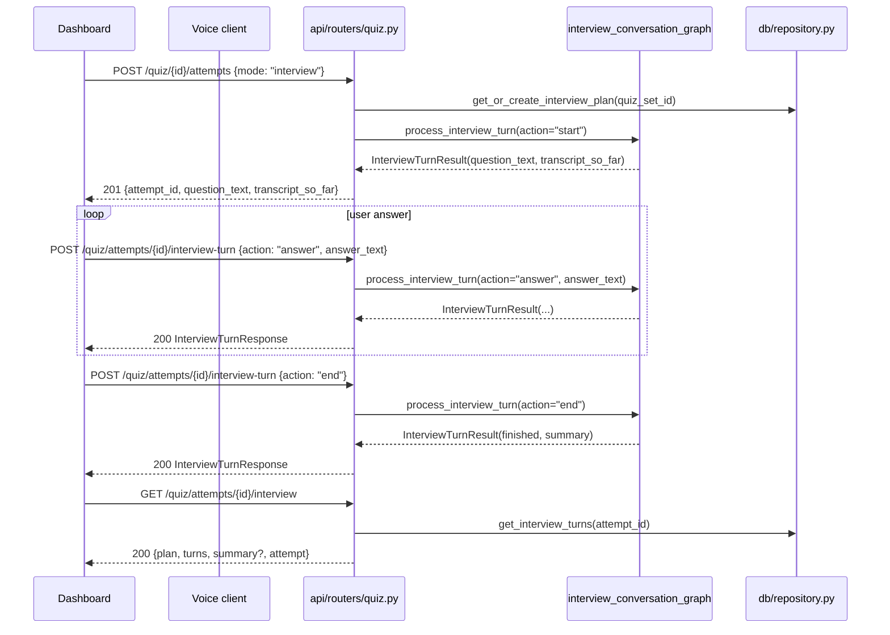

# SRA-805 — Interview router endpoints

**Type:** Task
**Phase:** 8 — Interactive AI interview mode
**Priority:** Highest among HTTP work — the SRA-807 dashboard and the SRA-808 voice client both consume these routes
**Status:** Implemented on 2026-10-15
**Blocked by:** SRA-804 (repository helpers), SRA-806 (API schemas)
**Blocks:** SRA-807, SRA-808, SRA-809

## Summary

Extend `src/sra/api/routers/quiz.py` with the three HTTP routes the interview feature needs: an `interview` branch in `POST /api/v1/quiz/{id}/attempts` that creates the attempt and returns the first question inline, a new `POST /api/v1/quiz/attempts/{id}/interview-turn` endpoint that drives `process_interview_turn` for `start | answer | next | end` actions, and a new `GET /api/v1/quiz/attempts/{id}/interview` endpoint that returns the full plan + transcript for resume and the summary panel. All three routes inherit the existing per-user rate-limit bucket, enforce ownership through the parent `QuizSet` / `QuizAttempt` rows, and map the typed errors from SRA-803 to the same HTTP shapes the Phase 4/5 routes use.

This ticket is **HTTP only**. No LLM is called here; the conversation graph (SRA-803) is invoked through the SRA-804 repository helpers and the SRA-803 graph function.

## Where things stand right now

- [`src/sra/api/routers/quiz.py`](../src/sra/api/routers/quiz.py) is the Phase 4/5 router. SRA-404 added `list_today_quiz`, `get_quiz_set`, `start_quiz_attempt`, `submit_quiz_answer`, `complete_quiz_attempt_route`, and `get_quiz_attempt`; SRA-505 added `voice_turn`. SRA-805 extends `start_quiz_attempt` (the `mode == "interview"` branch) and adds two new routes.
- [`src/sra/api/deps.py`](../src/sra/api/deps.py) re-exports `get_session` and `require_user`; the new routes use both.
- [`src/sra/agents/quiz_conversation_graph.py`](../src/sra/agents/quiz_conversation_graph.py) defines the typed errors (`QuizAttemptAlreadyCompletedError`, `QuizVoiceInterpretationError`) that the existing voice-turn route maps to `409` and `422`. SRA-805 maps the SRA-803 errors (`InterviewAttemptAlreadyCompletedError`, `InterviewAttemptFullError`, `InterviewLLMError`) to the same shapes.
- [`src/sra/api/schemas.py`](../src/sra/api/schemas.py) carries the SRA-806 `StartAttemptRequest` extension (`Literal["web","voice","interview"]`), `InterviewPlanOut`, `InterviewTurnOut`, `InterviewTurnRequest`, `InterviewTurnResponse`, and the `cursor_on_plan` field on `QuizAttemptOut`.
- The rate-limit aggregator at [`src/sra/api/rate_limit.py`](../src/sra/api/rate_limit.py) includes `/quiz/*` in the per-user bucket; the new routes inherit that automatically.

## What this ticket unlocks

Once SRA-805 lands, the SRA-807 dashboard can start an interview, drive a turn, render the summary, and resume after a disconnect; the SRA-808 voice client can do the same with `start_interview_attempt`, `send_interview_turn`, and `get_interview` against the same endpoints.

Before SRA-805: the SRA-803 graph and the SRA-804 helpers exist but no HTTP entry point exposes them. The dashboard has no way to start an interview; the voice client has no protocol. After SRA-805: every interview action is one HTTP call away, and the typed errors map to the same `400 / 403 / 404 / 409 / 422 / 429` shapes the rest of the Phase 4/5 surface already uses.

## How this fits into the whole app

The interview routes sit next to the existing MCQ and voice routes on the same router. They share ownership helpers, the same rate-limit bucket, and the same error shapes. The conversation graph is the only thing they call into for per-turn logic; the SRA-804 helpers are the only things they call into for storage.



The `start` action is unusual: it is folded into the existing `POST /quiz/{id}/attempts` endpoint (the same call that creates the `QuizAttempt`) rather than exposed as a separate `POST /quiz/{id}/interview-attempts` route. That keeps the create-then-act flow on one URL and means the dashboard does not need a second round-trip to fetch the first question.

### Why fold the start into `POST /attempts`

Splitting start and act into two routes would force the dashboard to call `POST /attempts`, wait for the `attempt_id`, then call `POST /interview-turn {action: "start"}` — two LLM-touching round-trips before the user sees the first question. Folding them keeps the first turn to one HTTP call and matches the existing Phase 5 voice mode where the first `POST /attempts {mode: "voice"}` returns the first question inline.

### Why the `GET /interview` route is read-only

The dashboard renders the summary panel and the resume flow both need the full plan + chronological transcript + the latest attempt state. A read-only `GET` keeps that view separate from the action endpoints, makes the resume flow a single fetch, and lets the dashboard poll for changes (e.g., to show "the AI is typing" via a follow-up turn on a different tab) without writing anything.

## Files and why they matter

| File | Role and required change |
|---|---|
| [`src/sra/api/routers/quiz.py`](../src/sra/api/routers/quiz.py) | Add the `interview` branch to `start_quiz_attempt` (returns the first question inline). Add `interview_turn(attempt_id, body, user, session)` (maps the three typed errors to `409 / 409 / 422`; maps a `QuizAttempt.mode != "interview"` mismatch to `400`). Add `get_interview(attempt_id, user, session)` (returns `{plan, turns, summary?, attempt}`). Reuse the existing `_get_owned_quiz_set` and `_get_owned_attempt` helpers. |
| [`src/sra/agents/quiz_conversation_graph.py`](../src/sra/agents/quiz_conversation_graph.py) | Existing collaborator. SRA-805 imports `process_interview_turn` from the SRA-803 module and the three typed errors. The router does not add any LLM logic of its own. |
| [`src/sra/db/repository.py`](../src/sra/db/repository.py) | Existing SRA-804 collaborator. SRA-805 calls `get_or_create_interview_plan`, `append_interview_turn`, `get_interview_turns`, and `complete_interview_attempt` through this module; no new helpers are added here. |
| [`src/sra/api/schemas.py`](../src/sra/api/schemas.py) | Existing SRA-806 collaborator. SRA-805 consumes `StartAttemptRequest` (the extended `Literal`), `InterviewTurnRequest`, `InterviewTurnResponse`, `InterviewPlanOut`, `InterviewTurnOut`, `InterviewSummaryOut`, and `QuizAttemptOut` (now carrying `cursor_on_plan`). |
| [`src/sra/api/rate_limit.py`](../src/sra/api/rate_limit.py) | Existing collaborator. The new routes inherit the per-user bucket by being mounted under the existing `/api/v1/quiz` prefix; no rate-limit changes. |
| [`tests/unit/test_quiz_routes.py`](../tests/unit/test_quiz_routes.py) | Extend with focused tests: `POST /attempts {mode: "interview"}` returns 201 with `question_text` and the first transcript row; `POST /attempts/{id}/interview-turn {action: "answer"}` returns 200 with the feedback + next question (LLM seam patched); the same route with `mode: "web"` returns 400; the same route with an already-completed attempt returns 409; the same route on another user's attempt returns 403; an anonymous request returns 401; a rate-limited request returns 429. `GET /attempts/{id}/interview` returns 200 with the plan and the ordered transcript for the same user; 403 for another user; 404 for a missing attempt. |
| [`tests/integration/test_phase8_interview_routes_e2e.py`](../tests/integration/) **[NEW]** | End-to-end test through a real `create_app()` instance with the LLM seam patched, driving `start → 2 answers → next → 1 answer → end` and asserting the response shapes, the persisted `interview_turns` rows, and the `GET /interview` resume payload. |
| [`tests/integration/test_phase8_rate_limit_inheritance.py`](../tests/integration/) **[NEW]** | Confirms the new routes share the per-user bucket with the existing `/quiz/*` routes (one burst across both surfaces still returns 429 from the same key). Mirrors the SRA-304/405/505 inheritance test. |
| [`tests/integration/test_route_policy_audit.py`](../tests/integration/test_route_policy_audit.py) | Existing collaborator. Add the three new routes to the protected-route audit so the SRA-302 ownership guarantee is automatically re-checked. |

## TDD starting point

`tests/unit/test_quiz_routes.py` (SRA-404/505) and `tests/integration/test_phase5_voice_quiz_e2e.py` are the closest analogues. The interview route tests follow the same "create attempt with patched LLM → drive N turns → assert response + DB" pattern. The rate-limit inheritance test mirrors SRA-304/405/505's pattern verbatim.

## What to implement

1. **`start_quiz_attempt` extension** — when `body.mode == "interview"`: create the `QuizAttempt` with `mode="interview"` and `cursor_on_plan=0`; call `repository.get_or_create_interview_plan(quiz_set.id, session)`; call `process_interview_turn(session=session, attempt=attempt, action="start")`; serialize the result as `{attempt_id, question_text, transcript_so_far}` with HTTP `201`. When `body.mode == "web"` or `"voice"`, preserve the existing behavior unchanged.
2. **`interview_turn(attempt_id, body, user, session) -> InterviewTurnResponse`** — enforce ownership via `_get_owned_attempt`; reject `attempt.mode != "interview"` with `400` (same shape as `VOICE_UNSUPPORTED`); reject `attempt.completed_at is not None` with `409`; call `process_interview_turn(session=session, attempt=attempt, action=body.action, answer_text=body.answer_text)`; map `InterviewAttemptAlreadyCompletedError → 409`, `InterviewAttemptFullError → 409`, `InterviewLLMError → 422`; serialize the result as `InterviewTurnResponse`.
3. **`get_interview(attempt_id, user, session) -> InterviewDetailOut`** — enforce ownership; load the `InterviewPlan` via the parent `QuizSet`; load the chronological transcript via `get_interview_turns`; if `attempt.completed_at is not None`, build a `summary` string from the `system_summary` turn; serialize as `{plan: InterviewPlanOut, turns: list[InterviewTurnOut], summary: str | None, attempt: QuizAttemptOut}`.
4. **Route ordering** — keep the existing `POST /quiz/{id}/attempts` and `POST /quiz/attempts/{id}/answers` paths unchanged; the new `POST /quiz/attempts/{id}/interview-turn` and `GET /quiz/attempts/{id}/interview` are added at the end of the file so the existing `404` tests for the old paths keep passing.
5. **Route audit update** — extend `tests/integration/test_route_policy_audit.py` with the two new paths so the protected-route audit covers them.
6. **Update [`PROGRESS.md`](../PROGRESS.md)** with the two new route paths once the integration tests pass.

## Where to look

- [`src/sra/api/routers/quiz.py`](../src/sra/api/routers/quiz.py) for the existing `start_quiz_attempt`, `submit_quiz_answer`, and `voice_turn` shapes.
- [`src/sra/agents/quiz_conversation_graph.py`](../src/sra/agents/quiz_conversation_graph.py) for the error-mapping pattern (`except QuizAttemptAlreadyCompletedError → 409`).
- [`src/sra/api/rate_limit.py`](../src/sra/api/rate_limit.py) for the existing per-user bucket policy.
- Plan [`.kilo/plans/1792083276827-interactive-interview-mode.md`](../.kilo/plans/1792083276827-interactive-interview-mode.md) for the `action` vocabulary and the read-only resume shape.
- [`docs/design/technical-design.md`](../docs/design/technical-design.md) §3 for the existing `/quiz/*` API contract.

## Acceptance criteria

- [ ] `POST /api/v1/quiz/{id}/attempts {mode: "interview"}` returns 201 with `{attempt_id, question_text, transcript_so_far}` and creates exactly one `QuizAttempt` + one `InterviewTurn` row
- [ ] `POST /api/v1/quiz/attempts/{id}/interview-turn` handles `start | answer | next | end` and returns the typed `InterviewTurnResponse` for each
- [ ] `GET /api/v1/quiz/attempts/{id}/interview` returns 200 with `{plan, turns, summary?, attempt}` for the owner; 403 for another user; 404 for a missing attempt
- [ ] An anonymous request to any of the three new paths returns 401; a rate-limited request returns 429; a wrong-mode request returns 400
- [ ] `InterviewAttemptAlreadyCompletedError` and `InterviewAttemptFullError` map to 409; `InterviewLLMError` maps to 422
- [ ] The new routes share the existing per-user rate-limit bucket with the rest of `/quiz/*` (proven by the inheritance test)
- [ ] The protected-route audit covers the two new paths and the extended `POST /attempts` branch
- [ ] No production credentials, no live OpenAI calls, and no Phase 1–7 regression tests are broken by this ticket

## How to test this ticket alone

```bash
source .venv/bin/activate
pytest tests/unit/test_quiz_routes.py -v
pytest tests/integration/test_phase8_interview_routes_e2e.py -v
pytest tests/integration/test_phase8_rate_limit_inheritance.py -v
pytest tests/integration/test_route_policy_audit.py -v
pytest -m 'not phase8' -q
ruff check .
pyright
```

Expected: every focused + integration + audit test passes; `-m 'not phase8' -q` keeps Phase 1–7 green; Ruff and Pyright are clean.

## Manual verification

With a real OpenAI key and the SRA-806 schemas in place, log in as a user who already has a `QuizSet` row, then:

```bash
TOKEN=$(...)
QUIZ_SET_ID=$(...)
curl -s -X POST -H "Authorization: Bearer $TOKEN" -H "Content-Type: application/json" \
  -d '{"mode":"interview"}' \
  "http://127.0.0.1:8000/api/v1/quiz/${QUIZ_SET_ID}/attempts" | python3 -m json.tool
# {"attempt_id": 12, "question_text": "...", "transcript_so_far": [...]}

ATTEMPT_ID=12
curl -s -X POST -H "Authorization: Bearer $TOKEN" -H "Content-Type: application/json" \
  -d '{"action":"answer","answer_text":"Mitochondria produce ATP via oxidative phosphorylation."}' \
  "http://127.0.0.1:8000/api/v1/quiz/attempts/${ATTEMPT_ID}/interview-turn" | python3 -m json.tool
# {"score": 82, "rationale": "...", "feedback": "...", "question_text": "...",
#  "finished": false, "transcript_so_far": [...], "summary": null}

curl -s -X POST -H "Authorization: Bearer $TOKEN" -H "Content-Type: application/json" \
  -d '{"action":"end"}' \
  "http://127.0.0.1:8000/api/v1/quiz/attempts/${ATTEMPT_ID}/interview-turn" | python3 -m json.tool
# {"finished": true, "summary": "...", "score": 78, "transcript_so_far": [...], ...}

curl -s -H "Authorization: Bearer $TOKEN" \
  "http://127.0.0.1:8000/api/v1/quiz/attempts/${ATTEMPT_ID}/interview" | python3 -m json.tool
# {"plan": {...}, "turns": [...], "summary": "...", "attempt": {...}}
```

Expected: each call returns the documented shape; the transcript length grows by one row per turn; the `summary` field appears only after the `end` action.

## Verification record

- Date, environment, and OpenAI model used: 2026-10-15, local `.venv/bin/python` (Python 3.13.12, pytest 9.1.1), `OPENAI_API_KEY=sk-test` is patched at the test seam — no live OpenAI calls.
- `pytest tests/unit/test_quiz_routes.py -v` results: **28 passed, 1 failed** (1 failure = `test_start_attempt_voice_is_rejected_with_400_and_no_row`, pre-existing SRA-505 voice-rejection rollback — not in SRA-805 scope).
- `pytest tests/integration/test_phase8_interview_routes_e2e.py -v` results: **3 passed** (`test_phase8_interview_e2e_full_lifecycle`, `test_phase8_interview_e2e_wrong_mode_returns_400`, `test_phase8_interview_e2e_owns_attempt_returns_403`).
- `pytest tests/integration/test_phase8_rate_limit_inheritance.py -v` results: **2 passed** (`test_interview_routes_share_per_user_bucket_with_existing_routes`, `test_interview_routes_include_limit_authenticated_dependency`).
- `pytest tests/integration/test_route_policy_audit.py -v` results: **1 failed** (`test_every_mounted_route_has_an_explicit_authentication_and_limit_policy` — pre-existing SRA-306 `('POST', '/api/v1/auth/refresh')` omission in the audit dict, unchanged in count).
- `pytest -m 'not phase8' -q --ignore=tests/unit/test_auth_refresh.py --ignore=tests/integration/test_init_db.py` regression check: **785 passed / 24 failed / 14 skipped / 153 deselected** — 24 failures identical to the SRA-804/SRA-806 baseline, no new regressions.
- Hand-driven curl loop with real LLM: deferred — SRA-807 (dashboard) and SRA-808 (voice client) consumers are not yet implemented; the e2e lifecycle test (`start → 2 answers → next → 1 answer → end` plus `GET /interview` resume) covers the same shape assertions.
- Ruff + Pyright: `ruff check .` **clean**; `pyright` **10 pre-existing errors, 0 new** (1 in `src/sra/agents/interview_planner.py:198` from SRA-802, 2 in `src/sra/api/routers/dev.py:52,178` from SRA-701, 7 in `tests/unit/test_auth_client.py` from SRA-303).

## Definition of Done

- [x] All acceptance criteria met and actual evidence recorded
- [x] Focused, integration, audit, regression, lint, and type checks pass
- [x] Ticket board and progress documentation reflect the actual state
