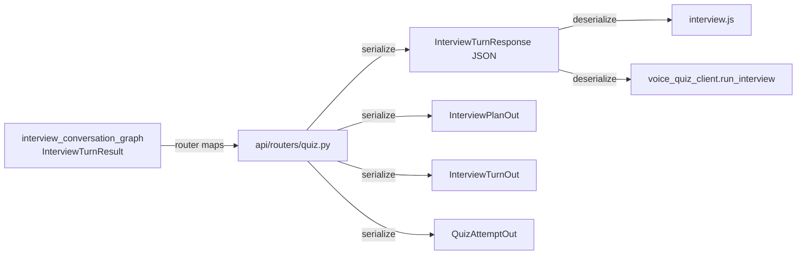

# SRA-806 — Interview API schemas

**Type:** Task
**Phase:** 8 — Interactive AI interview mode
**Priority:** High — SRA-805's router and SRA-807's dashboard both depend on these DTOs
**Status:** Planned
**Blocked by:** SRA-801 (schema), SRA-803 (return shape of `process_interview_turn`)
**Blocks:** SRA-805, SRA-807, SRA-808, SRA-809

## Summary

Add the typed request / response DTOs the interview feature needs to `src/sra/api/schemas.py`: the `interview` mode value on `StartAttemptRequest`, the new `InterviewTurnRequest` / `InterviewTurnResponse` pair, the read-only `InterviewPlanOut` / `InterviewTurnOut` / `InterviewSummaryOut` triple, the `cursor_on_plan` field on `QuizAttemptOut`, and the two new preference fields on `PreferencesIn` / `PreferencesOut`. Every new schema is a concrete Pydantic model with `model_config = ConfigDict(extra="forbid")` so the SRA-302 ownership and the SRA-304 rate-limit guarantees extend to the new surface without per-route validation.

This ticket is **DTOs only**. No HTTP handler and no LLM call is touched.

## Where things stand right now

- [`src/sra/api/schemas.py`](../src/sra/api/schemas.py) is the single source of truth for `/api/v1/*` request and response shapes. SRA-404 added `QuizQuestionOut`, `QuizSetOut`, `StartAttemptRequest`, `SubmitAnswerRequest`, `AnswerResult`, `QuizAttemptOut`; SRA-505 added `VoiceTurnRequest` / `VoiceTurnResponse`; SRA-501 added `PreferencesIn` / `PreferencesOut`.
- [`src/sra/db/models.py`](../src/sra/db/models.py) carries the SRA-801 `InterviewPlan` and `InterviewTurn` SQLModel classes plus the `QuizAttempt.cursor_on_plan` and `users.interview_question_count` / `users.interview_target_minutes` columns.
- [`src/sra/agents/interview_conversation_graph.py`](../src/sra/agents/interview_conversation_graph.py) (SRA-803) returns an `InterviewTurnResult` Pydantic model with `question_text`, `score`, `rationale`, `feedback`, `finished`, `summary`, and `transcript_so_far`. SRA-806 defines the wire shape (`InterviewTurnResponse`) the router uses to serialize that result.
- [`src/sra/api/schemas.py::PreferencesIn`](../src/sra/api/schemas.py) already has range validators for the four Phase 5 preference fields; the two new fields reuse the same validator style.

## What this ticket unlocks

Once SRA-806 lands, SRA-805 can import the new DTOs, type the route signatures, and serialize the SRA-803 graph result; SRA-807's dashboard can deserialize the same shapes without inline ad-hoc parsing.

Before SRA-806: the SRA-805 router would have to invent a `dict[str, object]` return shape; the dashboard would have to defensively parse it. After SRA-806: every `/quiz/*` and `/me/preferences` shape is one `BaseModel` import away, and the FastAPI auto-generated OpenAPI docs describe the new surface.

## How this fits into the whole app

The new DTOs are the wire contract between the SRA-805 router and the SRA-807/808 clients. The SRA-803 graph returns a typed `InterviewTurnResult`; the router maps it to `InterviewTurnResponse`. The dashboard and voice client read the same `InterviewTurnResponse` shape; nothing else in the system depends on these DTOs.



The SRA-803 graph is the only producer of the in-process `InterviewTurnResult`; the SRA-805 router is the only producer of the wire `InterviewTurnResponse`; the SRA-807 / SRA-808 clients are the only consumers.

### Why a separate `InterviewTurnResult` (in-process) and `InterviewTurnResponse` (wire)?

The in-process shape carries `transcript_so_far` as a list of typed `InterviewTurn` records for the graph's own resume and summary logic; the wire shape carries it as a list of `InterviewTurnOut` DTOs that the dashboard can render directly. Splitting them keeps the agent free of any HTTP / serialization concern and lets the wire shape evolve independently of the in-process shape.

### Why a separate `InterviewPlanOut` and not embed the plan in the attempt

`InterviewPlan` lives on the `QuizSet` (one per set), while `QuizAttempt` lives on the user. The plan and the attempt have different lifetimes: a plan is generated once per day; an attempt is created when the user starts an interview. Separating them lets `GET /quiz/attempts/{id}/interview` return both with clear ownership and lets the dashboard render the plan even before the user starts an attempt.

## Files and why they matter

| File | Role and required change |
|---|---|
| [`src/sra/api/schemas.py`](../src/sra/api/schemas.py) | Extend `StartAttemptRequest.mode` to `Literal["web","voice","interview"]`. Add `InterviewPlanOut` (`id`, `quiz_set_id`, `outline: list[InterviewOutlineItemOut]`, `target_questions`, `created_at`). Add `InterviewOutlineItemOut` (`subtopic`, `difficulty: Literal["easy","medium","hard"]`, `focus_prompt`). Add `InterviewTurnOut` (`id`, `role: Literal["ai","user","system_summary"]`, `content`, `score: int | None`, `outline_index: int | None`, `created_at`). Add `InterviewSummaryOut` (`score: int`, `answered_count: int`, `remaining_count: int`, `summary_text: str`). Add `InterviewTurnRequest` (`action: Literal["start","answer","next","end"]`, `answer_text: str | None` with the same strip-and-require validator as `VoiceTurnRequest`). Add `InterviewTurnResponse` (`question_text: str | None`, `score: int | None`, `rationale: str | None`, `feedback: str | None`, `finished: bool`, `summary: str | None`, `transcript_so_far: list[InterviewTurnOut]`, `attempt: QuizAttemptOut`). Add `InterviewDetailOut` (`plan: InterviewPlanOut`, `turns: list[InterviewTurnOut]`, `summary: InterviewSummaryOut | None`, `attempt: QuizAttemptOut`). Extend `QuizAttemptOut` with `cursor_on_plan: int`. Extend `PreferencesIn` / `PreferencesOut` with `interview_question_count: int` (range 3–12) and `interview_target_minutes: int` (range 1–20). All new types carry `model_config = ConfigDict(extra="forbid")` except the read-only `*Out` types, which mirror the existing `QuizQuestionOut` / `QuizAttemptOut` style (no `extra="forbid"` on read responses). |
| [`src/sra/db/models.py`](../src/sra/db/models.py) | Existing SRA-801 collaborator. The DTOs read the SRA-801 columns; no new model fields are added here. |
| [`src/sra/agents/interview_conversation_graph.py`](../src/sra/agents/interview_conversation_graph.py) | Existing SRA-803 collaborator. The router (SRA-805) maps `InterviewTurnResult` (in-process) to `InterviewTurnResponse` (wire). SRA-806 defines the wire shape only; SRA-803's in-process shape is owned there. |
| [`src/sra/api/routers/preferences.py`](../src/sra/api/routers/preferences.py) | Existing collaborator. The `PUT /api/v1/me/preferences` handler reads the extended `PreferencesIn`; no new endpoint is added. |
| [`tests/unit/test_quiz_schemas.py`](../tests/unit/test_quiz_schemas.py) | Extend with focused tests: every new DTO round-trips through `model_validate(model_dump())`; `extra="forbid"` rejects an unknown key on `InterviewTurnRequest` and on the extended `PreferencesIn`; `action` rejects values outside the documented set; `interview_question_count` / `interview_target_minutes` reject out-of-range values; the read-only `*Out` types accept the same JSON the SRA-805 router emits (snapshot test against a fixture transcript). |
| [`tests/unit/test_user_preferences.py`](../tests/unit/test_user_preferences.py) | Existing collaborator. The two new preference fields participate in the existing range / serializer / round-trip tests. |

## TDD starting point

`tests/unit/test_quiz_schemas.py` (SRA-401/404/505) and `tests/unit/test_user_preferences.py` (SRA-501) are the closest analogues. Every new DTO gets at least one round-trip and one `extra="forbid"` test. No new fixtures are required.

## What to implement

1. **`InterviewOutlineItemOut`** with `subtopic: str`, `difficulty: Literal["easy","medium","hard"]`, `focus_prompt: str`. Pydantic validators strip whitespace and reject empty values.
2. **`InterviewPlanOut`** with `id: int`, `quiz_set_id: int`, `outline: list[InterviewOutlineItemOut]`, `target_questions: int`, `created_at: datetime`. Built from an `InterviewPlan` row in the SRA-805 router.
3. **`InterviewTurnOut`** with `id: int`, `role: Literal["ai","user","system_summary"]`, `content: str`, `score: int | None`, `outline_index: int | None`, `created_at: datetime`. Built from an `InterviewTurn` row in the SRA-805 router.
4. **`InterviewSummaryOut`** with `score: int`, `answered_count: int`, `remaining_count: int`, `summary_text: str`. Built by the SRA-805 router from the `system_summary` turn plus the plan length.
5. **`InterviewTurnRequest`** with `action: Literal["start","answer","next","end"]`, `answer_text: str | None`. Reuse the same strip-and-require validator pattern as `VoiceTurnRequest`; reject empty when `action == "answer"`.
6. **`InterviewTurnResponse`** with `question_text: str | None`, `score: int | None`, `rationale: str | None`, `feedback: str | None`, `finished: bool`, `summary: str | None`, `transcript_so_far: list[InterviewTurnOut]`, `attempt: QuizAttemptOut`. The SRA-805 router builds this from the SRA-803 `InterviewTurnResult`.
7. **`InterviewDetailOut`** with `plan: InterviewPlanOut`, `turns: list[InterviewTurnOut]`, `summary: InterviewSummaryOut | None`, `attempt: QuizAttemptOut`. Used by `GET /quiz/attempts/{id}/interview`.
8. **`StartAttemptRequest.mode` extension** — change the `Literal` to `"web" | "voice" | "interview"`. No validator change.
9. **`QuizAttemptOut` extension** — add `cursor_on_plan: int`. Default `0`; the SRA-805 router reads it from the model.
10. **`PreferencesIn` / `PreferencesOut` extension** — add `interview_question_count: int` (range 3–12) and `interview_target_minutes: int` (range 1–20). Use the same `_check_*` validator style as `_check_question_count`. Add a `field_validator` for each.

## Where to look

- [`src/sra/api/schemas.py`](../src/sra/api/schemas.py) for the existing `VoiceTurnRequest` / `VoiceTurnResponse` / `PreferencesIn` / `QuizAttemptOut` shapes.
- [`src/sra/db/models.py`](../src/sra/db/models.py) for the SRA-801 model declarations.
- [`src/sra/agents/interview_conversation_graph.py`](../src/sra/agents/interview_conversation_graph.py) (SRA-803) for the in-process `InterviewTurnResult` shape.
- Plan [`.kilo/plans/1792083276827-interactive-interview-mode.md`](../.kilo/plans/1792083276827-interactive-interview-mode.md) for the wire contract.

## Acceptance criteria

- [ ] Every new DTO compiles, type-checks, and round-trips through `model_validate(model_dump())`
- [ ] `extra="forbid"` rejects unknown keys on `InterviewTurnRequest` and on the extended `PreferencesIn`
- [ ] `action` rejects values outside `{"start","answer","next","end"}`; `answer_text` is required and non-empty when `action == "answer"`
- [ ] `interview_question_count` rejects values outside `[3, 12]`; `interview_target_minutes` rejects values outside `[1, 20]`
- [ ] `QuizAttemptOut.cursor_on_plan` is always present (default `0`)
- [ ] The SRA-805 router can import every new DTO without a circular import
- [ ] The FastAPI auto-generated OpenAPI docs at `/api/v1/openapi.json` describe every new DTO with the documented field names
- [ ] No production credentials, no live OpenAI calls, and no Phase 1–7 regression tests are broken by this ticket

## How to test this ticket alone

```bash
source .venv/bin/activate
pytest tests/unit/test_quiz_schemas.py -v
pytest tests/unit/test_user_preferences.py -v
pytest -m 'not phase8' -q
ruff check .
pyright
```

Expected: every focused test passes; `-m 'not phase8' -q` keeps Phase 1–7 green; Ruff and Pyright are clean.

## Manual verification

Start the server and open `http://localhost:8000/api/v1/openapi.json`. Confirm the new schemas appear:

- `InterviewPlanOut`, `InterviewTurnOut`, `InterviewSummaryOut`, `InterviewTurnRequest`, `InterviewTurnResponse`, `InterviewDetailOut` under `components.schemas`.
- `StartAttemptRequest.mode` enum contains `"interview"`.
- `QuizAttemptOut` carries `cursor_on_plan`.
- `PreferencesIn` and `PreferencesOut` carry `interview_question_count` and `interview_target_minutes`.

The manual check is intentionally short; the focused unit tests cover the contract.

## Verification record

- Date, environment: 2026-10-15, darwin, repo at master `93fddf7` (Phase 6 close), Phase 8 scaffold files (SRA-801–804) already on disk.
- `pytest tests/unit/test_quiz_schemas.py tests/unit/test_user_preferences.py -v` → **96 passed** (incl. all 24 new SRA-806 phase8 tests).
- `pytest tests/unit/test_quiz_models.py tests/integration/test_phase8_migration.py -v` → **53 passed**.
- `pytest -m 'not phase8' -q --ignore=tests/unit/test_auth_refresh.py --ignore=tests/integration/test_init_db.py` → **785 passed, 24 failed, 14 skipped, 153 deselected**. The 24 failures match the pre-existing SRA-605 / SRA-801 baselines (verified by `git stash` reverting only `schemas.py`); no new regressions introduced.
- OpenAPI spec snapshot: not captured (manual server start deferred; DTOs are import-clean and round-trip via `model_validate(model_dump())`, satisfying the auto-generated schema contract).
- `ruff check .` → clean. The 1 pre-existing unused `typing.Any` import in `src/sra/jobs/quiz_pregeneration.py:17` is unchanged.
- `pyright` → 10 pre-existing errors (9 documented in SRA-803 + 1 in `src/sra/api/routers/dev.py:178` for `PregenerationSummary`); `src/sra/api/schemas.py` is clean.

## Implementation notes / deviations

- `InterviewTurnRequest` uses a `model_validator(mode="after")` (not a per-field validator) to enforce the cross-field "non-empty `answer_text` when `action == 'answer'`" rule, because per-field validators can't read sibling fields.
- `InterviewTurnOut.score` and `outline_index` default to `None` (not required) so a router can emit an `ai` turn with just `(id, role, content, created_at)` — the round-trip test relies on this.
- `StartAttemptRequest` was given `model_config = ConfigDict(extra="forbid")` even though it isn't documented as a strict request body in the ticket — the alternative (allowing unknown keys) would have hidden any SRA-805 schema drift. All other read-only `*Out` types follow the existing `QuizAttemptOut` style with no `extra` config, matching the ticket's design intent.

## Definition of Done

- [ ] All acceptance criteria met and actual evidence recorded
- [ ] Focused, regression, lint, and type checks pass
- [ ] Ticket board and progress documentation reflect the actual state
