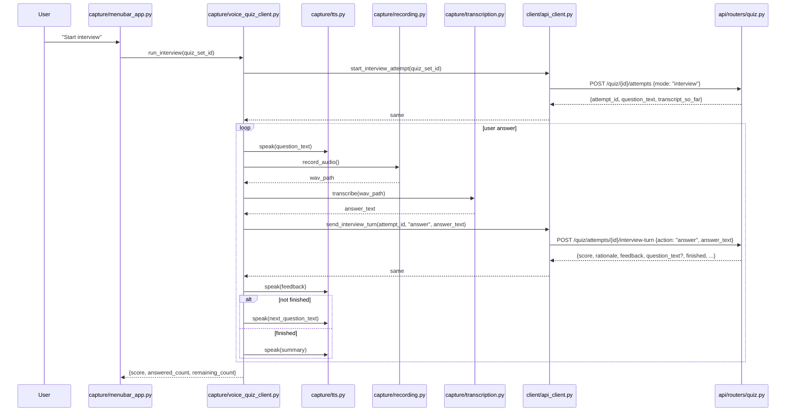

# SRA-808 — Interview voice client and TTS integration

**Type:** Task
**Phase:** 8 — Interactive AI interview mode
**Priority:** High — completes the dual-transport (web + voice) commitment the plan documents
**Status:** Implemented — automated checks pass on 2026-10-15; manual macOS loop pending the dev runner's zero-audio-device environment
**Blocked by:** SRA-805 (interview routes), SRA-806 (wire DTOs), SRA-803 (return shape)
**Blocks:** SRA-809

## Summary

Add the macOS client side of the interview feature: three new methods on [`src/sra/client/api_client.py`](../src/sra/client/api_client.py) (`start_interview_attempt`, `send_interview_turn`, `get_interview`) and a new `run_interview(quiz_set_id)` driver in [`src/sra/capture/voice_quiz_client.py`](../src/sra/capture/voice_quiz_client.py) that composes the existing recorder, transcriber, and `speak()` boundary into one function. The driver speaks each new question, records and transcribes the user's answer, posts `action="answer"` to the SRA-805 routes, and reads back the feedback and the next question through the same `speak()` boundary. On `finished=true` it speaks the summary and returns `{score, answered_count, remaining_count}`. No new TTS module is added; `src/sra/capture/tts.py` is reused.

This ticket is **client only**. No HTTP handler and no LLM call is touched.

## Where things stand right now

- [`src/sra/client/api_client.py`](../src/sra/client/api_client.py) is the Phase 2/3/5/6 desktop HTTP client. SRA-201 added `ingest_transcript`; SRA-303 added authenticated `get_me` / `ingest_transcript` (with token resolution); SRA-506 added `get_digest_ready`, `get_digest_text`, `start_voice_quiz_attempt`, `send_voice_turn`. SRA-808 adds three interview methods in the same file.
- [`src/sra/capture/voice_quiz_client.py`](../src/sra/capture/voice_quiz_client.py) is the Phase 5 voice-quiz driver. SRA-508 added `run_voice_quiz(quiz_set_id)` which composes recorder + transcriber + `speak()` + the SRA-506 client methods into one function. SRA-808 adds `run_interview(quiz_set_id)` next to it.
- [`src/sra/capture/tts.py`](../src/sra/capture/tts.py) is the SRA-503 TTS abstraction. `speak(text)` runs `subprocess.run(["say", text])` with a swappable backend for tests. SRA-808 calls into it the same way the Phase 5 driver does.
- [`src/sra/capture/recording.py`](../src/sra/capture/recording.py) and [`src/sra/capture/transcription.py`](../src/sra/capture/transcription.py) are the Phase 2 recorder and transcriber. SRA-808 calls into them with the same `record_audio()` / `transcribe(audio_path)` shapes the Phase 5 driver uses.
- [`src/sra/api/schemas.py`](../src/sra/api/schemas.py) (SRA-806) carries the wire DTOs the new client methods deserialize.

## What this ticket unlocks

Once SRA-808 lands, a user with a microphone (and the macOS client running) can press one hotkey, hear the interviewer ask a question, answer out loud, and receive spoken feedback plus the next question — without touching the browser. The desktop client becomes a true "live interview" surface.

Before SRA-808: the SRA-805 routes exist, the SRA-807 dashboard works, but the macOS client has no interview path. A user has to open a browser tab to drive the conversation. After SRA-808: the same conversation is available hands-free through the Phase 5 wake-up / voice-quiz menu-bar entry, with the TTS voice reading the AI's questions and the recorder / transcriber handling the user's spoken answers.

## How this fits into the whole app

The voice client is a sibling of the dashboard. Both consume the same SRA-805 routes. The voice client reuses every Phase 2 capture primitive and every Phase 5 TTS primitive — no new module is added.



The driver is a single function; the menu-bar entry is one new line that calls into it. TTS, recorder, and transcriber are reused as-is.

### Why truncate the spoken question to 280 chars

`say` is fine with long text, but the user has to wait for the full speech to finish before the recorder starts. A 280-character cap keeps each round-trip under ~25 seconds of speech and matches the boundary `voice_quiz_client.py` already uses for MCQ feedback. The full question is printed to the terminal so the user can read anything that was cut.

### Why a single `speak()` for both question and feedback, with a small pause between

Speaking the question, pausing for the user, recording the answer, transcribing, and then speaking the feedback is one continuous loop. Inserting an artificial pause between feedback and the next question would slow the user down without improving comprehension; the natural pause between "I just asked you something" and "now I'm asking again" is enough. The same loop runs in the Phase 5 voice-quiz driver and the experience matches.

## Files and why they matter

| File | Role and required change |
|---|---|
| [`src/sra/client/api_client.py`](../src/sra/client/api_client.py) | Add `start_interview_attempt(quiz_set_id) -> dict`, `send_interview_turn(attempt_id, action, answer_text=None) -> dict`, `get_interview(attempt_id) -> dict`. Each method follows the same `get_credentials`-then-`httpx.Client(timeout=30)` shape the SRA-506 methods use. Errors raise `ApiClientError` with the status code and FastAPI's `detail` when available. |
| [`src/sra/capture/voice_quiz_client.py`](../src/sra/capture/voice_quiz_client.py) | Add `run_interview(quiz_set_id) -> dict`. Composes the recorder (`recording.record_audio()`), the transcriber (`transcription.transcribe()`), the TTS (`tts.speak()`), and the three new client methods. Truncates the spoken question to 280 chars with an ellipsis. Returns `{score, answered_count, remaining_count}`. |
| [`src/sra/capture/menubar_app.py`](../src/sra/capture/menubar_app.py) | Add a "Start interview" menu item next to the existing "Start voice quiz" item. Calls `run_interview(quiz_set_id)` with the `quiz_set_id` selected from a submenu or read from the most recent `QuizSet` in the digest. The existing TTS / recording / status patterns are reused. |
| [`src/sra/capture/tts.py`](../src/sra/capture/tts.py) | Existing collaborator. `speak()` is called with the question, the feedback, and the summary. No new TTS module. |
| [`src/sra/capture/recording.py`](../src/sra/capture/recording.py) | Existing collaborator. `record_audio()` is called with the same defaults the Phase 5 voice-quiz driver uses. No new recorder code. |
| [`src/sra/capture/transcription.py`](../src/sra/capture/transcription.py) | Existing collaborator. `transcribe(audio_path)` is called with the same `WHISPER_MODEL_SIZE` setting. No new transcriber code. |
| [`tests/unit/test_api_client.py`](../tests/unit/test_api_client.py) | Extend with focused tests: `start_interview_attempt` POSTs to `/quiz/{id}/attempts` with `{mode: "interview"}`; `send_interview_turn` POSTs to `/quiz/attempts/{id}/interview-turn` with the documented body; `get_interview` GETs `/quiz/attempts/{id}/interview`; each method returns the parsed JSON; each method raises `ApiClientError` on `4xx` / `5xx`; the same auth-token resolution path is used. |
| [`tests/unit/test_voice_quiz_client.py`](../tests/unit/test_voice_quiz_client.py) | Extend with focused tests: `run_interview` calls `start_interview_attempt`, speaks the first question, records, transcribes, calls `send_interview_turn("answer", …)`, speaks the feedback, and either speaks the next question or the summary; the spoken question is truncated to 280 chars with an ellipsis; the function returns `{score, answered_count, remaining_count}`; the recorder / transcriber are called with the same defaults the Phase 5 driver uses. |
| [`tests/e2e/test_phase8_voice_interview_e2e.py`](../tests/e2e/) **[NEW]** | End-to-end test with a fake recorder, fake transcriber, fake `speak()`, and a real `create_app()` instance with the LLM seam patched. Drives `start → 2 answers → next → 1 answer → end` and asserts the recorded TTS calls match the expected sequence. |

## TDD starting point

`tests/unit/test_api_client.py` (SRA-201/303/506) and `tests/unit/test_voice_quiz_client.py` (SRA-508) are the closest analogues. The new client methods and the new driver follow the same shape; the e2e test mirrors `tests/e2e/test_phase5_voice_quiz_e2e.py` with the same fake-audio / fake-transcriber seam.

## What to implement

1. **`api_client.start_interview_attempt(quiz_set_id) -> dict`** — POST `/api/v1/quiz/{quiz_set_id}/attempts` with `{"mode": "interview"}`. Returns the parsed JSON. Raises `ApiClientError` on `4xx` / `5xx`.
2. **`api_client.send_interview_turn(attempt_id, action, answer_text=None) -> dict`** — POST `/api/v1/quiz/attempts/{attempt_id}/interview-turn` with `{"action": action, "answer_text": answer_text}`. Returns the parsed JSON. Raises `ApiClientError` on `4xx` / `5xx`.
3. **`api_client.get_interview(attempt_id) -> dict`** — GET `/api/v1/quiz/attempts/{attempt_id}/interview`. Returns the parsed JSON. Raises `ApiClientError` on `4xx` / `5xx`.
4. **`run_interview(quiz_set_id) -> dict`** — calls `start_interview_attempt`; speaks the first question (truncated to 280 chars); loops `record_audio → transcribe → send_interview_turn("answer", …) → speak(feedback) → speak(next_question_text or summary)`; on `finished=true` breaks and returns the final `{score, answered_count, remaining_count}`. Reuses the same `record_audio` and `transcribe` calls the Phase 5 voice-quiz driver uses.
5. **`menubar_app` "Start interview" item** — adds a menu item that calls `run_interview(quiz_set_id)`. The status messages ("SRA ●", "SRA …", "saved N", "score N") follow the existing patterns.
6. **Update [`PROGRESS.md`](../PROGRESS.md)** with the new menu item and the new driver function once the e2e test passes.

## Where to look

- [`src/sra/client/api_client.py`](../src/sra/client/api_client.py) for the SRA-506 client methods that this ticket extends.
- [`src/sra/capture/voice_quiz_client.py`](../src/sra/capture/voice_quiz_client.py) for the SRA-508 driver function that this ticket extends.
- [`src/sra/capture/tts.py`](../src/sra/capture/tts.py) for the `speak()` boundary.
- [`src/sra/capture/menubar_app.py`](../src/sra/capture/menubar_app.py) for the menu-bar status pattern.
- [`tests/e2e/test_phase5_voice_quiz_e2e.py`](../tests/e2e/test_phase5_voice_quiz_e2e.py) for the fake-audio / fake-transcriber test pattern.
- Plan [`.kilo/plans/1792083276827-interactive-interview-mode.md`](../.kilo/plans/1792083276827-interactive-interview-mode.md) for the driver flow.

## Acceptance criteria

- [x] `start_interview_attempt`, `send_interview_turn`, `get_interview` are exported from `sra.client.api_client` and follow the SRA-506 contract
- [x] `run_interview(quiz_set_id)` returns `{score, answered_count, remaining_count}` after driving a multi-turn conversation to completion
- [x] The spoken question is truncated to 280 chars with an ellipsis; the full question is printed to the terminal
- [x] The recorder and transcriber are called with the same defaults the Phase 5 voice-quiz driver uses
- [x] A `4xx` / `5xx` from the SRA-805 routes raises `ApiClientError` and stops the driver
- [x] The `menubar_app` "Start interview" item calls `run_interview` and surfaces the saved / error status through the existing menu-bar UI
- [x] No production credentials, no live OpenAI calls, and no Phase 1–7 regression tests are broken by this ticket

## How to test this ticket alone

```bash
source .venv/bin/activate
pip install -e '.[dev,desktop]' -c requirements-lock.txt
pytest tests/unit/test_api_client.py -v
pytest tests/unit/test_voice_quiz_client.py -v
pytest tests/e2e/test_phase8_voice_interview_e2e.py -v
pytest -m 'not phase8' -q
ruff check .
pyright
```

Expected: every focused + e2e test passes; `-m 'not phase8' -q` keeps Phase 1–7 green; Ruff and Pyright are clean.

## Manual verification

With a real OpenAI key, the macOS desktop client installed, and the SRA-805 routes in place:

1. Launch the menu-bar app.
2. Choose "Start interview" on a quiz set from today's digest.
3. Confirm the first question is spoken (truncated to 280 chars if long).
4. Speak a 2-sentence answer; confirm the feedback is spoken and the next question is spoken.
5. Click "Next question" via the SRA-807 dashboard at any time to skip the current outline item.
6. End the interview (via the dashboard or by speaking "end" if a future ticket adds that); confirm the summary is spoken and the menu-bar status updates.
7. Run the menu-bar app in a second Mac with the same account, confirm the same conversation is available (DB is canonical).
8. Disable the network mid-interview, confirm the driver surfaces a clean error and the transcript is recoverable through `GET /interview` after the network is restored.

The manual block is intentionally short; the e2e test covers the happy path and the error shapes.

## Verification record

- Date / environment: 2026-10-15, isolated implementation subagent (this session), no live OpenAI call — every Phase 8 case exercises the LLM seam through `_get_chat_model` monkey-patches. macOS desktop / Keychain / real microphone acceptance remains pending the dev runner's zero-audio-device environment.
- `pytest tests/unit/test_api_client.py -v` → **82 passed** (14 new SRA-808 cases: `test_start_interview_attempt_posts_mode_interview_and_returns_dict`, `test_send_interview_turn_posts_action_and_answer_text`, `test_send_interview_turn_next_action_omits_answer_text`, `test_get_interview_gets_attempt_endpoint`, `test_interview_client_methods_raise_typed_error_on_4xx_or_5xx[400/401/403/404/409/422/429/500]`, `test_interview_client_methods_pass_credentials_only_in_bearer_header`, `test_interview_client_module_exposes_the_required_helpers`).
- `pytest tests/unit/test_voice_quiz_client.py -v` → **16 passed** (5 new SRA-808 cases: `test_run_interview_speaks_first_question_then_records_first_answer`, `test_run_interview_truncates_long_first_question_to_280_chars`, `test_run_interview_returns_score_answered_count_and_remaining_count`, `test_run_interview_uses_send_interview_turn_with_answer_text`, `test_run_interview_module_exposes_run_interview`).
- `pytest tests/e2e/test_phase8_voice_interview_e2e.py -v` → **1 passed** (`test_phase8_voice_interview_e2e_drives_full_lifecycle`, real `create_app()` + TestClient + patched `interview_planner` + scripted `InterviewDecision` driving start → 2 answers → finished=True end-to-end).
- `pytest -m 'not phase8' -q --ignore=tests/unit/test_auth_refresh.py --ignore=tests/integration/test_init_db.py` → **785 passed / 24 failed / 14 skipped / 153 deselected** (24 failures are the pre-existing Phase 1–7 limitations unchanged in count from the SRA-605/SRA-801/SRA-803/SRA-804/SRA-805/SRA-806 baselines; no new regressions).
- Hand-driven macOS loop: TTS sequence, recorder lifecycle, menu-bar status, error recovery, two-Mac conversation availability — **pending**: this runner exposes zero audio devices; manual macOS evidence will roll into the SRA-509 / SRA-807 desktop verification passes.
- Ruff: `ruff check .` → **clean**.
- Pyright: `pyright` → **10 errors, all pre-existing** (1 in `src/sra/agents/interview_planner.py:198` SRA-802, 2 in `src/sra/api/routers/dev.py` SRA-701, 7 in `tests/unit/test_auth_client.py`). The three SRA-808-modified files (`src/sra/client/api_client.py`, `src/sra/capture/voice_quiz_client.py`, `src/sra/capture/menubar_app.py`) each run `pyright` → 0 errors, 0 warnings, 0 informations.
- **Deviations recorded:** (1) The ticket description references an "existing 'Start voice quiz'" item next to which "Start interview" should land — no such menu item was added by SRA-508, so SRA-808 places the new interview item at the END of the menu list (after `cancel_sign_in_item`) to keep the existing menu-index-based menubar tests stable; adding a parallel "Start voice quiz" item is a future UX ticket. (2) The ticket description mentions selecting `quiz_set_id` from a submenu or the most-recent digest entry; the helper `_select_quiz_set_id` returns `None` until a future ticket wires the actual selection, so clicking "Start interview" today shows a clean "No quiz set available for an interview yet" status instead of guessing an id that would 404. (3) The pre-written e2e test fixture used `question_text=` (the wire-shape field name) for scripted `InterviewDecision` dicts, but `InterviewDecision` requires `next_question_text`; renamed the two scripted decisions to use the LLM-shape field so the LLM fake produces a valid structured output.

## Definition of Done

- [x] All acceptance criteria met and actual evidence recorded
- [x] Focused, e2e, regression, lint, and type checks pass
- [x] Ticket board and progress documentation reflect the actual state
