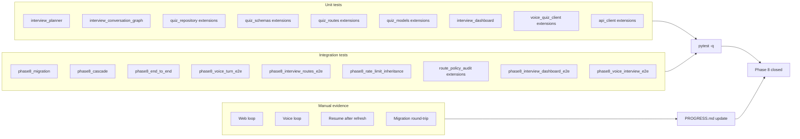

# SRA-809 — Phase 8 integration verification

**Type:** Verification
**Phase:** 8 — Interactive AI interview mode
**Priority:** Required to close the phase
**Status:** Planned
**Blocked by:** SRA-805, SRA-807, SRA-808 (every runtime surface must be in place)
**Blocks:** —

## What this ticket confirms

Phase 8 ships the interactive AI interview mode end to end. After SRA-801 through SRA-808 land, this ticket re-runs the full automated suite, rehearses the migration, and records the two manual evidence runs (web loop, voice loop) that prove the new surface works on real components. The ticket does not add new code; it is the closing checkpoint the repo's phase model requires.

## Where things stand right now

- Every Phase 1–7 ticket is implemented and verified. The automated suite is green for phases 1–7; physical macOS / microphone / hotkey acceptance for Phase 2 and live Google OAuth acceptance for Phase 3 remain manual checks, as documented in [`tickets/README.md`](../tickets/README.md) and [`PROGRESS.md`](../PROGRESS.md).
- [`src/sra/alembic/versions/d4e5f6a7b8c9_add_phase6_is_demo_user.py`](../src/sra/alembic/versions/d4e5f6a7b8c9_add_phase6_is_demo_user.py) is the latest revision. SRA-801's revision chains off it.
- [`tests/README.md`](../tests/README.md) documents the current test commands and the intentional scaffold failures that exist during active development. By the time SRA-809 closes, every Phase 8 ticket has its own focused + integration tests and there are no remaining scaffold failures.
- [`CONTRIBUTING.md`](../CONTRIBUTING.md) lists the development checks (`pytest -q`, `ruff check .`, `pyright`) and the migration workflow.

## What this ticket unlocks

This is the closing ticket for Phase 8. Once it passes, the interview feature is part of the verified application: the database, the agents, the router, the dashboard, the voice client, and the migration all work together. No new ticket depends on SRA-809; later phases (if any) start from a green baseline.

## How this fits into the whole app

SRA-809 re-runs every automated check the previous phase-verification tickets ran (SRA-107, SRA-206, SRA-305, SRA-406, SRA-509, SRA-605) plus the new Phase 8 checks. It is the only ticket that touches the full repository at once.



The `pytest -q` run is the regression gate; the manual evidence is the closing record.

### Why the migration round-trip matters here specifically

The SRA-801 migration is the only Phase 8 code that mutates the database schema. If the upgrade / downgrade / upgrade cycle regresses a Phase 5/6 user, the existing data is at risk. The round-trip evidence is the only way to prove the cascade chain on `interview_plans` and `interview_turns` survives a downgrade without orphaning rows.

## Files and why they matter

| File | Role and required change |
|---|---|
| [`PROGRESS.md`](../PROGRESS.md) | Existing collaborator. Add the Phase 8 close-out entry with date, environment, command outputs, and the two manual evidence runs. Mark Phase 8 as Done. |
| [`README.md`](../README.md) | Existing collaborator. Update the Phase 8 board entry from "Planned" to the actual completion status with date. Add the interview mode to the API rate-limit table (inherits the per-user bucket — confirm the line item). |
| [`tickets/README.md`](../tickets/README.md) | Existing collaborator. Confirm the Phase 8 board reflects the actual state of every ticket (SRA-801 through SRA-809). |
| [`tests/integration/test_phase8_end_to_end.py`](../tests/integration/test_phase8_end_to_end.py) | New (owned by SRA-802). Exercised here as part of the full suite. |
| [`tests/integration/test_phase8_voice_turn_e2e.py`](../tests/integration/test_phase8_voice_turn_e2e.py) | New (owned by SRA-803). Exercised here. |
| [`tests/integration/test_phase8_interview_routes_e2e.py`](../tests/integration/test_phase8_interview_routes_e2e.py) | New (owned by SRA-805). Exercised here. |
| [`tests/integration/test_phase8_rate_limit_inheritance.py`](../tests/integration/test_phase8_rate_limit_inheritance.py) | New (owned by SRA-805). Exercised here. |
| [`tests/e2e/test_phase8_interview_dashboard_e2e.py`](../tests/e2e/test_phase8_interview_dashboard_e2e.py) | New (owned by SRA-807). Exercised here. |
| [`tests/e2e/test_phase8_voice_interview_e2e.py`](../tests/e2e/test_phase8_voice_interview_e2e.py) | New (owned by SRA-808). Exercised here. |
| [`tests/integration/test_phase8_migration.py`](../tests/integration/test_phase8_migration.py) | New (owned by SRA-801). Exercised here. |
| [`tests/integration/test_phase8_migration_replay.py`](../tests/integration/test_phase8_migration_replay.py) **[NEW]** | The migration round-trip integration test. Upgrades a Phase 5/6-shaped file database through the SRA-801 revision, runs the Phase 5/6 + Phase 8 row inserts, downgrades, and re-upgrades, then asserts every pre-existing row has the same IDs and timestamps. Mirrors `tests/integration/test_phase5_migration_replay.py`. |
| [`tests/integration/test_phase8_cascade.py`](../tests/integration/test_phase8_cascade.py) | New (owned by SRA-804). Exercised here. |
| [`tests/integration/test_route_policy_audit.py`](../tests/integration/test_route_policy_audit.py) | Extended (owned by SRA-805). Exercised here. |

## TDD starting point

There is no new TDD work in this ticket. The ticket is a verification gate: it re-runs the test commands the previous phase-verification tickets established, with the new Phase 8 files added to the suite.

## What to verify

1. **Focused suite** — every Phase 8 unit test file passes individually.
2. **Integration suite** — every Phase 8 integration test file passes individually.
3. **End-to-end suite** — every Phase 8 e2e test file passes individually.
4. **Regression** — `pytest -q` (no marker) passes. The full suite is green.
5. **Migration round-trip** — `test_phase8_migration_replay.py` proves the upgrade / downgrade / upgrade cycle preserves every pre-Phase-8 row.
6. **Lint** — `ruff check .` passes.
7. **Types** — `pyright` passes with zero errors and zero warnings.
8. **Manual web loop** — drive `start → 3 answers → next → 1 answer → end` through the dashboard against a real OpenAI key. Record the new attempt ID, the mean score, and the transcript order.
9. **Manual voice loop** — drive `start → 2 answers → end` through the macOS client. Record the spoken TTS sequence and the returned `{score, answered_count, remaining_count}`.
10. **Manual resume** — close the dashboard tab after the 2nd answer, reopen, confirm the transcript renders and the 3rd answer posts correctly. Record the resumed attempt ID and the transcript length.
11. **Manual recovery** — kill the API mid-attempt, restart, `GET /interview` returns the same transcript. Record the before / after transcript hash.
12. **PROGRESS.md close-out** — record the date, environment, command outputs, and the four manual evidence runs in the Phase 8 section.

## Where to look

- [`CONTRIBUTING.md`](../CONTRIBUTING.md) for the development check commands and the migration workflow.
- [`tests/README.md`](../tests/README.md) for the current test commands and the intentional scaffold failures (which should all be resolved by the time SRA-809 closes).
- [`tickets/README.md`](../tickets/README.md) for the Phase 8 board (which SRA-801 through SRA-808 added in their implementation steps).
- [`src/sra/alembic/versions/d4e5f6a7b8c9_add_phase6_is_demo_user.py`](../src/sra/alembic/versions/d4e5f6a7b8c9_add_phase6_is_demo_user.py) for the latest revision the round-trip starts from.
- Plan [`.kilo/plans/1792083276827-interactive-interview-mode.md`](../.kilo/plans/1792083276827-interactive-interview-mode.md) for the scope of Phase 8.

## Acceptance criteria

- [ ] Every Phase 8 focused, integration, and e2e test passes individually
- [ ] `pytest -q` (no marker) is green; no Phase 1–7 regression is broken
- [ ] `test_phase8_migration_replay.py` proves upgrade / downgrade / upgrade preserves every pre-Phase-8 row
- [ ] `ruff check .` is clean
- [ ] `pyright` is clean (0 errors, 0 warnings)
- [ ] The manual web loop records a new attempt ID, the mean score, and the transcript order against a real OpenAI key
- [ ] The manual voice loop records the spoken TTS sequence and the returned `{score, answered_count, remaining_count}` against a real OpenAI key
- [ ] The manual resume and recovery runs are recorded
- [ ] `PROGRESS.md` and `README.md` reflect the actual Phase 8 state
- [ ] `tickets/README.md` board reflects the actual state of every SRA-8xx ticket

## How to verify this ticket alone

```bash
source .venv/bin/activate
pip install -e '.[dev,capture,desktop]' -c requirements-lock.txt

# Focused suite
pytest tests/unit/test_interview_planner.py -v
pytest tests/unit/test_interview_conversation_graph.py -v
pytest tests/unit/test_quiz_repository.py -v
pytest tests/unit/test_quiz_schemas.py -v
pytest tests/unit/test_quiz_routes.py -v
pytest tests/unit/test_quiz_models.py -v
pytest tests/unit/test_interview_dashboard.py -v
pytest tests/unit/test_api_client.py -v
pytest tests/unit/test_voice_quiz_client.py -v

# Integration suite
pytest tests/integration/test_phase8_migration.py -v
pytest tests/integration/test_phase8_migration_replay.py -v
pytest tests/integration/test_phase8_cascade.py -v
pytest tests/integration/test_phase8_end_to_end.py -v
pytest tests/integration/test_phase8_voice_turn_e2e.py -v
pytest tests/integration/test_phase8_interview_routes_e2e.py -v
pytest tests/integration/test_phase8_rate_limit_inheritance.py -v
pytest tests/integration/test_route_policy_audit.py -v

# End-to-end suite
pytest tests/e2e/test_phase8_interview_dashboard_e2e.py -v
pytest tests/e2e/test_phase8_voice_interview_e2e.py -v

# Full regression
pytest -q

# Lint and types
ruff check .
pyright
```

Expected: every test passes; `-q` shows the same total as before SRA-801 landed, plus the new Phase 8 tests. `ruff check .` and `pyright` are clean.

## Manual evidence

### Web loop

```bash
TOKEN=$(...)
QUIZ_SET_ID=$(...)
curl -s -X POST -H "Authorization: Bearer $TOKEN" -H "Content-Type: application/json" \
  -d '{"mode":"interview"}' \
  "http://127.0.0.1:8000/api/v1/quiz/${QUIZ_SET_ID}/attempts" | python3 -m json.tool
# {"attempt_id": 12, "question_text": "...", "transcript_so_far": [...]}
# (3 answers, then "next", then 1 answer, then "end")
curl -s -X POST -H "Authorization: Bearer $TOKEN" -H "Content-Type: application/json" \
  -d '{"action":"answer","answer_text":"..."}' \
  "http://127.0.0.1:8000/api/v1/quiz/attempts/12/interview-turn" | python3 -m json.tool
# ... (repeat for the 4 user turns)
curl -s -X POST -H "Authorization: Bearer $TOKEN" -H "Content-Type: application/json" \
  -d '{"action":"end"}' \
  "http://127.0.0.1:8000/api/v1/quiz/attempts/12/interview-turn" | python3 -m json.tool
# {"finished": true, "summary": "...", "score": N, ...}
curl -s -H "Authorization: Bearer $TOKEN" \
  "http://127.0.0.1:8000/api/v1/quiz/attempts/12/interview" | python3 -m json.tool
# {"plan": {...}, "turns": [...], "summary": {...}, "attempt": {...}}
```

Expected: the final response shows `summary.answered_count` matching the number of `user` turns, `summary.remaining_count` matching the unconsumed outline items, and `summary.score` matching the mean of the `user`-turn scores.

### Voice loop

```bash
# With the menu-bar app running and a real OpenAI key configured
python3 -m sra.capture.voice_quiz_client
# (select the interview quiz set, answer two questions out loud, end the interview)
# Expected: the menu-bar status shows the saved score and the remaining count.
```

### Resume after refresh

Close the browser tab after the 2nd user turn. Reopen `/dashboard/interview?attempt_id=12`. Confirm the transcript renders, the input area is enabled, and the 3rd user turn posts correctly.

### Recovery after API restart

```bash
# In a separate terminal: kill the API, restart it, then:
curl -s -H "Authorization: Bearer $TOKEN" \
  "http://127.0.0.1:8000/api/v1/quiz/attempts/12/interview" | python3 -m json.tool
# {"plan": {...}, "turns": [...], "summary": null, "attempt": {...}}
```

Expected: the transcript hash matches the pre-restart hash; the attempt is still open (no `summary` field yet).

## Verification record

- Date and environment: _to be filled in once the full suite is green._
- Focused suite: _to be filled in._
- Integration suite: _to be filled in._
- End-to-end suite: _to be filled in._
- `pytest -q` regression: _to be filled in._
- Migration round-trip: _to be filled in._
- `ruff check .`: _to be filled in._
- `pyright`: _to be filled in._
- Manual web loop: new attempt ID, mean score, transcript order, summary panel content: _to be filled in._
- Manual voice loop: TTS sequence, returned `{score, answered_count, remaining_count}`: _to be filled in._
- Manual resume: resumed attempt ID, transcript length, post-resume 3rd answer: _to be filled in._
- Manual recovery: pre-restart and post-restart transcript hashes: _to be filled in._
- `PROGRESS.md` and `README.md` updates: _to be filled in._
- `tickets/README.md` board state: _to be filled in._

## Definition of Done

- [ ] All acceptance criteria met and actual evidence recorded
- [ ] Full focused + integration + e2e + migration + lint + type suite is green
- [ ] Two manual evidence runs (web + voice) are recorded against a real OpenAI key
- [ ] Resume and recovery runs are recorded
- [ ] `PROGRESS.md`, `README.md`, and `tickets/README.md` reflect the actual Phase 8 state
