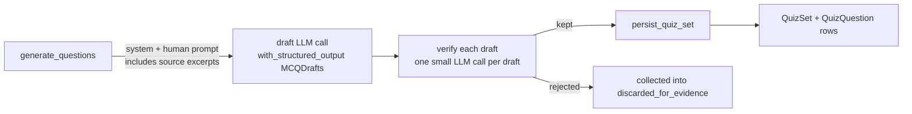

# SRA-903 — MCQ generation prompt uplift (Bloom's, distractor rubric, source-grounded)

**Type:** Implementation
**Phase:** 9
**Priority:** High (the actual quality uplift)
**Status:** Planned
**Blocked by:** SRA-901 (the references table + bundle helper)
**Blocks:** SRA-904 (interview uplift, parallels this), SRA-905 (verification)

## Summary

Rewrites `src/sra/agents/quiz_graph.py` so every MCQ is source-grounded, Bloom-distributed,
distractor-rubriced, and verified by a follow-up LLM call. The existing
`MCQDraft`/`MCQDrafts` schema gets three additive fields
(`bloom_level`, `source_passage_quote`, `distractor_misconception`); no breaking change.
A new `OPENAI_VERIFY_MCQS` setting (default `true`) gates the per-question verify pass.

## Where things stand right now

- `quiz_graph.generate_and_persist_questions(entry, user_id, session, question_count, option_count)`
  builds a 2-section prompt from `topic/subtopic/tags/summary` and a 1500-char transcript
  slice. Reviews of generated quiz sets complain of mediocrity.
- `MCQDraft` shape: `question_text`, `options[]`, `correct_option_index`, `explanation`.
- `QuizPreGenerationError` returns three typed strings today: LLM failure, "no drafts",
  and "no quiz set produced".

## What this ticket unlocks

After SRA-903, a quiz set generated from an `entry` whose `reference_materials` carry
two blog-posts of transformer material will look like:

```json
[
  {
    "question_text": "In multi-head attention, why is the projection dimension d_k chosen as d_model/h?",
    "options": [
      "It keeps the per-head compute constant as h grows, so total compute stays roughly d_model^2.",
      "It lets each head see the full d_model representation independently of the others.",
      "It matches the residual stream width so gradients flow without scaling.",
      "It is a theoretical optimum proved in Vaswani et al. 2017."
    ],
    "correct_option_index": 0,
    "explanation": "Distractor targets 'heads must each see d_model'. The projection per head is d_model/h so total work stays d_model^2 regardless of h.",
    "bloom_level": "analyze",
    "source_passage_quote": "we project to d_k = d_model/h, so each head computes attention at a fraction of the cost",
    "distractor_misconception": "Conflating per-head representation width with per-head compute"
  },
  ...
]
```

## How this fits into the whole app



The conversation-graph, planner, and dashboard all consume `QuizQuestion` rows; no
schema changes on the read side. The new fields are persisted alongside the existing
ones so old quiz rows keep working.

## Files and why they matter

| File | Action | Reason |
|---|---|---|
| `src/sra/agents/schemas.py` | modify | Extend `MCQDraft` with three additive fields; add `MCQVerifyResult` for the second-pass verdict |
| `src/sra/agents/quiz_graph.py` | rewrite | Six-section prompt with Bloom distribution, citation requirement, distractor rubric, few-shot exemplar; per-draft verify pass gated on `OPENAI_VERIFY_MCQS`; bundle helper from SRA-901 takes over from the entry-level summary |
| `src/sra/db/models.py` | modify | Persist `bloom_level`, `source_passage_quote`, `distractor_misconception` on `QuizQuestion` (additive, nullable) |
| `src/sra/alembic/versions/<new>_phase9_mcq_quality_fields.py` | new | Migration off `f6a7b8c9d0e1`, additive columns; reverse drops them with `downgrade()` |
| `src/sra/api/schemas.py` | modify | `QuizQuestionOut` exposes the three new fields when present (omits on legacy rows) |
| `src/sra/config.py` | modify | `OPENAI_VERIFY_MCQS: bool = True`, validator that forbids `True` if `OPENAI_API_KEY` is empty |
| `src/sra/db/repository.py` | modify | `create_quiz_set` writes the new columns per draft; default-null on the QuizQuestion ORM side |
| `src/sra/db/repository.py::create_quiz_set` (and `get_or_create_interview_plan`'s cascade companion) | verify | cascade untouched — new columns drop with the table |
| `src/sra/db/repository.py::delete_user_cascade` | no change expected |
| `tests/unit/test_quiz_graph_phase9.py` | new | Bloom distribution, distractor rubric honored, source_passage_quote present, verify-pass drops unanswered drafts, `OPENAI_VERIFY_MCQS=false` short-circuits the second pass |
| `tests/unit/test_quiz_models_phase9.py` | new | Additive columns nullable on legacy rows; CHECK constraint free (intentional additive change) |
| `tests/integration/test_phase9_migration.py` | extend | Forward + reverse + replay preserves pre-Phase-9 quiz rows |
| `tests/integration/test_phase9_verifier_quality.py` | new | Planted bad MCQ rejected by a fake verify-LLM; good MCQ passes |

## TDD starting point

- `MCQDraft` Pydantic has the existing four fields and raises `ValueError` on the new
  `bloom_level` literal until step 3.
- `quiz_graph._get_chat_model()` continues to be the LLM seam — subagent fakes both draft and verify passes by binding `_get_draft_model` / `_get_verify_model` lazily.
- `_verify_draft(draft, source_passage)` raises `NotImplementedError`.

## What to implement

1. **Schema extensions.**
   - `MCQDraft.bloom_level: Literal["remember","understand","apply","analyze","evaluate","create"]`
   - `MCQDraft.source_passage_quote: str` (8–30 words; validator strips and rejects empty)
   - `MCQDraft.distractor_misconception: str` (1–200 chars; required)
   - `QuizQuestion` ORM gets the same three columns (`sa_column_kwargs={"nullable": True}` on each so the migration is purely additive).
   - `MCQVerifyResult = { verdict: Literal["yes","no"], reason: str }` for the second-pass LLM.

2. **Prompt rewrite** (`quiz_graph.generate_questions`):
   - System prompt assembled from six fixed sections (Role, Source-First Rule, Citation, Bloom distribution, Distractor rubric, Few-shot) stored as constants in the module so tests can snapshot the rendered text.
   - Human message: entry metadata + a `source_excerpts = repository.get_reference_text_bundle(entry.id, session)` block (truncated per the SRA-901 helper's defaults) + the user's transcript slice as a "context" block.
   - Bloom distribution rule: `read it from prefs['quiz_question_count']` and ask the LLM for that many, broken down roughly as the table in `docs/plans/2026-10-16-phase9-topic-authoring-and-quality.md`.

3. **Verification pass** (`_verify_draft(draft, source_passage, llm)`):
   - Builds a 4-line system + human message that asks the LLM whether the question's correct option is actually supported by the cited passage; returns `MCQVerifyResult`.
   - Bounded on `max_completion_tokens=64`, `timeout=10s`, `max_retries=0`.
   - Skipped entirely when `Settings.openai_verify_mcqs is False`.

4. **Discard transparency.** When drafts are dropped (LLM error, validate fail, verify-fail), accumulate reasons in `state["discarded_for_evidence"]` rather than silently dropping. `_build_quiz_set_out` and the dashboard's quiz-list page surface `discarded_for_evidence` per quiz set when at least one draft was rejected.

5. **Phase-4 regression safety.** Existing `test_quiz_graph` cases keep passing: the schema additions are nullable, the validate step still drops empty/invalid drafts the same way, the per-day unique constraint on `quiz_sets(entry_id, generated_on)` is unchanged, and `create_quiz_set` accepts empty drafts fallback (mirrors the SRA-509 dev-affordance).

## Where to look

- `src/sra/agents/quiz_graph.py` itself — full rewrite; the existing file is the canonical starting point.
- `src/sra/agents/schemas.py` — Pydantic field discipline (`extra="forbid"` is not used here because Pydantic defaulted to `extra="ignore"`; the existing `field_validator` pattern shows how to enforce shapes).
- `src/sra/db/models.py::QuizQuestion` — additive columns with `sa_column_kwargs={"nullable": True}`.
- `src/sra/jobs/quiz_pregeneration.py` — how `generate_and_persist_questions` is called; pass an optional `references=` parameter through.
- `docs/plans/2026-10-16-phase9-topic-authoring-and-quality.md` — design contract for the prompt structure.

## Acceptance criteria

- [ ] Quiz generated from a topic with two references contains `bloom_level` and `source_passage_quote` on every question.
- [ ] Distractor misconception is non-empty on every question.
- [ ] Bloom distribution approximates the requested split (within ±1 per level).
- [ ] A planted MCQ whose correct option is unsupported by the cited passage is dropped by the verifier (fake LLM returns `verdict="no"`).
- [ ] `OPENAI_VERIFY_MCQS=false` skips the verifier entirely; the verify test suite uses `monkeypatch.setenv("OPENAI_VERIFY_MCQS", "false")` to assert it.
- [ ] Migration adds the three columns nullable; a legacy `QuizQuestion` row loads with `bloom_level=None` and is returned through `QuizQuestionOut` without the new fields rendered.
- [ ] Existing Phase 4 quiz regression suite (26 tests in `test_quiz_routes.py` + `test_quiz_graph.py`) stays green without modification.
- [ ] `ruff check .` clean; `pyright` clean on changed modules.

## How to test this ticket alone

```bash
pytest tests/unit/test_quiz_graph_phase9.py tests/unit/test_quiz_models_phase9.py tests/integration/test_phase9_verifier_quality.py -v
pytest tests/integration/test_phase9_migration.py -v   # extend in step 2
OPENAI_VERIFY_MCQS=false pytest tests/unit/test_quiz_graph.py -v   # regression
ruff check src/sra
pyright src/sra/agents/quiz_graph.py src/sra/agents/schemas.py
```

## Manual verification

1. Seed a temporary SQLite file with one entry + one paste reference carrying real transformer material.
2. With `OPENAI_VERIFY_MCQS=true` and the real `OPENAI_API_KEY`, hit the dev-mode endpoint from SRA-509 to trigger `pregenerate_quizzes_for_user`.
3. Pick 5 questions at random from the resulting `QuizSet`; confirm each one cites a passage that exists in the source and that the distractor misconception reads like a known confusable error.
4. Run with `OPENAI_VERIFY_MCQS=false` once and confirm the same structure but without the verify-rejection drop.

## Verification record

- Date and environment:
- Commands and inputs:
- New IDs/artifacts and observed downstream results:
- Failure/recovery and cleanup:
- Automated/manual results, skips, and limitations:

## Definition of Done

- [ ] All acceptance criteria met
- [ ] Migration round-trip + replay green
- [ ] No new lint / type errors
- [ ] Default regression suite stays green
- [ ] README's "How we generate MCQs" section documents the new rubric
- [ ] PROGRESS.md updated
