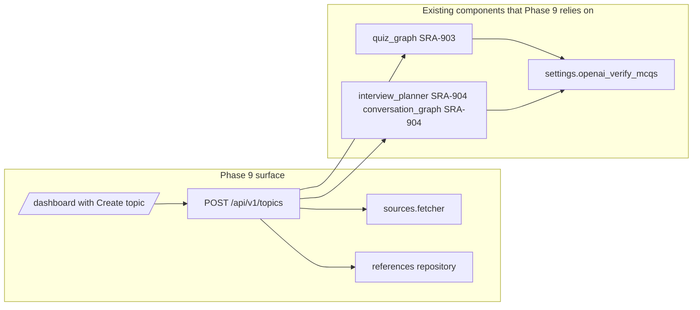

# SRA-905 — Phase 9 integration verification + README

**Type:** Verification
**Phase:** 9
**Priority:** High (closes the phase)
**Status:** Planned
**Blocked by:** SRA-901, SRA-902, SRA-903, SRA-904
**Blocks:** Phase 10 / next phase

## Summary

Closes Phase 9: re-runs the full regression matrix on the new pipeline, adds the
two cross-cutting integration tests that live across all of SRA-901–904
(end-to-end "topic with references → quiz → interview" + manual live
verification), updates the README with a "Creating a topic with references"
walkthrough and a "How we generate questions" rubric, and seals the migration
record in `PROGRESS.md`.

## Where things stand right now

- All four implementation tickets closed with their own focused tests.
- Pre-Phase-9 baseline is the SRA-509 (Phase 5) close-out record: roughly
  **479 passed / 14 skipped / 0 Phase 5-attributed failures** with the
  documented Phase 3/4/6/8 limitations unchanged.

## What this ticket unlocks

A user-visible claim backed by reproducible evidence:

> Sign in. Click **Create topic**. Type "Transformer attention heads". Add a URL.
> Add a pasted snippet. Click **Generate now**. The dashboard renders a new entry
> card with **Start quiz** and **Start interview** links. The quiz questions and the
> interview grading are demonstrably grounded in the source material: open any
> question's explanation and the cited passage is in the source; open any
> interview turn and the rationale references the planner's rubric.

## How this fits into the whole app



## Files and why they matter

| File | Action | Reason |
|---|---|---|
| `README.md` | modify | New "Creating a topic with references" section; new "How we generate questions" sub-section; env-var rows for `OPENAI_VERIFY_MCQS` and the Phase 9 entry in the build-phases list |
| `PROGRESS.md` | modify | Phase 9 row added at the bottom (replacing "Status: not started"); a "Phase 9 close-out" entry mirroring the SRA-509 record |
| `tickets/README.md` | modify | Phase 9 board with the 5 SRA-9xx entries + the mermaid dependency diagram |
| `tickets/SRA-9{01..05}-*.md` | no changes | The tickets themselves |
| `tests/integration/test_phase9_end_to_end.py` | new | Topic → references → quiz → interview start → quiz question → submit answer → interview answer → finish; partial-success on LLM failure; cross-user isolation |
| `tests/integration/test_phase9_route_policy_audit.py` | new | Audit extension: `/api/v1/topics` and the regenerate endpoint appear under `user`+`limit_authenticated` |
| `tests/integration/test_phase9_cascade.py` | new | `delete_user_cascade` drops `reference_materials` for the user's `study_entries` |
| `tests/integration/test_phase9_prompt_smoke.py` | new | Smoke test: the rendered system prompt of `quiz_graph.generate_questions` and `interview_planner._call_planner` both contain all six rubric sections (constant string matches against the rendered template) |

## TDD starting point

- No new behaviour — this ticket is the verifier. Tests added here either are net-new
  integration coverage (end-to-end + cascade + audit) or sanity checks on the
  *rendered* prompt of the existing prompts.

## What to implement

1. **End-to-end integration test** (`tests/integration/test_phase9_end_to_end.py`):
   - Set up a real-DB session with a fresh user, one `StudyEntry` row, two
     `reference_materials` rows (one paste, one URL — the URL is mocked via
     a fake `httpx.Client` or by stubbing `sources.fetcher.fetch_url_text`),
     run `POST /api/v1/topics` with the dev pregen-equivalent settings.
   - Assert the response carries a `quiz_set_id` and an `interview_plan_id`.
   - Run `GET /api/v1/quiz/{quiz_set_id}` and confirm every returned question
     has the three new fields populated.
   - Run `POST /api/v1/quiz/{quiz_set_id}/attempts` with `mode="interview"`, then
     `POST .../interview-turn {action:"answer", answer_text:"<covers the rubric>"}`,
     then a follow-up turn that completes the attempt; read the transcript and
     confirm the rationale references the supplied source passage.

2. **Phase-9 cross-cutting tests** (the three other `tests/integration/test_phase9_*` files):
   - **Cascade test** — `delete_user_cascade(user)` removes every `reference_materials`
     row for the user, even when FK enforcement is off.
   - **Route-policy audit test** — the audit dict covers every `/api/v1/topics*` route
     and every `/api/v1/entries/{id}/references` route under `limit_authenticated`.
   - **Prompt smoke test** — assert that `quiz_graph._build_messages(entry_with_refs, n)`
     and `interview_planner._build_messages(entry_with_refs, n)` both render the full
     six-section rubric, the Citation block, and the Bloom distribution rule. The
     assertions use the *exact* textual fragments from the constants in those modules.

3. **Documentation:**
   - README:
     - Add a `## Creating a topic with references` section after the "Submit a typed
       note from Python" code block. Include a screenshot-style description, a
       copy-pasteable `curl` example, and a bullet-list of what each kind of
       reference does.
     - Add a `## How we generate questions` section linking to SRA-903/SRA-904's
       rubric (the rubric is the source of truth; the README points at the code).
     - Add an env-var row for `OPENAI_VERIFY_MCQS` (default `true`).
     - Add an env-var row for the Phase 9 dependency add (`trafilatura` is in `dependencies`, no extra).
     - Mark Phase 9 in the build-phases checklist as `[x] Phase 9 — Topic authoring with references + quality uplift`.
   - `PROGRESS.md`:
     - Add a "## Phase 9 — Topic authoring with reference materials + question-quality uplift"
       section at the bottom, mirroring the per-ticket close-out summary pattern that
       SRA-509 used (focused test count + integration suite outcome + ruff/pyright + open
       Phase 4 / 8 documentation limitations + real OpenAI evidence).

4. **Live verification (mandatory).** Run the suite under a real `OPENAI_API_KEY` against a disposable SQLite and a real URL fetch (e.g. one of the seed URLs from `docs/plans/2026-10-16-phase9-topic-authoring-and-quality.md`). Capture: the new entry id, the quiz set id, the interview plan id, the rendered 5 MCQs' `source_passage_quote` and `bloom_level`, and one full interview attempt transcript including rationale. Paste the raw output into SRA-905's verification record.

## Where to look

- `tests/integration/test_phase8_end_to_end.py` — closest existing precedent for
  the end-to-end integration test shape.
- `tests/integration/test_phase5_end_to_end.py` — the wakeup-loop evidence pattern.
- `README.md` "Submit a typed note from Python" section — for the new "Creating a
  topic with references" walkthrough format.
- `tickets/README.md` Phase 8 board — exact format to mirror for Phase 9.

## Acceptance criteria

- [ ] Default `pytest -q` result is ≥ the SRA-509 baseline; no new failures; no new skips.
- [ ] `ruff check .` clean.
- [ ] `pyright` clean on the changed modules (matches the SRA-509 record).
- [ ] Live verification records one new topic entry + quiz set + interview transcript anchored to its source references.
- [ ] Migration round-trip + replay preserves pre-Phase-9 data.
- [ ] README has the new sections; PROGRESS.md closes Phase 9.

## How to test this ticket alone

```bash
pip install -e '.[dev]'
alembic upgrade head
pytest tests/integration/test_phase9_end_to_end.py tests/integration/test_phase9_cascade.py tests/integration/test_phase9_route_policy_audit.py tests/integration/test_phase9_prompt_smoke.py -v
pytest -q   # baseline
ruff check .
pyright
```

## Manual verification

Live run with the user's own real API key:

```bash
export OPENAI_API_KEY=...
export OPENAI_VERIFY_MCQS=true
export OPENAI_MODEL=gpt-4.1
alembic upgrade head
python -m uvicorn sra.api.app:create_app --factory --no-access-log
# In another shell, with a real session cookie:
curl -b sra_session=… -X POST http://127.0.0.1:8000/api/v1/topics \
  -H 'Content-Type: application/json' \
  -d @phase9_topics_demo.json
# Then run /quiz/{quiz_set_id}/attempts … and the interview route
```

The disposable SQLite is committed to `.gitignore` already; clean up the file after the
verification run.

## Verification record

- Date and environment:
- Commands and inputs:
- New IDs/artifacts and observed downstream results:
- Failure/recovery and cleanup:
- Automated/manual results, skips, and limitations:

## Definition of Done

- [ ] All acceptance criteria met
- [ ] Live verification done; output transcribed into the ticket's record
- [ ] README updated
- [ ] PROGRESS.md updated; Phase 9 row marked `[x]` in the build-phases checklist
- [ ] Phase 9 board in `tickets/README.md` links each ticket with its close-out status
