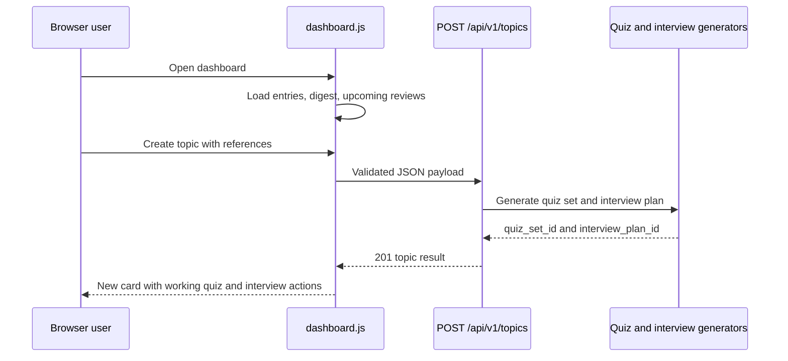

# SRA-906 — Dashboard UI recovery and topic-generation completion

**Type:** Bug fix / integration stabilization
**Phase:** 9
**Priority:** Critical — the dashboard JavaScript aborts before any user action works
**Status:** Done — 2026-10-17
**Blocked by:** SRA-901, SRA-902, SRA-903, SRA-904
**Blocks:** SRA-905

## Summary

Restore the running `/dashboard` experience and finish the create-topic flow.
The current script calls the modal initializer across two isolated IIFEs, which
raises `ReferenceError` during module evaluation. That one exception prevents
entry loading, search, review statistics, and the modal from starting. Once it
is removed, the unfinished modal wiring and invalid quiz/interview links also
need to be corrected so a created topic becomes usable rather than merely
persisted.

## Observed issue inventory

The 2026-10-17 localhost and real-browser audit found:

1. `/dashboard` loads its HTML, then `dashboard.js` aborts at
   `initCreateTopicModal(createTopicButton)` because the function is declared in
   a different closure. Entries, search, due/upcoming counts, and Create topic
   therefore remain inert.
2. Modal controls are rebound on every open, causing duplicate add/submit/close
   handlers after reopening.
3. Existing entry cards never receive Regenerate/Add references actions; only a
   newly prepended card gets an action.
4. `POST /api/v1/topics` persists the entry and references but always returns
   `quiz_set_id=null` and `interview_plan_id=null`, contrary to “Generate now”.
5. New-card links use `/quiz/{id}` and `/interview/{plan_id}`, but the mounted
   browser pages are `/quiz` and `/dashboard/interview`; the interview page
   starts from `quiz_set_id`, not `interview_plan_id`.
6. Network errors can leave create/regenerate controls stuck because the fetch
   calls are not guarded by `try/finally`.
7. Invalid upload base64 is accepted as a partial-success `201` instead of the
   documented request-validation `422`.
8. The real-browser landing capture assertion is a test-double defect, not a
   product failure: its fake model ignores tuple-form LangChain messages and
   saves `Study Note` while the test searches for `Mitosis`.
9. Invoking the documented `.venv/bin/pytest` entry point cannot import the
   top-level `web` package; `python -m pytest` succeeds. Packaging/import-path
   behavior must be made consistent.

Environment-only observations are not product bugs: loopback tests cannot bind
inside the default sandbox, and seven legacy dashboard unit tests require a
`node` executable that is not installed on this machine.

## Working result

An authenticated user opens `/dashboard` and immediately sees entries and
review statistics. They can search, open Create topic, add pasted/URL/upload
references, submit once, and receive a generated quiz and interview. The new
card links to the mounted quiz/interview pages. Reopening the modal does not
duplicate handlers. Existing cards can regenerate from their saved references,
and request/network errors restore controls and remain visible.



## Files and why they matter

| File | Action | Responsibility |
|---|---|---|
| `web/static/js/dashboard.js` | Fix | Keep helpers/controller in one scope, bind once, recover controls, render actions on all cards, and build valid page links. |
| `src/sra/api/routers/topics.py` | Fix | Validate uploads and run generation during create using the same shared generation path as regenerate. |
| `web/static/js/quiz.js` | Possibly extend | Accept an optional `quiz_set_id` query parameter if direct-start navigation is retained. |
| `tests/playwright/test_user_flows.py` | Extend/fix | Drive dashboard load, search, modal reopen, create, regenerate, and link navigation in Chromium; repair the tuple-aware ingestion fake. |
| `tests/unit/test_dashboard_phase9_js.py` | Extend | Pin script parse/scope, one-time binding, error recovery, and route construction. |
| `tests/e2e/test_phase9_dashboard_create_topic_e2e.py` | Extend | Require create-topic generation IDs and correct request failure behavior. |
| `pyproject.toml` | Inspect/fix | Ensure the installed test entry point can import the browser-facing `web` package. |

## Contracts

- Dashboard startup must perform the three established reads without a browser
  console exception.
- One modal open produces one set of handlers; reopening and submitting still
  produces exactly one request.
- Topic creation either returns usable generation IDs or explicit per-pipeline
  errors; it must not claim silent generation success with both IDs absent.
- Existing and new cards use only mounted browser URLs. Interview startup uses
  the quiz-set identifier required by `interview.js`.
- Fetch rejection and non-2xx responses restore button state and show an inline
  error without closing the modal.
- Malformed base64 is a `422` client error and does not persist an entry.
- Browser/test fixtures must model the production tuple-form prompt correctly.

## Acceptance criteria

- [x] Dashboard entries, search, stats, upcoming reviews, and Create topic work in Chromium with no console/page errors.
- [x] Create topic supports paste, URL, and upload payloads and sends exactly one request per submit after any number of modal opens.
- [x] Generate now returns a quiz set and interview plan (or explicit partial errors) and renders working actions.
- [x] Existing cards can regenerate; ownership and review-schedule invariants remain intact.
- [x] Invalid uploads and network/server failures are visible and recoverable.
- [x] Both direct `pytest` and `python -m pytest` collect the browser tests.

## How to test this ticket alone

```bash
SRA_RUN_PLAYWRIGHT_TESTS=1 python -m pytest tests/playwright/test_user_flows.py -v
python -m pytest tests/unit/test_dashboard_phase9_js.py tests/unit/test_topics_route_regenerate.py -v
python -m pytest tests/e2e/test_phase9_dashboard_create_topic_e2e.py -v
python -m pytest tests/integration/test_phase9_topic_route.py -v
ruff check web src/sra/api/routers/topics.py tests/playwright
pyright web src/sra/api/routers/topics.py tests/playwright
```

## Verification record

- Date and environment: 2026-10-17, macOS, Python 3.13.12, headless Chromium, localhost Uvicorn.
- Pre-fix evidence: established Playwright suite `12 passed, 1 failed`; full suite `1173 passed, 34 failed, 27 skipped`. The full-suite total includes documented pre-existing, Phase 9 WIP, missing-Node, and sandbox-only failures and is not itself the post-fix target.
- Post-fix commands and results:
  - focused dashboard/topic suite: `22 passed`;
  - Phase 9 marker: `227 passed, 3 skipped`;
  - real Chromium user flows: `16 passed`;
  - Ruff and Pyright on changed Python/test surfaces: clean;
  - full default suite: `1196 passed, 30 skipped, 17 failed`. The 17 are the
    already classified Phase 3/4 migration and generation baseline failures,
    three sandbox-only loopback failures, and seven legacy Node-harness failures
    caused by that harness replacing `PATH` with a location that has no Node.
- Manual localhost result: the running service answered `/api/health` and `/`;
  `/dashboard` correctly required authentication. Authenticated UI behavior was
  exercised against the same FastAPI app in headless Chromium rather than
  modifying the user's live account/session.
- Follow-up regression repair on 2026-10-17:
  - initial default run: `18 failed, 1213 passed, 30 skipped`;
  - fixed same-day regeneration to replace the existing quiz questions and
    interview outline in place, preserving the parent IDs and attempts;
  - corrected attempt totals to count persisted questions after verifier drops;
  - restored answer-feedback and final-score rendering in the quiz dashboard;
  - repaired historical migration fixtures/tooling and the Node dashboard test
    harness without weakening their behavioral assertions;
  - unrestricted full suite: `1232 passed, 29 skipped`;
  - restricted sandbox run: `1228 passed, 30 skipped, 3 failed`, with all three
    failures caused solely by the sandbox denying ephemeral localhost binds;
  - `ruff check .`: clean; `pyright`: `0 errors, 0 warnings, 0 informations`.
