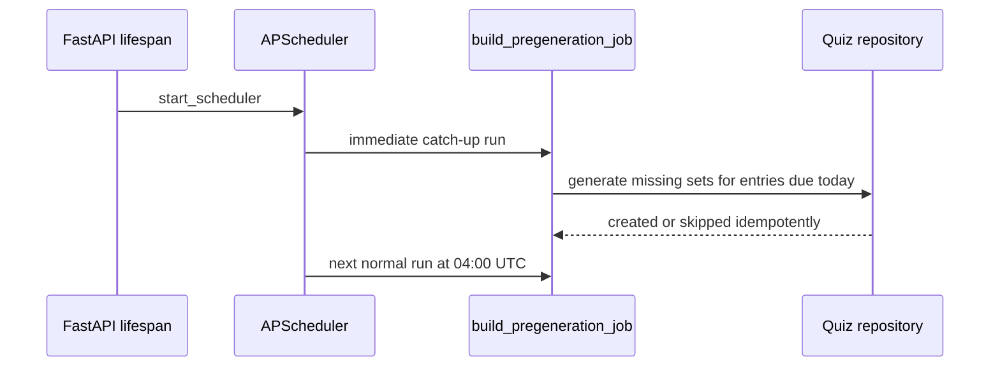

# SRA-907 — Catch up quiz pre-generation when the API starts

**Type:** Bug fix
**Phase:** 9
**Priority:** High — a server started after the daily cron leaves due entries without quizzes for the rest of the day
**Status:** Done — 2026-10-17
**Blocked by:** SRA-403, SRA-502
**Blocks:** Reliable dashboard quiz availability and SRA-905 verification

## Summary

Run the existing, idempotent daily quiz pre-generation job once when the API
scheduler starts, then keep its normal 04:00 UTC cron schedule. Today the job
is registered only as a cron trigger. A process that was stopped at 04:00 UTC
and starts later does not run until the following day, so entries already due
today remain without a `QuizSet` even though generation itself works.

## Where things stand right now

The configured database contains six entries. Three older entries have quiz
sets, while one entry whose first review is due today has no quiz set. The
focused Phase 9 generation suite passes, and a live authenticated dashboard
request returns all six entries, so neither the database connection nor the
quiz graph is the missing boundary. `start_scheduler()` registers
`sra.pregenerate` for 04:00 UTC without an initial run.

## What this ticket unlocks

Before: starting Uvicorn at 17:00 UTC leaves today's due entries without quizzes
until 04:00 UTC tomorrow.

After: the scheduler immediately queues the same idempotent pre-generation job,
which creates only missing quiz sets for due entries. The registered cron then
continues at 04:00 UTC on later days. Restarting does not duplicate quiz sets.



## Files and why they matter

| File | Action | Responsibility |
|---|---|---|
| `src/sra/jobs/digest_scheduler.py` | Modify | Register `sra.pregenerate` with an immediate first run while preserving its daily cron trigger, single-instance limit, and coalescing. |
| `tests/unit/test_digest_scheduler.py` | Extend | Isolate scheduler registration and prove the first run is immediate, the recurring trigger remains 04:00 UTC, disabled mode stays inert, and restart-safe settings are retained. |
| `tests/integration/test_phase5_scheduler.py` | Extend | Exercise the application lifespan with substituted inference/session boundaries and prove a due entry receives one quiz set after startup and no duplicate after restart. |
| `tickets/README.md` and `PROGRESS.md` | Update | Track the regression and record actual verification evidence. |

## TDD starting point

Add a unit test that inspects the registered `sra.pregenerate` job and expects
its first `next_run_time` to be at scheduler startup rather than the next 04:00
UTC boundary. Add an integration test that starts the application after the
configured daily hour with a due entry and substituted LLM output, waits on a
deterministic synchronization primitive (not a sleep), and reads one persisted
quiz set. Both tests must fail against the current registration behavior.

## Contracts

- When `scheduler_enabled=True`, `start_scheduler()` queues one pre-generation
  run immediately and retains the daily 04:00 UTC cron schedule.
- The immediate run reuses `build_pregeneration_job()` and
  `pregenerate_quizzes_for_day()`; it does not introduce a second generation
  implementation.
- The existing per-entry idempotency remains the duplicate guard across
  restarts and repeated runs.
- `max_instances=1`, `coalesce=True`, shutdown behavior, demo reset, and the
  wake-up interval remain unchanged.
- When `scheduler_enabled=False`, no scheduler or catch-up work starts.
- Tests replace OpenAI and wall-clock waiting; no real model call, network,
  hardware, or production database is used.

## Acceptance criteria

- [x] Starting after 04:00 UTC produces a quiz set for an entry due today without waiting for the next day under substituted inference.
- [x] Restarting after the catch-up leaves exactly one quiz set for that entry.
- [x] The next recurring run remains scheduled for 04:00 UTC.
- [x] Disabled scheduler mode performs no catch-up.
- [x] Existing scheduler, quiz pre-generation, Phase 9 generation, lint, and type checks pass.

## How to test this ticket alone

```bash
python -m pytest tests/unit/test_digest_scheduler.py tests/integration/test_phase5_scheduler.py -q
python -m pytest tests/unit/test_quiz_pregeneration.py tests/integration/test_phase9_quiz_graph_e2e.py -q
ruff check src/sra/jobs/digest_scheduler.py tests/unit/test_digest_scheduler.py tests/integration/test_phase5_scheduler.py
pyright src/sra/jobs/digest_scheduler.py
```

## Manual verification

Back up the configured database, start the API after 04:00 UTC with a due entry
that has no quiz set, and watch for the pre-generation summary. Confirm the
entry gains one quiz set and questions, restart once, and confirm its quiz-set
count stays one. This check uses the configured OpenAI account and must not be
presented as completed until explicitly run.

## Verification record

- Date and environment: 2026-10-17, macOS, Python 3.13.12, SQLite and
  APScheduler with OpenAI replaced in automated tests.
- Commands and inputs: focused scheduler suite; quiz pre-generation regression
  suite; Ruff and Pyright commands listed above.
- New IDs/artifacts and observed downstream results: the integration test
  created one quiz set for a due entry on startup and retained exactly one
  after an application restart.
- Failure/recovery and cleanup: pre-implementation tests failed because the
  cron registration lacked `next_run_time` and startup never signalled the
  pre-generation event. After adding an immediate first run to the existing
  cron job, both passed. The live reload exercised the catch-up path, but the
  configured OpenAI draft call still failed and no live quiz row was created.
- Automated/manual results, skips, and limitations: scheduler tests `19 passed`;
  quiz pre-generation regressions `19 passed`; Ruff clean; Pyright zero errors.
  After explicit approval, one non-persisting real-model diagnostic returned
  10 structured drafts. SRA-908 fixed the downstream transcript-evidence gap;
  the reload-triggered startup catch-up then persisted one quiz set with nine
  verifier-approved questions for the previously missing due entry.

## Definition of Done

- [x] Acceptance criteria met under substituted inference
- [x] Focused and regression checks green
- [x] Actual verification evidence recorded here
- [x] `PROGRESS.md` and the Phase 9 board updated
