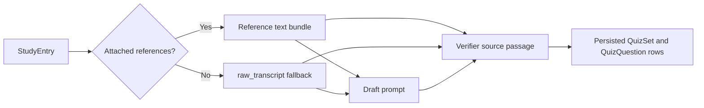

# SRA-908 — Verify quizzes generated from captured transcripts

**Type:** Bug fix
**Phase:** 9
**Priority:** Critical — captured entries without Phase 9 reference rows cannot produce usable verified quizzes
**Status:** Done — 2026-10-17
**Blocked by:** SRA-903, SRA-907
**Blocks:** Reliable quiz generation for voice and text capture

## Summary

Use the entry transcript as verifier evidence when an entry has no attached
`reference_materials`. The draft prompt already includes `raw_transcript`, so
the draft model can generate grounded questions. The Phase 9 verifier currently
selects evidence only from reference rows and receives an empty passage for all
legacy, voice-captured, and text-captured entries.

## Observed evidence

- The configured model and structured-output schema returned 10 valid drafts in
  one approved, non-persisting diagnostic call for entry 4.
- Entry 4 has a transcript and no references.
- `_pick_source_passage()` returns `""` whenever `references` is empty, even
  though the same graph supplied `entry.raw_transcript` to the draft prompt.
- Existing quiz-generation tests cover reference-grounded verification but not
  the transcript-only application path.

## Working result

A transcript captured through the existing ingestion flow can be used both to
draft and verify MCQs. Reference-backed topics still prefer their stored
reference excerpts. A transcript-only entry receives a populated `QuizSet`
instead of having every valid draft evaluated against an empty passage.



## Files and why they matter

| File | Action | Responsibility |
|---|---|---|
| `src/sra/agents/quiz_graph.py` | Fix | Select the transcript as evidence only when no usable reference excerpt exists, while retaining reference preference and existing truncation bounds. |
| `tests/unit/test_quiz_graph_phase9.py` | Extend | Prove transcript fallback, reference preference, blank transcript behavior, and the exact verifier passage. |
| `tests/integration/test_phase9_quiz_graph_e2e.py` | Extend | Keep the real graph and repository path, substitute inference, and prove a transcript-only captured entry persists non-empty quiz questions. |
| `tickets/README.md` and `PROGRESS.md` | Update | Track and verify the regression. |

## Contracts

- When at least one usable reference excerpt exists, verification uses the
  matching reference behavior already implemented by SRA-903.
- When no usable reference excerpt exists, verification uses
  `entry.raw_transcript` as the source passage.
- Blank references and a blank transcript remain an evidence-empty case; the
  code must not invent support.
- The same bounded transcript slice used by the draft prompt is supplied to the
  verifier so the verifier cannot approve from unseen text.
- Tests substitute OpenAI; no additional paid call is required to implement or
  verify this regression.

## Acceptance criteria

- [x] A transcript-only entry persists at least one verified quiz question under deterministic fake inference.
- [x] Reference-backed entries continue to verify against references.
- [x] Empty-evidence entries remain explicit and do not fabricate a passage.
- [x] Existing Phase 4 and Phase 9 quiz suites remain green.
- [x] Ruff and Pyright pass on the changed surfaces.

## How to test this ticket alone

```bash
python -m pytest tests/unit/test_quiz_graph_phase9.py tests/integration/test_phase9_quiz_graph_e2e.py -q
python -m pytest tests/unit/test_quiz_graph.py tests/unit/test_quiz_pregeneration.py -q
ruff check src/sra/agents/quiz_graph.py tests/unit/test_quiz_graph_phase9.py tests/integration/test_phase9_quiz_graph_e2e.py
pyright src/sra/agents/quiz_graph.py
```

## Verification record

- Date and environment: 2026-10-17, macOS, Python 3.13.12, SQLite;
  deterministic fake inference plus one explicitly approved real OpenAI draft
  diagnostic and the reload-triggered application catch-up.
- Commands and inputs: focused unit/integration suite, Phase 4 quiz and
  pre-generation regressions, Ruff, Pyright, and read-only live database counts.
- New IDs/artifacts and observed downstream results: the approved diagnostic
  returned 10 structured drafts without persistence. After the fix, the live
  catch-up created exactly one quiz set for entry 4 and persisted nine questions;
  one draft was rejected by the verifier as designed.
- Failure/recovery and cleanup: before the fix, whitespace-only/missing
  references produced empty verifier evidence and the integration flow persisted
  zero questions. The selector now prefers usable references and otherwise uses
  the same 1,500-character transcript slice visible to the draft model. No
  temporary rows were created by the diagnostic call.
- Automated/manual results, skips, and limitations: focused SRA-908 suite
  `26 passed`; existing quiz/pre-generation regressions `24 passed`; Ruff clean;
  Pyright zero errors. The real result proves the configured model path for one
  existing due entry, not every possible transcript or model response.

## Definition of Done

- [x] Acceptance criteria met
- [x] Focused and regression checks green
- [x] Verification evidence recorded
- [x] Phase 9 board and `PROGRESS.md` updated
