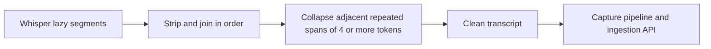

# SRA-909 — Collapse repeated spans in local transcription

**Type:** Bug fix
**Phase:** 9
**Priority:** High — repeated Whisper text is saved as noisy study material and later produces poor quizzes
**Status:** Done — 2026-10-17
**Blocked by:** SRA-202
**Blocks:** Reliable voice capture and downstream generation quality

## Summary

Remove exact adjacent repetition of multi-word spans from the transcript returned
by the local Whisper boundary. Preserve normal word repetition and segment order.
The current implementation strips and joins model segments verbatim, so a
hallucinated loop inside one segment or across neighboring segments reaches the
ingestion API unchanged.

## Observed evidence

A read-only analysis of stored entry 5 found 181 words, a 21-word block repeated
immediately, and repeated 5–10-word n-grams occurring multiple times. No study
content was printed during the analysis. The existing transcription code has no
overlap or repetition handling; it only joins nonblank segment strings.

## Working result

When Whisper returns `"retrieval practice improves memory"` repeatedly in one
segment or adjacent segments, `transcribe()` returns one copy. Short natural
emphasis such as `"very very important"` and non-adjacent reuse remain unchanged.



## Files and why they matter

| File | Action | Responsibility |
|---|---|---|
| `src/sra/capture/transcription.py` | Fix | Normalize segment whitespace and collapse exact adjacent repeated spans without changing file/model ownership or error behavior. |
| `tests/unit/test_transcription.py` | Extend | Pin within-segment, cross-segment, multi-copy, punctuation/case, natural repetition, ordering, silence, and lazy-iteration contracts. |
| `tests/e2e/test_voice_capture_to_digest_e2e.py` | Extend | Keep recorder/pipeline/API/storage real with fake Whisper output and prove only the cleaned transcript is submitted and persisted. |
| `tickets/README.md` and `PROGRESS.md` | Update | Track the bug and verification evidence. |

## Contracts

- Collapse exact adjacent repeated spans only when the repeated unit contains at
  least four whitespace-delimited tokens.
- Collapse two or more consecutive copies to one, including repetitions split
  across Whisper segment boundaries.
- Match repeated tokens case-insensitively while retaining the first copy's
  spelling and punctuation.
- Preserve single-word and short-phrase repetition, non-adjacent repetition,
  and the order of unrelated text.
- Retain the existing file validation, model cache, `vad_filter=True`, lazy
  iteration, typed errors, silence behavior, and caller-owned file contract.
- Tests substitute Whisper and HTTP/OpenAI boundaries; no real microphone,
  model download, or external request is needed.

## Acceptance criteria

- [x] The observed class of long adjacent repeated blocks collapses to one copy.
- [x] Repetition both within and across segment boundaries is handled.
- [x] Natural short repetition and non-adjacent reuse are preserved.
- [x] The capture-to-storage flow persists the cleaned transcript exactly once.
- [x] Existing Phase 2 transcription/capture regressions, Ruff, and Pyright pass.

## How to test this ticket alone

```bash
python -m pytest tests/unit/test_transcription.py tests/unit/test_capture_pipeline.py -q
python -m pytest tests/e2e/test_voice_capture_to_digest_e2e.py -q
ruff check src/sra/capture/transcription.py tests/unit/test_transcription.py tests/e2e/test_voice_capture_to_digest_e2e.py
pyright src/sra/capture/transcription.py
```

## Verification record

- Date and environment: 2026-10-17, macOS, Python 3.13.12; fake Whisper
  segments and isolated capture/API/database fixtures.
- Commands and inputs: focused unit/pipeline suite, voice-capture E2E suite,
  Ruff, Pyright, plus a read-only replay of the post-processor against the
  previously repeated stored transcript.
- New IDs/artifacts and observed downstream results: the E2E path submitted one
  cleaned transcript and persisted one study entry. Read-only replay reduced
  the observed transcript from 181 words to 81 words, removing 100 looped words.
- Failure/recovery and cleanup: before implementation, four unit cases and one
  E2E case retained all repeated copies. The implementation collapses adjacent
  case-insensitive units of four or more tokens, using the smallest repeating
  unit to protect one-, two-, and three-token natural repetition. The historical
  database row was deliberately not modified.
- Automated/manual results, skips, and limitations: unit/pipeline `35 passed`;
  voice-capture E2E `7 passed`; Ruff clean; Pyright zero errors. The algorithm
  intentionally does not remove non-adjacent or differently punctuated text.

## Definition of Done

- [x] Acceptance criteria met
- [x] Focused and regression checks green
- [x] Verification evidence recorded
- [x] Phase 9 board and `PROGRESS.md` updated
