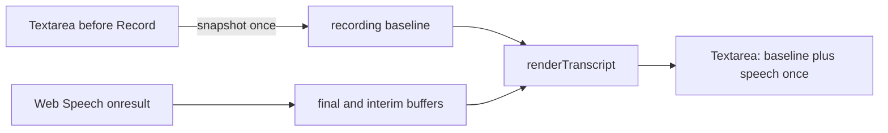

# SRA-910 — Keep browser dictation transcript segments single

**Type:** Bug fix
**Phase:** 9 — Topic authoring with reference materials + question-quality uplift
**Priority:** High — browser dictation produces unusable repeated notes
**Status:** Implemented; focused verification complete
**Blocked by:** None
**Blocks:** Reliable landing-page voice capture

## Summary

Fix the landing-page Web Speech API renderer so each recognition segment appears
once. Today every `onresult` callback reads the textarea after the preceding live
render and treats that already-rendered text as the baseline. It then appends the
same final and interim buffers again, causing the escalating repetition visible in
browser dictation.

## Working result

Before this fix, successive interim/final events can turn “There is a bug in the
transcript” into an expanding series of repeated prefixes. After the fix, text
that existed before recording remains untouched, finalized speech is committed
once, and the current interim hypothesis is replaced rather than accumulated.



The recording baseline belongs to one recognition session. Speech events update
recognition buffers; they must not promote the renderer's previous output into a
new baseline.

## Files and why they matter

| File | Action | Responsibility |
|---|---|---|
| `web/static/js/landing-capture.js` | Modify | Snapshot pre-recording text and render recognition state without feeding rendered output back into the next event. |
| `tests/playwright/test_user_flows.py` | Modify | Exercise successive Web Speech events in a real browser and verify typed text, interim replacement, and final results appear once. |
| `tickets/README.md` | Modify | Index this regression ticket. |
| `PROGRESS.md` | Modify after verification | Record the observed test evidence. |

## Contracts

- Snapshot the textarea value once when recording starts.
- Preserve text typed or pasted before recording, adding only the spacing needed
  to separate it from dictated text.
- Re-render from that stable baseline plus finalized speech and the latest
  interim hypothesis; never derive the baseline from an earlier live render.
- Re-delivered final results and an interim prefix that echoes finalized words
  must not duplicate text.
- Starting a later recording session uses the then-current textarea as its new
  baseline.
- Stopping, clearing, submitting, permission errors, and unsupported-browser
  behavior retain their existing contracts.

## Acceptance criteria

- [x] Repeated interim events replace the live hypothesis instead of accumulating it.
- [x] A final result followed by another event remains present exactly once.
- [x] Pre-existing textarea content is preserved exactly once.
- [x] A second recording session appends to the first session without duplicating it.
- [x] Focused and full browser suites pass; changed-file syntax, Ruff, and Pyright checks are clean.
- [ ] The unfiltered repository suite, Ruff, and Pyright are green after the unrelated in-progress SRA-1101 work is completed.

## How to test this ticket alone

```bash
SRA_RUN_PLAYWRIGHT_TESTS=1 pytest tests/playwright/test_user_flows.py -k voice_capture -q
pytest -q
ruff check .
pyright
```

The Playwright test substitutes only the browser speech-recognition provider.
The actual landing page, JavaScript event handlers, DOM, and Chromium renderer
remain in the path. No microphone, inference model, or network service is used.

## Manual verification

Open the landing page in a browser with Web Speech support, type a short prefix,
click **Record**, dictate a sentence containing pauses, and stop. Confirm the
prefix and each spoken phrase occur once. Start and stop a second recording and
confirm it appends once. Clear the field and confirm no prior session returns.

## Verification record

- Date and environment: 2026-10-24, macOS, headless Chromium.
- Red test: focused voice-capture run produced `1 passed, 1 failed, 21 deselected`;
  the failure expected `Typed context. There is a bug` and observed
  `Typed context. There is There is a bug`.
- Green tests: focused voice-capture run `2 passed, 21 deselected`; complete
  browser user-flow file `23 passed`.
- Changed-file checks: `node --check web/static/js/landing-capture.js`, Ruff on
  the Playwright test, and Pyright on the Playwright test all passed.
- Wider regression result excluding the two unfinished SRA-1101 test files:
  `1233 passed, 36 skipped, 1 failed`. The sole failure was an unrelated
  in-progress SRA-1101 assessment route missing from the route-policy audit.
  Full Ruff/Pyright were likewise blocked only by files from that concurrent
  assessment work.
- The Web Speech provider was replaced with a deterministic browser fake. The
  real page JavaScript, DOM, lifecycle events, and Chromium rendering ran; a
  physical microphone and browser speech service were not exercised.

## Definition of Done

- [x] Browser-dictation acceptance criteria met with actual evidence recorded
- [x] Focused and browser regression checks pass
- [x] Ticket board and progress log match the verified behavior
